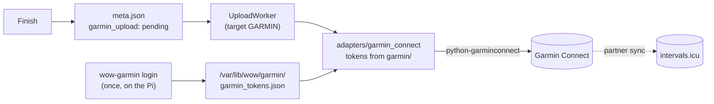

# Garmin Connect upload (experimental, branch `feature/garmin-upload`)

A side project outside the approved phase documents: no APP requirement, no Phase 4 catalogue entry. The tests carry supporting IDs `S-GAR-01` to `S-GAR-16`. Merge only after every Pi check below passes.

## What it does

When a ride finishes with **Upload rides to Garmin Connect** on (Settings, default off), wow uploads `ride.fit` to Garmin Connect. It works like the intervals.icu upload: the same worker and states (pending, uploading, done, retrying, failed, auth_error), a retry every 15 minutes for 7 days, the state in `meta.json` under its own keys (`garmin_upload`, `garmin_upload_first_utc`, `garmin_upload_last_utc`, `garmin_upload_attempts`), **Try again**/**Upload now** on the Summary, and the state in Past rides. Rides on simulated devices are never uploaded by themselves. wow only sends rides to Garmin; it reads nothing from there.



## How it reaches Garmin

Garmin has no API for uploading activities: the Personal API key (Oct 2026) only reads, and the business Training and Courses APIs push workouts and routes, not rides. So this branch uses [python-garminconnect](https://github.com/cyberjunky/python-garminconnect) 0.3.20, an unofficial client that signs in the way the Garmin Connect app does. That brings two risks: Garmin broke every such client in March 2026 and can do it again, and the account's refresh token sits on the Pi.

- **Sign-in:** `wow-garmin login` asks for the email, password and MFA code once and stores only the tokens (directory 0700, file 0600, written by the library). The service never sees the password.
- **Upload:** each upload loads the tokens and posts the file with `Garmin.upload_activity`; the library writes refreshed tokens back. Library retries are off (`retry_attempts=0`), so only the worker's 15-minute retry applies; an upload that takes longer than 60 s counts as a failed try.

| Garmin's answer | Outcome | State |
|---|---|---|
| 2xx, no failures in the import report | created | done |
| 409, or a failure saying "Duplicate" | known | done |
| 401 or 403 after the library's token refresh; tokens missing or unreadable | key refused | auth_error (waits for the rider) |
| 429, 5xx, no answer, network error, 60 s timeout | try again | retrying |
| other 4xx, invalid file | refused | failed |

## Assumptions to check on the Pi

| ID | Assumption | Source | Check |
|---|---|---|---|
| G-1 | Garmin answers a second upload of the same file with 409 | python-garminconnect's `import_activity` treats 409 as a duplicate | P-3 |
| G-2 | An uploaded ride reaches intervals.icu through the Garmin link, as the web import did (F-35) | Phase 2 F-35, for the web import only | P-2 |
| G-3 | `--import` uploads are not passed on to intervals.icu | python-garminconnect's docstring ("not re-exported to third parties like Strava"); intervals.icu not named | P-4 |
| G-4 | The stored tokens keep working for weeks without a new login | none: refresh-token lifetime not published | P-8 |
| G-5 | Garmin names the activity itself (the upload has no name, and its answer has no activity ID to rename) | python-garminconnect 0.3.20 source | P-2 |

## Install and sign in on the Pi

```
git fetch && git checkout feature/garmin-upload
uv sync --frozen
sudo deploy/install.sh                       # display built on the laptop, as always
sudo -u wow /opt/wow/venv/bin/wow-garmin login
sudo -u wow /opt/wow/venv/bin/wow-garmin check
```

Run `wow-garmin` as `wow`, so the tokens belong to the service (`install.sh` also fixes their owner). On the laptop: `uv run wow-garmin --config wow.toml login`.

Back to main: `git checkout main && sudo deploy/install.sh`. The `garmin_upload_on` setting and the `garmin_*` keys in `meta.json` are ignored there, and `/var/lib/wow/garmin` can be deleted.

## Pi checks before merging

| ID | Check | Pass |
|---|---|---|
| P-1 | `wow-garmin login`, then `check` | "Tokens accepted for <name>"; `ls -l /var/lib/wow/garmin` shows owner wow, 0600 file |
| P-2 | `wow-garmin upload /var/lib/wow/rides/<id>/ride.fit` for a real past ride (not yet on Garmin) | `created`; in Garmin Connect as indoor cycling with laps, power and heart rate; the name Garmin chose; whether and when it shows up in intervals.icu (G-2) |
| P-3 | The same command again | `known`, no second activity (G-1) |
| P-4 | Another real ride with `--import` | `created`; whether it reaches intervals.icu (G-3) |
| P-5 | A real ride with Garmin upload on, intervals.icu upload off | Summary goes Waiting → Uploading → Uploaded to Garmin Connect; one activity in Garmin, one in intervals.icu |
| P-6 | Wi-Fi off at Finish, on again after 5 min | Retrying Garmin, then done within 15 min of the Wi-Fi coming back |
| P-7 | `wow-garmin logout`, finish a ride, `login`, Try again | Garmin sign-in needed, then Uploaded to Garmin Connect |
| P-8 | `wow-garmin check` two and four weeks after P-1 | still accepted (G-4) |
| P-9 | Both uploads on for one real ride | what intervals.icu does with the two copies (the Settings screen warns about it) |
