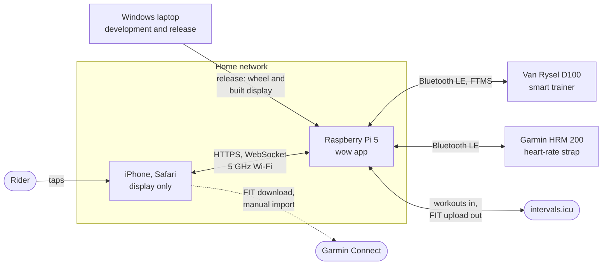
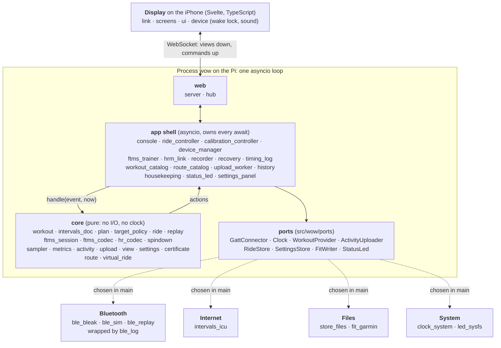
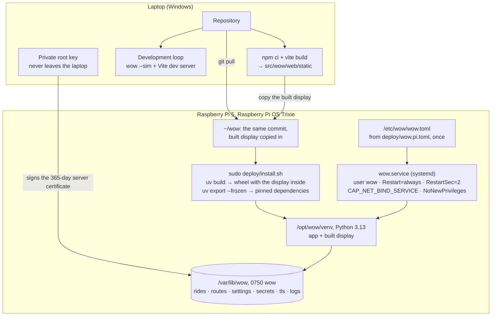
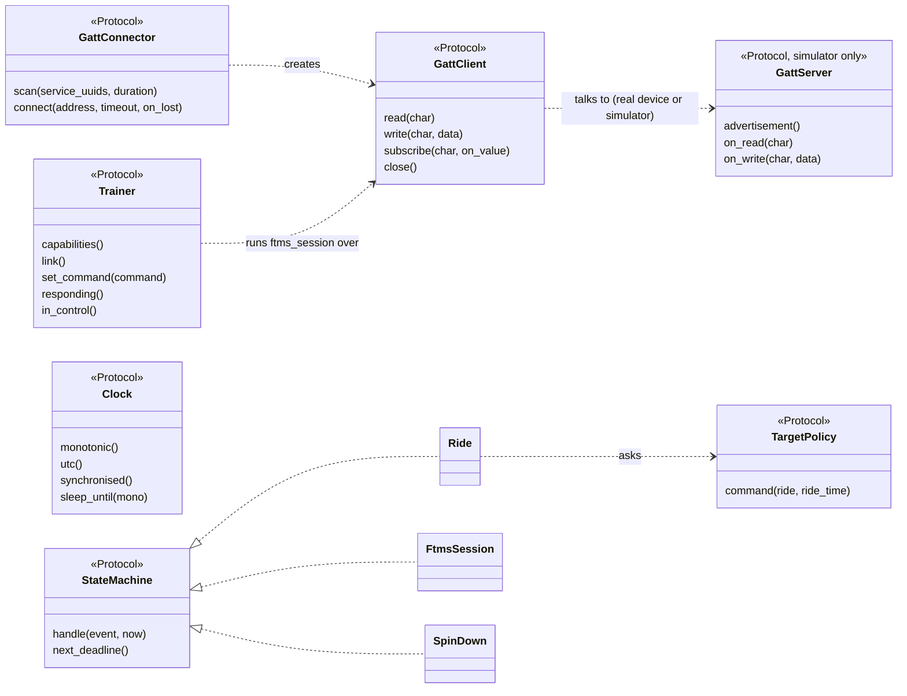
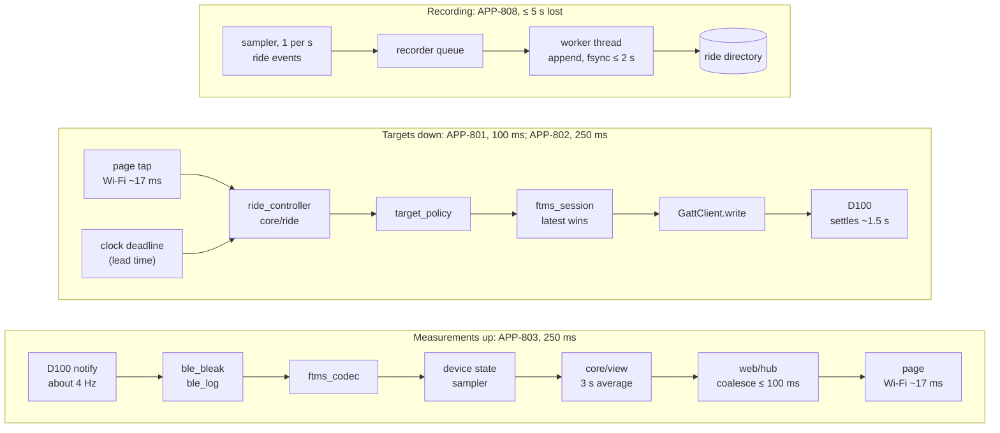
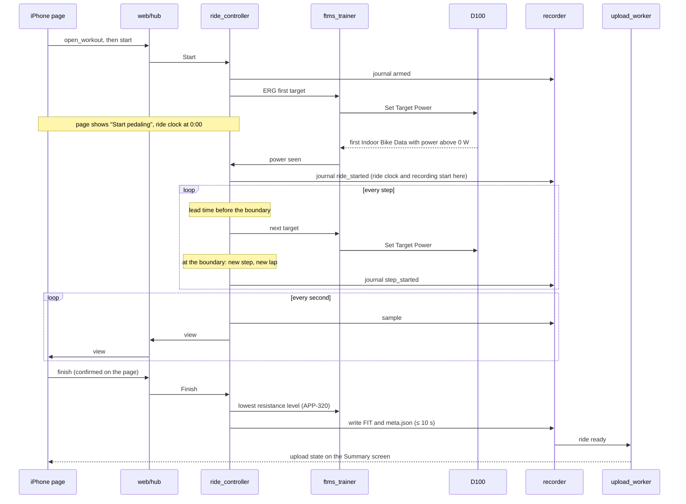
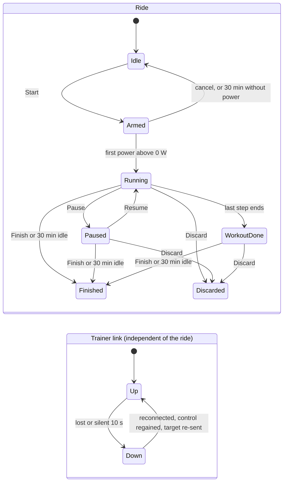
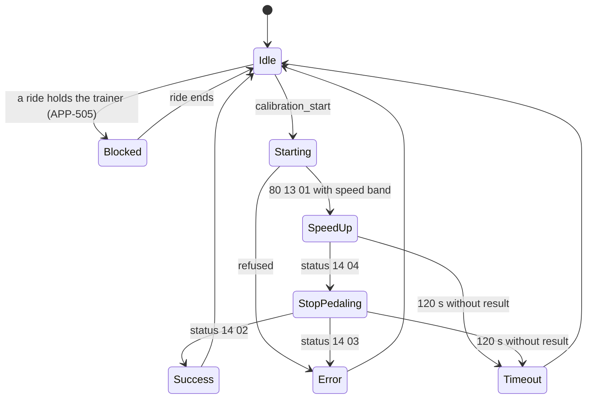
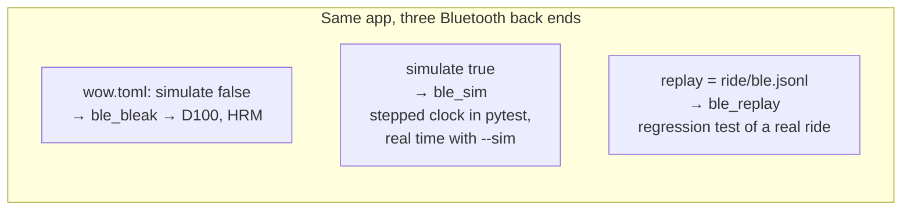
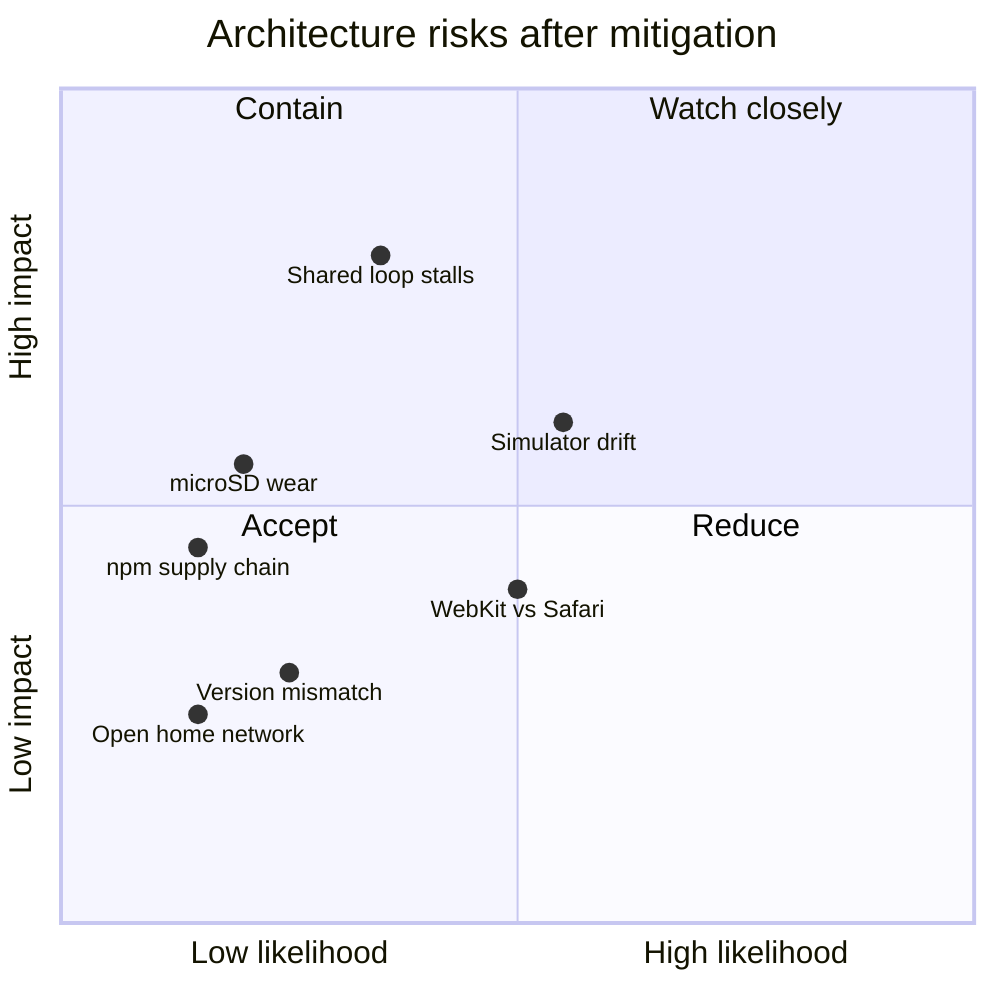

# Phase 3A — Architecture

**Status:** approved; revision 6, 18 Nov 2026. Revision 6 applies the changes Ferran approved during Phase 5 (Phase 5 sections 13.6, 16.5, 22.5, 29.5, 35.5, 41.5 and 47.5): the modules as built, among them `app/console`, the route modules and the live ride along a route; the `ports` folder; the tool versions as pinned; deployment as built; the gallery. No architecture decision changes. Closed and approved by Ferran, 11 Nov 2026; revision 5, 11 Nov 2026, applied the changes Ferran approved with the Phase 4 findings: every wait goes through the `Clock` port (new AD-22), the overview state diagram follows the ICD, the simulator can fail the Bluetooth adapter, rides keep a `timing.jsonl`, and the display is verified by looking at it (AD-17, AD-18). Phase 3 consists of this document, the Interface Control Document (`phase3-icd.md`, revision 5) and the display design (`phase3-display.md`, revision 3). Revision 4 applied Ferran's comments of 11 Nov: the other options considered for every decision, AD-08 reworded, GATT client and server names (AD-21), the unit-naming rule (AD-20), and recording that starts at the first pedal stroke. Builds on the Phase 0 record (revision 2), the Phase 1 requirements (revision 8) and the Phase 2 record (revision 14).

## How Phase 3 is split

| Part | Content | File | State |
|------|---------|------|-------|
| 3A | Components, interface shapes, data flow, tech choices, deployment, requirement allocation | this file | Approved, revision 6 |
| 3B | Interface Control Document (ICD): every interface's data elements, messages, protocols, timing and error handling | `phase3-icd.md` | Approved, revision 5 |
| 3C | Display design: look, layouts of the screens, wake-lock prompt, spin-down guidance | `phase3-display.md` | Approved, revision 3 |
| 3D | Built-in workouts (ramp test) | IF-13 in the ICD | Approved with the ICD |

**Diagrams** are Mermaid blocks: they render in GitHub, GitLab and VS Code's Markdown preview, and the PDF of this document shows them rendered.

IDs: architecture decisions are AD-xx. New assumptions start at A-48. A-45 to A-47, APP-827 to APP-829, D-21 and D-22 are left free for the parked shared-Pi proposals; nothing in this design depends on them. APP-709, also left free for them until Phase 5, is the rider's weight since SL-13.

## Design drivers

| Driver | From | What it forces |
|--------|------|----------------|
| The ride must survive anything short of the Pi dying, and then lose at most 5 s | APP-318, APP-807 to APP-811 | The ride runs on the Pi only; the phone is a view; ride state is journaled as it happens |
| A due target starts being written within 100 ms; a tap within 250 ms | APP-801, APP-802 | Nothing blocks the event loop; one process, no hops between processes on the control path |
| Every function runs without hardware, and real rides become regression tests | APP-819, APP-820, APP-812 | One seam under the whole Bluetooth stack; time is injected, never read directly |
| Test data is language-neutral for a JavaScript v2 | APP-821, D-17 | Core logic as state machines with data in, data out; fixtures as JSON and JSON Lines |
| One rider, one Pi, one trainer, one strap | D-16 | No database server, no accounts, no multi-ride concurrency |
| A display that looks good and is used every week | Ferran, 10 Nov 2026 | A component framework with transitions; a design pass in 3C |

## System context



## Layers and components

The core never imports asyncio, bleak, aiohttp or the file system. The app shell owns every `await`. Adapters sit behind ports and are chosen once, in the composition root (`main`), from the configuration: real, simulated or replay. The Pi runs no Node.js: the display is built on the laptop and shipped as static files.



## Deployment and release



As built (Phase 5, IM-95, IM-112): `deploy/install.sh` builds the wheel with the display inside and installs it with the dependencies of `uv export --frozen --no-dev --no-emit-project` into `/opt/wow/venv`. It creates the system user `wow` (group `bluetooth`), `/var/lib/wow` (0750) with `routes/` and `tls/` (0750), sets `secrets.json` and `tls/server.key` to 0600, and writes `/etc/wow/wow.toml` from `deploy/wow.pi.toml` once (ports 443 and 80, data in `/var/lib/wow`). The unit adds `StartLimitIntervalSec=0`, gives the group `wow` write access to the LED's sysfs files before the start (`ExecStartPre=+`) and switches the LED off after any stop (`ExecStopPost=+`). The Pi needs no Node.js: the display is built on the laptop and copied into the Pi's checkout before the install.

## Architecture decisions

AD-01 to AD-21 were approved on 10 and 11 Nov 2026; AD-22 with the Phase 4 findings on 11 Nov 2026. Each decision lists the other options that were considered and why each was discarded.

| ID | Decision | Why | Other options considered, and why discarded |
|-------|----------|-----|---------------------------------------------|
| AD-01 | The simulated trainer plugs in at GATT level: the simulator hosts fake GATT servers that answer in bytes, reached through the same `GattConnector` port as the real devices (AD-21). A plain fake `Trainer` also exists above it for ride-engine unit tests. | Tests the codec, the control-point queue, reconnects and the Bluetooth log without hardware; replay (APP-820) uses the same seam. | **Fake only at device level** (`Trainer` with `set_command`): simpler, but leaves untested exactly the code where Phase 2 found its bugs (F-1, F-9, F-29, F-32). **A virtual Bluetooth controller** (a second adapter or a software stack such as Bumble acting as the trainer): exercises bleak and BlueZ too, but runs only on Linux with extra set-up, in real time, so a 4-hour ride takes 4 hours and timing isn't repeatable. **Replay of recorded logs only**: can't produce faults that haven't been recorded yet. |
| AD-02 | Web stack: aiohttp 3.14.5 for the HTTPS server, the WebSocket and the intervals.icu client, on our own loop with `AppRunner` and `TCPSite(ssl_context=...)`. | One dependency instead of four; we keep the event loop that bleak also uses. | **Starlette, uvicorn, a WebSocket library and httpx**: four dependencies, and uvicorn expects to own the process and the loop. **FastAPI**: adds request validation and generated API documentation that one WebSocket doesn't need. **Python's standard library** (`http.server`, as in the S8 spike): no WebSocket support, and the server is not built for long-lived connections. |
| AD-03 | Display: Svelte 5 with TypeScript, built with Vite 8 into static files; plain Svelte, not SvelteKit. | Chosen by Ferran for a nicer-looking interface. Small compiled output, built-in transitions, typed view-state contract. | **Plain HTML and JavaScript without a build** (revision 1): rejected by Ferran on looks. **React**: more runtime and code per screen; transitions need extra libraries. **Vue**: no advantage over Svelte here, larger runtime. **SvelteKit**: its addition is routing, which the app doesn't need because the Pi decides the screen (AD-10). |
| AD-04 | Storage in plain files: one directory per ride with append-only JSON Lines; settings as JSON written atomically (temp file, fsync, rename). | Inspectable, already the spike log format, serves D-17, crash safety by append plus fsync. | **SQLite in WAL mode**: transactions and queries the app doesn't need at one rider's scale, and a binary file to inspect and diff. **A time-series database** (such as InfluxDB): a server process on the Pi for one stream of 1 Hz samples. **The FIT file as the only record**: binary, and written in one go at Finish, so a crash would lose the ride. |
| AD-05 | Own reconnect handling: release the stale BlueZ link over D-Bus before every connect, plus the session state machine. bleak-retry-connector remains the fallback inside the bleak adapter. | The reconnect logic is the reliability core and must run against the simulator. | **bleak-retry-connector 4.7.1**: does the same release and adds retries, but only on a real adapter, and brings bluetooth-adapters and further dependencies. **Restarting the Bluetooth service on failure**: needs root, and drops the strap's link along with the trainer's. |
| AD-06 | One process with one asyncio event loop for Bluetooth, ride control and the web server. File writes and FIT encoding run in a worker thread. | No inter-process hop on the control path (APP-801, APP-802). Sharing one loop is new: A-51, measured in the first Phase 5 slice with a loop-lag monitor that logs any lag over 50 ms. | **Two processes** (a Bluetooth daemon and a web server talking over a socket): a second failure mode and a hop on every tap. **Bluetooth in its own thread**: bleak is built on asyncio, so this means two loops and locking between them. **FIT encoding in a child process**: kept as the fallback if a thread stalls the loop (A-52). |
| AD-07 | Functional core, thin shell. The ride state machine, the FTMS session, the sampler, the metrics, the spin-down logic and the view model are plain objects with `handle(event, now) -> actions` and `next_deadline()`. | Deterministic tests without asyncio or sleeping; a simulated 4-hour ride (APP-812) runs in seconds; inputs and expected outputs are data (D-17). | **Controllers with asyncio inside**: tests then need real time or patched sleeps, and a 4-hour ride can't be tested quickly. **An actor or state-machine library**: one more dependency for what a `handle` method already gives. |
| AD-08 | Internally the app uses relative time only: the Pi's monotonic clock and the ride time derived from it. Every deadline is computed from the ride's start (start + planned ride time of the event + time spent paused), never from the moment the previous event was handled. UTC is read only to stamp recordings, logs, FIT files and uploads. | Ferran asked (11 Nov) whether the app could work in relative time and add absolute time only to the outputs: it does. "Absolute deadline" in revision 3 meant "counted from the ride start", not wall-clock time; the wording is fixed here. The monotonic clock never jumps; UTC can jump when the Pi first gets network time, because it has no clock battery (A-29). Counting from the start keeps handling delays from adding up: a ramp updated every second for 4 hours is 14,400 updates, and 1 ms of handling each would put the end 14 s late, against APP-804's 100 ms. | **Chained relative sleeps** (sleep for the step's duration, then the next): every handling delay adds to all later steps (the 14 s above). **Scheduling on UTC**: a clock correction during a ride would shift or skip a step. **A one-second tick counter as ride time**: drifts the same way, and can't place a target 1.5 s before a boundary to within 100 ms. |
| AD-09 | The ride's event journal (`events.jsonl`) holds every input of the ride state machine. After a crash, the ride is rebuilt by replaying the journal through the same state machine, then adding the outage as a dropout. | APP-809 without a second "save state" format. | **Periodic snapshots of the state**: a second format that can disagree with the journal, and up to one snapshot period lost. **No recovery; a restart begins a new ride**: one session becomes two files, against APP-809. |
| AD-10 | The Pi is authoritative for everything shown. The page holds no ride state, only the last snapshot and the wake-lock state. | APP-807; Safari reloads by itself (F-42). | **Ride state kept in the page and synchronised with the Pi**: two sources of truth, and a reload loses whatever the page held. |
| AD-11 | The trainer command for each instant comes from one interface, `TargetPolicy`. v1 has one implementation: plan, intensity, lead time, mode per block. | Heart-rate-controlled training can be added later without touching device code. | **Targets computed inside the ride state machine**: works for v1, but a heart-rate policy later would mean changing the ride logic. |
| AD-12 | TLS lives in the server configuration. The private root's key is made on the laptop and never copied to the Pi; the Pi holds only the 365-day server certificate and its key. | A stolen Pi or card can't sign new certificates. Renewal needs the laptop (APP-830). | **The root key on the Pi**: renewal without the laptop, but a stolen card could sign certificates for `wow.local` names. **A public certificate authority** (such as Let's Encrypt): needs a public domain name, and `wow.local` can't have one. **Plain HTTP**: Safari then refuses the wake lock (A-14). |
| AD-13 | Deployment as a systemd service under its own user `wow`: `Restart=always` with a 2 s delay, `AmbientCapabilities=CAP_NET_BIND_SERVICE` for ports 80 and 443, member of the `bluetooth` group, no dependency on the network being up. | APP-810, APP-811, APP-817, APP-202. | **A container** (Docker or Podman): Bluetooth through D-Bus into a container needs extra configuration, for one app on one Pi. **Running as root**: far more privilege than binding two ports needs. **A systemd user service**: assumption that a user manager can't hand out the capability to bind ports below 1024; the system service is the documented route. **Ports above 1024** (such as 8443): the address then needs a port number typed on the phone. |
| AD-14 | Python 3.13 (what Trixie ships), dependencies pinned in `uv.lock`, installed with `uv sync --frozen`. flake8 as required; mypy in strict mode as a development check. | APP-822, APP-823. | **A newer Python installed by uv**: possible, but diverges from the Python that Raspberry Pi OS patches. **pip with a requirements file**: weaker locking than `uv.lock`. **No type checker**: type hints that nothing checks drift from the code. **pyright**: needs Node.js on the Python side. |
| AD-15 | The Bluetooth adapter name is a configuration value (default `hci0`). | Phase 2's fallback for a 2.4 GHz network (OP-5). | **`hci0` fixed in code**: the USB-adapter fallback would need a code change. |
| AD-16 | The app uses five control-point commands, all confirmed on the D100: Request Control (0x00), Set Target Resistance Level (0x04), Set Target Power (0x05), Start or Resume (0x07), Spin Down Control (0x13). Pause and release use the lowest resistance level, not Stop or Pause (0x08). | Fewer untested paths. | **Stop or Pause (0x08) for pausing**: never tried on the D100. **Reset (0x01)**: never tried, and what it resets on the D100 is unknown. **Set Indoor Bike Simulation Parameters (0x11)**: slope mode is out of v1 (Phase 1, later versions). |
| AD-17 | Display toolchain on the laptop only: Node.js 26 LTS, npm with `package-lock.json` installed by `npm ci`, Vite 8, TypeScript strict, `svelte-check` and ESLint with zero findings. Tests: Vitest with Testing Library; Playwright's WebKit with an iPhone profile for a few end-to-end runs against `wow --sim`. Since Phase 4 these display tests support development only: Ferran decided (11 Nov) that the display's requirements are verified by looking at it on the iPhone. | Pinning and lint as strict as on the Python side. WebKit emulation is close to Safari, not equal: the real iPhone stays the demonstration. | **Building on the Pi**: Node.js on the Pi, slow builds, more software exposed on the network. **pnpm or Yarn**: another tool, where npm ships with Node.js. **Jest**: Vitest reuses the Vite configuration. **Playwright with Chromium only**: further from Safari than WebKit is. |
| AD-18 | The Pi sends the domain view state (screen, values, warnings, link states, step times); the page owns formatting, layout, animation, the wake lock and its prompt, confirmations and sound. Golden view-state snapshots in `testdata/display/` are produced and checked by pytest; the simulator shows the same states on the iPhone for the Phase 4 walk-through, and Vitest renders them as a development check. | Requirement-relevant view logic stays in Python; the snapshots catch drift between the two languages. | **The Pi sends finished text**: every design change becomes a Python change, and the page can't animate values. **The page computes the view from raw data**: requirement logic (3 s average, dropout after 3 s) would live in TypeScript, outside pytest. **A generated schema** (JSON Schema or OpenAPI with code generation): another tool, where snapshots catch the same drift. |
| AD-19 | The page loads nothing from the internet: fonts, icons and scripts are bundled and served by the Pi. | APP-202 offline, APP-818 no third parties. | **Fonts and libraries from a CDN or Google Fonts**: the page breaks without internet, and the phone contacts third parties. |
| AD-20 | Names carry a unit suffix only when the value is not in the coherent SI unit: `duration` (s), `power` (W), `timeout` (s), but `mono_ms`, `speed_kmh`, `heart_rate_bpm`, `cadence_rpm`, `battery_pct`, `work_kj`, `free_mb`, `level_raw`. Constants follow the same rule (`CONNECT_TIMEOUT = 10.0`, in s). Every data element's unit is stated in the ICD. | Ferran's rule (11 Nov): SI values need no suffix; anything else does, so a minute or a km/h can't be mistaken for an SI value. Prefixed units (`_ms`, `_kj`) count as "not the SI unit" here, because they differ from it by a factor. | **A suffix on every quantity** (`_s`, `_w`, as in revision 3): noise on the most common names. **No suffixes at all**: minutes, km/h and percent would be indistinguishable from SI values in code. **Unit-aware types** (such as the pint library): runtime cost and complexity in hot code paths. |
| AD-21 | Bluetooth ports follow the GATT roles. The app is the GATT client; the trainer and the strap are GATT servers. `GattConnector` finds servers and connects to them; each connection is a `GattClient` (read, write, subscribe, close). The simulator implements `GattServer` objects (`SimD100Server`, `SimHrm200Server`) that a `SimConnector` connects to in-process. | Ferran asked (11 Nov) for client and server names. GATT defines exactly these roles: the server holds the characteristics, the client reads, writes and subscribes. The names then say what each side does, and the simulator really is a server. | **Central and peripheral** (revision 3's `GattCentral`): those are link-layer roles, independent of who holds the data. **Device-level names only** (`TrainerLink`): would hide that the same port serves the trainer, the strap and the simulator. |
| AD-22 | Every wait in the app shell goes through the `Clock` port: `sleep_until(mono)`. The real clock sleeps on the event loop; the stepped clock of the tests wakes sleepers in deadline order when the test moves time on. | Phase 4 (P-4): AD-07 gave stepped time to the core only. With the shell sleeping on asyncio directly, shell tests run in real time and the simulated 4-hour ride (APP-812) takes 4 hours. New: A-61. | **`asyncio.sleep` called directly, with the loop's clock patched in tests**: depends on asyncio internals. **A virtual-time event loop from a test library**: one more dependency, and the app's own clock readings would still need the port. **Shell tests in real time only**: slow, and timing assertions turn flaky; kept as the fallback of A-61. |

## Component responsibilities

Single responsibility each. "Req." lists the requirements the component carries; Phase 4 maps each to tests.

### Core (pure)

| Module | Responsibility | Req. |
|--------|----------------|------|
| `core/workout` | Value types: workout, block, step, target (percent of FTP, watts, zone, range, ramp, free ride, unsupported) | APP-204 |
| `core/intervals_doc` | Turn an intervals.icu `workout_doc` (and a built-in workout, IF-13) into a workout: nested repeats, ranges at their midpoint, zone midpoints from `zoneTimes`, ramps, free ride, unsupported targets marked | APP-204 to APP-206, APP-209, APP-211 |
| `core/plan` | Flatten a workout, FTP and the rider's per-block modes into a ride plan: steps with start and end ride times, targets in watts | APP-203, APP-207, APP-302 |
| `core/target_policy` | `TargetPolicy`: the ERG target in watts for a step, with intensity, rounding and limiting to the trainer's range, and the resistance level of a step. When a command goes out is `core/ride`'s (Phase 5, IM-84) | APP-302, APP-303, APP-308, APP-309, APP-313 |
| `core/ride` | Ride state machine: armed after Start, ride clock and recording from the first power above 0 W, steps and laps, the lead time and ramp ticks, the free-ride level, pause, skip, mode switch, end of workout, finish, discard, dropouts; the abandoned ride, 30 min after the last power above 0 W or rider action, checked and not moved by each reading (IM-84, IM-109) | APP-301, APP-304 to APP-307, APP-311, APP-312, APP-314 to APP-320, APP-116, APP-117, APP-705, APP-804, APP-825 |
| `core/replay` | Rebuild a ride from its journal: Start from `armed`, the first power, each rider command, the dropouts and the Ticks between them (AD-09; IM-91) | APP-809 |
| `core/ftms_codec` | Encode commands; decode Indoor Bike Data by its flags, features, ranges, control-point responses, status | APP-103, APP-108, APP-109 |
| `core/ftms_session` | Trainer protocol state machine: take control, Start or Resume, one procedure at a time with latest-wins for waiting targets, the 3 s warning, timeout and re-send, regain control, ignore the expected Reset and repeated statuses | APP-101, APP-104 to APP-107, APP-801 |
| `core/hr_codec` | Decode Heart Rate Measurement and Battery Level | APP-111, APP-113 |
| `core/spindown` | Spin-down state machine: start, speed band, stop pedaling, result, 120 s timeout | APP-501 to APP-504, APP-506 |
| `core/sampler` | One sample per second of ride time with the 2 s hold; gaps as missing values | APP-602, APP-603 |
| `core/metrics` | Table M | APP-606 |
| `core/activity` | The finished ride as the FIT writer needs it: samples, lap starts, pauses, metrics, and the track along a route (IM-48, IM-135) | APP-601, APP-604, APP-605, APP-904 |
| `core/upload` | Upload states and their changes: done, retry 15 min after the last attempt until 7 days after the first, refused key, failed (IM-97) | APP-607 to APP-609 |
| `core/view` | Project ride, device and settings state into the domain view state: screen, values, warnings, 3 s power average, step times, battery, link states; Settings; the route message and each second's place along the route. No formatting (AD-18). | APP-112, APP-401 to APP-406, APP-411, APP-414, APP-415, APP-824, APP-906, APP-909 |
| `core/settings` | Settings model: ranges, steps, defaults of table S, validation, the JSON form of `settings.json` (IM-104) | APP-701 to APP-704, APP-708, APP-709 |
| `core/certificate` | The end of validity of the display's certificate, read from its DER encoding (RFC 5280; IM-110) | APP-830 |
| `core/route` | A GPX file to a route resampled every 10 m: positions, smoothed elevation, grades; the reasons a file is refused (IM-128, IM-129) | APP-901, APP-907 |
| `core/virtual_ride` | The road-cycling power model (Martin et al. 1998) ridden one second at a time (`VirtualRider`): speed, distance, position, altitude and climb from power; the route starts again when the ride is longer (IM-130, IM-131, IM-146) | APP-903, APP-905, APP-910 |

### App shell (asyncio)

| Module | Responsibility | Req. |
|--------|----------------|------|
| `app/console` | Which screen is open; display commands routed by screen to the controllers; the view assembled from `core/view`; the route message while a ride on a route runs; rides on simulated devices start with upload off (Phase 5, IM-22, IM-137) | APP-102, APP-613, APP-902 |
| `app/device_manager` | Own the trainer and strap connections: connect when the Pre-ride screen opens, one device at a time, reconnect for the whole ride, scan for device choice. Release both devices, the trainer at its lowest level first, 600 s after the last of Pre-ride, a ride or Calibration closes; nothing reconnects until Pre-ride or Calibration opens again (IM-64, IM-108). Grants the trainer to one user at a time (ride or calibration). | APP-102, APP-110, APP-111, APP-114, APP-115, APP-318, APP-319, APP-505, APP-805, APP-806 |
| `app/ftms_trainer` | Run `ftms_session` over a `GattClient`: carry out its writes, feed it indications, notifications and timer expiries | APP-101, APP-801 |
| `app/ride_controller` | Run `core/ride`: schedule its deadlines on the clock, pass rider commands and device events in, send commands to the trainer, hand events and samples to the recorder. On a ride along a route, the live ride: one `VirtualRider` second per power sample on the event loop, stopped before a pause is journalled; at Finish its track goes into the FIT file, `meta.json` and the Summary (IM-146, in place of SL-13's ride at Finish in the recorder's thread, IM-134) | APP-301, APP-802, APP-804, APP-903, APP-904, APP-908, APP-910 |
| `app/calibration_controller` | Run `core/spindown` on the trainer | APP-501 to APP-506 |
| `app/recorder` | Queue to worker thread: append and fsync the journal, samples, timing lines and Bluetooth log; on Finish, write the FIT file and `meta.json`. Begun in SL-02 with the journal and the Bluetooth log (IM-24) | APP-601, APP-604, APP-605, APP-808, APP-814, APP-815 |
| `app/recovery` | At start, find an unfinished ride, rebuild it from its journal and offer continue or finish | APP-809 |
| `app/workout_catalog` | Today's plan, library and built-in workouts; cache of the last download with its time. Begun in SL-02 with the built-ins (IM-23) | APP-201, APP-202, APP-208, APP-210, APP-211 |
| `app/route_catalog` | The usable routes of the `routes` folder with their parsed routes, read in a thread whenever Pre-ride opens; of reads that overlap, the latest started is kept (IM-132) | APP-901, APP-907 |
| `app/upload_worker` | Upload once, retry every 15 minutes for 7 days, manual retry, upload state | APP-607 to APP-609 |
| `app/history` | Past rides: the list, a past ride's Summary, deletion, the FIT file's download name (IM-98) | APP-610 to APP-612 |
| `app/housekeeping` | Free-space warning, certificate expiry warning (IM-99, IM-110) | APP-612, APP-830 |
| `app/status_led` | The ACT LED: blinking without a trainer, steady with one, off when the app stops (IM-96) | APP-826 |
| `app/settings_panel` | The Settings screen's commands: values, the intervals.icu account, the device scan and choice (IM-105 to IM-107) | APP-114, APP-701 to APP-706, APP-709 |
| `app/timing_log` | `timing.jsonl`: taps with the trainer write they caused, and painted views (IM-118) | APP-802, APP-803 |
| `app/main` | Composition root: read the configuration, wire real, simulated or replay adapters, start everything, shut down in order (trainer to lowest level first) | APP-320, APP-819, APP-820 |

### Web (Python)

| Module | Responsibility | Req. |
|--------|----------------|------|
| `web/server` | HTTPS site serving the built display files, plain-HTTP site that redirects and serves the root certificate for set-up, FIT download | APP-410, APP-610, APP-816 |
| `web/hub` | Display connections: push the view state on every change (coalesced to at most 10 a second, at least 1 a second), accept commands, answer pings, and log tap and paint times for the latency checks | APP-802, APP-803, APP-807 |

### Display (Svelte, in `display/`)

| Module | Responsibility | Req. |
|--------|----------------|------|
| `display/src/link` | WebSocket connection: reconnect, last snapshot, send commands, the Pi's clock offset from pings, reload when the app version changes | APP-807 |
| `display/src/screens` | One component per screen (Start, Home, Pre-ride, Ride with its ERG and resistance layouts and the route view, Summary, Ride history, Calibration, Settings), chosen by the snapshot's screen field; the Start screen is the page's own (IM-102) | APP-401, APP-403, APP-404, APP-411, APP-414, APP-415 |
| `display/src/ui` | Shared parts: big numbers, buttons with 60 pt targets, link and battery indicators, workout profile drawn as SVG, confirmation sheet, the route's drawing and elevation profile (`RouteMap`, `Elevation`) | APP-405 to APP-408, APP-412, APP-909 |
| `display/src/gallery` | `#gallery`: every golden view of `testdata/display` through the real screens, without a connection to the Pi; a separate chunk, not linked from the app. A display-only tool for DS-8 and the walk-through (IM-138) | — |
| `display/src/device` | Wake lock and its full-width prompt, sound unlock and step sound | APP-409, APP-413, APP-416 |
| `display/src/types` | TypeScript types of the view state and commands (ICD, IF-06) | AD-18 |

### Adapters

| Module | Port | Responsibility | Req. |
|--------|------|----------------|------|
| `adapters/ble_bleak` | `GattConnector` | bleak on BlueZ; release a stale link before connecting; drop disconnect reports that arrive during a connect or from an older client (F-32, F-33) | APP-822 |
| `adapters/ble_log` | wraps any `GattConnector` | Log every read, write, notification and indication | APP-813 |
| `adapters/ble_sim` | `GattConnector` | Simulated D100 and HRM 200 as in-process GATT servers; faults scripted as time windows per device in `ble_sim/faults` (IM-81) | APP-819 |
| `adapters/ble_replay` | `GattConnector` | Replay a Bluetooth log: reads and notifications at their recorded times, each write compared with the logged one in bytes and within 100 ms, differences listed (IM-82) | APP-820 |
| `adapters/intervals_icu` | `WorkoutProvider`, `ActivityUploader` | The only module that talks to the internet | APP-201, APP-210, APP-607, APP-818 |
| `adapters/store_files` | `RideStore`, `SettingsStore` | Directory layout, atomic writes with the file mode set before the content (IM-106), file modes | APP-611, APP-612, APP-706, APP-707, APP-817 |
| `adapters/fit_garmin` | `FitWriter` | FIT activity with the Garmin SDK's encoder | APP-601, APP-604, APP-605 |
| `adapters/clock_system` | `Clock` | Monotonic time, UTC, whether the clock is synchronised, waiting until a monotonic time (AD-22) | APP-824 |
| `adapters/led_sysfs` | `StatusLed` | The ACT LED | APP-826 |

Not carried by a module: APP-810 and APP-811 (systemd unit), APP-812 (test harness on the core with the simulator), APP-821 (`testdata/`), APP-823 (tooling).

Tools in `tools/` support verification and are not part of the app: `gate.py` (the slice gate), `trace.py` (traceability), `check_ride.py` (ride checks RR-01 to RR-14), `keep_ride.py` (a real ride kept as a replay case, without intervals.icu's answers, IM-124), `import_spike_log.py` (Phase 2 logs to IF-11) and `make_pdf.py` (the phase documents as PDFs, laptop only).

## Interface shapes

The ICD fixes every signature, message and file format (IF-01 to IF-13). The shapes in one picture:



`GattClient` stays this small on purpose: it is everything the simulator and the replay have to imitate. The real trainer and strap are GATT servers too; the app never acts as a server.

## Data flows



| Flow | Path | Timing |
|------|------|--------|
| Power to screen | D100 notification, `ble_bleak`, `ble_log`, `ftms_codec`, device state, `core/view`, `web/hub`, page | APP-803: 250 ms. Decode and view under 5 ms, coalescing up to 100 ms, Wi-Fi about 17 ms one way (F-41), one frame to draw |
| Scheduled target | Clock deadline, `ride_controller`, `core/ride`, `target_policy`, `ftms_trainer`, `ftms_session`, `GattClient.write` | APP-801: write starts within 100 ms. 0 to 1 ms on an idle loop (F-28); A-51 covers the shared loop |
| Rider tap | Page, WebSocket, `web/hub`, `ride_controller`, then as above | APP-802 (revised): 250 ms, or 100 ms after a pending procedure completes |
| Recording | `sampler` each second and every ride event, `recorder` queue, worker thread, append, fsync at most every 2 s | APP-808: at most 5 s lost |
| Finish | `core/ride` finish, trainer to lowest level, `recorder` writes FIT and `meta.json`, `core/metrics`, Summary screen, `upload_worker` | APP-315: files within 10 s (A-52) |
| Workouts | Home screen opens, `workout_catalog`, `intervals_icu` (events, library), cache file, `core/intervals_doc` on selection | Falls back to the cache when offline (APP-202) |
| Ride along a route | Each power sample, `ride_controller`, `VirtualRider` (one ride second), `core/view`, `web/hub`: the `route` message once per page and route, then the place along the route in every view | APP-910: each second's view. 13 µs per ride second in the workspace (A-71) |

## A ride from start to finish



## State machines

The ICD has the detailed trainer-session and ride state machines (IF-01, IF-04). The overview:



**Calibration** (`core/spindown`):



**Crash recovery.** Each journal line carries ride time, UTC, monotonic time and the boot ID. After a restart in the same boot, the outage length comes from the monotonic clock. After a reboot, it comes from UTC, and only if the clock is synchronised; if it isn't, the app offers Finish only (A-50, tied to A-29). The flow is drawn in the ICD, IF-09.

## Simulated devices

`adapters/ble_sim` implements `GattConnector` and two GATT servers built from the Phase 2 findings; the faults live in `adapters/ble_sim/faults` (Phase 5, IM-81):

| Peripheral | Behaviour |
|------------|-----------|
| D100 | Advertises FTMS with service data `01 20 00`; stops advertising while linked (F-33). Features and ranges as probed. Indoor Bike Data at 4 Hz, 16 bytes with 10 undeclared ones (F-1, F-46). Control point answers `80 <op> <result>`; one Reset after each granted Request Control (F-29); every status three times (F-9). ERG response as a first-order lag reaching 90 % in 1.5 s (F-25); resistance levels mapped to power as in F-12. Spin-down with the 0 to 40 km/h band, repeated Stop Pedaling and the 2 extra Success bytes (F-30, F-37). |
| HRM 200 | Heart rate at 2 Hz with one RR interval, Battery Level every 2 s (F-5, F-15). |
| Faults, scripted by ride time | Link loss and return, silence without link loss, refused control, no answer to a write, Control Permission Lost, a trainer reset, battery out of range, a strap that never appears, the Bluetooth adapter failing (scan and connect raise errors; Phase 4). |



## Storage layout

```
/etc/wow/wow.toml              adapter, ports, paths, TLS files, simulation switch
/var/lib/wow/settings.json     table S and chosen devices
/var/lib/wow/secrets.json      intervals.icu athlete ID and API key, mode 0600
/var/lib/wow/cache/            last intervals.icu download
/var/lib/wow/tls/              server certificate and key, mode 0600; root certificate (no key)
/var/lib/wow/routes/           GPX files for routes (APP-901)
/var/lib/wow/rides/<UTC start>/
    meta.json                  version, FTP, state, summary metrics, upload state, route
    workout.json               as downloaded (APP-208)
    route.gpx                  the route's file, on a ride along a route (APP-908)
    events.jsonl               ride journal: rider actions, state changes, laps, pauses, dropouts
    samples.jsonl              one line per second of ride time
    ble.jsonl                  Bluetooth log (APP-813)
    timing.jsonl               tap and paint times for the latency checks (APP-802, APP-803)
    ride.fit                   written on Finish
/var/lib/wow/logs/system.jsonl rotated system log
/var/lib/wow/logs/ble-system.jsonl  Bluetooth log outside rides
/var/lib/wow/logs/calibration.jsonl spin-down results
```

The API key sits in its own file so that settings can be shown, logged and attached to a bug report without it (APP-817). Formats: ICD, IF-09 to IF-12.

## Tech choices

| Area | Choice | Version | Checked |
|------|--------|---------|---------|
| Python | CPython, managed by uv | 3.13 (Trixie ships 3.13.5) | 10 Nov, Debian package listing |
| Bluetooth | bleak | 3.0.2. 3.1.0 (7 Nov 2026) changes the BlueZ disconnect teardown; it was to be tried in SL-06 and wasn't, so 0.8.0 ships 3.0.2 (Phase 5, IM-01) | 11 Nov, PyPI |
| D-Bus (stale-link release) | dbus-fast, through bleak | 5.2.0, as locked by uv | 11 Nov |
| Web server, WebSocket, HTTP client | aiohttp | 3.14.5 (11 Oct 2026), needs Python 3.10 or later | 10 Nov, PyPI mirror |
| FIT | garmin-fit-sdk | 21.221.0 | 13 Nov, PyPI |
| Python tests and lint | pytest, pytest-asyncio, pytest-cov, hypothesis, flake8 with flake8-docstrings, mypy strict | pytest 9.2.0, pytest-asyncio 1.4.1.post1, pytest-cov 7.1.0, hypothesis 6.170.15, flake8 7.5.0, flake8-docstrings 1.7.0, mypy 2.4.1 (Phase 5, IM-02, IM-47) | 11 Nov, PyPI |
| Display framework | Svelte | 5.57.3, with @sveltejs/vite-plugin-svelte 7.3.1 (IM-21) | 12 Nov, npm registry |
| Display build | Vite | 8.3.8, needs Node.js 20.19+ or 22.12+ (IM-21) | 12 Nov, npm registry |
| Display tooling runtime | Node.js, laptop only | 26 LTS (Active LTS since 28 Oct 2026, end of life 30 Apr 2029) | 10 Nov, Node.js release schedule |
| Display unit and component tests | Vitest with Testing Library for Svelte | Vitest 5.1.0 (needs Node.js 22.12, 24 or 26 and later), @testing-library/svelte 5.4.2, jsdom 31.0.0 (IM-21) | 12 Nov, npm registry |
| Display end-to-end | Playwright, WebKit with Playwright's iPhone 17 profile | @playwright/test 1.65.1 (IM-85) | 14 Nov, npm registry |
| Display type check and lint | TypeScript strict, `svelte-check`, ESLint | TypeScript 6.0.3: 7.0.2 is newer, but typescript-eslint 8.72.2 accepts `>=4.8.4 <6.1.0` and svelte-check 4.7.8 `^5.0.0 \|\| ^6.0.0`. svelte-check 4.7.8, ESLint 10.14.0, typescript-eslint 8.72.2, eslint-plugin-svelte 3.24.1 (IM-21) | 12 Nov, npm registry |
| Display fonts | Sofia Sans, Sofia Sans Condensed (Fontsource variable packages) | 5.3.0 | 10 Nov, npm registry |
| Supervision | systemd | Trixie's | — |

Every version was looked up when its slice started, not taken from memory, and is pinned in `uv.lock` or `display/package-lock.json`; the table shows the versions of app version 0.8.0.

Rejected: pyftms (its decoder fails on every D100 record, F-1; kept as a reference); a separate Bluetooth daemon (adds a hop and a second failure mode); SQLite (AD-04); plain JavaScript without a build (Ferran, 10 Nov 2026); React, Vue and SvelteKit (AD-03).

## Changes to Phase 1 (applied in Phase 1 revision 6)

| Requirement | Change | Why |
|-------------|--------|-----|
| APP-301 | "When the rider presses Start, the system shall send the first step's target to the trainer and show that it is waiting for pedaling; when the trainer first reports a power above 0 W, the system shall start the ride clock and the recording." | Ferran, 11 Nov: the recording waits for the first pedal stroke. The ride clock waits too, so the first step keeps its full length and the file has no idle start. |
| APP-802 | Add: "...within 250 ms of the tap, or within 100 ms of the pending control point procedure completing, for 95 % of taps...". The 1 s ceiling stays. | APP-106 allows one procedure at a time and the D100 answers 186 to 390 ms after a write begins (F-28): a tap during a pending procedure can't meet 250 ms. APP-801 already has the clause. |
| APP-822 | "The software on the Pi shall be written in Python with every dependency pinned through uv, and shall run on the Raspberry Pi 5 under Raspberry Pi OS Trixie. The display shall be written in TypeScript and built before installation, with every dependency pinned in a lockfile; the Pi shall not need Node.js." | AD-03. |
| APP-823 | Add: "The display code shall pass its type check and linter with no findings." | Same standard for both languages. |
| APP-830 (new, should, T) | "If the display's HTTPS certificate expires within 30 days, then the system shall show a warning on the Home screen." | Renewal needs the laptop (AD-12). |
| APP-211 | Rationale only: the ramp protocol is the one Ferran defined on 11 Nov, fixed in the ICD (IF-13). | Phase 1 left it to Phase 3. |
| Later versions | Add: a landscape layout of the display. | Ferran, 11 Nov: no landscape in v1, but it is wanted later. |

## Changes from Phase 4 (revision 5)

Approved by Ferran on 11 Nov 2026 with the findings of the Phase 4 test plan (P-x and N-x are its finding numbers).

| Where | Change | From |
|-------|--------|------|
| AD-22 (new), interface shapes, `adapters/clock_system` | `Clock.sleep_until(mono)`: the app shell waits only through the port, so shell tests run on a stepped clock. | P-4 |
| Overview state diagram | Paused to Finished after 30 min idle; Discard from Paused and WorkoutDone, as the ICD has it. | P-1, N-7 |
| Simulated devices | New fault: the Bluetooth adapter failing. | N-8 |
| Storage layout, `web/hub`, `display/src/link`, `app/recorder` | `timing.jsonl` with tap and paint times; pings give the page the Pi's clock. | P-2 |
| AD-17, AD-18 | The display's requirements are verified by looking at it on the iPhone; Vitest and Playwright support development only. | Ferran's answer 5 |

## Changes from Phase 5 (revision 6)

Approved by Ferran with the slices of Phase 5 (IM-xx, SF-xx and the section numbers are that document's).

| Where | Change | From |
|-------|--------|------|
| Tech choices | bleak 3.0.2 (3.1.0 not tried); the pinned Python test tools; the display versions, with TypeScript 6.0.3 and its reason; the display fonts. | 13.6 (IM-01, IM-02, IM-21) |
| Layers, app shell | `app/console` owns the open screen and routes the display's commands; `app/workout_catalog` and `app/recorder` begin in SL-02. | 13.6 (IM-22 to IM-24) |
| Repository layout, layers | Ports in `src/wow/ports`, a fifth folder. | 13.6 (IM-03) |
| Core | `core/activity`; the workout port in `ports/workouts`. | 16.5 |
| Storage layout | `secrets.json` in the data directory (already listed). | 16.5 (IM-57) |
| Core, adapters | `core/target_policy` gives targets only, `core/ride` schedules them; `adapters/ble_sim/faults`; `adapters/ble_replay` as built. | 22.5 (IM-81, IM-82, IM-84) |
| Core, app shell, deployment | `core/replay`, `core/upload`, `app/history`, `app/housekeeping` (with `app/status_led`); deployment as built. | 29.5 (IM-95) |
| Core, app shell, tools | `core/settings`, `core/certificate`, `app/settings_panel`, `app/timing_log`, `tools/keep_ride.py`; the idle release and the abandoned ride as built. | 35.5 (IM-108, IM-109) |
| Core, app shell, display, storage | `core/route`, `core/virtual_ride`, `app/route_catalog`, the `routes` folder and `route.gpx`; the gallery as a display-only tool. | 41.5 |
| App shell, data flows | The live ride along a route on the event loop, in place of the ride at Finish in the recorder's thread; the `route` message. | 47.5 (IM-146) |

## Open points after Phase 3

Everything Phase 3 leaves open, where it closes, and what happens if it goes wrong. None blocks Phase 4.

| # | Open point | Evidence so far | If it goes wrong | Closes in |
|------|------------|-----------------|------------------|-----------|
| OP-1 to OP-3 | Trainer after a real link loss (A-33), reconnect within 10 s (APP-805), restart after a crash (A-44); from Phase 2 | Mechanism known (F-31 to F-33); the simulator scripts all three | Tune retries; unplug the trainer as a last resort | Phase 5, reconnect slice (t35) |
| OP-4 | Lead time on real workouts; from Phase 2 | Default 1.5 s (F-25) | It's a setting (APP-703) | Phase 5 (t30) |
| OP-6 | Target power in the FIT file (A-28), intervals.icu's load (A-19); from Phase 2 | Garmin Connect accepts our file (F-35) | Leave the target out; one module changes (`FitWriter`) | Phase 5, recording slice (t29) |
| OP-8 | Clock without network (A-29), LED without root (A-36); from Phase 2 | Clock reported working; LED triggers listed | APP-824 warns; the LED is *could* | Phase 5 (t17) |
| OP-9 | FTMS procedure timeout (A-48) and split records; from Phase 2 | D100 never splits a record (F-3); timeout set to 30 s | One constant in `ftms_session` | When a copy of FTMS 4.16.4 is available (t19) |
| OP-12 | One event loop for Bluetooth, ride control and the web server meets APP-801 (A-51) | Spike measured 0 to 1 ms in a separate process (F-28) | Move the web server to its own thread or process | Phase 5, first slice |
| OP-13 | FIT encoding of a 4-hour ride within 10 s (A-52) | — | Encode in a child process behind `FitWriter` | Phase 5, recording slice |
| OP-14 | intervals.icu de-duplication and status codes (A-53); pauses as timer events (A-54) | Developer's forum statements; Garmin's recipe | Keep a local "uploaded" flag (already planned); drop timer events | Phase 5, upload and recording slices |
| OP-15 | `workout_doc` key names (A-55) | Keys seen in Phase 2 files (F-18, F-36) | Rename keys in one parser | Phase 5, workout slice |
| OP-16 | Safari details: sound after a tap (A-49), wake lock on any tap (A-57), no double-tap zoom (A-58), viewport height on the iPhone 17 (A-56) | F-39 to F-45 | Prompt-only wake lock; sound is *could*; layout is fluid | Phase 5, display slice |
| OP-17 | The D100 reports 0 W at standstill with an ERG target set (A-60), so the first-power trigger works | — | Also require speed above 0 km/h before starting | Phase 5, first ride slice |
| OP-18 | Outage length after a reboot during a ride (A-50) | Follows A-29 | Offer Finish only | Phase 5, recovery slice |
| OP-19 | A stepped clock drives the asyncio app shell deterministically (A-61); from Phase 4 | AD-07 shows it for the core | Shell tests in real time on short plans; timing logic stays in the core tests | Phase 5, first slice |

## Architecture risks

| Risk | Effect | Mitigation |
|------|--------|------------|
| The shared event loop stalls (a slow handler, garbage collection, FIT encoding) | Late targets, late display | No blocking call on the loop; worker thread; loop-lag monitor with a 50 ms warning (A-51, A-52) |
| The simulator drifts from the real D100 | Tests pass, rides fail | Replay of real logs (APP-820) runs beside the simulator tests; every new real-ride surprise becomes a simulator behaviour and a fixture |
| Anyone on the home Wi-Fi can open the page and control a ride | A housemate skips your interval | Accepted for v1: one rider, home network only (Phase 1, not planned). No login. |
| microSD wear or corruption from fsync every 2 s | Lost history | About 7,200 small syncs in a 4-hour ride; JSON Lines survive a torn last line (the reader drops it). Ride files can be copied off through the FIT download. |
| The page and the Pi disagree on message format after an update | Blank screen | `hello` carries the app version; the page reloads itself when it differs; golden snapshots test both sides (AD-18) |
| npm dependencies: a second ecosystem to pin and keep safe | A compromised or broken package in the display build | `npm ci` from the lockfile only, no automatic updates, updates reviewed by hand; the display runs in the browser with no access to the Pi beyond the WebSocket commands |
| WebKit emulation passes, real Safari fails (wake lock, reloads, audio) | Display bugs found only on the bike | The display is judged on the real iPhone: a demonstration or inspection for every display requirement (Phase 4); Phase 2's Safari findings (F-40 to F-45) are written into 3C |



Positions are a judgement, not a measurement.

## Repository layout

```
src/wow/{core,ports,app,web,adapters}/
src/wow/builtin/           built-in workouts (IF-13)
src/wow/web/static/        built display files (generated by the display build, not committed)
display/                   Svelte app: package.json, package-lock.json, src/ (with gallery/), e2e/
tests/                     pytest; core tests need no asyncio
testdata/                  language-neutral fixtures: workouts, Bluetooth logs, expected timelines and metrics, display snapshots
tools/                     gate.py, trace.py, check_ride.py, keep_ride.py, import_spike_log.py; make_pdf.py with tools/pdf/
deploy/                    wow.service, install.sh, wow.pi.toml, wow.example.toml, settings.example.json, routes/example-loop.gpx
docs/                      phase documents, traceability report, verification log
spikes/phase2/             unchanged, never imported
pyproject.toml, uv.lock
```

## Decisions made in Phase 3

1. Phase 3 is three documents: this architecture (3A), the Interface Control Document (3B, with the built-in workouts, 3D) and the display design (3C).
2. Architecture decisions AD-01 to AD-21 as listed, each with the options considered and why they were discarded.
3. Display: Svelte 5, TypeScript and Vite 8, built on the laptop and served by the Pi as static files (AD-03, AD-17 to AD-19).
4. Time: relative time internally (monotonic clock, ride time), UTC only in outputs (AD-08).
5. Names carry a unit only when the value isn't in the coherent SI unit (AD-20).
6. Bluetooth ports follow the GATT roles: the app is the client, the trainer and strap are servers, and the simulator hosts servers (AD-21).
7. After Start the app waits for the first pedal stroke: the ride clock and the recording start at the first power above 0 W (APP-301 revised).
8. The ICD fixes thirteen interfaces (IF-01 to IF-13); the ramp test is Ferran's protocol (IF-13).
9. The display design "Night ride" with the zone-coloured band, approved with the four default answers; designed for the iPhone 17 (402 pt wide); landscape recorded for a later version.
10. Phase 1 revision 6 applies the changes listed above.
11. New assumptions A-48 to A-60 (A-45 to A-47 reserved); open points OP-12 to OP-18 added, none blocking Phase 4.
12. Phase documents carry Mermaid diagrams and mockups, and their PDFs use the Phase 0 to 2 format.

Phase 3 ended with every part approved. **Approved by Ferran on 11 Nov 2026.**

Added with Phase 4, approved by Ferran on 11 Nov 2026:

13. Every wait in the app shell goes through `Clock.sleep_until` (AD-22, A-61, OP-19).
14. The display's requirements are verified by looking at it on the iPhone; its automated tests support development only (AD-17, AD-18).
15. The simulator can fail the Bluetooth adapter, and each ride keeps a `timing.jsonl`.

Applied in revision 6, from Phase 5, approved by Ferran with the slices:

16. The modules, ports, deployment and tool versions as built for app version 0.8.0, among them `app/console`, the route modules and the gallery; no architecture decision changes.
17. A ride along a route is ridden live on the event loop, one second per power sample; the same track goes into the FIT file, `meta.json` and the Summary.

## Change log

| Rev. | Date | Change |
|------|------|--------|
| 1 | 10 Nov 2026 | First draft of part 3A. |
| 2 | 10 Nov 2026 | Ferran approved 3A except AD-03. AD-03 replaced: Svelte 5, TypeScript, Vite 8. New AD-17 (display toolchain), AD-18 (view contract and golden snapshots), AD-19 (no internet assets). APP-822 and APP-823 rewordings proposed. |
| 3 | 10 Nov 2026 | Approved by Ferran with AD-03 revised and AD-06 to AD-19, and the Phase 1 changes. No decision changed. Ferran asked for more visual schemas: diagrams added for system context, layers and components, deployment and release, interface shapes, data flows, a ride end to end, state machines, simulator modes and risks. |
| 4 | 11 Nov 2026 | Ferran's comments: other options considered for every decision; AD-08 reworded (relative time internally, UTC only in outputs); new AD-20 (unit suffixes) and AD-21 (GATT client and server names; ports renamed to `GattConnector` and `GattClient`); armed state and start on first power; 3B renamed to ICD; open points after Phase 3; decisions of the whole phase. Phase 3 closed and approved. |
| 5 | 11 Nov 2026 | Phase 4 findings, approved by Ferran: new AD-22 (`Clock.sleep_until`) with A-61 and OP-19; overview state diagram aligned with the ICD (idle finish from Paused, Discard from Paused and WorkoutDone); simulator fault "adapter failing"; `timing.jsonl` in the storage layout, with the hub, link and recorder responsibilities; AD-17 and AD-18 reworded for display verification by inspection; `tools/` in the repository layout. |
| 6 | 18 Nov 2026 | Phase 5 changes, approved by Ferran with the slices (Phase 5 sections 13.6, 16.5, 22.5, 29.5, 35.5, 41.5 and 47.5): modules as built (`app/console`, `core/activity`, `core/replay`, `core/upload`, `core/certificate`, `core/route`, `core/virtual_ride`, `app/history`, `app/status_led`, `app/settings_panel`, `app/timing_log`, `app/route_catalog`, the gallery), `target_policy` and `ride` as split in SL-05, the idle release and the abandoned ride, the live ride along a route; the `ports` folder; deployment as built; tool versions as pinned; storage layout with routes and logs; tools in `tools/`; new section "Changes from Phase 5". No decision changes. |

## Sources

- aiohttp 3.14.5, release date and Python requirement (PyPI mirror): https://simple-repository.app.cern.ch/project/aiohttp
- aiohttp, `aiohttp.web` module source (`AppRunner`, `TCPSite` with `ssl_context`, `WebSocketResponse`): https://docs.aiohttp.org/en/stable/_modules/aiohttp/web.html
- bleak 3.0.2 on PyPI: https://pypi.org/pypi/bleak
- Debian package tracker, bleak 3.0.2: https://tracker.debian.org/pkg/src:bleak
- Debian, python3-bleak-retry-connector dependencies (bleak, bluetooth-adapters, dbus-fast): https://packages.debian.org/en/sid/python3-bleak-retry-connector
- Debian Trixie, python3 3.13.5: https://aptpeek.dev/debian/trixie/main/arm64/python3
- Svelte release list (5.57.2, 6 Oct 2026): https://releases.sh/svelte/svelte-releases.md
- Svelte, testing (Vitest, Playwright): https://svelte.dev/docs/svelte/testing
- SvelteKit, single-page apps and adapter-static: https://svelte.dev/docs/kit/single-page-apps
- Vite 8 announcement (12 Mar 2026; Node.js 20.19+ or 22.12+): https://vite.dev/blog/announcing-vite8
- Vite, getting started (production builds target Baseline Widely Available browsers): https://vite.dev/guide/
- Node.js release schedule (26.x Active LTS from 28 Oct 2026, end of life 30 Apr 2029): https://cdn.jsdelivr.net/gh/nodejs/release@main/README.md
- Vitest release list (5.0.4, 12 Oct 2026): https://releases.sh/vitest.md
- Testing Svelte 5 components with Vitest (Testing Library and browser mode): https://blog.openreplay.com/test-svelte-5-components-vitest/
- Playwright, emulation (device descriptors, WebKit): https://playwright.dev/python/docs/emulation
- intervals.icu API integration cookbook (upload as multipart form data, personal API key): https://forum.intervals.icu/t/intervals-icu-api-integration-cookbook/80090
- intervals.icu forum, API access (basic authentication with user `API_KEY`; workout library endpoints; upload de-duplication and status codes): https://forum.intervals.icu/t/api-access-to-intervals-icu/609
- Zwift Insider, Zwift's ramp test (100 W start, 20 W per minute, 5-minute warm-up): https://zwiftinsider.com/?p=43816
- Nordic DevZone, ATT transaction timeout of 30 s, quoting Bluetooth Core Vol 3 Part F 3.3.3 (secondary): https://devzone.nordicsemi.com/f/nordic-q-a/4608/gatt-characteristic-read-timeout
- systemd.service(5), Debian manual pages: https://manpages.debian.org/systemd.service.5
- Binding privileged ports with `AmbientCapabilities=CAP_NET_BIND_SERVICE` (secondary): https://stbuehler.de/blog/article/2017/06/23/systemd_allow_normal_process_to_bind_to_privileged_port.html
- Phase 0 record, revision 2: `docs/phase0-discovery.md`
- GATT client and server roles, independent of central and peripheral: Texas Instruments BLE5-Stack user's guide, GATT: https://software-dl.ti.com/lprf/ble5stack-docs-latest/docs/ble5stack/ble_user_guide/html/ble-stack-5.x/gatt.html, and Nordic Developer Academy, Bluetooth LE fundamentals: https://academy.nordicsemi.com/?p=14290
- Phase 1 requirements, revision 8: `docs/phase1-requirements.md`
- Phase 3B Interface Control Document, revision 5: `docs/phase3-icd.md`
- Phase 3C display design, revision 3: `docs/phase3-display.md`
- Phase 2 record, revision 14: `docs/phase2-spikes.md`
- Phase 4 test plan, revision 5: `docs/phase4-test-plan.md`
- Phase 5 implementation, revision 15 (the decisions IM-xx cited above, and their sources): `docs/phase5-implementation.md`
- Martin, J. C. et al. (1998), Validation of a mathematical model for road cycling power, Journal of Applied Biomechanics 14(3), 276–291: https://doi.org/10.1123/jab.14.3.276