# Phase 3C — Display design

**Status:** approved; revision 3, 18 Nov 2026. Revision 3 records the display as built in Phase 5 (app 0.8.0) with the changes Ferran approved there (Phase 5 sections 13.6, 29.5, 35.5, 41.5 and 47.5): the heart symbol and the fixed header and footer, the Start screen, Home's recovery card and buttons, Past rides, the Summary's actions, Calibration as built, Settings, the 64 pt wake-lock prompt, the sizes of IM-116, the resistance line on the profile, the warning banners, the route row and sheet on Pre-ride, the Summary's route panel, the route view of the ride screen and the gallery. Its figures are now screenshots of the built display. Revision 2 was approved by Ferran on 11 Nov 2026 with Phase 3. Builds on the Phase 3A architecture (revision 6) and the Interface Control Document (`phase3-icd.md`, revision 5).

## How to read this

- **Figures are screenshots of the built display**, not mockups. `tools/make_pdf.py --screens` opens each state of the gallery (IM-138) in Chromium at 402 × 720 pt, the iPhone 17's width with Safari's bars shown, and puts the screens of a figure side by side; the list of figures and pins is `tools/pdf/screens.json`. They are the PNG files under `docs/img/phase3-display/`. Safari may set type slightly differently (A-66). The values on them come from the golden views of `testdata/display`, so they are examples, not one real ride.
- **Red numbered pins** on a screenshot refer to the table under it. A pin sits at the top left of its element.
- **Sizes are in points (pt)**, which equal CSS pixels on the iPhone.
- **Who decides what:** the Pi decides which screen shows and every value on it (AD-10, AD-18). This document specifies what the page draws for each state the Pi sends (ICD, IF-06), and the few things the page owns: layout, formatting, motion, the wake lock, confirmations, sound, the Start screen and the choice between the workout and the route view.
- **Diagrams** are Mermaid blocks, as in 3A and the ICD.
- **P5** marks what Phase 5 added or changed.

## Design brief

| | |
|---|---|
| Rider | One person, on the bike, breathing hard, sweaty hands, glancing for under a second. |
| Device | iPhone 17: 402 × 874 pt, 6.3 in, in portrait in front of the rider. The page gets the width minus margins and the height minus Safari's bars (A-56). |
| Place | Indoors, usually evening, phone about 60 to 80 cm from the eyes (A-56). |
| Job of the ride screens | Answer four questions at a glance: how hard should I go, how hard am I going, how long still, what comes next. On a route, also: how fast and how steep (P5). |
| Job of every other screen | Get the rider onto the bike quickly, and show afterwards that the ride was saved. |
| Constraints | APP-407 (60 pt touch targets on ride screens), APP-412 (48 pt numbers), APP-414 (120 pt resistance buttons), APP-909 (route view one tap away, P5), no scrolling while riding, everything bundled (AD-19). |

### Direction

**Night ride.** A deep violet night as the ground, moon-white numbers, and one loud element: **the band**. The band is the block that holds power and target, and it takes the colour of the target's power zone. In a 30/30 it flips between red and blue every 30 seconds, so the step change registers in the corner of the eye before any number is read. Everything around the band stays quiet: no second accent colour, no gradients, no decoration.

Considered and rejected: a black screen with a single neon accent (the look of every trainer app; it would also spend the accent on decoration and not on information); a light theme (glare in a dim room, and zone colours lose strength on white); zone colour on the whole screen (the controls would change colour under the thumb).

## Colours, type and sizes

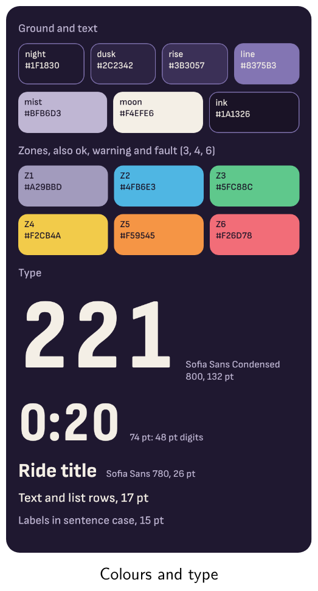{width=36%}

### Colour roles

| Token | Value | Used for |
|-------|-------|----------|
| `night` | `#1F1830` | Page background |
| `dusk` | `#2C2342` | Panels, lists, sheets |
| `rise` | `#3B3057` | Buttons; the band while paused or lost |
| `line` | `#8375B3` | Outlines of secondary buttons and dashed states; the route's verge |
| `mist` | `#BFB6D3` | Labels and secondary text |
| `moon` | `#F4EFE6` | Numbers, text, the one primary button per screen, the part of a route ridden |
| `ink` | `#1A1326` | Text on `moon` and on zone colours |
| `zone 1` to `zone 6` | `#A29BBD`, `#4FB6E3`, `#5FC88C`, `#F2CB4A`, `#F59545`, `#F26D78` | The band, the workout profile, time in zone |
| ok, warning, fault | zone 3, zone 4, zone 6 | Status only, always with a shape and words |

**Rule:** colour never carries a meaning alone. Link states have a shape and a word; warnings have text; the band has the numbers.

### Contrast, measured

Computed with the WCAG 2 formula from the values above. WCAG asks 4.5:1 for normal text and 3:1 for large text at level AA, 7:1 and 4.5:1 at level AAA, and 3:1 for interface outlines.

| Pair | Ratio | Meets |
|------|-------|-------|
| `moon` on `night`, `dusk`, `rise` | 14.9, 12.9, 10.5 | AAA |
| `mist` on `night`, `dusk` | 8.8, 7.6 | AAA |
| `ink` on `moon` | 15.7 | AAA |
| `ink` on zones 2 to 5 | 7.8 to 11.5 | AAA |
| `ink` on zone 1, zone 6 | 6.8, 6.2 | AAA for the large numbers; AA for the 15 pt labels on the band |
| Zone colours on `night` (profile) | 5.9 to 10.9 | Above the 3:1 for graphics |
| `line` on `night`, `dusk` | 4.2, 3.6 | Above the 3:1 for outlines |

### Type

| Role | Typeface | Size | Notes |
|------|----------|------|-------|
| Hero number (power; resistance level) | Sofia Sans Condensed, weight 800 | 132 pt, down to 74 pt; 168 pt, down to 80 pt | Tabular digits, so numbers don't jitter as they change. They shrink to fit smaller screens (IM-116, P5). |
| Key numbers (target, heart rate, step time left; speed and grade on the route view) | Sofia Sans Condensed 800 | 74 pt | See APP-412 below. A number wider than its cell shrinks to fit it, never below 48 pt digits (P5). |
| Small numbers | Sofia Sans Condensed 800 | 15 to 40 pt | Info lines, ride time, Summary |
| Titles | Sofia Sans, weight 780 | 26 to 30 pt | |
| Buttons | Sofia Sans 650 | 18 to 24 pt | |
| Text and list rows | Sofia Sans 500 to 550 | 17 pt | |
| Labels | Sofia Sans 500 | 15 pt | Sentence case, never all capitals |

Both are one family in two widths, under the SIL Open Font License 1.1, taken from the `@fontsource-variable/sofia-sans` and `@fontsource-variable/sofia-sans-condensed` packages (5.3.0), so they are pinned in the lockfile and bundled (AD-17, AD-19). The condensed width is what lets three 74 pt numbers and a 132 pt one fit a phone.

**APP-412, read strictly.** "Text at least 48 pt high" is taken as the height of the digits, not the font size. Sofia Sans Condensed's capital height is 0.655 of the font size (measured from the font file), so 74 pt type gives 48.5 pt digits. Power at full size is larger still: 86 pt digits.

**Heart symbol (P5, IM-42).** A small white heart follows the heart rate, and the strap's battery symbol in the status line carries one too, so the strap's battery isn't read as the phone's.

### Sizes

| Item | Size | Requirement |
|------|------|-------------|
| Buttons on ride screens | at least 62 × 62 pt | APP-407 (60 × 60 pt) |
| Resistance − and + | two equal columns, at least 120 pt high (181 × 120 pt at 402 pt width) | APP-414 (120 × 120 pt) |
| Buttons in confirmation sheets | 66 pt high, full width | APP-407 |
| Wake-lock prompt | 64 pt high, full width (P5, IM-114) | APP-416 |
| Controls on other screens; Settings rows | at least 44 pt high | Apple's minimum (Phase 1 source) |
| Gaps between touch targets | at least 8 pt | — |
| Page margin | 16 pt, or the safe-area inset when larger | — |
| Corner radius | 22 pt band and sheets, 18 pt panels, 16 pt buttons, 14 pt banners | — |

**Fitting the screen (P5, IM-116).** The ride screens fit every size from 375 × 600 to 430 × 800 pt with a banner. When space runs short, the power number shrinks first, from 132 pt to no less than 74 pt, by width so the 74 pt target always fits beside it, and by height; then the profile, down to nothing; the resistance level shrinks from 168 pt to no less than 80 pt. Below 390 pt width the status line is tighter. Only at 375 × 600 with a banner and the wake-lock prompt together does the bottom row leave the screen, and the prompt's one tap brings it back (Phase 5, 35.2).

## Screen map

The Pi names the screen in every view (ICD, IF-06), so the page has no router and no history of its own. Two things are the page's alone: the Start screen, shown once per page load, and the route view, a second face of the ride screen. Opening or reloading the page during a ride or a running calibration skips Start and lands on that screen at once (APP-807).

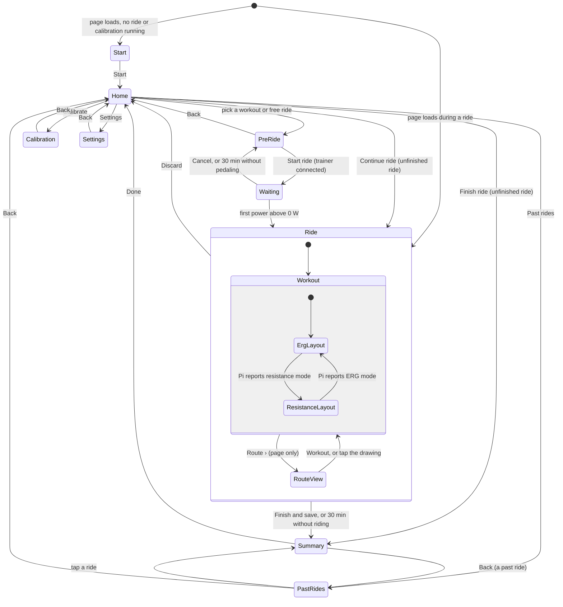

## Ride screens

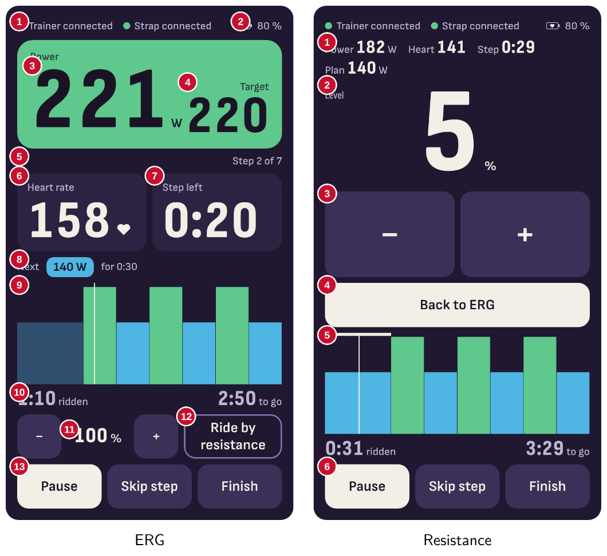{width=68%}

### Ride, ERG (left)

| Pin | Element | Behaviour | Requirements |
|-----|---------|-----------|--------------|
| 1 | Link states | Trainer and strap, each a shape plus a word: dot for connected, ring for searching, triangle and "lost" for a dropout. Always visible. | APP-405 |
| 2 | Strap battery | Battery symbol with a heart, and the percent. At or below the threshold it turns amber with "low". "?" when unknown. | APP-406, APP-112, APP-113 |
| 3 | Power | The 3 s average from the Pi, 132 pt, smaller on small screens (IM-116). "––" when no value. The label reads "Paused" while paused. | APP-401, APP-402, APP-412 |
| 4 | Target | 74 pt. Shows "limit" under it when the trainer's range clipped the target. | APP-401, APP-303, APP-412 |
| — | The band | Filled with the zone colour of the target. `rise` with a dashed edge when the trainer is lost; `rise` while paused. | Design |
| 5 | Cue and step number | The step's text from intervals.icu, the cadence when the trainer reports it, and "Step n of m". | APP-209, APP-115 |
| 6 | Heart rate | 74 pt with the heart symbol. "––" when the strap is missing. | APP-401, APP-412, APP-116 |
| 7 | Step time left | 74 pt, m:ss. In the last 5 s the cell turns moon-white and counts 5 to 1. On a free ride the cell shows the ride time. | APP-401, APP-404, APP-412 |
| 8 | Next step | Zone chip, target and duration. Hidden on the last step. | APP-401 |
| 9 | Workout profile | Steps drawn to scale in zone colours; the part ridden is dimmed; a white marker at the position; a moon-white line over blocks set to resistance (IM-117). Grows to fill spare height; carries "Route ›" on a ride with a route. | APP-403, APP-909 |
| 10 | Ride time | Ridden and to go. | APP-401 |
| 11 | Intensity | −, value, +, in 5-point steps. On a free ride: −, the target power, +. | APP-401, APP-313, APP-317, APP-407 |
| 12 | Ride by resistance | Switches the current block to resistance mode. | APP-307, APP-407 |
| 13 | Pause, Skip step, Finish | Pause is the primary button and becomes Resume. Skip and Finish open a confirmation. Skip is disabled while paused and on a free ride. | APP-311, APP-312, APP-315, APP-407, APP-408 |

### Ride, resistance (right)

| Pin | Element | Behaviour | Requirements |
|-----|---------|-----------|--------------|
| 1 | Info line | Power, heart rate, cadence when reported, step time left, and the plan's target ("Free ride" on a free-ride step). | APP-414, APP-401 |
| 2 | Level | Percent of the trainer's range, 168 pt, smaller on small screens (IM-116). | APP-414, APP-308 |
| 3 | − and + | Two equal columns at least 120 pt high, 5 % of the range per tap. Disabled while paused. | APP-414, APP-308 |
| 4 | Back to ERG | The primary button of this layout; "Ride by power" on a free ride. | APP-414, APP-307 |
| 5 | Workout profile | As in ERG. | APP-403 |
| 6 | Pause, Skip step, Finish | As in ERG. | APP-311, APP-312, APP-315, APP-408 |

Revision 2 had the heart rate in the status line of this layout; as built it is in the info line (P5).

### Which variant shows

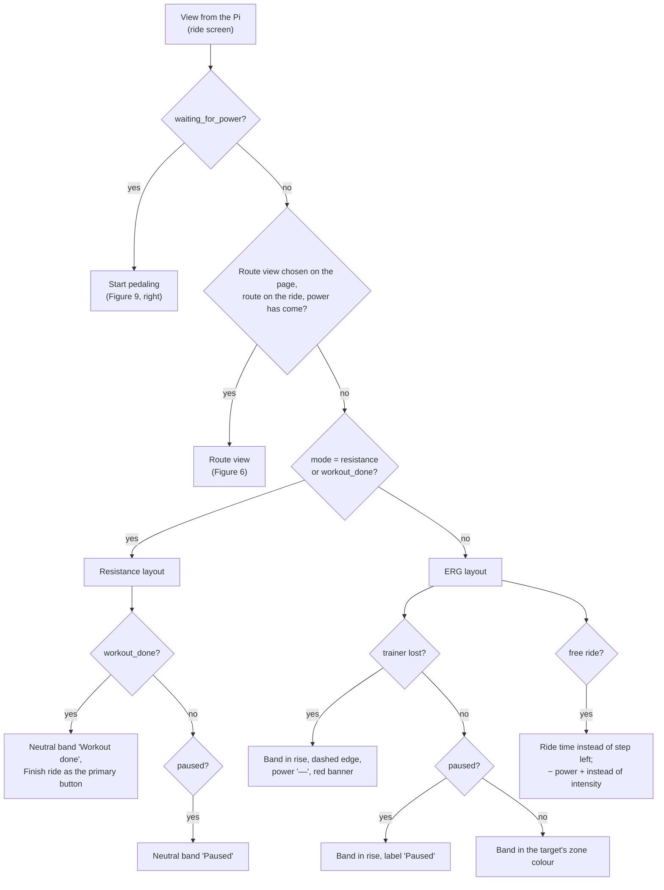

*Figure 3. Which variant of the ride screen shows. The Pi sends the answers; the page only follows them, except for the route view, which the rider chooses on the page.*

### States during a ride

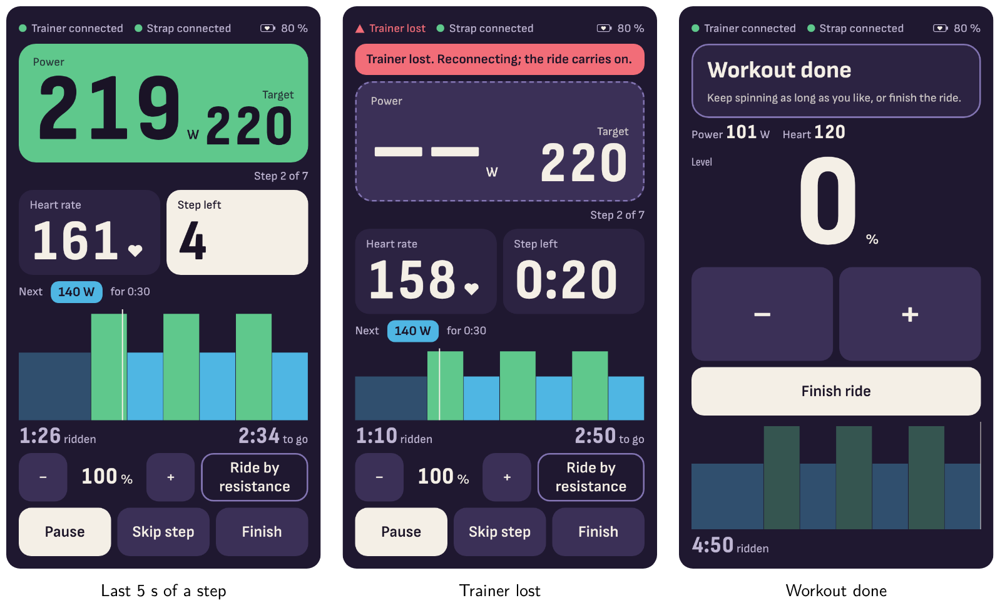

| State | What changes | Requirements |
|-------|--------------|--------------|
| Last 5 s of a step | The step-time cell inverts and counts down; the Next line already shows what is coming. | APP-404 |
| Step change | The band takes the new zone colour in a 200 ms cross-fade; one short tone. | APP-413, APP-415 |
| Trainer dropout | Triangle and "Trainer lost" in the status line within 3 s; red banner "Trainer lost. Reconnecting; the ride carries on."; power "––"; the band turns `rise` with a dashed edge; clock, steps and heart rate carry on. | APP-405, APP-318, APP-603 |
| Strap dropout | Triangle and "Strap lost"; heart rate "––". No banner: the ride doesn't depend on it. | APP-405, APP-319 |
| Trainer not responding, or control refused | Amber banner "Trainer isn't answering. Still trying." or "Another app has the trainer. Taking control back." | APP-105, APP-107 |
| Clock not set at Start | Amber banner "The Pi's clock wasn't set at Start. Ride times may be off." (P5) | APP-824 |
| Strap battery low | The battery turns amber with "low" in the status line (P5, Figure 13). | APP-406, APP-112 |
| Paused | Power's label reads "Paused" and the band turns `rise`; clocks stand still; Pause becomes Resume; intensity, Skip and Ride by resistance are disabled. | APP-311 |
| Workout done | Resistance layout at the free-ride level with a neutral band "Workout done"; Finish ride becomes the primary button; the ride keeps recording. | APP-314 |

### How a step change plays out

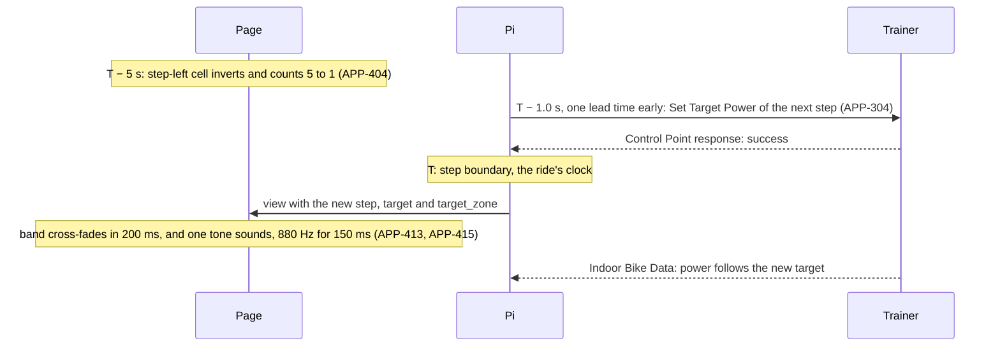

*Figure 5. The five seconds around a step boundary: what the page, the Pi and the trainer do.*

The countdown ends on the boundary, not on the moment the target is written: the rider feels the trainer change as the count reaches zero, because the write went out one lead time earlier (APP-304, F-25). The lead time is 1.0 s by default (table S, IM-41).

## The route view (P5)

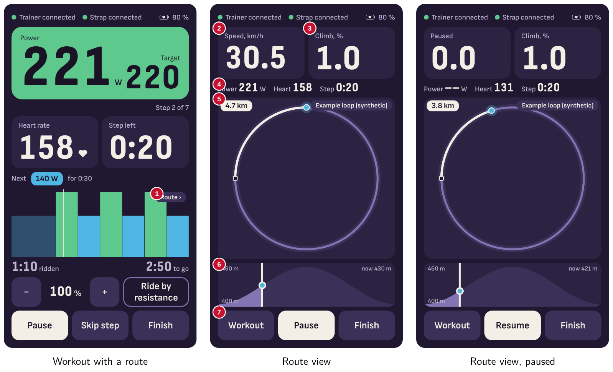

The route view is a second face of the ride screen, not a new screen of the state machine (IM-142): the ride's states, its commands and the ICD's screens stay as they are. Every ride, and every reload, starts on the workout.

| Pin | Element | Behaviour | Requirements |
|-----|---------|-----------|--------------|
| 1 | Route › | On the workout profile, in ERG and resistance, when the ride has a route and power has come. One tap opens the route view. | APP-909 |
| 2 | Speed | km/h, one decimal, 74 pt, the unit in the label. While paused the label says "Paused" and the speed is 0.0. | APP-909, APP-910 |
| 3 | Climb | Grade at the rider's place in %, one decimal, 74 pt; a descent carries a minus sign (U+2212). | APP-909 |
| 4 | Info line | Power, heart rate and step time left, small. | APP-909 |
| 5 | Drawing | The route's own shape, not a map: north up, a dotted ground, a wide verge under the road line, the part ridden in moon white, the start as a small square, the rider as a dot with a halo. Labels: the distance ridden in km and the route's name. A tap returns to the workout ("Back to the workout"). | APP-909; IM-144 |
| 6 | Elevation | The route's profile with the part ridden filled, the rider's place as a line and dot, the lowest and highest altitude, and the altitude now. | APP-909 |
| 7 | Workout, Pause, Finish | Workout returns to the workout layout; Pause is the primary button and becomes Resume; Finish opens the confirmation. | APP-909, APP-311, APP-315 |

Speed, distance, altitude and grade come with each second's view from the ride the Pi works out live (APP-910, IM-146); the drawing and the elevation come once per page and route in the `route` message (IM-145). The numbers keep the size of the workout's cells at 375 × 600 (SF-44). No map tiles, no third-party data, no network.

## Overlays

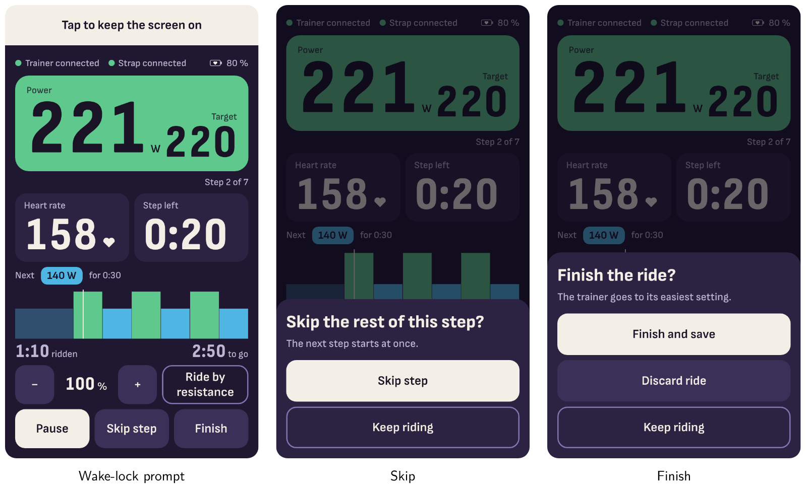

| Overlay | Behaviour | Requirements |
|---------|-----------|--------------|
| Wake-lock prompt | "Tap to keep the screen on": a full-width moon-white bar, 64 pt, at the top while a ride or a running calibration is on screen, the page is live and the lock isn't held. The page moves down by its height, so nothing scrolls (IM-114, P5). A browser without the API is told to set Auto-Lock to Never. | APP-409, APP-416 |
| Skip confirmation | "Skip the rest of this step?" from the bottom, with the consequence in words, "Skip step" and "Keep riding". It closes by itself after 5 s, so an accidental tap undoes itself. | APP-408, APP-312 |
| Finish confirmation | "Finish the ride?", "The trainer goes to its easiest setting.", with "Finish and save", "Discard ride" and "Keep riding". Discard opens a second sheet before anything is deleted. No auto-close here: the rider may be catching breath. | APP-408, APP-315, APP-316 |
| Pi lost | After 3 s without a view: everything dimmed to 45 %, taps disabled, amber banner "Lost the Pi. Reconnecting…" at the top. Revision 2's count of seconds in the banner was not built (P5). | APP-807 |

Sheets are the page's own: nothing is sent to the Pi until the confirming button is tapped.

### Screen wake lock

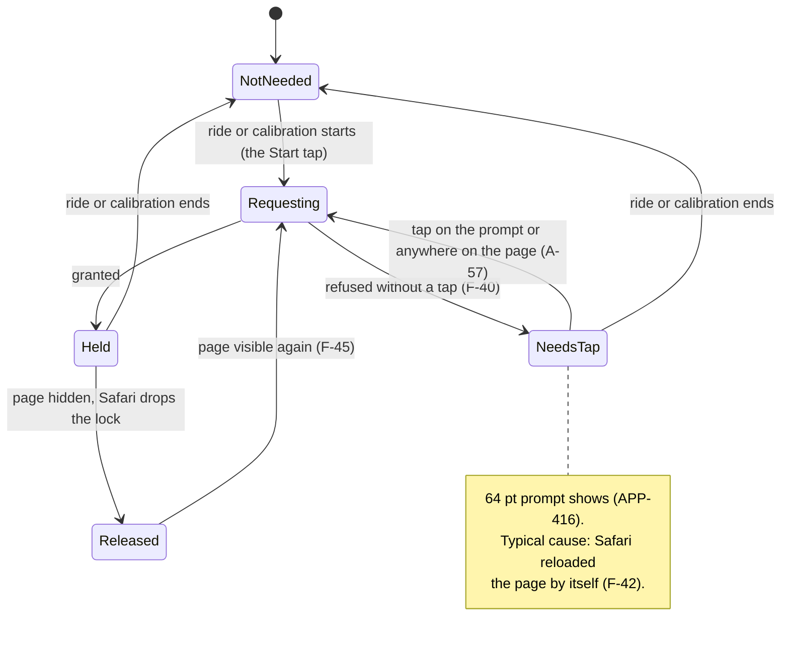

## Before the ride

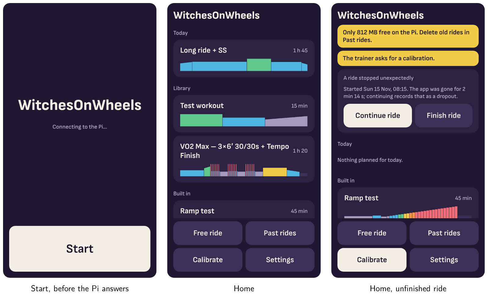

### Start (P5, IM-102)

When the page loads it shows the app's name, the link state ("Connecting to the Pi…", then "Connected to the Pi.") and one Start button. The tap that leaves it is the user action Safari needs for sound and the wake lock later (A-49, A-57). It is skipped when the Pi is in a ride or a running calibration.

### Home

| Element | Behaviour | Requirements |
|---------|-----------|--------------|
| Title | The app's name stays at the top; the four buttons stay at the bottom; only the lists between them scroll (IM-43, P5). | — |
| Banners | Amber, at the top, only when there is something to say: intervals.icu out of reach with the download time of the workouts shown, storage low, the trainer asks for a calibration, the certificate ending within 30 days, the Pi's clock not set (Figure 13). | APP-202, APP-612, APP-506, APP-830, APP-824 |
| Unfinished ride | A card "A ride stopped unexpectedly" with its start, how long the app was gone, and "Continue ride" (primary) and "Finish ride". When the gap is unknown (no synchronised clock) only Finish is offered, and the card says why (P5). | APP-809 |
| Today | A card per planned ride with name, duration and a sketch of its profile. "Nothing planned for today." when empty. | APP-201 |
| Library | The intervals.icu library, name and duration. A workout the app can't ride is disabled with "Can't be ridden here". | APP-210 |
| Built in | Ramp test. | APP-211 |
| Free ride, Past rides, Calibrate, Settings | Four buttons in two rows of two (P5). Calibrate becomes the primary button while the trainer asks for a calibration. | APP-317, APP-611, APP-501, APP-701 |

### Pre-ride and the wait for the first pedal stroke

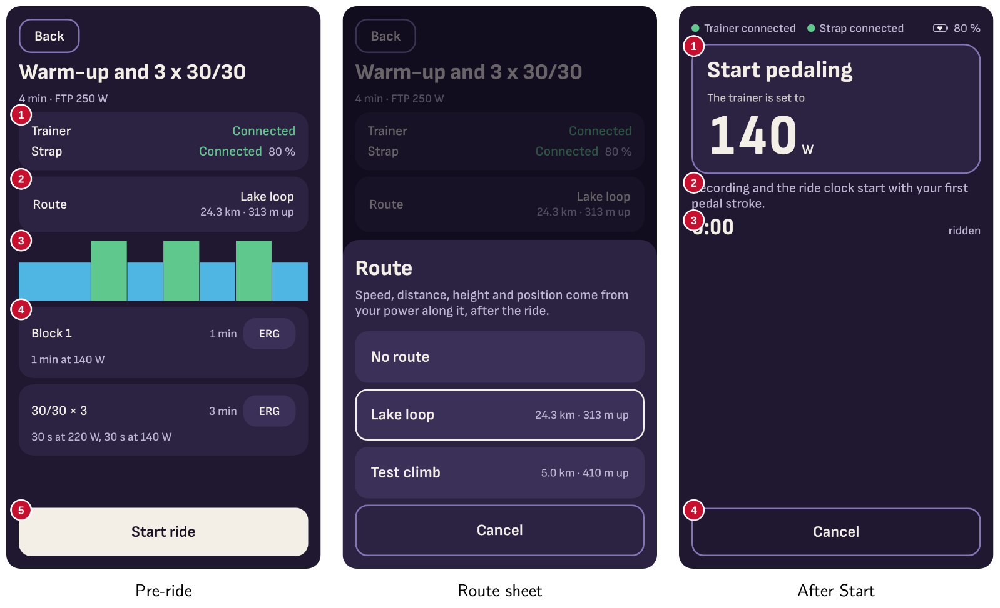

**Pre-ride (left).** Back and the title stay at the top and Start ride at the bottom; the rest scrolls (IM-43).

| Pin | Element | Behaviour | Requirements |
|-----|---------|-----------|--------------|
| 1 | Devices | Trainer and strap: searching, connected or not found; the strap's battery with "low" at or below the threshold. | APP-102, APP-406, APP-112 |
| 2 | Route | The chosen route with its length and climb, or "None". Opens the route sheet. Hidden when the `routes` folder has no usable route (P5). | APP-901, APP-902 |
| 3 | Profile | The whole workout in zone colours at the app's FTP. Not on a free ride. | APP-203 |
| 4 | Blocks | Each block with its steps in watts, and a button that switches it between ERG and Resistance. A block without an ERG step says "Free ride". | APP-203, APP-206, APP-207 |
| 5 | Start ride | Disabled with "Trainer not connected" until the trainer is there. A missing strap doesn't block it. | APP-301, APP-116, APP-117 |

Banners for a low strap battery and an unset clock show under the route row (P5). A free ride shows "Starts at the free-ride level. Switch to riding by power, and back, at any time." instead of the duration and FTP.

**Route sheet (middle, P5).** "No route" and each usable route with its length and climb; the chosen one is outlined. A choice is sent at once (`set_route`) and kept for later rides, free rides included (IM-133). Cancel closes the sheet. Its sentence still says the ride along the route is worked out "after the ride", which stopped being true with SL-14 (IM-146); see the open points.

**After Start (right):** the app has sent the first step's target and waits; nothing is recorded yet (APP-301).

| Pin | Element | Behaviour | Requirements |
|-----|---------|-----------|--------------|
| 1 | Start pedaling | Neutral band, never a zone colour, so it can't be mistaken for a running step. Shows the load the trainer is set to. | APP-301 |
| 2 | Explanation | "Recording and the ride clock start with your first pedal stroke." | APP-301 |
| 3 | Ride time | Stays at 0:00 until the trainer reports power; then the ERG or resistance layout takes over. | APP-301, APP-415 |
| 4 | Cancel | Back to Pre-ride; nothing saved. After 30 min without pedaling the app does the same by itself. | APP-301 |

### Settings (P5, IM-105)

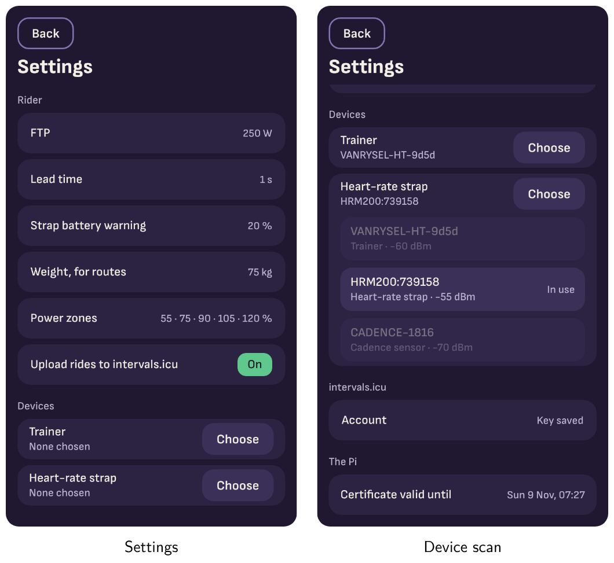{width=68%}

Back and the title stay at the top; the rows scroll. Each row is at least 44 pt high.

| Group | Rows | Behaviour | Requirements |
|-------|------|-----------|--------------|
| Rider | FTP, Lead time, Strap battery warning, Weight for routes, Power zones | A tap opens a stepper on a draft within table S's range and step (FTP also ±10 W; the zones as five steppers, one per upper bound); Save sends the value once, Cancel drops the draft. A value the Pi refuses comes back with its range (`invalid_value`). | APP-701 to APP-705, APP-708, APP-709 |
| Rider | Upload rides to intervals.icu | A switch, On or Off. | APP-707 |
| Devices | Trainer, Heart-rate strap | The device in use, and Choose: a 5 s scan lists trainers, then straps, then cadence sensors, each with its kind and signal; only a device of the role being chosen can be picked; the one in use says "In use". | APP-114 |
| intervals.icu | Account | Two fields, athlete ID and API key. The key never comes back to the page: the row says "Key saved" (APP-817). | APP-706, APP-817 |
| The Pi | Certificate valid until | Date and time the display's certificate ends. | APP-830 |

The screen opens from Home only, so a running ride never sees a change; the ride keeps the FTP and zones of its Start.

## Calibration

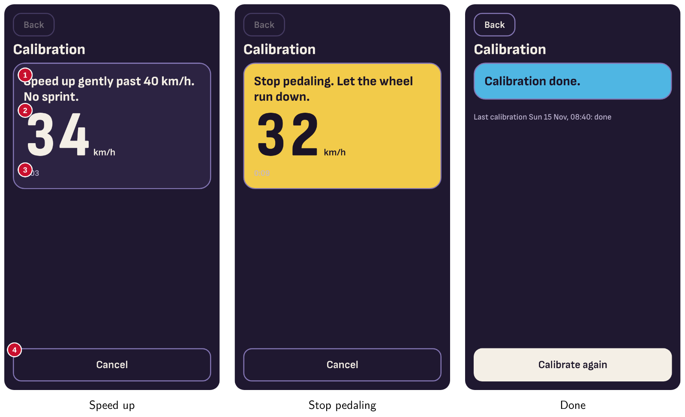

| Pin | Element | Behaviour | Requirements |
|-----|---------|-----------|--------------|
| 1 | Instruction | One sentence in large type in the band: "Speed up gently past 40 km/h. No sprint.", with the top of the band the trainer gave; then "Stop pedaling. Let the wheel run down." in an amber band; then the result. | APP-502; F-30, F-37 |
| 2 | Speed | Live, whole km/h, hero size. | APP-502, APP-803 |
| 3 | Elapsed time | m:ss. The run stops at 120 s with a failure (texts below). | APP-504 |
| 4 | Cancel | Leaves the trainer at its lowest level. | APP-501 |

Revision 2's speed gauge was not built (P5): the instruction names the speed to reach, and the number shows where the rider is. Back is disabled while a run is on. After a run the band turns blue for "Calibration done." or red for a failure, the date and result of the last calibration show under it, and the button reads "Calibrate again". A ride running or no trainer disables the button with the reason (APP-505).

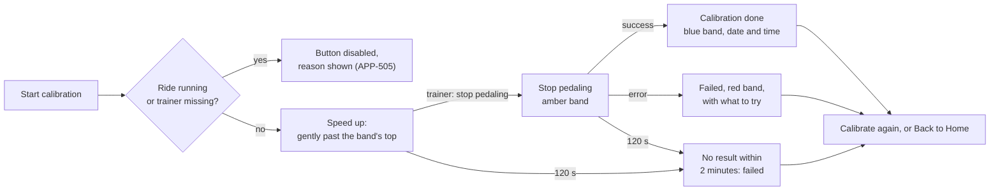

Texts as built (P5): before a run, "Warm up for 10 minutes first. Then the trainer guides you: speed up, then stop pedaling."; on the trainer's error, "The trainer reported a failed calibration. Try again, with a gentler speed-up."; at 120 s, "No result within 2 minutes: calibration failed."

## After the ride

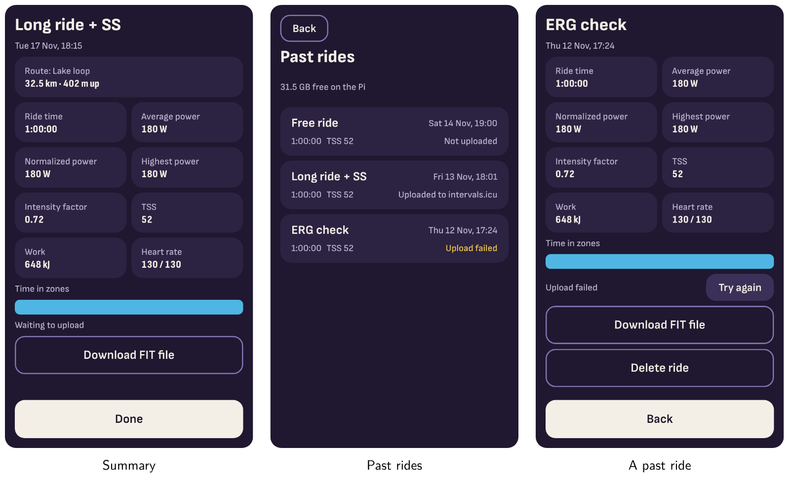

| Screen | Content | Requirements |
|--------|---------|--------------|
| Summary | Title, date and time; on a route, a panel with the route's name, the distance and the climb (P5); ride time, average, normalized and highest power, intensity factor, TSS, work, average and highest heart rate; time in each zone as one bar; the upload state in words with "Try again" or "Upload now" where it applies; Download FIT file; Done. Only Done stays fixed at the bottom; the rest scrolls. | APP-411, APP-606, APP-610, APP-609, APP-906 |
| Past rides | The free space on the Pi, then per ride: title, date and time, ride time, TSS and upload state ("Upload failed" in amber), newest first. A tap opens its Summary. | APP-611, APP-612 |
| A past ride | The same Summary with Delete ride, which asks first ("Delete this ride?", "Its FIT file and logs go; intervals.icu keeps what it already has."), and Back instead of Done (P5). | APP-608, APP-609, APP-611 |

Upload states in words: "Not uploaded" (upload off, or a simulated ride: APP-613), "Waiting to upload", "Uploading…", "Uploaded to intervals.icu", "Retrying", "Upload failed", "intervals.icu refused the key".

### The page's connection to the Pi

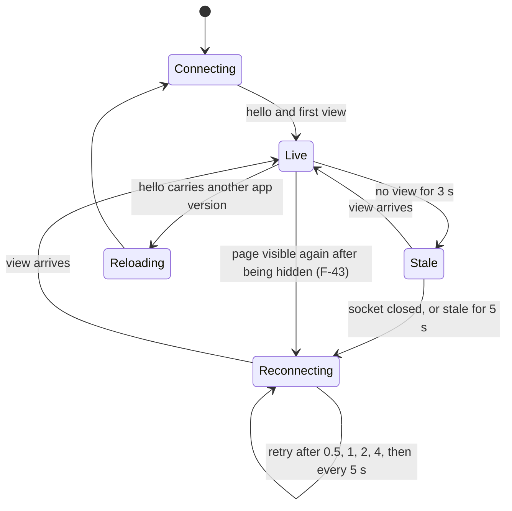

In Stale and Reconnecting the last values stay on screen, dimmed, so the rider isn't looking at nothing; taps do nothing, because a command that can't reach the Pi must not look accepted. After each `hello` the page reports its viewport, which the Pi logs (IM-119, A-56).

## Warnings (P5)

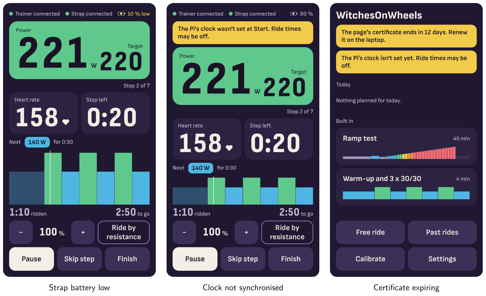

| Warning | Where | Look | Requirements |
|---------|-------|------|--------------|
| Strap battery low | Ride screens: status line; Pre-ride: devices panel and a banner | Amber percent with "low"; banner "The strap's battery is low. Replace it soon." | APP-406, APP-112 |
| Clock not set | Home and Pre-ride while unset; ride screen when it wasn't set at Start or isn't now | Amber banner | APP-824 |
| Certificate ending | Home, at 30 days and below | Amber banner "The page's certificate ends in n days. Renew it on the laptop." | APP-830 |
| Storage low | Home and Past rides, below 1000 MB | Amber banner with the free space | APP-612 |
| Calibration requested | Home, while no ride runs | Amber banner; Calibrate becomes the primary button | APP-506 |
| Workouts offline | Home | Amber banner with the time the workouts were downloaded | APP-202 |

## Rules for the whole page

### Formatting

| Value | Format | Missing |
|-------|--------|---------|
| Power, target | Whole watts: `331`, unit "W" small | `––` |
| Heart rate | Whole beats: `162` | `––` |
| Step time, ride time | `m:ss` below an hour, `h:mm:ss` from an hour | — |
| Countdown | One digit, 5 to 1 | — |
| Durations in lists | `35 min`, `1 h 05` | — |
| Resistance, intensity, battery | Whole percent: `45 %` | `?` for battery |
| Speed | Route view: one decimal, `30.5`, the unit "km/h" in the label. Calibration: whole km/h, `34` | `––` |
| Grade | One decimal with a true minus sign: `−2.5`, the unit "%" in the label | `––` |
| Distance | `4.7 km`; lengths in lists `24.3 km · 313 m up` | — |
| Altitude | Whole metres: `now 430 m` | — |
| Dates | `Tue 10 Nov, 18:40`, local time | — |

Language: English, sentence case. A button says what it does and keeps that name through the flow: "Skip step" opens "Skip the rest of this step?" with the button "Skip step".

### Motion and sound

| What | How |
|------|-----|
| Numbers | Change in place, no animation: the tabular digits keep them still. |
| Band colour at a step change | 200 ms cross-fade. This is the one orchestrated moment. |
| Sheets | Slide up in 180 ms; the screen behind dims under a scrim. |
| Layout switch between ERG and resistance, and from the wait to the ride | Instant. Revision 2's 200 ms cross-fade here was not built (P5): the band's colour change already marks the moment. |
| Reduced motion set on the phone | The cross-fade and the sheets become instant. |
| Step change sound | One tone, 880 Hz for 150 ms through Web Audio, at each step change and when the workout ends; the first tap on the page unlocks audio (IM-115, A-49; APP-413 is *could*). |

### Safari

| Rule | Why |
|------|-----|
| The page fills the dynamic viewport height (`100dvh`) and ride screens never scroll. | Safari's toolbars come and go; `dvh` follows them. Supported from Safari 15.4. |
| The layout targets the iPhone 17's 402 pt width and fits 375 × 600 to 430 × 800 pt (IM-116); the numbers size with the container units `cqi` and `cqb` (A-66). The figures are drawn at 402 × 720 pt. | iPhone 17: 402 × 874 pt (A-56). |
| On scrolling screens the title and Back stay at the top and the main button at the bottom; only the content between scrolls (IM-43). | The button the rider wants is never scrolled away. |
| Safe-area insets pad the edges; `viewport-fit=cover`. | Notch and home indicator. |
| Double-tap zoom, text selection and pull-to-refresh are switched off on the page. | Sweaty double taps on + must not zoom or reload (A-58). |
| Portrait only in v1. A landscape layout is in Phase 1's later-versions list. | Ferran, 11 Nov. |
| v1 is used as a Safari tab, as in Phase 2. Add to Home Screen is not required. | Phase 2 tested the tab only. Home Screen mode would hide the toolbars and give about 85 pt more height; the wake lock works there from iOS 18.4 (A-59). |

## Components

As built in `display/src` (P5). The two ride layouts and the route view live inside `RideScreen`; revision 2's separate layout and part components (ZoneBand, BigNumber, Button, Gauge) became CSS classes of the shared style sheet `theme.css`.

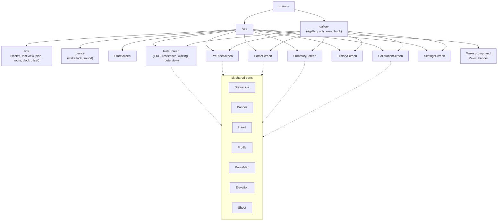

Each screen component takes its part of the view (and the plan or route the link holds) as its only input and renders it; none keeps state of its own beyond an open sheet, a draft in Settings and the route-view choice. That is what lets Vitest render every golden view (AD-18).

### The gallery (P5, IM-138)

`https://wow.local/#gallery` lists every golden view of `testdata/display` by screen and shows each through the real screens, with the Pre-ride plans of `plans.json` and the routes of `routes.json`. It opens no WebSocket; commands go to the page's console only. It is loaded only behind that address, in its own chunk, and not linked from the app. It lets DS-8's states and the walk-through I-14 to I-20 be looked at on the iPhone without a fault script, and it is where the figures of this document come from. A lost Pi is the one state it can't show, as it is the page's own.

## Requirement coverage

| Requirement | Where in this design |
|-------------|----------------------|
| APP-401 | Figure 2, ERG pins 3, 4, 6 to 8, 10, 11; resistance pin 1 |
| APP-402 | ERG pin 3 (value from the Pi) |
| APP-403 | ERG pin 9, resistance pin 5 |
| APP-404 | Figure 4 left, Figure 5 |
| APP-405 | ERG pin 1; Figure 4 middle |
| APP-406, APP-112 | ERG pin 2; Pre-ride pin 1; Figure 13 |
| APP-407 | Sizes table |
| APP-408 | Figure 7 |
| APP-409, APP-416 | Wake-lock prompt and state machine |
| APP-410 | Safari rules |
| APP-411 | Figure 12 left |
| APP-412 | Type table and the strict reading; fitting the screen |
| APP-413 | Motion and sound |
| APP-414 | Figure 2 right |
| APP-415 | Screen map; Figure 3 |
| APP-102, APP-116, APP-117, APP-203, APP-206, APP-207 | Pre-ride, Figure 9 left |
| APP-301 | Figure 9 right: waiting for the first pedal stroke |
| APP-201, APP-202, APP-210, APP-211, APP-809 | Home, Figure 8 |
| APP-501 to APP-506 | Calibration, Figure 11 |
| APP-606, APP-608 to APP-613 | After the ride, Figure 12 |
| APP-701 to APP-709, APP-114, APP-817 | Settings, Figure 10 |
| APP-807 | Pi lost; connection state machine |
| APP-824, APP-830 | Warnings, Figure 13 |
| APP-901, APP-902 | Pre-ride pin 2 and the route sheet, Figure 9 |
| APP-906 | Summary route panel, Figure 12 |
| APP-909, APP-910 | The route view, Figure 6 |

## Display fields in the ICD (IF-06)

| Message | Field | For | Added |
|---------|-------|-----|-------|
| `PlanSegment` | `zone` | Zone colours in the profile without the page knowing FTP or zones | 3C rev. 1 |
| `Plan` | `blocks` (label, repeats, steps in watts) | The block list on Pre-ride | 3C rev. 1 |
| `RideScreen` | `target_zone`, `next.zone` | The band and the Next chip | 3C rev. 1 |
| `WorkoutCard` | `max_power`, `sketch` | Today's card on Home | 3C rev. 1 |
| `SummaryScreen` | `start_utc` | Date and time of the ride | 3C rev. 1 |
| `HistoryScreen` | `free_mb` | Free space | 3C rev. 1 |
| `SettingsScreen` | `cert_valid_until` | Certificate date | 3C rev. 1 |
| `RideScreen` | `waiting_for_power` | The screen after Start (Figure 9) | 3C rev. 2 |
| `SummaryScreen` | `past` | Delete ride and Back on a past ride | P5, 29.5 |
| `RideScreen` | `cadence_rpm`, `resistance_blocks` | Cadence; the resistance line on the profile | P5, IM-113 |
| `SettingsScreen` | `scan.found[].kind`, `rider_kg` | The device list; the weight row | P5, IM-107, IM-136 |
| `PreRideScreen` | `routes`, `route` | The route row and sheet | P5, IM-133 |
| `SummaryScreen` | `route` (name, distance, climb) | The Summary's route panel | P5, IM-134 |
| `route` message | `route_id`, `name`, `length_m`, `width`, `height`, `ele_min`, `ele_max`, `points` | The drawing and the elevation profile | P5, IM-145 |
| `RideScreen` | `route` (`speed_kmh`, `grade_pct`, `altitude_m`, `distance_m`, `at_m`) | The route view's live values | P5, IM-145 |
| up: `viewport`; `rtt_ms` on `command` and `painted` | width, height; round trip | A-56; latency logging | P5, IM-118, IM-119 |

## Assumptions

Status on 18 Nov 2026. None has been checked on the iPhone since SL-11: `docs/verification-log.md` has no entries for DS-8 yet.

| ID | Assumption | Status | Source | How it gets checked |
|------|-----------|--------|--------|---------------------|
| A-56 | On the iPhone 17 (402 × 874 pt), Safari leaves the page at least 402 × 664 pt in portrait with its bars visible; the phone sits 60 to 80 cm away. | Width confirmed; height built, open | Phone named by Ferran, 11 Nov; 402 × 874 pt from device tables (Use Your Loaf, yesviz) | The viewport the page reports at each load, in the system log (IM-119), DS-1 |
| A-57 | Any tap on the page counts as the user action Safari needs to grant the wake lock, not only a tap on the prompt. | Built, open | F-39: the Start tap was enough | D-17 |
| A-58 | CSS can switch off double-tap zoom, selection and pull-to-refresh in Safari 26. | Built, open | — | I-03, D-19 |
| A-59 | Opened from the Home Screen, the page keeps the wake lock as it does in a Safari tab. | Open, optional | WebKit bug 254545: fixed in iOS 18.4 | Only if the extra height is wanted |
| A-49 | Safari plays the step tone once a tap has unlocked audio. | Built, open | Phase 3A; IM-115 | D-08 in DS-2 |
| A-66 | Safari on the iPhone 17 sizes the ride screens' numbers with the container query units `cqi` and `cqb` as Chrome does. | Open | Phase 5, 35.3 | I-03, I-04 in DS-8 |

## Open points

1. The route sheet's sentence ends "…come from your power along it, after the ride." Since SL-14 the ride along the route is worked out live (IM-146), so "after the ride" is wrong. A one-line text change in `PreRideScreen.svelte` with its Vitest snapshot, for the next code change; this revision is documentation only.
2. APP-906 asks for the route's name, distance and climb on "the Summary and Past rides". As built they are on the Summary, which Past rides opens; the list's row itself has no route. Whether that is enough is checked in D-33.
3. The figures are drawn by Chromium. If Safari sets type or the container units differently (A-66), DS-8 will show it, and the figures stay as they are.

## Answers (11 Nov 2026)

| # | Question | Answer |
|---|----------|--------|
| 1 | Which iPhone? | iPhone 17: the layout targets 402 pt width (A-56). |
| 2 | Where and which way up? | In front of the rider, portrait. No landscape in v1; landscape is recorded in Phase 1's later-versions list. |
| 3 | The look | As shown. |
| 4 | Step sound | One short tone at each step change, no countdown beeps, no setting. |

## Decisions made in 3C

1. Direction "Night ride": violet ground, moon-white numbers, and the band in the target's zone colour as the single loud element.
2. Colours, type and sizes as tabled; contrast measured; Sofia Sans and Sofia Sans Condensed, bundled.
3. APP-412 is read as digit height: 74 pt type for the key numbers, 132 pt for power, and no number below 74 pt when it shrinks to fit (IM-116).
4. Two ride layouts chosen by the Pi's mode, with variants for paused, workout done and free ride; overlays in a fixed order.
5. Confirmation by bottom sheet; the Skip sheet closes itself after 5 s; Discard needs two sheets.
6. The wake-lock prompt is a 64 pt full-width bar that moves the page down; any tap also re-requests the lock.
7. Dropouts and a lost Pi keep the last layout and say in words what is happening.
8. Calibration names the speed to reach and warns against sprinting; the gauge of revision 2 was left out (P5).
9. The figures are screenshots of the built display through the gallery (IM-138), made by `tools/make_pdf.py --screens`; revision 2's mockup file `display/mockups/screens.html` never went into the repository and is not needed (P5).
10. Field additions to the display messages, in the ICD (IF-06), as tabled.
11. Designed for the iPhone 17 in portrait; landscape is a later version.
12. After Start a neutral "Start pedaling" screen shows until the first power; Cancel returns to Pre-ride.
13. A Start screen comes before Home at each page load, except during a ride or a running calibration (IM-102, P5).
14. Scrolling screens keep their title and Back at the top and their main button at the bottom (IM-43, P5).
15. The route view is a second face of the ride screen, chosen on the page, one tap each way; the drawing is the route's own shape in the app's colours, not a map (IM-142 to IM-144, P5).

**Approved by Ferran on 11 Nov 2026** with Phase 3 (revision 2). Revision 3 applies the changes he approved in Phase 5 on 13, 16 and 18 Nov 2026.

## Change log

| Rev. | Date | Change |
|------|------|--------|
| 1 | 10 Nov 2026 | First draft of 3C. |
| 2 | 11 Nov 2026 | Ferran's answers (iPhone 17, portrait, default look and sound); landscape recorded as a later version; new screen after Start (Figure 8) and Cancel; Home lists the ramp test at up to 45 min; field names follow the ICD (AD-20). Approved by Ferran with Phase 3. |
| 3 | 18 Nov 2026 | The display as built in Phase 5 (0.8.0), with the approved changes of Phase 5 sections 13.6 (heart symbol, fixed header and footer), 29.5 (Start screen, Home's recovery card and 2 × 2 buttons, Past rides, Summary actions, Calibration), 35.5 (Settings, 64 pt prompt, sizes of IM-116, resistance line, banners), 41.5 (Pre-ride route row and sheet, Summary route panel, Settings weight, gallery) and 47.5 (route view, IM-142 to IM-144). Figures replaced by screenshots of the built display; variants and the step timeline as Mermaid; components as built; assumptions' status; open points. Moved into the repository as `docs/phase3-display.md`. |

## Sources

- W3C, Understanding WCAG 2.2, Contrast (Minimum) 1.4.3: https://w3.org/WAI/WCAG22/Understanding/contrast-minimum.html
- W3C, Understanding Contrast (Enhanced) 1.4.6: https://www.w3.org/TR/UNDERSTANDING-WCAG20/visual-audio-contrast7
- MDN, colour contrast (text, large text and interface components): https://developer.mozilla.org/en-US/docs/Web/Accessibility/Understanding_WCAG/Perceivable/Color_Contrast
- web.dev, the large, small and dynamic viewport units (Safari 15.4): https://web.dev/blog/viewport-units
- WebKit bug 254545, Wake Lock in Home Screen web apps: https://bugs.webkit.org/show_bug.cgi?id=254545
- WebKit bug 303885, noting the wake-lock fix in iOS 18.4: https://bugs.webkit.org/show_bug.cgi?id=303885
- Fontsource packages on npm, version 5.3.0, licence OFL-1.1 (read from the registry on 10 Nov 2026): `@fontsource-variable/sofia-sans`, `@fontsource-variable/sofia-sans-condensed`
- Apple Human Interface Guidelines, Buttons (44 pt minimum; cited in Phase 1): https://developer.apple.com/design/human-interface-guidelines/buttons
- Use Your Loaf, iPhone 17 screen sizes (402 × 874 pt): https://useyourloaf.com/blog/iphone-17-screen-sizes/
- yesviz, iPhone 17 viewport (402 × 874): https://yesviz.com/devices/iphone-17/
- The built display, app 0.8.0: `display/src` (screens, `ui`, `theme.css`, `types/protocol.ts`) and the golden views of `testdata/display`
- Phase 5 implementation record, revision 15 (IM-42, IM-43, IM-102 to IM-117, IM-133 to IM-146): `docs/phase5-implementation.md`
- Phase 3B Interface Control Document, revision 5: `docs/phase3-icd.md`
- Phase 3A architecture, revision 6: `docs/phase3-arch.md`
- Phase 2 record, revision 14 (F-25, F-30, F-37, F-39 to F-45): `docs/phase2-spikes.md`
- Phase 1 requirements, revision 8: `docs/phase1-requirements.md`
