# Phase 3B — Interface Control Document (ICD)

**Status:** draft; revision 6, 25 Nov 2026. Revision 6 sets every built-in workout's targets in percent of FTP and adds eight built-ins (IF-13, 4.13), at Ferran's request of 25 Nov 2026; a draft until he approves it. Revision 5, approved on 18 Nov 2026, applies the changes Ferran approved during Phase 5 (Phase 5 sections 13.6, 16.5, 22.5, 29.5, 35.5, 41.5 and 47.5): the trainer session's retry and release rules and its spin-down events, the simulator's server methods, the ride state machine's events and actions as built, the journal's and `meta.json`'s fields, the display messages as built (among them the route message, `set_route`, `viewport` and `rtt_ms`), the HTTP details, header-based authentication and the upload fields, `settings.json` with the rider's weight and the route, the `routes` folder, `[web] listen` and `[system] led`, and the FIT fields of a ride along a route. Approved by Ferran, 11 Nov 2026, as part of Phase 3; revision 4, 11 Nov 2026, applied the changes Ferran approved with the Phase 4 findings: the idle finish of a paused ride, how a free ride starts, the `Clock` port with `sleep_until`, the timing messages of the display and the ride's `timing.jsonl`, `due_mono_ms` in the journal, rounding with halves up, the simulator's adapter fault, and display qualification by inspection. Revision 3 restructured Part 3B as an Interface Control Document at Ferran's request and applied his comments of 11 Nov: the unit-naming rule (AD-20), GATT client and server names (AD-21), recording that starts at the first pedal stroke (APP-301), and his ramp-test protocol (IF-13). Builds on the Phase 3A architecture (revision 6), the Phase 1 requirements (revision 9) and the Phase 2 record (revision 14).

## 1 Scope

### 1.1 Identification

| Item | Value |
|------|-------|
| Document | WitchesOnWheels Interface Control Document |
| Document ID | WOW-ICD |
| Revision | 5, 18 November 2026 |
| System | WitchesOnWheels v1: the `wow` app on a Raspberry Pi 5, its display in Safari on an iPhone 17 |
| Interfaces covered | IF-01 to IF-13 |
| Formerly | Phase 3B interface specification, revisions 1 and 2 (`phase3-interfaces.md`) |

### 1.2 System overview

WitchesOnWheels runs structured workouts on a Van Rysel D100 smart trainer, reads a Garmin HRM 200 heart-rate strap, records each ride and uploads it to intervals.icu. The `wow` app on the Pi does all of this; the iPhone shows a page served by the Pi. The architecture is in Phase 3A.

### 1.3 Document overview

| Section | Content |
|---------|---------|
| 1 | Scope, conventions |
| 2 | Referenced documents |
| 3 | Interface identification: diagram and list |
| 4 | Interface definitions, one subsection per interface: identification, data elements, messages, protocol and timing, error handling |
| 5 | Qualification provisions: how each interface is verified |
| 6 | Requirements traceability |
| 7 | Notes: assumptions, open points, acronyms, change log |

### 1.4 Conventions

| Topic | Rule |
|-------|------|
| Byte order | Little-endian, as in every Bluetooth SIG characteristic. |
| UUIDs | Short form (`0x2AD9`) in tables; full lower-case form (`00002ad9-0000-1000-8000-00805f9b34fb`) in code and files. |
| Names | Constants in `UPPER_SNAKE_CASE`, fields and parameters in `lower_snake_case`. |
| Units in names (AD-20) | No suffix when the value is in the coherent SI unit: seconds, metres, watts, joules, hertz. A suffix in every other case: prefixed units (`_ms`, `_kj`), non-SI units (`_min`, `_kmh`, `_bpm`, `_rpm`, `_days`, `_mb`, `_kg`), percentages (`_pct`) and device-defined raw values (`_raw`). Every data element table states the unit. The route fields of Phase 5 also carry `_m` and `_mps`, which the code had already used when this document was revised (`length_m`, `distance_m`, `max_speed_mps`). |
| Time bases (AD-08) | `mono` (s) or `mono_ms`: the Pi's monotonic clock, used for all control. `t_ride` (s): ride time, pauses excluded. `utc`: ISO 8601 with milliseconds and `Z`, used only in outputs. |
| Rounding | Watts and resistance levels are rounded to the trainer's step with halves up: 162.5 W becomes 163 W, as intervals.icu shows it (F-20). Python's `round()` rounds halves to even and is not used for them. **design** (Phase 4) |
| Evidence | Protocol facts carry their source (RD number or Phase 2 finding F-xx). Values chosen in this document are marked **design**. Unverified facts are assumptions (section 7.1). Decisions taken while building are cited by their Phase 5 number (IM-xx, RD-16). |
| Diagrams | Mermaid blocks; they render in GitHub, GitLab and VS Code, and the PDF has them rendered. |
| Interface types | External hardware, external service, human-machine, internal software, storage. |
| Fixed or developed | An interface side is **fixed** when we can't change it (the D100, the strap, intervals.icu, Safari) and **developed** when this project builds it. |

## 2 Referenced documents

| RD | Title | Version | Source |
|----|-------|---------|--------|
| RD-01 | Bluetooth SIG, Fitness Machine Service | 1.0.1 (Table 4.15 read; 4.16.4 and 4.19 unread) | files.bluetooth.com/download/ftms_v1-0-1 |
| RD-02 | Bluetooth SIG, GATT Specification Supplement (GSS YAML: Indoor Bike Data, range characteristics, Heart Rate Measurement, Battery Level) | as bundled in bluetooth-sig 0.6.0 | pypi.org/project/bluetooth-sig |
| RD-03 | GATT client and server roles, independent of central and peripheral | — | TI BLE5-Stack user's guide, GATT; Nordic Developer Academy (secondary sources for the Core Specification) |
| RD-04 | bleak `BleakClient` and `BleakScanner` API | 3.0.2 | bleak.readthedocs.io |
| RD-05 | aiohttp web, WebSocket and client API | 3.14.5 | docs.aiohttp.org |
| RD-06 | intervals.icu API: forum thread "API access to Intervals.icu" and the API Integration Cookbook | as read 10 Nov 2026 | forum.intervals.icu |
| RD-07 | Garmin, FIT Activity File; Encoding FIT Activity Files | as read 10 Nov 2026 | developer.garmin.com/fit |
| RD-08 | Garmin FIT Python SDK, with its profile as installed | 21.221.0 | pypi.org/project/garmin-fit-sdk |
| RD-09 | Phase 0 record | revision 2 | `docs/phase0-discovery.md` |
| RD-10 | Phase 1 requirements | revision 9 | `docs/phase1-requirements.md` |
| RD-11 | Phase 2 record (findings F-1 to F-50) | revision 14 | `docs/phase2-spikes.md` |
| RD-12 | Phase 3A architecture | revision 6 | `docs/phase3-arch.md` |
| RD-13 | Phase 3C display design | revision 3 | `docs/phase3-display.md` |
| RD-14 | Zwift Insider, Zwift's ramp test (20 W per minute; FTP as 75 % of the best minute) | — | zwiftinsider.com |
| RD-15 | Phase 4 test plan | revision 5 | `docs/phase4-test-plan.md` |
| RD-16 | Phase 5 implementation (decisions IM-01 to IM-151, findings SF-1 to SF-44) | revision 15 | `docs/phase5-implementation.md` |
| RD-17 | GPX 1.1 schema (`trk`, `trkseg`, `trkpt`, `rte`, `rtept`, `lat` and `lon` in WGS84 decimal degrees, `ele` in metres, `name`) | 1.1 | topografix.com/GPX/1/1 |
| RD-18 | Allen and Coggan's 20-minute FTP test (20 min at 65 %, 3 × 1 min fast pedaling with 1 min between, 5 min at 65 %, 5 min all out, 10 min at 65 %, 20 min all out, 10–15 min at 65 %; FTP = 95 % of the 20-minute average), as replicated in Table 1 of a study on PubMed Central | as read 25 Nov 2026 | pmc.ncbi.nlm.nih.gov/articles/PMC6886609 |
| RD-19 | Coggan's power levels in % of FTP (1 below 55, 2 56–75, 3 76–90, 4 91–105, 5 106–120, 6 121–150); sweet spot at 88–94 % | as read 25 Nov 2026 | trainingpeaks.com |
| RD-20 | Rønnestad, Hansen, Nygaard and Lundby, Scand J Med Sci Sports 30(5):849–857: short intervals of 3 series of 13 × (30 s on, 15 s off) with 3 min between series | 2020 | pubmed.gov/31977120 |
| RD-21 | Helgerud et al., Med Sci Sports Exerc 39(4):665–671: 4 × 4 min at 90–95 % of HRmax with 3 min active recovery at 70 % of HRmax | 2007 | pubmed.ncbi.nlm.nih.gov/17414804 |

## 3 Interface identification

### 3.1 Interface diagram

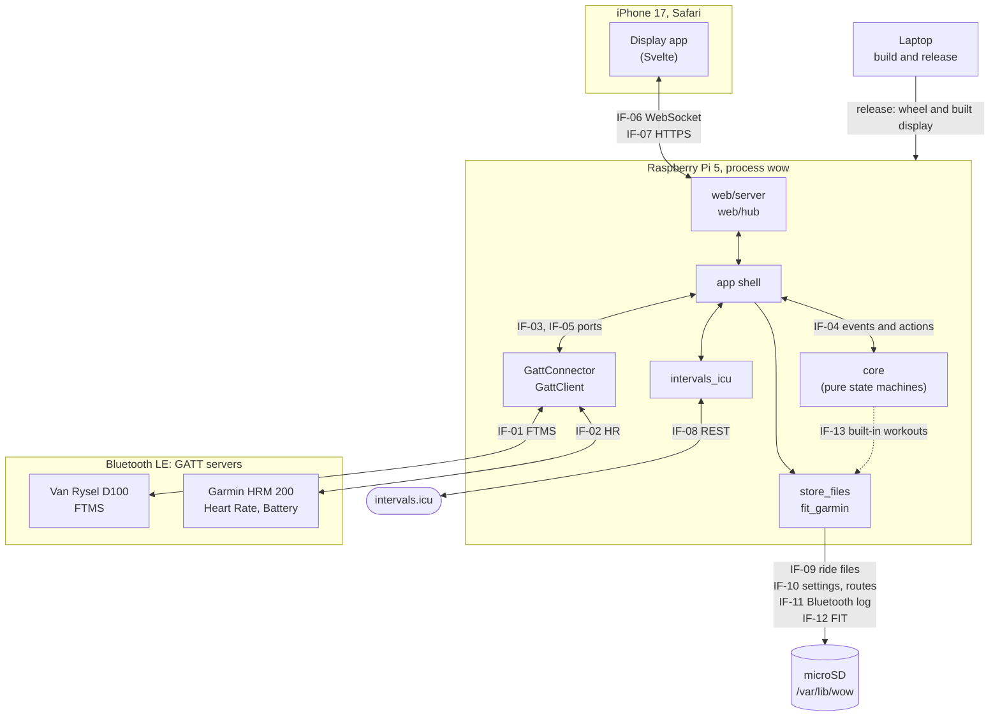

### 3.2 Interface list

| ID | Name | Type | Provider (fixed or developed) | Consumer | Medium | Initiated by | Priority | Requirements |
|----|------|------|-------------------------------|----------|--------|--------------|----------|--------------|
| IF-01 | Fitness Machine Service | External hardware | D100 (fixed) | `ftms_codec`, `ftms_session` | Bluetooth LE, GATT | App (client) | must | APP-101 to APP-110, APP-501 to APP-506, APP-801 |
| IF-02 | Heart Rate and Battery services | External hardware | HRM 200 (fixed) | `hr_codec` | Bluetooth LE, GATT | App (client) | must | APP-111 to APP-113 |
| IF-03 | Bluetooth ports | Internal software | Connectors (developed) | App shell | Python calls | App shell | must | APP-819, APP-820, APP-822 |
| IF-04 | Core state-machine contract | Internal software | Core (developed) | App shell | Python calls | App shell | must | APP-804, APP-812, APP-821 |
| IF-05 | Device ports | Internal software | `device_manager` (developed) | Controllers | Python calls | Controllers | must | APP-102, APP-318, APP-319 |
| IF-06 | Display WebSocket | Human-machine | `web/hub` (developed) | Display (developed) | WebSocket over TLS, Wi-Fi | Display | must | APP-401 to APP-416, APP-802, APP-803, APP-807, APP-902, APP-906, APP-909, APP-910 |
| IF-07 | HTTP endpoints | Human-machine | `web/server` (developed) | Safari (fixed) | HTTPS, HTTP | Safari | must | APP-410, APP-610, APP-816 |
| IF-08 | intervals.icu REST | External service | intervals.icu (fixed) | `intervals_icu` | HTTPS, internet | App | must | APP-201, APP-202, APP-210, APP-607 to APP-609, APP-613, APP-817, APP-818 |
| IF-09 | Ride files | Storage | `recorder` (developed) | `recovery`, history, tests | Files on microSD | App | must | APP-208, APP-601 to APP-612, APP-808, APP-809, APP-814, APP-903, APP-908 |
| IF-10 | Settings, configuration and routes | Storage | `store_files`, installer, rider (developed; GPX files from third parties) | `main`, settings, `route_catalog` | Files on microSD | App, installer, rider | must | APP-701 to APP-709, APP-817, APP-901, APP-902, APP-907 |
| IF-11 | Bluetooth log and replay | Storage | `ble_log` (developed) | `ble_replay`, tests | Files | App | must | APP-813, APP-820 |
| IF-12 | FIT activity file | Storage, external format | `fit_garmin` (developed) | intervals.icu, Garmin Connect (fixed) | File | App | must | APP-601, APP-604, APP-605, APP-815, APP-904 |
| IF-13 | Built-in workout files | Storage | Repository (developed) | `workout_catalog`, `intervals_doc` | Files in the package | App | should | APP-211 |

## 4 Interface definitions

### 4.1 IF-01 Fitness Machine Service (D100)

#### 4.1.1 Identification

| Item | Value |
|------|-------|
| Provider | Van Rysel D100, firmware 0.108 (F-16): GATT server, fixed |
| Consumer | `ftms_codec` and `ftms_session`, through `GattClient`: GATT client, developed |
| Medium | Bluetooth LE, one connection at a time (Phase 0) |
| Data rate | Indoor Bike Data at about 4 Hz (F-5, F-46) |

#### 4.1.2 Characteristics used

| Characteristic | UUID | Property used | When | Source |
|----------------|------|---------------|------|--------|
| Fitness Machine service | 0x1826 | scan filter, service data | Scan | RD-09; F-14 |
| Fitness Machine Feature | 0x2ACC | read | Every connect | RD-09 |
| Supported Resistance Level Range | 0x2AD6 | read | Every connect | RD-09; A-20 |
| Supported Power Range | 0x2AD8 | read | Every connect | RD-09 |
| Supported Inclination Range | 0x2AD5 | read | Every connect, logged only | RD-09 |
| Indoor Bike Data | 0x2AD2 | notify | Every connect | RD-09; F-1 |
| Fitness Machine Control Point | 0x2AD9 | write with response, indicate | Every connect | RD-09; F-7 |
| Fitness Machine Status | 0x2ADA | notify | Every connect | F-8, F-29 |
| Cycling Power service | 0x1818 | not used | — | D-18; F-4 |

#### 4.1.3 Data elements

| Name | Meaning | Type | Unit | Range on the D100 | Resolution | Source |
|------|---------|------|------|-------------------|------------|--------|
| `features` | Fitness Machine Features | uint32 | bit field | `0x00004001` | — | RD-01 Table 4.3 |
| `target_features` | Target Setting Features | uint32 | bit field | `0x0000A00C` | — | RD-01 Table 4.4 |
| `power_range` | Supported Power Range | sint16, sint16, uint16 | W | 50 to 600 | 1 | RD-02 |
| `inclination_range` | Supported Inclination Range | sint16, sint16, uint16 | 0.1 % | 0 to 60 raw (0 to 6.0 %) | 1 raw | RD-02 |
| `resistance_range` | Supported Resistance Level Range | 6 bytes: sint16, sint16, uint16 (FTMS 1.0); or 3 bytes: uint8 × 3 (current GSS) | raw, unitless | 0 to 100 | 1 | RD-02; A-20, A-37 |
| `power` | Instantaneous Power | sint16 | W | 0 to about 600 | 1 | RD-02 |
| `speed_kmh` | Instantaneous Speed | uint16 | 0.01 km/h | 0 to about 60 | 0.01 | RD-02 |
| `cadence_rpm` | Instantaneous Cadence (if declared) | uint16 | 0.5 rpm | not declared on the D100 | 0.5 | RD-02; A-7 |
| `level_raw` | Resistance level written | uint8 | 0.1 raw step | 0 to 100 | 1 | A-38 |
| `target_power` | Target power written | sint16 | W | 50 to 600 | 1 | RD-01 Table 4.15 |

**Feature bits read:**

| Field | Bit | Meaning | D100 | App use |
|-------|-----|---------|------|---------|
| `features` | 1 | Cadence supported | 0 | APP-109, APP-115 |
| `features` | 14 | Power measurement supported | 1 | Power shown and recorded |
| `target_features` | 2 | Resistance target setting supported | 1 | Resistance mode offered (APP-103) |
| `target_features` | 3 | Power target setting supported | 1 | ERG offered (APP-103) |
| `target_features` | 15 | Spin down control supported | 1 | Calibration offered (APP-501) |

**Range decoding:** the resistance layout is picked by length (6 or 3 bytes); any other length disables resistance mode for that connection and logs the raw value. Resistance in percent (**design**): `pct = (raw − min) / (max − min) × 100`; the inverse rounds to the trainer's step. For the D100 raw and percent coincide.

#### 4.1.4 Messages

**Indoor Bike Data (0x2AD2, notify).** Flags (uint16) decide which fields follow, in this order. A field is present when its bit is 1, except Instantaneous Speed, which is present when bit 0 (More Data) is **0** (RD-02).

| Bit | Field | Type | Unit | App use |
|-----|-------|------|------|---------|
| 0 | More Data (inverted: Instantaneous Speed present when 0) | uint16 | 0.01 km/h | Spin-down guidance (APP-502) |
| 1 | Average Speed | uint16 | 0.01 km/h | skipped |
| 2 | Instantaneous Cadence | uint16 | 0.5 rpm | only if cadence is declared (APP-109) |
| 3 | Average Cadence | uint16 | 0.5 rpm | skipped |
| 4 | Total Distance | uint24 | m | skipped |
| 5 | Resistance Level | width from the range layout (A-37) | raw | logged |
| 6 | Instantaneous Power | sint16 | W | **power** (D-18) |
| 7 | Average Power | sint16 | W | skipped |
| 8 | Expended Energy | uint16, uint16, uint8 | kcal, kcal/h, kcal/min | skipped |
| 9 | Heart Rate | uint8 | bpm | skipped (the strap is the source) |
| 10 | Metabolic Equivalent | uint8 | 0.1 | skipped |
| 11 | Elapsed Time | uint16 | s | skipped |
| 12 | Remaining Time | uint16 | s | skipped |

A D100 record with flags `0x0040` (power only, speed implied) at 28.60 km/h and 200 W:

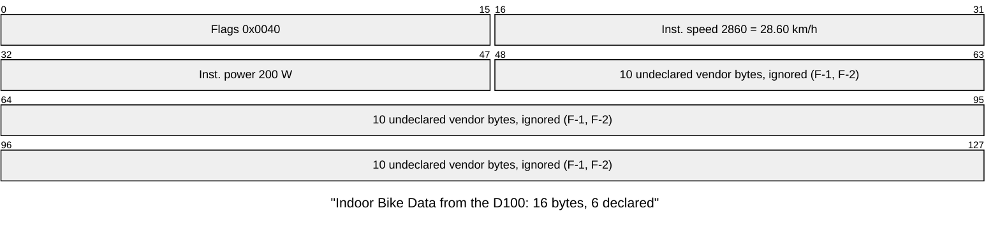

Bytes on the wire: `40 00 2C 0B C8 00` followed by 10 vendor bytes.

**Control point requests (0x2AD9, write with response).** The app sends these five (AD-16):

| Procedure | Op | Parameter | Example | Source |
|-----------|----|-----------|---------|--------|
| Request Control | `0x00` | none | `00` | RD-01 Table 4.15; F-7 |
| Set Target Resistance Level | `0x04` | uint8 in steps of 0.1, in the same raw units as the resistance range | `04 32` = raw 50 | A-38; F-12 |
| Set Target Power | `0x05` | sint16, W | `05 C8 00` = 200 W | RD-01 Table 4.15; F-7 |
| Start or Resume | `0x07` | none | `07` | A-25; F-7, F-26 |
| Spin Down Control | `0x13` | uint8: `0x01` start, `0x02` ignore | `13 01` | A-25; F-30, F-37 |

**Control point response (indicate):** `80 <request op> <result> [parameters]`. Spin Down Control with `0x01` and Success carries Target Speed Low and High, each uint16 in 0.01 km/h (D100: 0 and 40 km/h, F-30).

**Fitness Machine Status (0x2ADA, notify):**

| Code | Meaning | Parameter | Source |
|------|---------|-----------|--------|
| `0x01` | Reset | none | A-41 |
| `0x14` | Spin Down Status | uint8: `01` requested, `02` success, `03` error, `04` stop pedaling; the D100 adds 2 bytes to Success (F-37) | A-25 |
| `0xFF` | Control Permission Lost | none | A-25 |
| other | e.g. target changed | varies | kept only in the Bluetooth log (IM-10) |

#### 4.1.5 Protocol and timing

**Constants** (unit per AD-20: seconds unless suffixed):

| Constant | Value | Unit | Source |
|----------|-------|------|--------|
| `CONNECT_TIMEOUT` | 10 | s | Phase 2 spikes (bleak's default is 30 s) |
| `NOT_RESPONDING_WARN` | 3 | s | APP-107 |
| `PROCEDURE_TIMEOUT` | 30 | s | A-48 |
| `REGAIN_INTERVAL` | 2 | s | APP-105; counted from the previous request's write, not from the refusal (IM-06) |
| `EXPECTED_RESET_WINDOW` | 1.0 | s | F-29 measured 0.2 to 0.3 s; **design** margin |
| `STATUS_DEDUP` | 0.5 | s | F-9; **design** |
| `DATA_DROPOUT` | 3 | s | Phase 1 term "dropout"; APP-405 |
| `SILENT_LINK_RESET` | 10 | s | **design**: the D100's longest gap in 75 min was 0.49 s (F-46) |
| `IDLE_RELEASE` | 600 | s | APP-110 |
| `SPINDOWN_TIMEOUT` | 120 | s | APP-504 |
| `FIRST_POWER_MIN` | 1 | W | APP-301; A-60 |

**Trainer session state machine:**

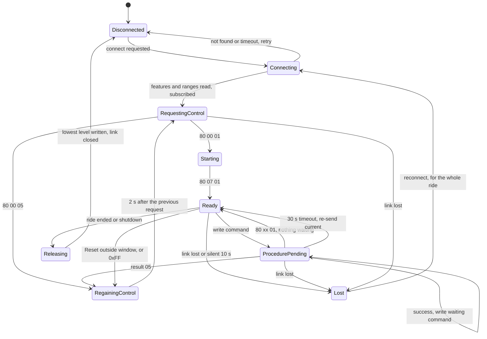

A desired command can be set in any state. It is written only from Ready and replaced, never queued (APP-106). After every return to Ready the current command is re-sent (APP-105, APP-318). A release clears the current command, so a later connection never re-applies an old target (IM-09).

**Spin-down in the session (Phase 5, IM-100):** the session takes a `SpinDown` event and writes `13 01` once control is held; it hands the answer on as the action `SpinDownAnswered` (result code, and the band in km/h when the trainer returned one), which `core/spindown` follows through Stop Pedaling, Success and Error to the 120 s timeout. After any end of a spin-down the trainer goes to its lowest level.

**S-1, connect and take control:**

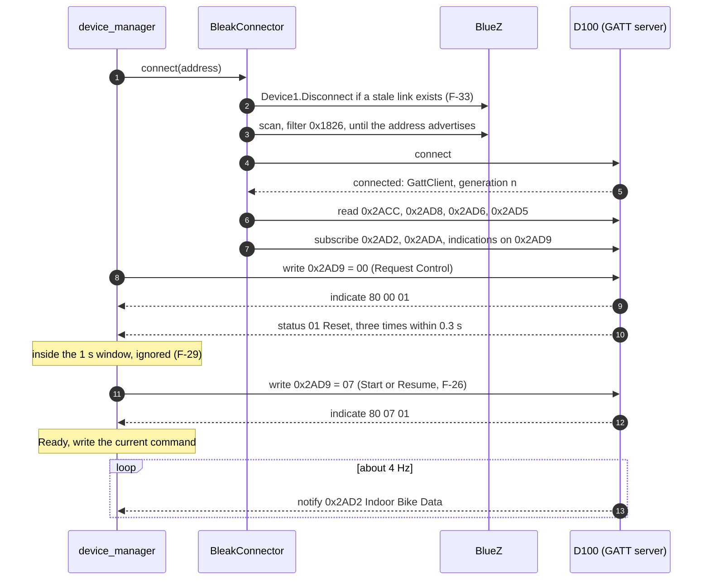

**S-2, targets falling due while a procedure is pending:**

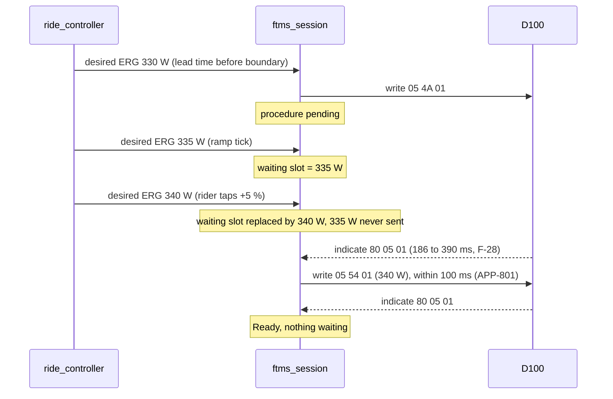

**S-3, control lost or trainer reset:**

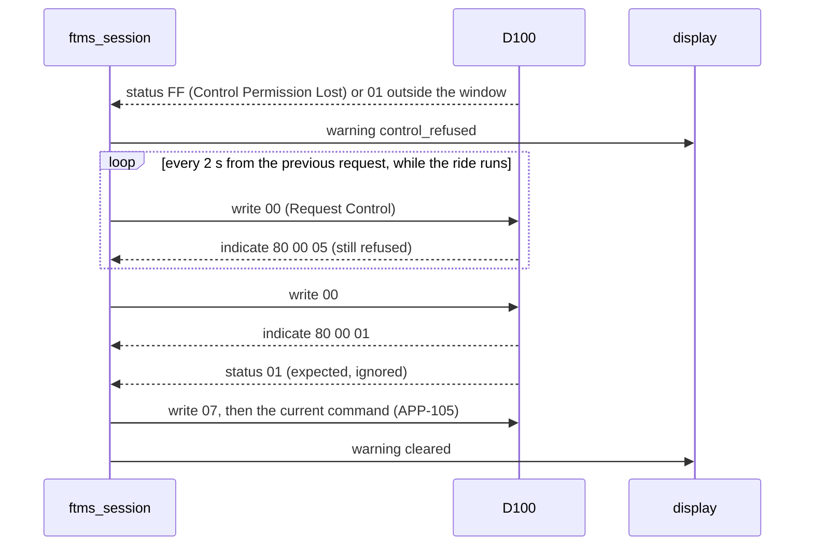

**S-4, link loss and reconnect:**

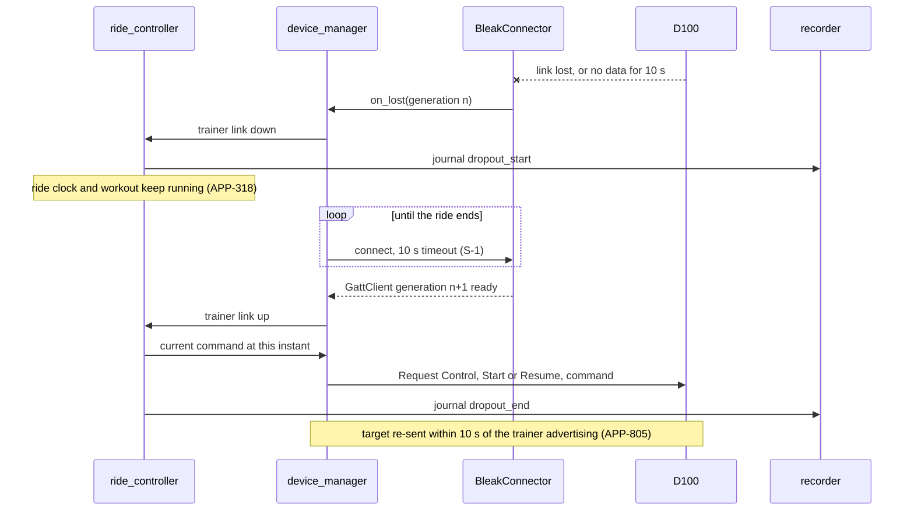

Disconnect reports carrying an old generation, or arriving while a connect is in progress, are dropped (F-32).

**S-5, spin-down:**

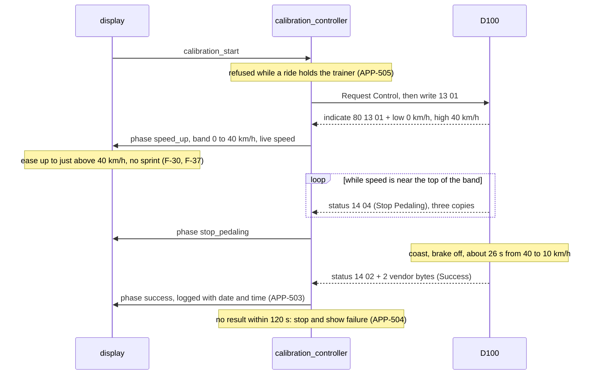

**S-6, orderly release:**

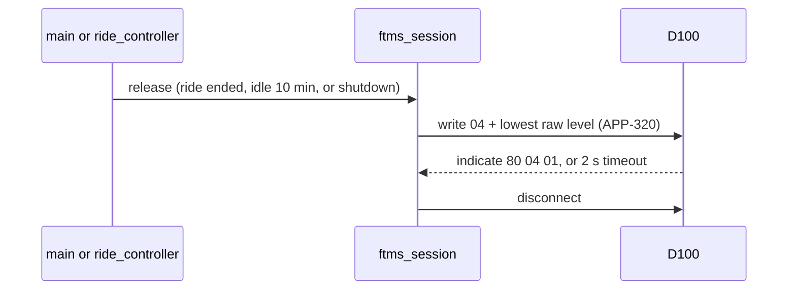

A release before control is granted, or on a trainer without a resistance range, closes the link at once (IM-09).

#### 4.1.6 Error handling

| Condition | Reaction | Requirement |
|-----------|----------|-------------|
| Result `0x02` Op Code not supported | Log; mark the mode unavailable for this connection | APP-103 |
| Result `0x03` Invalid Parameter | Log with the bytes; the last command the trainer accepted becomes the current one again, so a reconnect sends that, not the refused one (IM-08) | — |
| Result `0x04` Operation Failed | Log; retry once after 2 s; if that fails too, warn `trainer_not_responding` and send the command again every 30 s until it succeeds (IM-07) | APP-107 |
| Result `0x05` Control Not Permitted | Regain control (S-3) | APP-105 |
| No answer within 3 s | Warn "trainer not responding"; at 30 s treat as failed and re-send | APP-107 |
| Reset (`0x01`) outside the 1 s window, or `0xFF` | Regain control (S-3) | APP-105 |
| Same status within 0.5 s | Ignore (the D100 sends each three times, F-9) | — |
| Indoor Bike Data shorter than its flags declare | Drop the record, log it | APP-108 |
| More Data set | Hold and join with the next record (RD-01 4.1; never seen on the D100, F-3) | APP-108 |
| No data for 3 s | Dropout shown | APP-405 |
| No data for 10 s, link still up | Close the link and reconnect (S-4) | APP-318 |
| Target outside the power range | Send the nearest limit; notice `target_limited` | APP-303 |
| Release | The current command is cleared (IM-09) | APP-320 |

### 4.2 IF-02 Heart Rate and Battery (HRM 200)

#### 4.2.1 Identification

| Item | Value |
|------|-------|
| Provider | Garmin HRM 200: GATT server, fixed |
| Consumer | `hr_codec` through `GattClient`, developed |
| Medium | Bluetooth LE; the strap allows up to 3 connections (A-8) |
| Data rate | Heart rate about 2 Hz, battery about every 2 s (F-5, F-15) |

#### 4.2.2 Data elements

| Name | Characteristic | UUID | Property | Type | Unit | Range | Source |
|------|----------------|------|----------|------|------|-------|--------|
| — | Heart Rate service | 0x180D | scan filter | — | — | — | F-14 |
| `heart_rate_bpm` | Heart Rate Measurement | 0x2A37 | notify | uint8 or uint16 (flag bit 0) | bpm | 30 to 220 expected | RD-02 |
| `rr` | RR intervals in the same record (flag bit 4) | 0x2A37 | notify | uint16 each | 1/1024 s on the wire, stored in s | — | RD-02 |
| `battery_pct` | Battery Level | 0x2A19 | read, notify | uint8 | % | 0 to 100; other values reserved | A-21 |

Heart Rate Measurement layout: flags (uint8; bit 0 value width, bits 1–2 sensor contact, bit 3 energy expended present, bit 4 RR intervals present), the value, then energy (uint16) if present, then RR intervals.

#### 4.2.3 Protocol

Connect: release a stale link, connect, read Battery Level, subscribe to 0x2A37 and 0x2A19. Reconnect as for the trainer, without control steps (APP-806). The device manager connects one device at a time, because BlueZ answered `InProgress` to a second connect (IM-64, SF-5).

#### 4.2.4 Error handling

| Condition | Reaction | Requirement |
|-----------|----------|-------------|
| Heart rate 0 | Recorded as missing (**design**: the strap can't report contact, F-15) | APP-603 |
| Battery outside 0 to 100 | Shown as unknown; raw value logged | APP-113 |
| Strap not found at Start | Ride starts; heart rate shown as missing | APP-116 |
| Link lost | Reconnect for the rest of the ride; no banner | APP-319 |

### 4.3 IF-03 Bluetooth ports

#### 4.3.1 Identification

| Item | Value |
|------|-------|
| Provider | `BleakConnector` (real), `SimConnector` (simulator), `ReplayConnector` (replay), each optionally wrapped by `LoggingConnector` |
| Consumer | `device_manager`, `ftms_trainer` |
| Roles | The app is the GATT client; the D100, the HRM 200 and the simulator's servers are GATT servers (RD-03, AD-21) |

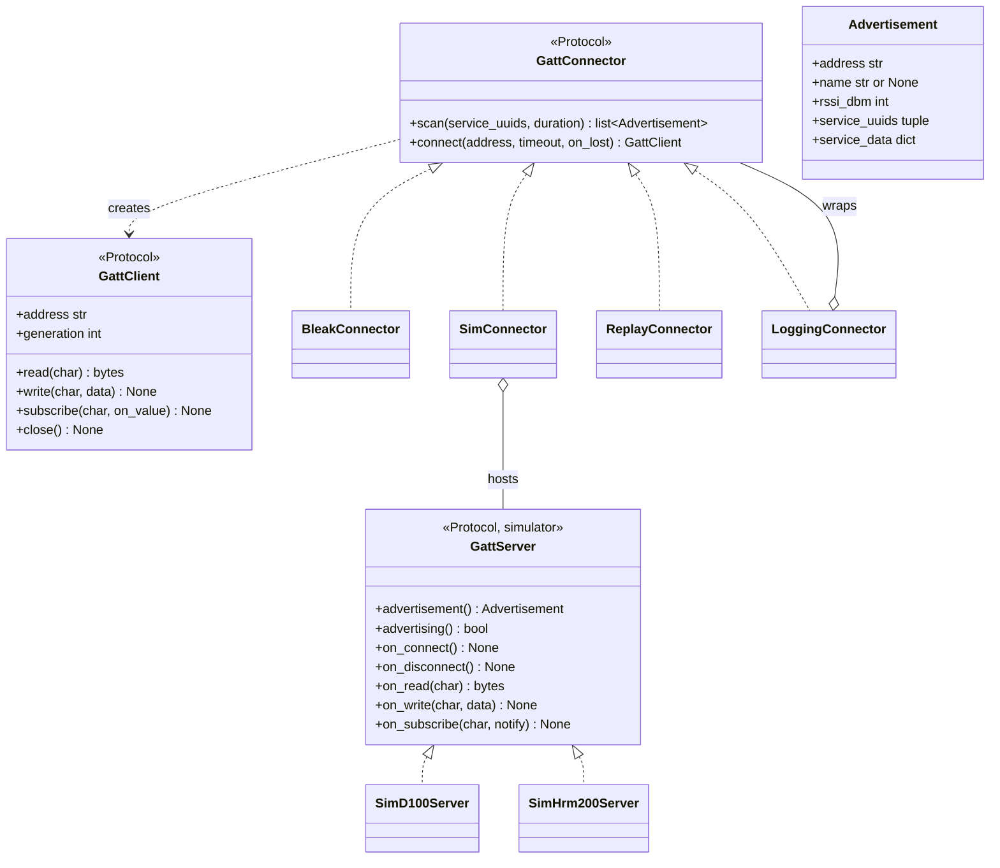

#### 4.3.2 Definitions

```python
Uuid = str  # full 128-bit, lower case


@dataclass(frozen=True)
class Advertisement:
    address: str
    name: str | None
    rssi_dbm: int
    service_uuids: tuple[Uuid, ...]
    service_data: Mapping[Uuid, bytes]


class GattError(Exception): ...
class LinkLost(GattError): ...
class GattTimeout(GattError): ...
class DeviceNotFound(GattError): ...


class GattClient(Protocol):
    address: str
    generation: int

    async def read(self, char: Uuid) -> bytes: ...
    async def write(self, char: Uuid, data: bytes) -> None: ...
    async def subscribe(self, char: Uuid, on_value: Callable[[bytes], None]) -> None: ...
    async def close(self) -> None: ...


class GattConnector(Protocol):
    async def scan(self, service_uuids: Sequence[Uuid], duration: float) -> list[Advertisement]: ...
    async def connect(
        self, address: str, timeout: float, on_lost: Callable[[int], None]
    ) -> GattClient: ...


class GattServer(Protocol):
    def advertisement(self) -> Advertisement: ...
    def advertising(self) -> bool: ...
    def on_connect(self) -> None: ...
    def on_disconnect(self) -> None: ...
    def on_read(self, char: Uuid) -> bytes: ...
    def on_write(self, char: Uuid, data: bytes) -> None: ...
    def on_subscribe(self, char: Uuid, notify: Callable[[bytes], None]) -> None: ...
```

| Element | Unit | Notes |
|---------|------|-------|
| `duration` | s | Scan length |
| `timeout` | s | Connect timeout |
| `generation` | count | Increases with every connection to the address; `on_lost` receives it, so a stale report can be told apart (F-32) |
| `write` | — | Always a write with response |
| `advertising()`, `on_connect()`, `on_disconnect()` | — | Simulator only: a server that stops advertising while linked, as the D100 does (F-33; IM-15) |

#### 4.3.3 Mapping to bleak 3.0.2 (RD-04)

| Port | bleak |
|------|-------|
| `scan` | `BleakScanner.discover(timeout=duration, return_adv=True, service_uuids=[...])` |
| `connect` | `BleakClient(address, disconnected_callback=..., timeout=timeout)` then `connect()`, after the D-Bus release of the spike's `bluez_release.py` |
| `read` | `read_gatt_char(char)` |
| `write` | `write_gatt_char(char, data, response=True)` |
| `subscribe` | `start_notify(char, callback)`; the callback gets the characteristic and a `bytearray` |
| `close` | `disconnect()` |

#### 4.3.4 Simulator

`SimConnector` delivers notifications from its servers on the test's clock (stepped) or in real time (`wow --sim`). `SimD100Server` behaves as listed in 3A, "Simulated devices"; faults are scripted by ride time: link loss and return, silence without link loss, refused control, no answer to a write, Control Permission Lost, a trainer reset, battery out of range, a strap that never appears, power stuck at 0 W, and the Bluetooth adapter failing, where `scan` and `connect` raise `GattError` for a scripted time (Phase 4).

### 4.4 IF-04 Core state-machine contract

#### 4.4.1 Definition

```python
class StateMachine(Protocol[E, A]):
    def handle(self, event: E, now: float) -> list[A]: ...
    def next_deadline(self) -> float | None: ...


class Clock(Protocol):
    def monotonic(self) -> float: ...
    def utc(self) -> datetime: ...
    def synchronised(self) -> bool: ...
    async def sleep_until(self, mono: float) -> None: ...
```

| Element | Unit | Notes |
|---------|------|-------|
| `now` | s, monotonic | Never UTC (AD-08) |
| `next_deadline()` | s, monotonic | The shell sends `Tick()` when it is reached |
| `Clock.monotonic()` | s | The only source of `now` |
| `Clock.utc()` | UTC date and time | For output stamps only |
| `Clock.sleep_until(mono)` | s, monotonic | The only way the app shell waits (AD-22). It returns at once when `mono` has passed. The stepped clock of the tests wakes sleepers in deadline order when the test moves time on (A-61) |

Events and actions are frozen dataclasses with JSON forms, so a test is a list of `(now, event)` in and a list of actions out, stored in `testdata/` (APP-821).

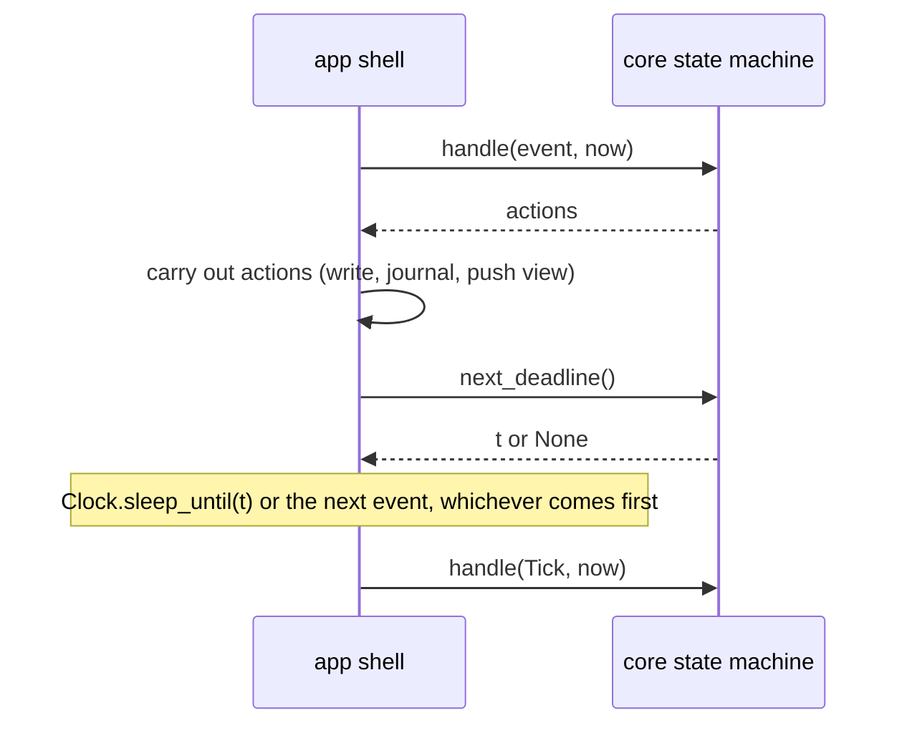

#### 4.4.2 Ride state machine: data elements

As built in Phase 5 (IM-69, IM-91, IM-109); `core/ride` also owns when each command goes out: the lead time, ramp ticks and the free-ride level (IM-84).

| Event in | Fields | Unit | Requirement |
|----------|--------|------|-------------|
| `Start` | `workout` (a one-step free-ride workout for a free ride, IM-76), `ftp`, `capabilities` (the trainer's ranges), `lead_time`, `intensity_pct = 100`, `free_ride_level_pct`, `block_modes` | —, W, —, s, %, %, — | APP-301, APP-317 |
| `CancelStart` | — | — | APP-301 |
| `PowerSeen` | `power` | W | APP-301, APP-825 |
| `Pause`, `Resume`, `Skip`, `Finish`, `Discard` | — | — | APP-311, APP-312, APP-315, APP-316 |
| `IntensityStep` | `step: +1 or −1` | 5 % points | APP-313 |
| `SwitchMode` | `mode: erg or resistance`; `power`: the 3 s average at the tap, or none | —, W | APP-307, APP-317 |
| `ResistanceStep` | `step: +1 or −1` | 5 % of range | APP-308 |
| `FreeRidePowerStep` | `step: +1 or −1` | 5 W | APP-317 |
| `TrainerLink`, `HrmLink` | `up: bool` | — | APP-318, APP-319 |
| `Tick` | — | — | — |
| `Recovered` | — (the rider continued the ride after the app's outage; the 30-minute watch starts again) | — | APP-809, APP-825 |

| Action out | Fields | Unit | Requirement |
|------------|--------|------|-------------|
| `SetTrainer` | `command: Erg(power) or Resistance(level_raw)` | W, raw | APP-302, APP-308 |
| `Journal` | `event`, `t_ride`, `data`: one `events.jsonl` record (4.9.2). The ride's start, step starts, the workout's end and notices such as `target_limited` are journal records | —, s, — | APP-301, APP-303, APP-314, APP-605, APP-814 |
| `Refused` | `reason`: `not_riding` or `invalid_state` | — | APP-408 |
| `Ended` | `finished`, `discarded` or `cancelled`; a finish after 30 idle minutes journals cause `idle` | — | APP-315, APP-316, APP-825 |
| `FreeRideLevel` | `level_pct`: kept for later rides | % | APP-705 |

Each accepted rider control is journalled as a `command` record with its name and arguments; a refused one gives `Refused` (IM-69).

| Constant | Value | Unit | Requirement |
|----------|-------|------|-------------|
| `ABANDON_AFTER` | 1800 | s | APP-825; counts in Running, Paused and WorkoutDone, and starts again at every power above 0 W and every rider action. Each reading checks the deadline instead of moving it, so four readings a second don't reset a timer. A ride rebuilt from its journal doesn't watch until `Recovered` (IM-109) |
| `ARMED_TIMEOUT` | 1800 | s | **design**: an armed ride nobody pedals returns to Pre-ride with nothing recorded |
| `FREE_RIDE_POWER_STEP` | 5 | W | APP-317 |

**Free ride (APP-317).** A ride started without a plan behaves as one free-ride step with no end (24 h, `ref` `free_ride`): at `Start` the command is `Resistance` at the free-ride level (APP-705), and `ResistanceStep` changes it. `SwitchMode(erg)` sets `Erg` to the event's `power`, rounded to 5 W and limited to the trainer's power range; with no power in the last 3 s it is the range's lowest value. `FreeRidePowerStep` then moves the target by 5 W inside the range, and `SwitchMode(resistance)` returns to the level last used. The lead time and the intensity don't apply. The level the rider sets in a free ride or a free-ride step is kept as `free_ride_level_pct` in `settings.json` (IM-76).

#### 4.4.3 Ride state machine: states

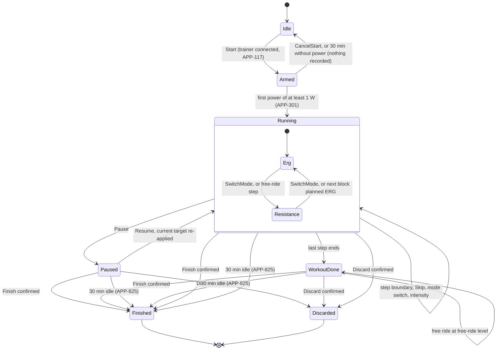

**Armed:** the first step's command is sent at Start, so the trainer already holds the right load when the rider clips in. Ride time stays at 0, nothing is sampled or recorded, and the display shows "Start pedaling". The first Indoor Bike Data record with `power` of at least 1 W moves the ride to Running at that record's `mono`: ride time 0, first sample, first FIT record and timer start all take that instant. Trainer and strap link states are independent of this machine: losing a link never changes the ride state (APP-318, APP-319).

**Idle finish:** a ride left alone for 30 minutes finishes as with Finish from Running, WorkoutDone and Paused alike (APP-825, Phase 4): a paused ride would otherwise hold the trainer's only connection for good.

### 4.5 IF-05 Device ports

```python
@dataclass(frozen=True)
class Range:
    minimum: int
    maximum: int
    step: int


@dataclass(frozen=True)
class TrainerCapabilities:
    power: Range | None          # W; None: ERG not offered
    resistance: Range | None     # raw; None: resistance mode not offered
    spin_down: bool
    cadence: bool


@dataclass(frozen=True)
class Erg:
    power: int                   # W


@dataclass(frozen=True)
class Resistance:
    level_raw: int


TrainerCommand = Erg | Resistance

LinkState = Literal["not_configured", "searching", "connected", "not_found", "dropout"]


@dataclass(frozen=True)
class TrainerSample:
    mono: float                  # s
    power: int | None            # W
    speed_kmh: float | None
    cadence_rpm: float | None


@dataclass(frozen=True)
class HrSample:
    mono: float                  # s
    heart_rate_bpm: int | None
    rr: tuple[float, ...]        # s


class Trainer(Protocol):
    def capabilities(self) -> TrainerCapabilities | None: ...
    def link(self) -> LinkState: ...
    def set_command(self, command: TrainerCommand) -> None: ...  # latest wins
    def responding(self) -> bool: ...                             # False after 3 s without an answer
    def in_control(self) -> bool: ...


class HeartRateMonitor(Protocol):
    def link(self) -> LinkState: ...
    def battery_pct(self) -> int | None: ...
```

The comments above state units, which the ICD requires for every data element; in the code they are carried by the names and by this table, and the comments are left out (code standard). In the code, closed sets of strings such as `LinkState` are `StrEnum`s (IM-47).

Samples reach the controllers through one callback each (`on_trainer_sample`, `on_hr_sample`), set when the device manager hands a device to a ride or calibration.

### 4.6 IF-06 Display WebSocket

#### 4.6.1 Identification

| Item | Value |
|------|-------|
| Provider | `web/hub` on the Pi, developed |
| Consumer | Display app in Safari on the iPhone 17, developed |
| Endpoint | `wss://wow.local/ws` |
| Framing | JSON text frames, one object per frame |
| Keep-alive | aiohttp `WebSocketResponse(heartbeat=5)` (RD-05; **design**: a dead phone is noticed within about 10 s) |
| Rates | View on every change, at most 10 per second, at least 1 per second |

#### 4.6.2 Message flow

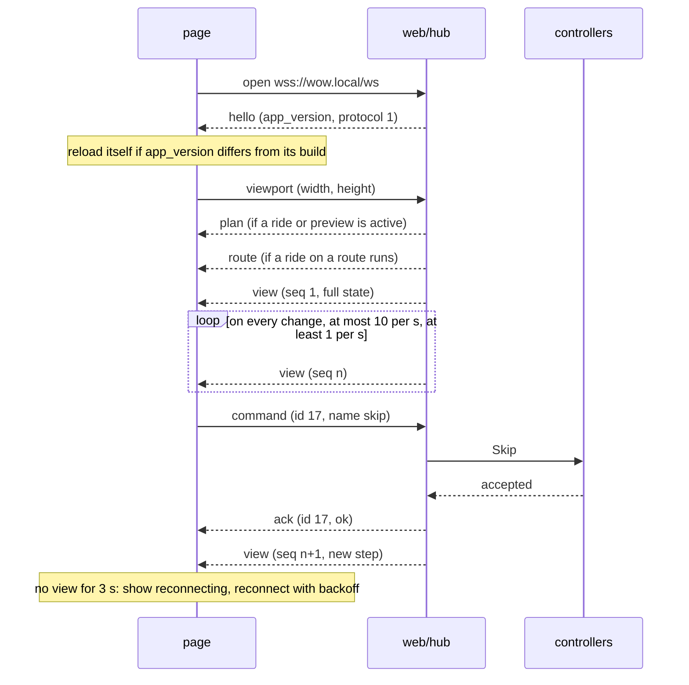

**Rules:** every `view` is complete, never a delta, so a dropped frame or a reload costs nothing (APP-807). `seq` grows by one per view; the page ignores a `view` whose `seq` is not above the last one. The page counts `step.left` down by itself between views from the moment of receipt (APP-404). The Pi stamps `recv_mono_ms` on every command and logs it in `timing.jsonl` with the page's `tap_mono_ms` and the start of the trainer write (APP-802; 4.6.7).

**Plan and route messages (Phase 5, IM-29, IM-89, IM-145).** The hub sends `plan` before the first view that needs it and again whenever `plan_id` changes. `plan_id` is `<ref>@<ftp>`; while the ride screen is open the plan carries its segments at the ride's intensity, and the id becomes `<ref>@<ftp>@<intensity>%` when the intensity isn't 100 %, so each intensity change sends the plan again. Pre-ride's plan stays at 100 %. The `route` message (the route's drawing and elevation profile, about 12 kB for the example route) goes once per page and route, before the first view whose `screen.route` names it; each view then carries only the place along the route.

#### 4.6.3 Messages, Pi to page (`display/src/types/protocol.ts`)

As built for app version 0.8.0.

```typescript
export type LinkState = "not_configured" | "searching" | "connected" | "not_found" | "dropout";
export type Mode = "erg" | "resistance";
export type StepKind = "erg" | "free_ride" | "unsupported";
export type UploadState =
  | "off" | "pending" | "uploading" | "done" | "retrying" | "failed" | "auth_error";

export interface Hello { type: "hello"; app_version: string; protocol: 1 }
export interface Ack { type: "ack"; id: number; ok: boolean; error?: string }
export interface Pong { type: "pong"; id: number; t_page_ms: number; pi_mono_ms: number }

export interface PlanSegment {
  start: number; end: number; block: number; step: number;
  mode: Mode; kind: StepKind;
  start_power: number | null; end_power: number | null; zone: number | null; text: string | null;
}
export interface PlanBlock {
  index: number; label: string; repeats: number; duration: number; mode: Mode;
  steps: { duration: number; kind: StepKind;
           start_power: number | null; end_power: number | null; zone: number | null }[];
}
export interface Plan { type: "plan"; plan_id: string; segments: PlanSegment[]; blocks: PlanBlock[] }

// Each point: distance along the route (m), x, y (north up, larger side 1000), elevation (m).
export interface RouteMap {
  type: "route"; route_id: string; name: string; length_m: number;
  width: number; height: number; ele_min: number; ele_max: number;
  points: [number, number, number, number][];
}
export interface RouteLive {
  route_id: string; speed_kmh: number; grade_pct: number; altitude_m: number;
  distance_m: number; at_m: number;
}

export type Warning =
  | { kind: "hrm_battery_low"; battery_pct: number }
  | { kind: "trainer_not_responding" }
  | { kind: "control_refused" }
  | { kind: "target_limited"; requested_power: number; sent_power: number }
  | { kind: "clock_unsynced" }
  | { kind: "storage_low"; free_mb: number }
  | { kind: "cert_expiring"; days_left: number }
  | { kind: "spindown_requested" }
  | { kind: "workouts_offline"; downloaded_utc: string };

export interface View {
  type: "view"; seq: number; sent_mono_ms: number;
  data_mono_ms: number | null;      // arrival of the newest trainer or strap value shown (APP-803)
  links: { trainer: LinkState; hrm: LinkState };
  hrm_battery_pct: number | null;
  warnings: Warning[];
  screen: Screen;
}

export type Screen =
  | HomeScreen | PreRideScreen | RideScreen | SummaryScreen
  | HistoryScreen | CalibrationScreen | SettingsScreen;

export interface WorkoutCard {
  ref: string; source: "plan" | "library" | "builtin";
  name: string; duration: number | null; rideable: boolean; max_power: number | null;
  sketch: { duration: number; start_power: number; end_power: number; zone: number }[] | null;
}
export interface HomeScreen {
  name: "home";
  today: WorkoutCard[]; library: WorkoutCard[]; builtin: WorkoutCard[];
  recovery: { ride_id: string; started_utc: string | null; outage: number | null; can_continue: boolean } | null;
}

export interface RouteOption { file: string; name: string; length_m: number; ascent_m: number }
export interface PreRideScreen {
  name: "pre_ride";
  title: string; free_ride: boolean; ftp: number; duration: number | null;
  plan_id: string | null; block_modes: Mode[];
  routes: RouteOption[]; route: string | null;   // the chosen route's file (APP-901, APP-902)
  can_start: boolean; blocked: "trainer_missing" | null;
}

export interface RideScreen {
  name: "ride";
  waiting_for_power: boolean;       // armed: shows "Start pedaling" (APP-301)
  mode: Mode;                       // chooses the ERG or resistance layout (APP-415)
  paused: boolean; workout_done: boolean;
  elapsed: number; remaining: number | null;
  step: { index: number; count: number; left: number; text: string | null } | null;
  target: number | null; target_zone: number | null; target_limited: boolean;
  power: number | null;             // 3 s average (APP-402)
  hr_bpm: number | null;
  next: { kind: "erg" | "free_ride"; target: number | null; zone: number | null; duration: number } | null;
  intensity_pct: number;
  resistance_pct: number | null;    // while paused: the level the ride resumes at (IM-78)
  free_ride_target: number | null;
  resistance_blocks: number[];      // blocks the rider set to resistance (IM-117)
  cadence_rpm: number | null;       // a trainer that declares cadence (APP-115)
  route: RouteLive | null;          // on a ride along a route (APP-909, APP-910)
}

export interface Metrics {
  duration: number; avg_power: number | null; max_power: number | null;
  np: number | null; intensity_factor: number | null; tss: number | null; work_kj: number;
  time_in_zone: number[]; avg_hr_bpm: number | null; max_hr_bpm: number | null;
}
export interface RiddenRoute { name: string; distance_m: number | null; ascent_m: number | null }
export interface SummaryScreen {
  name: "summary"; ride_id: string; title: string; start_utc: string; metrics: Metrics; upload: UploadState;
  past: boolean;                    // opened from Past rides: download, upload and delete offered (IM-98)
  route: RiddenRoute | null;        // APP-906
}

export interface HistoryScreen {
  name: "history";
  rides: { ride_id: string; start_utc: string | null; title: string; duration: number | null; tss: number | null;
           upload: UploadState }[];
  free_mb: number;
}

export interface CalibrationScreen {
  name: "calibration";
  phase: "idle" | "starting" | "speed_up" | "stop_pedaling" | "success" | "error" | "timeout";
  band_kmh: [number, number] | null; speed_kmh: number | null; elapsed: number;
  last: { utc: string; ok: boolean } | null;
  blocked: "ride_running" | "trainer_missing" | null;
}

export type DeviceKind = "trainer" | "hrm" | "cadence";
export interface FoundDevice { address: string; name: string | null; rssi_dbm: number; kind: DeviceKind }
export interface SettingsScreen {
  name: "settings";
  ftp: number; zones_pct: number[]; lead_time: number; battery_warn_pct: number; rider_kg: number;
  upload_on: boolean; intervals_account_set: boolean; cert_valid_until: string | null;
  trainer: { address: string; name: string | null } | null;
  hrm: { address: string; name: string | null } | null;
  scan: { kind: "trainer" | "hrm"; running: boolean; found: FoundDevice[] } | null;
}

export type Down = Hello | Plan | RouteMap | View | Ack | Pong;
```

#### 4.6.4 Data element dictionary (view)

| Element | Unit | Range | Notes |
|---------|------|-------|-------|
| `seq` | count | 1 upwards | Per connection |
| `sent_mono_ms`, `recv_mono_ms`, `data_mono_ms`, `tap_mono_ms`, `paint_mono_ms`, `pi_mono_ms` | ms, Pi monotonic | — | Latency logging (APP-802, APP-803; 4.6.7) |
| `t_page_ms` | ms, the page's own clock | — | Echoed in `pong` |
| `rtt_ms` | ms | ≥ 0 | Round trip of the ping the page's clock offset came from (4.6.7) |
| `start`, `end`, `duration`, `elapsed`, `remaining`, `left`, `outage`, `lead_time` | s | ≥ 0 | Ride time where it applies |
| `power`, `target`, `start_power`, `end_power`, `max_power`, `avg_power`, `np`, `ftp`, `free_ride_target`, `requested_power`, `sent_power` | W | 0 to 2000 | `null` when no value |
| `zone`, `target_zone` | zone number | 1 to 6 | App's zones (APP-702); `null` for free ride |
| `hr_bpm`, `avg_hr_bpm`, `max_hr_bpm` | bpm | 30 to 220 | `null` when missing |
| `cadence_rpm` | rpm | 0 to 200 | `null` without a cadence source |
| `intensity_pct` | % | 50 to 150 | APP-313 |
| `resistance_pct`, `battery_pct`, `hrm_battery_pct`, `battery_warn_pct`, `zones_pct` | % | 0 to 100 (zones 1 to 200) | — |
| `resistance_blocks` | block indices | — | Blocks set to resistance |
| `speed_kmh`, `band_kmh` | km/h | 0 to 80 | Calibration; the speed along a route |
| `grade_pct` | % | −25 to 25 | At the rider's place on the route (IM-129) |
| `altitude_m`, `ele_min`, `ele_max` | m | — | Smoothed route elevation |
| `length_m`, `distance_m`, `at_m`, `ascent_m` | m | ≥ 0 | Route length, distance ridden, place along the route, climb |
| `width`, `height`, `points[].x`, `points[].y` | drawing units | 0 to 1000 | The route drawn north up, the larger side 1000 (IM-144) |
| `rider_kg` | kg | 40 to 150 | APP-709 |
| `work_kj` | kJ | ≥ 0 | — |
| `time_in_zone` | s per zone | 6 values | Table M |
| `intensity_factor` | ratio | ≥ 0 | NP / FTP |
| `tss` | points | ≥ 0 | Table M |
| `free_mb` | MB | ≥ 0 | — |
| `days_left` | days | ≥ 0 | APP-830 |
| `rssi_dbm` | dBm | −100 to 0 | Scan list |
| `*_utc` | ISO 8601 | — | Display only |

The API key never appears in any message; Settings only says whether one is stored (APP-817).

#### 4.6.5 Messages, page to Pi

```typescript
export interface Command {
  type: "command"; id: number; name: CommandName; args?: Record<string, unknown>;
  tap_mono_ms?: number;             // the tap, on the Pi's clock (4.6.7)
  rtt_ms?: number;                  // round trip behind that clock offset (IM-118)
}
export interface Ping { type: "ping"; id: number; t_page_ms: number }
export interface Painted { type: "painted"; seq: number; paint_mono_ms: number; rtt_ms: number }
export interface Viewport { type: "viewport"; width: number; height: number }   // after each hello (IM-119)

export type Up = Command | Ping | Painted | Viewport;
```

| Name | Args | Valid on | Confirmed on the page | Requirement |
|------|------|----------|-----------------------|-------------|
| `open_workout` | `ref` | home | — | APP-203 |
| `open_free_ride` | — | home | — | APP-317 |
| `set_block_mode` | `block`, `mode` | pre_ride | — | APP-207 |
| `set_route` | `file`, or null for no route | pre_ride | — | APP-902 |
| `start` | — | pre_ride | — | APP-301 |
| `cancel_start` | — | ride, while waiting for power | — | APP-301 |
| `pause`, `resume` | — | ride | — | APP-311 |
| `skip` | — | ride | yes | APP-312, APP-408 |
| `intensity` | `step: 1 or −1` | ride | — | APP-313 |
| `switch_mode` | `mode` | ride | — | APP-307 |
| `resistance` | `step: 1 or −1` | ride | — | APP-308 |
| `free_ride_power` | `step: 1 or −1` | ride (free ride) | — | APP-317 |
| `finish` | — | ride | yes | APP-315, APP-408 |
| `discard` | — | ride | yes | APP-316, APP-408 |
| `back` | — | any but ride | — | — |
| `open_history`, `open_ride` | `ride_id` for `open_ride` | home, history | — | APP-611 |
| `upload_retry` | `ride_id` | summary (also a past ride's), history | — | APP-608, APP-609 |
| `delete_ride` | `ride_id` | history, a past ride's summary | yes | APP-612 |
| `open_calibration`, `calibration_start`, `calibration_cancel` | — | home, calibration | — | APP-501 to APP-505 |
| `open_settings`, `settings_set` | `key`, `value` | settings | — | APP-701 to APP-705, APP-709 |
| `intervals_account_set` | `athlete_id`, `api_key` | settings | — | APP-706 |
| `device_scan`, `device_choose` | `kind`; `address` for choose | settings | — | APP-114 |
| `recovery_continue`, `recovery_finish` | — | home | — | APP-809 |

The page's Start screen (3C) sends nothing: it only opens the page's view of Home. `set_route` can't be sent through `settings_set` (IM-133).

#### 4.6.6 Error handling

| Condition | Reaction |
|-----------|----------|
| Command not valid on the current screen, or not offered by the app | `ack ok=false, error="invalid_state"`; nothing changes (IM-27) |
| Malformed JSON or unknown command | `ack ok=false, error="bad_request"` (when `id` is readable); logged |
| A setting out of its range or step | `ack ok=false, error="invalid_value"`; the field and its range are logged (IM-104) |
| Calibration while a ride holds the trainer, or without a trainer | `ack ok=false, error="ride_running"` or `"trainer_missing"` (APP-505) |
| No view for 3 s | Page dims, shows the lost-Pi banner, reconnects with backoff 0.5, 1, 2, 4, then every 5 s (3C) |
| `hello.app_version` differs from the page's build | Page reloads itself |
| `tap_mono_ms` missing, or later than `recv_mono_ms` | The command is carried out; the tap is left out of `timing.jsonl` |

#### 4.6.7 Timing messages (Phase 4)

The tap and the paint happen on the phone, whose clock the Pi doesn't know. These messages let APP-802 and APP-803 be measured from the tap and to the paint, on every ride.

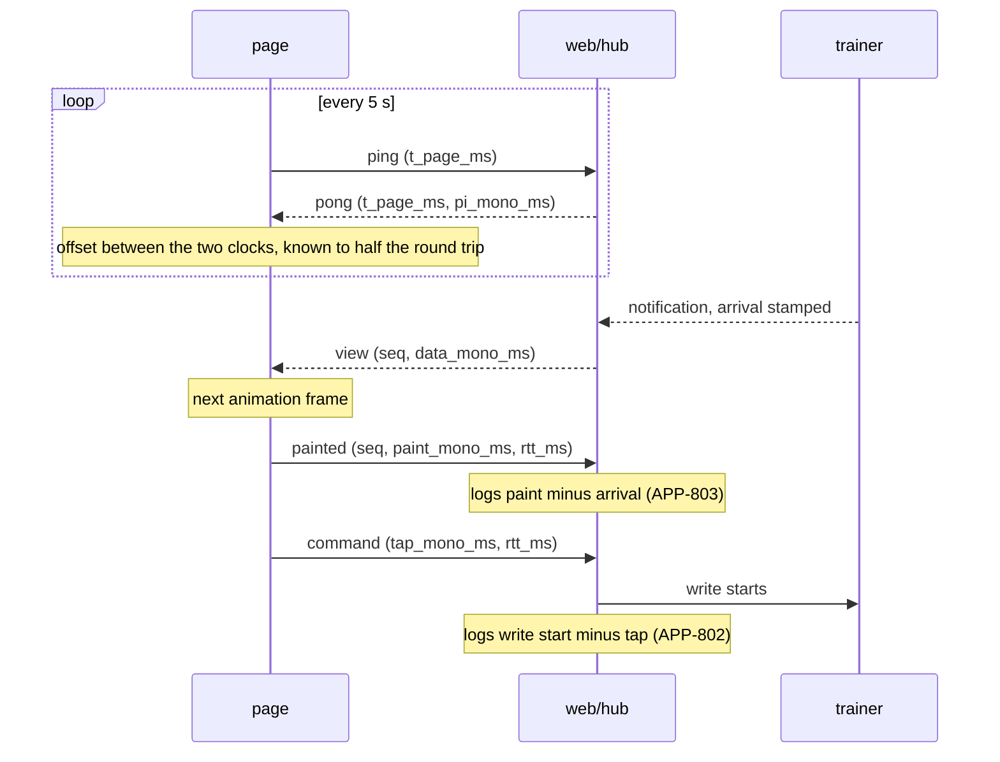

| Rule | Value |
|------|-------|
| `PING_INTERVAL` | 5 s (**design**) |
| Offset | From the ping with the shortest round trip in the last 60 s: `pi_mono_ms − (t_page_ms + round trip / 2)`. Its error is at most half that round trip, about 12 ms at the median Phase 2 measured (F-41) |
| `painted` | Sent for a view whose `data_mono_ms` is newer than the last one painted, from the animation-frame callback that follows its rendering (A-63); at most 10 per second. The hub keeps `data_mono_ms` and `sent_mono_ms` of the page's last 64 views (IM-118) |
| `tap_mono_ms` | The tap's time on the page's clock plus the offset; left out until a first `pong` has arrived |
| `rtt_ms` | Sent with every command and paint report: the round trip of the ping the offset came from |
| Outside a ride | Pings continue; nothing is logged |

### 4.7 IF-07 HTTP endpoints

| Port | Method and path | Response | Requirement |
|------|-----------------|----------|-------------|
| 443 | `GET /` | `index.html` of the built display, not cached; `503` "display not built" when there is no `index.html` (IM-30) | APP-410 |
| 443 | `GET /assets/*` | Built files with hashed names, cached for a year (`immutable`) | AD-17, AD-19 |
| 443 | `GET /ws` | WebSocket upgrade (IF-06) | APP-807 |
| 443 | `GET /rides/{ride_id}/ride.fit` | FIT file, `Content-Disposition: attachment`, name `wow-<yyyy-mm-dd>-<title>.fit`, the title reduced to letters, digits and dashes; the ride ID is checked against its pattern, so no path leaves `rides/` (IM-98) | APP-610 |
| 80 | `GET /setup/root.crt` | The private root certificate only, never a key | APP-816 |
| 80 | anything else | `301` to `https://wow.local` + same path; the HTTPS port is kept in `Location` when it isn't 443 (IM-30) | APP-816 |

Unknown paths on 443 answer `404`; a missing ride file answers `404` with a short text. The gallery (`https://wow.local/#gallery`, 3C) is the same `index.html`: the part after `#` never reaches the Pi.

### 4.8 IF-08 intervals.icu

#### 4.8.1 Identification

| Item | Value |
|------|-------|
| Provider | intervals.icu, fixed |
| Consumer | `adapters/intervals_icu`, the only module that talks to the internet (APP-818) |
| Base URL | `https://intervals.icu/api/v1` |
| Authentication | HTTP basic, user `API_KEY`, password the rider's key, sent as an `Authorization` header built with `aiohttp.encode_basic_auth`: aiohttp 3.14.5 marks `BasicAuth` and `ClientSession(auth=...)` deprecated, to go in aiohttp 4 (RD-05, RD-06; IM-54) |
| Timeout | `HTTP_TIMEOUT = 20` s per call (**design**) |

#### 4.8.2 Calls

| Call | Request | Used for | Source |
|------|---------|----------|--------|
| Planned workouts | `GET /athlete/{id}/events?oldest=<today>&newest=<today+6>` (local dates, `yyyy-MM-dd`) | Today's list and the 7-day cache (APP-201, APP-202). Kept: `category == "WORKOUT"` and `type == "Ride"` (F-24); the day from `start_date_local` | RD-06 |
| Library | `GET /athlete/{id}/workouts` | Library list (APP-210); kept: `type == "Ride"` | RD-06; A-35 |
| Upload | `POST /athlete/{id}/activities?name=<title>`, multipart field `file` with `ride.fit` (aiohttp `FormData.add_field("file", ..., filename=...)`) | APP-607. `201` created, `200` already known (A-53) | RD-06 |

Workouts are read from `workout_doc` (Phase 2 decision 8). A workout without one is listed with `rideable: false`. The catalog downloads when Home opens, at most once a minute, and keeps the answers in `cache/intervals.json` with `downloaded_utc`; with no cache, only the built-ins are listed and no warning shows (IM-55).

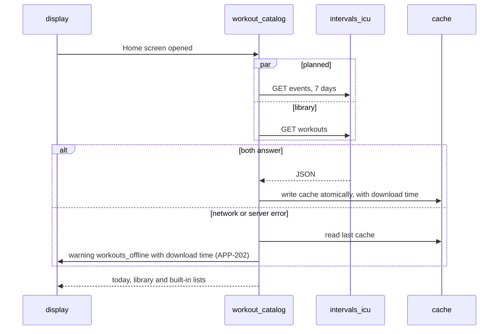

#### 4.8.3 Upload protocol

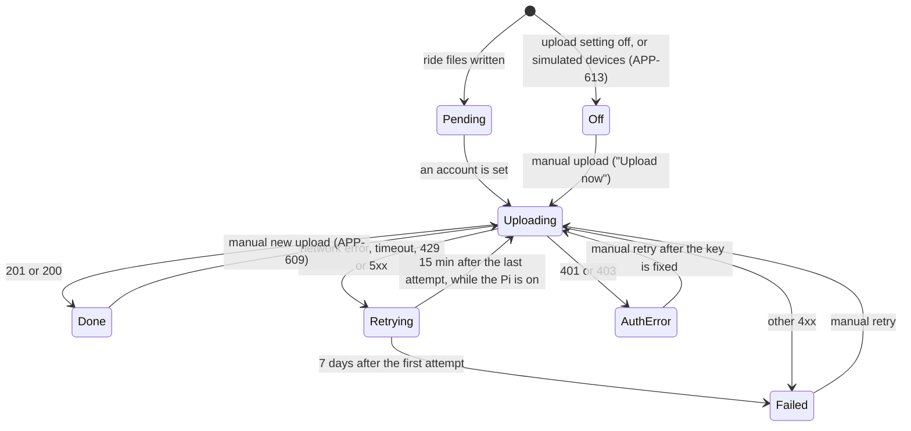

| Constant | Value | Unit | Requirement |
|----------|-------|------|-------------|
| `UPLOAD_RETRY_INTERVAL` | 900 | s | APP-608 |
| `UPLOAD_GIVE_UP_AFTER` | 604800 | s (7 days) | APP-608 |

The state lives in the ride's `meta.json`, so retries survive restarts (APP-608): `upload` (the state), `upload_first_utc`, `upload_last_utc` and `upload_attempts` (IM-97). One worker uploads; it waits until the ride's final `meta.json` is written. An upload found in `uploading` at start is retried. A manual retry starts the count over, also after `done`. Without an intervals.icu account nothing is sent and rides stay `pending`; an account entered in Settings starts them at once (IM-106). Rides on simulated devices start in `off`, whatever the setting says; "Upload now" on their Summary still sends one (IM-137).

### 4.9 IF-09 Ride files

#### 4.9.1 Structure

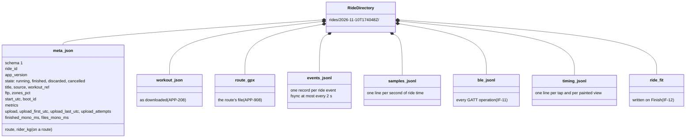

**Write rules:** JSON Lines files are append-only; each line ends with `\n`; a reader drops a last line without one. The recorder calls `fsync` at most every 2 s, and at once on `paused`, `dropout_start`, `dropout_end`, `finished` and `discarded` (APP-808; IM-51). `meta.json` and every other whole file are replaced atomically (temp file, `fsync`, rename, directory `fsync`). The directory is created at Start (armed), so the Bluetooth log of the wait is kept; the ride ID is the UTC time of Start, `YYYY-MM-DDTHHMMSSZ`. A ride cancelled while armed keeps its directory with `state: "cancelled"` and no samples, so its log stays for debugging (APP-316's rule for logs). A ride's files close 3 s after it ends, so the last trainer write and its answer land in its `ble.jsonl`; a ride started in those 3 s gets its own directory (IM-25).

**`meta.json`** is written whole at Start, at the first pedal stroke and at the end. Its fields beyond the diagram's names (IM-52, IM-97, IM-134, IM-146):

| Field | Unit | Notes |
|-------|------|-------|
| `finished_mono_ms` | ms, Pi monotonic | When the ride finished |
| `files_mono_ms` | ms, Pi monotonic | When `ride.fit` was on disk; RR-12 takes the difference |
| `upload_first_utc`, `upload_last_utc`, `upload_attempts` | ISO 8601, count | 4.8.3 |
| `route` | — | On a ride along a route: `file`, `name`; at Finish also `distance_m`, `ascent_m`, `descent_m` (m) and `max_speed_mps` (m/s) of the ride along it |
| `rider_kg` | kg | The weight the route model used (APP-709) |

`workout.json` holds the built-in's bytes, or an intervals.icu entry's JSON written again, not the HTTP body byte for byte (IM-51). `route.gpx` is the chosen route's file, copied at Start (IM-134).

#### 4.9.2 `events.jsonl`

Common fields:

| Field | Unit | Notes |
|-------|------|-------|
| `t_ride` | s | `null` while armed |
| `utc` | ISO 8601 | Output stamp only |
| `mono_ms` | ms, Pi monotonic | — |
| `boot_id` | text | Tells a restart from a reboot (crash recovery) |
| `type` | text | Below |

| `type` | Extra fields | Requirement |
|--------|--------------|-------------|
| `armed` | `workout_ref`, `plan_id`, `ftp` (W), `lead_time` (s), `block_modes`, `capabilities` (the trainer's ranges), `free_ride_level_pct` (%), `app_version` (IM-26, IM-52, IM-91) | APP-301, APP-809 |
| `ride_started` | `power` (W, the first value seen) | APP-301 |
| `cancelled` | `cause: rider or timeout` | APP-301 |
| `command` | `name`, `args` (every accepted rider action, Start and Cancel included, so the ride can be replayed, AD-09) | APP-814 |
| `step_started` | `index`, `cause: schedule or skip`, `scheduled` (s: the step's plan start minus the time skipped), `kind`, `mode`, `target` (W, or null for free ride) (IM-26, IM-65, IM-70) | APP-605 |
| `trainer_command` | `mode`, `power` (W) or `level_raw`; `due_mono_ms` (ms, Pi monotonic: when the command fell due; for a tap, when it was received). Every ramp tick is one record (IM-65) | APP-302, APP-308, APP-801 |
| `paused`, `resumed` | — | APP-604 |
| `dropout_start`, `dropout_end` | `device` | APP-603 |
| `target_limited` | `requested_power`, `sent_power` (W) | APP-303 |
| `workout_done` | — | APP-314 |
| `recovered` | `outage` (s) | APP-809 |
| `finished`, `discarded` | `cause: rider or idle` | APP-315, APP-316, APP-825 |

```json
{"t_ride": 1830.000, "utc": "2026-11-10T18:11:18.412Z", "mono_ms": 9381220.4, "boot_id": "6f1c…", "type": "step_started", "index": 7, "cause": "schedule", "scheduled": 1830.0, "kind": "erg", "mode": "erg", "target": 330}
```

`due_mono_ms` and the `write` line of the same command in `ble.jsonl` give the delay APP-801 limits to 100 ms (Phase 4, ride check RR-02).

#### 4.9.3 `samples.jsonl` (APP-601, APP-602)

| Field | Unit | Notes |
|-------|------|-------|
| `t` | s, ride time | Whole seconds from 0, starting at the first power (APP-301) |
| `utc` | ISO 8601 | — |
| `power` | W | Latest value in the previous 2 s, else `null` |
| `hr_bpm` | bpm | Same rule |
| `cadence_rpm` | rpm | With a sensor only |
| `target` | W | Target in effect; `null` in resistance mode |
| `mode` | `erg` or `resistance` | — |

```json
{"t": 1830, "utc": "2026-11-10T18:11:18.000Z", "power": 331, "hr_bpm": 162, "cadence_rpm": null, "target": 330, "mode": "erg"}
```

`null` means no value arrived in the previous 2 s; zeros are real zeros (APP-603).

#### 4.9.4 Crash recovery

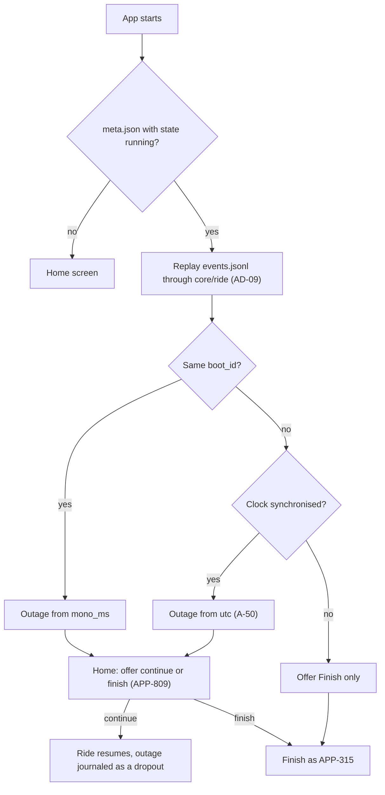

A ride that was still armed when the app stopped is closed as `cancelled`: nothing was recorded. A ride along a route keeps its route: the ride along it is rebuilt from `route.gpx` and the journal's samples with their pauses (APP-908; IM-147).

#### 4.9.5 `timing.jsonl` (APP-802, APP-803; Phase 4)

One line per tap that changes the target, level, mode or intensity, and one per painted view, written while a ride runs (4.6.7). All times are in ms on the Pi's monotonic clock. The taps are the commands `intensity`, `resistance`, `switch_mode`, `free_ride_power`, `pause`, `resume` and `skip` (IM-118).

| `kind` | Fields | Notes |
|--------|--------|-------|
| `tap` | `name`, `tap_mono_ms`, `recv_mono_ms`, `write_mono_ms`, `pending`, `rtt_ms` | `write_mono_ms`: start of the first control point write after the command, or `null` when none starts within 1 s; a ramp tick or scheduled change written within that second counts for the tap. `pending`: a control point procedure was pending when the command arrived, so the 100 ms clause of APP-802 applies. `rtt_ms`: round trip of the ping the page's offset came from |
| `paint` | `seq`, `data_mono_ms`, `sent_mono_ms`, `paint_mono_ms`, `rtt_ms` | From the newest value's arrival to the frame that showed it |

```json
{"kind": "tap", "name": "resistance", "tap_mono_ms": 9381220.4, "recv_mono_ms": 9381238.9, "write_mono_ms": 9381239.6, "pending": false, "rtt_ms": 23.1}
{"kind": "paint", "seq": 18412, "data_mono_ms": 9381301.2, "sent_mono_ms": 9381344.0, "paint_mono_ms": 9381377.5, "rtt_ms": 23.1}
```

A check adds half of `rtt_ms` to each measured delay before comparing it with the limit, so the clock offset can only count against the app.

#### 4.9.6 Logs outside rides

| File | Content |
|------|---------|
| System log | Not a file here: the app logs to the systemd journal (`journalctl -u wow`), the page's viewport after each `hello` included (APP-814; IM-119) |
| `logs/ble-system.jsonl` | Bluetooth operations outside rides, in the IF-11 format (IM-24) |
| `logs/calibration.jsonl` | One line per spin-down result: `utc`, `ok`, `outcome`, `hex` (the status bytes); the last one shows on the Calibration screen (IM-100) |

### 4.10 IF-10 Settings, configuration and routes

`/var/lib/wow/settings.json` (table S; replaced atomically; APP-707):

| Field | Unit | Range and step | Default |
|-------|------|----------------|---------|
| `schema` | — | 1 | 1 |
| `ftp` | W | 100 to 500, 1 | 250 |
| `zones_pct` | % of FTP | upper bounds of Z1 to Z5, 1 to 200, strictly increasing, 1 | 55, 75, 90, 105, 120 |
| `lead_time` | s | 0 to 5, 0.5 | 1.0 (Phase 1 table S, revision 8) |
| `battery_warn_pct` | % | 5 to 50, 5 | 20 |
| `free_ride_level_pct` | % of range | 0 to 100, 5 | 0 |
| `upload_on` | — | true, false | true |
| `trainer`, `hrm` | — | address and name | none |
| `rider_kg` | kg | 40 to 150, 1 | 75 (APP-709) |
| `route` | — | the name of a `.gpx` file in `routes/`, or null | null (APP-902) |

```json
{
  "schema": 1,
  "ftp": 250,
  "zones_pct": [55, 75, 90, 105, 120],
  "lead_time": 1.0,
  "battery_warn_pct": 20,
  "free_ride_level_pct": 0,
  "upload_on": true,
  "trainer": {"address": "94:05:BB:03:5D:9D", "name": "VANRYSEL-HT-9d5d"},
  "hrm": {"address": "E0:E2:EF:63:14:BC", "name": "HRM200:739158"},
  "rider_kg": 75,
  "route": "example-loop.gpx"
}
```

A value out of its range or step sent from Settings is refused with the field name and the allowed range (`invalid_value`, 4.6.6); a value in the file that can't be used keeps its default and is logged; a missing file means the defaults (APP-708; IM-104). A chosen route whose file has gone shows as no route (IM-133).

`/var/lib/wow/secrets.json`, mode `0600`, owner `wow` (APP-817). It is written atomically with the mode set on the temporary file before any byte (IM-106); the app warns in its log when group or others can read it (IM-57):

```json
{"schema": 1, "intervals_athlete_id": "i123456", "intervals_api_key": "…"}
```

`/etc/wow/wow.toml`, set at installation from `deploy/wow.pi.toml`:

```toml
[bluetooth]
adapter = "hci0"            # AD-15
simulate = false            # true: ble_sim (APP-819)
replay = ""                 # path to a ble.jsonl: ble_replay (APP-820)

[web]
host = "wow.local"
https_port = 443
http_port = 80
cert = "/var/lib/wow/tls/server.crt"
key = "/var/lib/wow/tls/server.key"
root_cert = "/var/lib/wow/tls/root.crt"   # served on /setup/root.crt; key stays on the laptop (AD-12)
# listen = "127.0.0.1"      # optional: one address to listen on; all addresses when absent (IM-44)

[paths]
data = "/var/lib/wow"

[system]
led = "/sys/class/leds/ACT" # the green ACT LED (APP-826); leave out to keep the LED to the system (IM-96)
```

**Routes folder** (APP-901, APP-907; IM-128, IM-132): `/var/lib/wow/routes`, made by `deploy/install.sh`, 0750, owner `wow`. The rider copies GPX files there; they come from third parties, so the app treats them as untrusted. A file is listed when its name ends in `.gpx` in any case, isn't hidden, has no path and has at most 120 characters. It is read with the standard library's ElementTree: GPX 1.1, 1.0 or no namespace (RD-17); the track points of every track and segment in order, else the route points; the name from `metadata`, then the track, then the route, then the file name. A file is left out, with the reason in the log, when it is over 10 MB, declares a `<!DOCTYPE` or `<!ENTITY`, isn't XML, has a root other than `gpx`, has fewer than two points, has a latitude or longitude outside WGS84's ranges or a number that isn't finite, or is a route under 100 m. The folder is read in a thread whenever Pre-ride opens.

### 4.11 IF-11 Bluetooth log and replay

`ble.jsonl` per ride, plus `logs/ble-system.jsonl` outside rides (APP-813):

| Field | Unit | Notes |
|-------|------|-------|
| `utc` | ISO 8601 | — |
| `mono_ms` | ms, Pi monotonic | — |
| `dev` | `trainer`, `hrm`, `cadence` or `other` | `cadence` on a cadence sensor's `scan_result`; `other` for a device that is none of these (IM-16, IM-107) |
| `addr` | text | Bluetooth address |
| `gen` | count | Connection generation (IF-03) |
| `op` | text | Below |
| `uuid` | full UUID | Characteristic |
| `hex` | text | Raw bytes |

| `op` | Meaning |
|------|---------|
| `scan_result` | One advertisement (`rssi_dbm`, `service_data` as hex) |
| `connect_start`, `connected`, `connect_failed`, `disconnected`, `released_stale` | Link events; `released_stale` carries `outcome` (`released`, `not connected`, …) (IM-16) |
| `read` | Read result |
| `write`, `write_done`, `write_failed` | Write start, ATT response, error |
| `notify`, `indicate` | Value received; the kind follows the characteristic's property |

```json
{"utc": "2026-11-10T17:40:48.123Z", "mono_ms": 123456.7, "dev": "trainer", "addr": "94:05:BB:03:5D:9D", "gen": 2, "op": "notify", "uuid": "00002ad2-0000-1000-8000-00805f9b34fb", "hex": "40002c0bc800…"}
```

The Phase 2 spike logs use an earlier field set; a one-off importer converts them into this format for `testdata/` (D-17).

**Replay (`ReplayConnector`):** connects succeed when the log has a `connected` for the address; reads return the recorded values in order, each at its recorded time (IM-82); received values are delivered at their recorded `mono_ms` offsets, scaled to the test clock; each app write is compared with the next recorded write on that characteristic. A mismatch in bytes, or a timing difference over 100 ms, is a test failure that shows both lines (APP-820).

### 4.12 IF-12 FIT activity file

Written by `fit_garmin` with the Garmin FIT Python SDK's `Encoder` (RD-08) on Finish. Message order follows Garmin's activity recipe (RD-07: required File Id, Activity, Session, Lap, Record; Event and Device Info recommended):

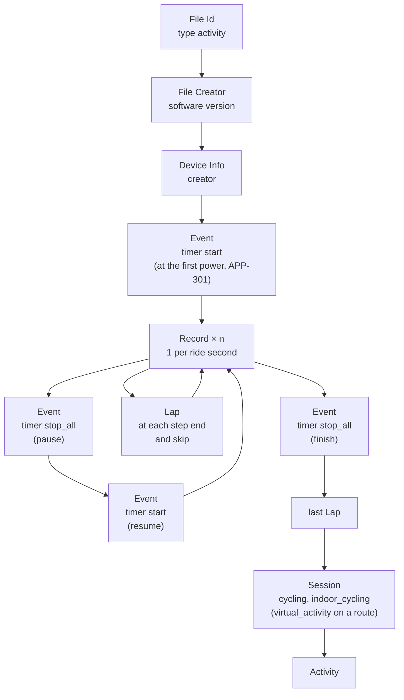

| Message | Fields written | Requirement |
|---------|----------------|-------------|
| File Id | type activity, manufacturer development, product, serial number, time created | — |
| File Creator, Device Info | software version from the app version (major × 100 + minor); Device Info product name "WitchesOnWheels \<version\>" | APP-815 |
| Event | timer start at the first power and at Resume; timer stop_all at Pause and Finish. No Record while paused | APP-301, APP-604 |
| Record | timestamp, power, heart rate, cadence (with a sensor), target power; a missing value is left out, never 0. On a route also `distance`, `speed` and `enhanced_speed`, `altitude` and `enhanced_altitude`, `position_lat` and `position_long` in semicircles (2³¹ per 180°) | APP-601, APP-603, APP-904 |
| Lap | start time, timestamp, total elapsed and timer time, average and maximum power and heart rate; one per step. On a route also distance, average and maximum speed | APP-605, APP-904 |
| Session | sport cycling, sub-sport indoor cycling (6), or virtual activity (58) on a route; start time (the first power), totals, normalized power, intensity factor, training stress score, threshold power, total work, heart-rate averages. On a route also total distance, average and maximum speed (and their enhanced fields), `total_ascent`, `total_descent` | APP-601, APP-606, APP-904 |
| Activity | timestamp, local timestamp, number of sessions 1, total timer time | — |

Field names and scales are those of the SDK's profile (RD-08), which the encoder applies itself. Target power is developer field 0 `target_power` (uint16, W), declared with `developer_data_id` and `field_description` (IM-48); whether intervals.icu and Garmin Connect show it stays open (A-28, OP-6). FIT time has whole seconds, so a lap starting at 200.5 s starts at 200 s in the file. Without a route the file has no speed, distance, altitude or position (IM-135).

### 4.13 IF-13 Built-in workouts (Part 3D)

#### 4.13.1 Format

Built-in workouts use intervals.icu's `workout_doc` structure, so one parser (`core/intervals_doc`) reads both, and the shared test data covers both (D-17). Files live in `src/wow/builtin/<id>.json`; adding a workout is adding a file.

| Field | Unit | Notes |
|-------|------|-------|
| `schema` | — | 1 |
| `id`, `name`, `description` | text | Name on Home, description on Pre-ride |
| `protocol_source` | text | Where the protocol comes from |
| `workout_doc.steps[]` | — | Keys as intervals.icu sends them (F-18, F-36; A-55): `duration` (s), `power` with `units` (`w` or `%ftp`) and `value`, or `start` and `end`; `ramp`, `freeride`, `warmup`, `cooldown`, `text`; a repeat block is `{"reps": n, "steps": [...]}` |

Every built-in the app ships gives its targets in `%ftp`, so it follows the FTP set in the app for the rider (APP-302) (**design**, Ferran, 25 Nov 2026). The parser still reads `w`; the tests' own 30/30 workout uses it (`testdata/workouts/s2-30-30.builtin.json`). Home lists the built-ins in the order of their file names. An all-out effort is a `freeride` step: it runs in resistance mode, and the rider sets the load with + and − (APP-306, APP-308), because ERG would cap the effort at its target.

#### 4.13.2 Ramp test (APP-211)

Protocol defined by Ferran on 11 Nov 2026, in percent of FTP since 25 Nov 2026; at FTP 250 the steps are the watts of the original protocol. All steps run in ERG except the cool-down.

| Part | Steps | Watts at FTP 250 | Total |
|------|-------|------------------|-------|
| Warm-up | 10 min at 48 %, 3 min at 60 %, 2 min at 40 % | 120, 150, 100 W | 15 min |
| Ramp | 1-minute steps from 48 %, +8 % of FTP each step, to 240 % (25 steps) | 120, 140, … 600 W, the D100's maximum | up to 25 min |
| Cool-down | 5 min free ride | — | 5 min |

At FTP 250 the ramp's 1-minute, 20 W steps are those of Zwift's ramp test (RD-14), which matters if the FTP estimate in the later-versions list uses Zwift's rule (75 % of the best minute); at another FTP each step is 8 % of it (**design**). Above FTP 250 the last steps lie above the D100's 600 W and are limited to it (APP-303).

`src/wow/builtin/ramp-test.json` (the 25 ramp steps abbreviated):

```json
{
  "schema": 1,
  "id": "ramp-test",
  "name": "Ramp test",
  "description": "15 min warm-up, then the target rises by 8 % of FTP every minute from 48 % until you can't hold it. Tap Ride by resistance, Pause or Finish when you stop. Your FTP is about 75 % of your best minute.",
  "protocol_source": "Ferran, 11 Nov 2026; in % of FTP since 25 Nov 2026: at FTP 250 the original 120 W start and 20 W a minute, Zwift's ramp rate (ICD RD-14)",
  "workout_doc": {
    "steps": [
      {"duration": 600, "power": {"units": "%ftp", "value": 48}, "warmup": true, "text": "Warm-up"},
      {"duration": 180, "power": {"units": "%ftp", "value": 60}, "warmup": true, "text": "Warm-up: a little harder"},
      {"duration": 120, "power": {"units": "%ftp", "value": 40}, "warmup": true, "text": "Warm-up: easy before the ramp"},
      {"reps": 1, "text": "Ramp: hold each step as long as you can", "steps": [
        {"duration": 60, "power": {"units": "%ftp", "value": 48}},
        {"duration": 60, "power": {"units": "%ftp", "value": 56}},
        {"duration": 60, "power": {"units": "%ftp", "value": 64}},
        "… one step per 8 % …",
        {"duration": 60, "power": {"units": "%ftp", "value": 240}}
      ]},
      {"duration": 300, "freeride": true, "cooldown": true, "text": "Cool-down"}
    ]
  }
}
```

**Why the ramp is one repeat block with `reps: 1`:** a mode switch applies to the rest of the current block (APP-307). With all 25 steps in one block, one tap on "Ride by resistance" when the rider fails ends ERG for the rest of the ramp; he then spins at the free-ride level into the cool-down. Without the block, every following step would put ERG back on. The other ways to stop are Pause (lowest resistance at once, APP-311) and Finish (ends the ride without the recorded cool-down). The best 1-minute power shows in intervals.icu after the upload; the Summary shows the metrics of table M.

#### 4.13.3 The other built-ins (APP-211)

Real sessions for a rider without intervals.icu at hand, at Ferran's request of 25 Nov 2026 (a 20-minute test, a 4 × 4 and more): tests, VO2max, threshold, sweet spot and easy rides. The structure comes from the source; a value the source doesn't give in percent of FTP is **design**, placed inside the Coggan level the source's intensity belongs to (RD-19). Unless the table says otherwise, the warm-up is a 10-minute ramp from 50 to 75 % and the cool-down a ramp down from 55 to 40 %; recoveries are ERG steps.

| File | Name | Main set | Warm-up, cool-down | Total | Source |
|------|------|----------|--------------------|-------|--------|
| `endurance-1h` | Endurance 1 h | 45 min at 65 % | 10-min ramp 50→65 %; 5-min ramp 65→50 % | 60 min | Level 2, 56–75 % (RD-19); 65 % **design** |
| `erg-check` | ERG check | 2 × (30 s at 88 %, 60 s at 52 %) | 2 min at 48 %; 1 min at 48 % | 6 min | The SL-02 check (IM-23), the same watts at FTP 250 |
| `ftp-test-20min` | FTP test 20 min | 5 min all out (free ride), 10 min at 65 %, 20 min all out (free ride); FTP = 95 % of the 20-minute lap | 20 min at 65 %, 3 × (1 min fast pedaling at 65 %, 1 min at 50 %), 5 min at 65 %; 10 min at 65 % | 76 min | RD-18; the 1-minute recoveries at 50 % and the 10-minute cool-down **design** |
| `recovery-30min` | Recovery 30 min | 20 min at 50 % | 5-min ramps 40→50 % and 50→40 % | 30 min | Level 1, below 55 % (RD-19) |
| `sweet-spot-3x15` | Sweet spot 3 × 15 | 3 × (15 min at 90 %, 5 min at 55 %) | ramp, then 5 min at 60 %; 5 min | 80 min | Sweet spot 88–94 % (RD-19); 90 % and the set **design** |
| `threshold-2x20` | Threshold 2 × 20 | 2 × (20 min at 95 %, 5 min at 55 %) | ramp, 2 min at 90 %, 3 min at 55 %; 5 min | 70 min | Level 4, 91–105 % (RD-19); 95 % and the set **design** |
| `vo2max-30-15` | VO2max 30/15 | 3 series of 13 × (30 s at 120 %, 15 s at 60 %), 3 min at 50 % between series | ramp, 2 × (1 min at 115 %, 2 min at 55 %); 10 min | 61 min 15 s | Structure RD-20; 120 % (top of level 5) and the off steps at half of it **design** |
| `vo2max-30-30` | VO2max 30/30 | 3 sets of 6 × (30 s at 132 %, 30 s at 56 %), 5 min at 55 % between sets | ramp, 4-min ramp 85→105 %, 3 min at 55 %; 10 min | 55 min | The targets of Phase 2's S2 session (330 and 140 W at FTP 250); the sets **design** |
| `vo2max-4x4` | VO2max 4 × 4 | 4 × (4 min at 112 %, 3 min at 60 %) | ramp, 1 min at 105 %, 4 min at 55 %; 10 min | 53 min | Structure RD-21; 112 % (level 5) and 60 % **design** |

Each series, set or repeat is one block, so "Ride by resistance" during it lasts to the end of that block only (APP-307): the way out when ERG can't follow the short steps of the 30/15 and the 30/30. The 30/15's 15-second off steps last about ten times the D100's ERG step response (T90 about 1.5 s, Phase 2 F-25). The 20-minute test's fast pedaling is judged by the rider: the D100 reports no cadence (Phase 0, D-05).

## 5 Qualification provisions

The Phase 4 test plan (RD-15) maps every requirement to the tests, ride checks, demonstrations and inspections behind these methods.

| Interface | Method | How |
|-----------|--------|-----|
| IF-01 | Test, demonstration | Codec unit tests on real D100 records (F-1); session tests against `SimD100Server`, faults scripted; replay of Phase 2 and Phase 5 logs; rides on the D100 |
| IF-02 | Test, demonstration | Codec tests on S1 records; `SimHrm200Server`; rides with the strap |
| IF-03 | Test, inspection | The same test suite runs over `SimConnector` and `ReplayConnector`; the bleak mapping inspected against RD-04 |
| IF-04 | Test | Event-in, action-out cases stored in `testdata/` (APP-821); a simulated 4-hour ride (APP-812) on the stepped clock |
| IF-05 | Test | Controller tests with fake devices |
| IF-06 | Test, inspection, demonstration | Golden view states and message tests in pytest on the Pi's side; the display inspected on the iPhone state by state against 3C, in the gallery and on real rides (Ferran, 11 Nov: the display is checked by looking at it); tap and paint times from `timing.jsonl`. A few Vitest and Playwright tests support development |
| IF-07 | Test | HTTP tests against the server over real TLS (as in the S8 spike) |
| IF-08 | Test, demonstration | Recorded responses (S6 files) for the parser; a real upload in the upload slice |
| IF-09 | Test | Crash tests: kill during a ride, check at most 5 s lost (APP-808) and recovery (APP-809) |
| IF-10 | Test, inspection | Validation tests; file modes inspected (APP-817); route files built in the tests, refusals checked one by one |
| IF-11 | Test | Round trip: log a simulated ride, replay it, no differences |
| IF-12 | Test, demonstration | Decode our file with the SDK's `Decoder`; import into intervals.icu and Garmin Connect (F-35), on a route as a virtual ride with its map |
| IF-13 | Test | Parse every built-in file; the ramp test's plan matches its expected timeline at FTP 250 and follows the FTP at 200; every shipped target is in percent of FTP and every total is that of 4.13.3 (S-WKO-02) |

## 6 Requirements traceability

| Requirement group | Interfaces |
|-------------------|-----------|
| 1 Devices and connection (APP-101 to APP-117) | IF-01, IF-02, IF-03, IF-05 |
| 2 Workouts (APP-201 to APP-211) | IF-08, IF-13 |
| 3 Running a ride (APP-301 to APP-320) | IF-01, IF-04, IF-05 |
| 4 Display and controls (APP-401 to APP-416) | IF-06, IF-07 |
| 5 Calibration (APP-501 to APP-506) | IF-01 (S-5), IF-06 |
| 6 Recording, metrics and upload (APP-601 to APP-613) | IF-08, IF-09, IF-12 |
| 7 Settings (APP-701 to APP-709) | IF-06, IF-10 |
| 8 Timing, reliability, logging, security (APP-801 to APP-830) | IF-01, IF-04, IF-06, IF-09, IF-10, IF-11 |
| 9 Routes (APP-901 to APP-910) | IF-06, IF-09, IF-10, IF-12 |

## 7 Notes

### 7.1 Assumptions used in this ICD

Statuses as of revision 4. Phase 5 confirmed A-55 (16.3), A-60 (13.1) and A-61 (5.3), and added A-64 to A-72 (RD-16); Phase 6 brings every status up to date.

| ID | Assumption | Status | Source | How it gets checked |
|------|-----------|--------|--------|---------------------|
| A-48 | The FTMS procedure timeout equals the 30 s ATT transaction timeout. | Open | Bluetooth Core Vol 3 Part F 3.3.3, quoted on Nordic DevZone (secondary); FTMS 4.16.4 unread | When a copy of FTMS 4.16.4 is available |
| A-53 | intervals.icu skips a file it has already received, answering 200; 201 when it created an activity. | Open | intervals.icu developer, forum, 2021 | Phase 5, upload slice |
| A-54 | intervals.icu and Garmin Connect treat timer stop and start events as pauses. | Open | RD-07 recommends timer events for pauses | Phase 5, recording slice |
| A-55 | The `workout_doc` key names in IF-13 are the ones intervals.icu sends. | Open | F-18, F-36 | Phase 5, workout slice |
| A-60 | With an ERG target set and the wheel still, the D100 reports 0 W, so the first record with at least 1 W marks the first pedal stroke. | Open | F-11 showed reported ERG power sits on the target while pedaling; standstill not observed | Phase 5, first ride slice. Fallback: also require `speed_kmh` above 0 |
| A-61 | With every wait going through `Clock.sleep_until`, a stepped clock can drive the asyncio app shell deterministically. | Open | AD-07 shows it for the core; Phase 4 | Phase 5, first slice. Fallback: shell tests in real time on short plans |
| A-63 | The page can time a paint closely enough with the animation-frame callback after a view is applied, and Safari's timer resolution doesn't hide differences of a few milliseconds. | Open | Phase 4 | Phase 5, display slice, against the Pi-side numbers |

### 7.2 Acronyms

| Term | Meaning |
|------|---------|
| ATT | Attribute Protocol (Bluetooth) |
| ERG | Trainer mode that holds a target power |
| FIT | Garmin's Flexible and Interoperable data Transfer file format |
| FTMS | Fitness Machine Service (Bluetooth SIG) |
| GATT | Generic Attribute Profile (Bluetooth) |
| GPX | GPS Exchange Format (RD-17) |
| GSS | GATT Specification Supplement |
| ICD | Interface Control Document |
| NP, IF, TSS | Normalized Power, Intensity Factor, Training Stress Score (Phase 1, table M) |
| RD | Referenced document (section 2) |

### 7.3 Change log

| Rev. | Date | Change |
|------|------|--------|
| 1 | 10 Nov 2026 | First draft of 3B and 3D (`phase3-interfaces.md`). |
| 2 | 10 Nov 2026 | Display fields for 3C in IF-06. |
| 3 | 11 Nov 2026 | Ferran's comments: restructured as an ICD (identification, referenced documents, interface list with provider, consumer and type, data element tables, error handling, qualification provisions, notes); unit-naming rule applied to every constant and field (AD-20); GATT client and server names (`GattConnector`, `GattClient`, simulator `GattServer`, AD-21); armed state and start on the first power (APP-301, new A-60); ramp test with Ferran's warm-up, 120 W start and 5-minute cool-down, without diagrams. File renamed `phase3-icd.md`. Approved by Ferran as part of Phase 3. |
| 4 | 11 Nov 2026 | Phase 4 findings, approved by Ferran: idle finish from Paused (4.4.3); free ride defined, with `power` in `SwitchMode` (4.4.2); `Clock` port with `sleep_until` (4.4.1); timing messages `ping`, `pong`, `painted`, with `data_mono_ms` and `tap_mono_ms` (4.6.3, 4.6.5, new 4.6.7); `due_mono_ms` in `trainer_command` and new `timing.jsonl` (4.9.2, new 4.9.5); rounding with halves up (1.4); simulator fault "adapter failing" (4.3.4); IF-06 qualified by Pi-side tests and by inspection on the iPhone (5); A-61 and A-63; RD-15. |
| 5 | 18 Nov 2026 | Phase 5 changes, approved by Ferran with the slices (Phase 5 sections 13.6, 16.5, 22.5, 29.5, 35.5, 41.5 and 47.5): Request Control every 2 s from the previous request, results 03 and 04, release clears the command (4.1.5, 4.1.6); `SpinDown` and `SpinDownAnswered` (4.1.5); simulator server methods (4.3); ride events and actions as built, `Recovered`, `ABANDON_AFTER` checked by readings (4.4.2); the plan and route messages, the display types as built with `set_route`, `viewport`, `rtt_ms`, `invalid_value` and the route fields (4.6); redirect port, 503 and caching (4.7); header-based authentication, the upload fields and the waiting rule, simulated rides with upload off (4.8); journal and `meta.json` fields, `route.gpx`, logs outside rides (4.9); `settings.json` with `rider_kg` and `route`, `secrets.json` written 0600 first, `[web] listen`, `[system] led`, the `routes` folder (4.10); `outcome` and `dev` values (4.11); FIT fields of a ride along a route and the target power field (4.12); RD-16, RD-17; routes in the traceability table. Moved from the project into the repository as `docs/phase3-icd.md`. |
| 6 | 25 Nov 2026 | At Ferran's request: every built-in workout in percent of FTP (4.13.1); the ramp test in percent of FTP, the same watts at FTP 250 (4.13.2); eight new built-ins, and the S2 session "30/30 and a surge" moved to the tests (new 4.13.3); IF-13's qualification (5); RD-18 to RD-21; Phase 1 revision 9. Draft until Ferran approves it. |

## Sources

- Bluetooth SIG, Fitness Machine Service 1.0.1 (Table 4.15): https://files.bluetooth.com/download/ftms_v1-0-1/
- Bluetooth SIG, GSS YAML via bluetooth-sig 0.6.0: https://pypi.org/project/bluetooth-sig/
- Texas Instruments, BLE5-Stack user's guide, GATT (client and server roles, independent of central and peripheral): https://software-dl.ti.com/lprf/ble5stack-docs-latest/docs/ble5stack/ble_user_guide/html/ble-stack-5.x/gatt.html
- Nordic Developer Academy, Bluetooth LE fundamentals (GATT client and server): https://academy.nordicsemi.com/?p=14290
- MIL-STD-498 Interface Design Description, DI-IPSC-81436 (structure of an interface document: identification, interface diagrams, data elements, communication methods, protocols): https://web.do.metacpan.org/pod/Docs::US_DOD::IDD and https://www.ppi-int.com/wp-content/uploads/2021/01/DID-Interface-Design-Description-IDD.pdf
- bleak, `BleakClient` API: https://bleak.readthedocs.io/en/stable/api/client.html
- bleak, `BleakScanner.discover` with `return_adv` and `service_uuids`: https://bleak.readthedocs.io/_/downloads/en/develop/pdf/
- aiohttp, `FormData.add_field` and `BasicAuth`: https://docs.aiohttp.org/en/stable/genindex.html and https://docs.aiohttp.org/en/v3.8.4/client_quickstart.html
- aiohttp 3.14.5 as installed: `aiohttp.encode_basic_auth(login, password)` and the deprecation warnings of `BasicAuth` and `ClientSession(auth=...)` (Phase 5, IM-54)
- aiohttp, `WebSocketResponse` with `heartbeat`: https://docs.aiohttp.org/en/stable/_modules/aiohttp/web.html
- intervals.icu forum, API access: https://forum.intervals.icu/t/api-access-to-intervals-icu/609
- intervals.icu API integration cookbook: https://forum.intervals.icu/t/intervals-icu-api-integration-cookbook/80090
- Garmin, Encoding FIT Activity Files: https://developer.garmin.com/fit/articles/cookbook/encoding_activity_files.html
- Garmin, FIT Activity File: https://developer.garmin.com/fit/articles/file-types/activity.html
- Garmin FIT SDK 21.221.0 profile as installed (Record `position_lat`/`position_long` in semicircles, `distance`, `speed`, `enhanced_speed`, `altitude`, `enhanced_altitude`; Session `total_ascent`, `total_descent`; `sub_sport` 58 `virtual_activity`, 6 `indoor_cycling`), as quoted in Phase 5: https://pypi.org/project/garmin-fit-sdk/
- GPX 1.1 schema: https://www.topografix.com/GPX/1/1/
- Zwift Insider, Zwift's ramp test: https://zwiftinsider.com/?p=43816 and https://zwiftinsider.com/group-ramp-test/
- Allen and Coggan's 20-minute FTP test protocol, Table 1: https://pmc.ncbi.nlm.nih.gov/articles/PMC6886609
- TrainingPeaks, power training levels (Coggan): https://www.trainingpeaks.com/learn/articles/power-training-levels/
- TrainingPeaks, how to get started training with power (sweet spot at 88–94 % of FTP): https://www.trainingpeaks.com/blog/how-to-get-started-training-with-power/
- Rønnestad et al. 2020, short intervals in elite cyclists (abstract): https://www.pubmed.gov/31977120/
- Helgerud et al. 2007, aerobic high-intensity intervals (abstract): https://pubmed.ncbi.nlm.nih.gov/17414804/
- Phase 5 implementation, revision 15: `docs/phase5-implementation.md`
- Phase 4 test plan, revision 5: `docs/phase4-test-plan.md`
- Phase 3A architecture, revision 6: `docs/phase3-arch.md`
- Phase 3C display design, revision 3: `docs/phase3-display.md`
- Phase 2 record, revision 14: `docs/phase2-spikes.md`
- Phase 1 requirements, revision 9: `docs/phase1-requirements.md`
- Phase 0 record, revision 2: `docs/phase0-discovery.md`
