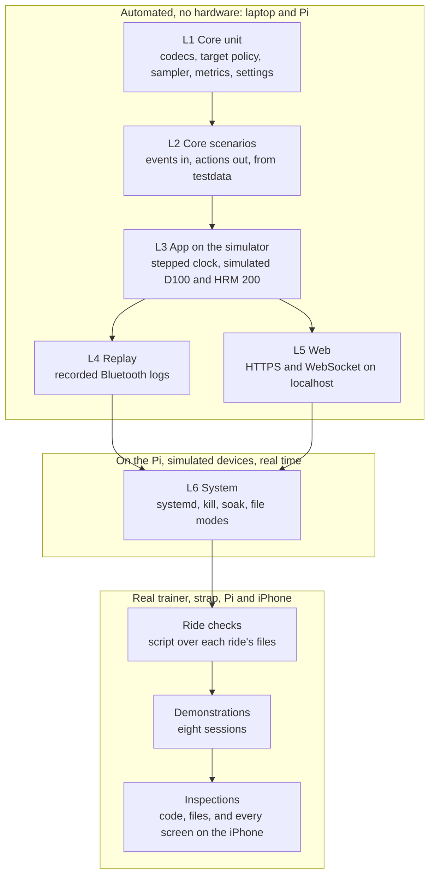
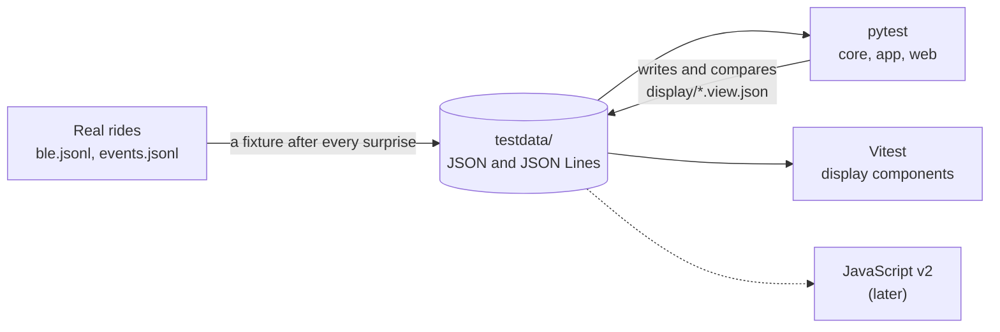
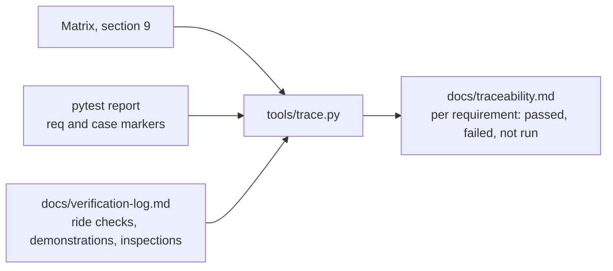
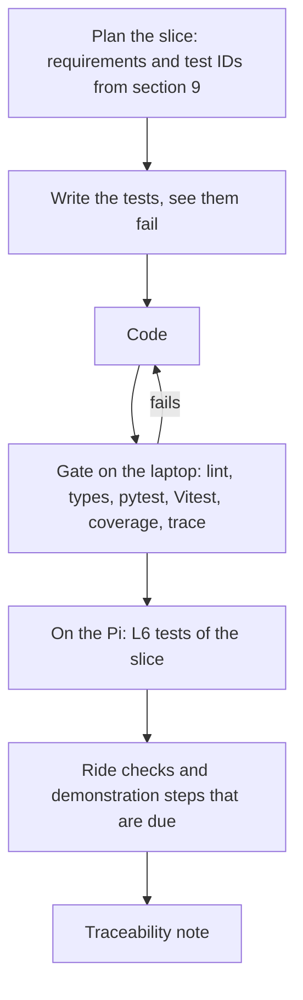
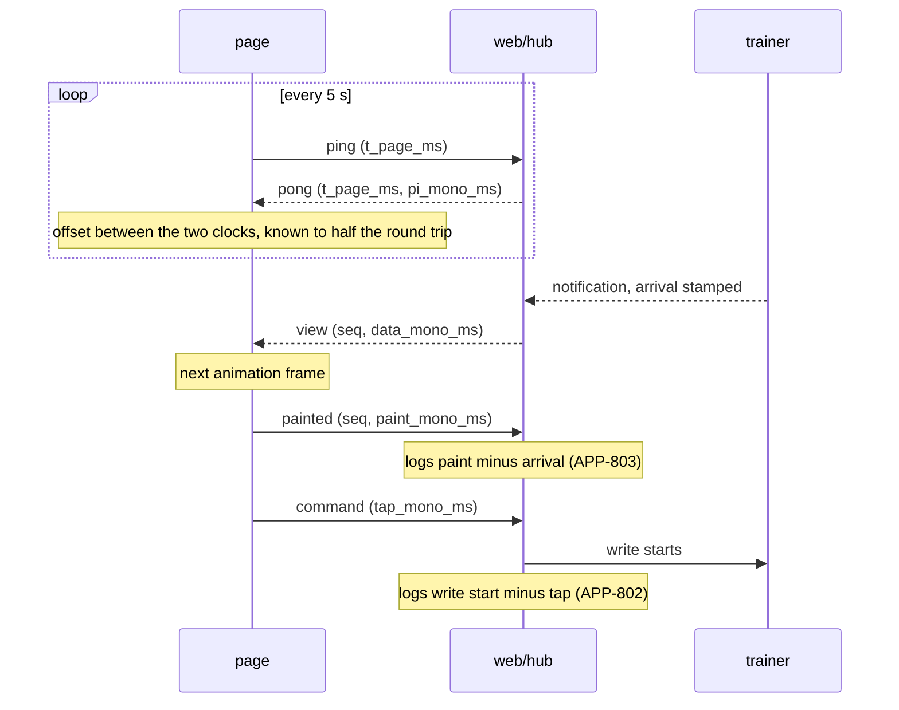

# Phase 4 — Test plan

**Status:** approved by Ferran, 11 Nov 2026 (revision 2). Phase 4 is closed; Phase 5 starts with slice SL-01. On 11 Nov 2026 Ferran approved the findings of revision 1 and their changes to earlier documents, and answered the five questions: 1 to 4 as proposed, 5 with "the display is checked by inspection". Revision 2 applies that answer: automated display tests leave the verification, and a walk-through of every screen on the iPhone takes their place. The changes to earlier documents are applied in the Interface Control Document (revision 4), the Phase 3A architecture (revision 5) and the Phase 1 requirements (revision 7). The plan maps each of Phase 1's 116 requirements to automated tests, checks on real-ride files, demonstrations and inspections. It also builds on the display design (revision 2) and the Phase 2 record (revision 14).

## How to read this

- **Verification methods** are Phase 1's: **T** test, automated, no hardware; **D** demonstration on the real trainer, strap, Pi and iPhone; **I** inspection. This plan splits D into two kinds of evidence: a **ride check** (a script reads the files of a real ride and prints pass or fail) and a **demonstration step** (Ferran does something and looks).
- **IDs:** automated tests `T-<group>-nn`, ride checks `RR-nn`, demonstration steps `D-nn` inside sessions `DS-n`, inspections `I-nn`, supporting display tests `S-<group>-nn`. Provisional Phase 5 slices are `SL-nn`.
- **The matrix** in section 9 is generated from the catalogues in sections 5 to 8 by `tools/make_matrix.py`, delivered with this plan and the starting point of `tools/trace.py`. It rewrites section 9 in place and fails when a requirement lacks the evidence its method asks for, so the catalogues and the matrix can't disagree. Run it after any change to a catalogue, or to a priority or method in Phase 1.
- **Values marked design** are chosen in this plan. Tool facts carry their source; anything unverified is an assumption (section 12).
- **Scope:** *must* and *should* requirements are verified for v1. *Could* requirements (APP-115, APP-209, APP-413, APP-506, APP-826) have their checks defined here and are verified only if they are built.

## 1 Findings from writing the plan

Writing a pass criterion for every requirement showed seven places where the approved documents don't yet say enough, or contradict each other. Ferran approved the fixes on 11 Nov 2026, except P-7, which he decided the other way; section 11 says where each is applied.

| # | Finding | Why it matters | Proposed fix |
|---|---------|----------------|--------------|
| P-1 | APP-825 finishes a ride after 30 idle minutes "during a ride". The ICD's ride state machine has that transition from Running and WorkoutDone, not from Paused. | A ride paused and forgotten never ends: the trainer stays connected (APP-110 can't release it) and the ride never uploads. | ICD IF-04: add Paused to Finished after 30 min idle. T-RID-18 tests all three states. |
| P-2 | APP-802 and APP-803 can't be demonstrated as the ICD stands. The Pi stamps a command when it *arrives* and a view when it is *sent*; the tap and the paint happen on the phone, whose clock the Pi doesn't know. | The two latency requirements Ferran tightened to 250 ms would be verified only on the Pi's side, leaving out Wi-Fi and Safari. | ICD IF-06: a ping and pong pair that gives the page the Pi's clock to within half a round trip (about 12 ms, F-41), a tap time on every command, and a `painted` report. Section 10 has the method. |
| P-3 | APP-801 on real rides needs the moment each command fell *due*; the journal's `trainer_command` records only when it was issued. | The 100 ms check would compare a time with itself. | ICD IF-09: add `due_mono_ms` to `trainer_command`. |
| P-4 | The `Clock` port has `monotonic()`, `utc()` and `synchronised()` but no way to wait. The app shell has to sleep until the next deadline; if it calls asyncio's sleep directly, shell tests can't run on a stepped clock, and a simulated 4-hour ride takes 4 hours. | APP-812 and every L3 test depend on stepped time (AD-07 covers only the core). | 3A and ICD IF-04: add `sleep_until(mono)` to `Clock`; the stepped clock wakes sleepers in deadline order (A-61). |
| P-5 | Watts are "rounded to the trainer's increment" (APP-302), but the rounding rule isn't fixed. Python's `round()` rounds halves to even: intervals.icu's Z2 at FTP 250 is 162.5 W, which it shows as 163 W (F-20) and `round()` makes 162. | Targets and fixtures would differ from intervals.icu by 1 W in half the tie cases. | ICD: round half up, as a design rule; T-WKO-03 and T-TGT-01 pin it. |
| P-6 | APP-317 doesn't say how a free ride starts: in which mode, at what target. | T-RID-15 needs an expected first command. | APP-317 and ICD IF-04: a free ride starts in resistance mode at the free-ride level; switching to ERG takes the current 3 s power, rounded to 5 W, as the first target (answer 2). |
| P-7 | Thirteen display requirements are verified by D or I only (APP-401, APP-403, APP-404, APP-406 to APP-409, APP-411, APP-412, APP-414, APP-416, APP-610, APP-611). Revision 1 proposed adding automated display tests to them. | A regression in the ride screen shows only when someone looks. | **Decided otherwise by Ferran (answer 5):** the display is checked by inspection, by looking at it. No method changes in Phase 1; the walk-through I-14 to I-20 covers every screen and state. |

Smaller points, handled inside the plan without changing a requirement:

| # | Point | Reading used by the tests |
|---|-------|---------------------------|
| N-1 | APP-405: "show a dropout within 3 s of its start", while a dropout by silence only *exists* after 3 s without data. | A lost link shows in the first view after the loss (at most 1 s). Silence shows at 3.0 s after the last value. Confirmed by Ferran (answer 3) and now in APP-405's rationale. |
| N-2 | APP-304 with a lead time longer than the time since the current step began (after a skip, or a 3 s step with a 5 s lead). | The next target is never sent before the current step has started (T-TGT-07). |
| N-3 | APP-112's demonstration needs a strap at or below 50 %; it reads 80 % (F-49). | Demonstrated on the real iPhone against the simulator on the Pi (session DS-8). |
| N-4 | APP-115's demonstration needs a cadence sensor that isn't bought (D-05). | Blocked until one exists; *could*. |
| N-5 | APP-812's 4-hour ride on a stepped clock proves the logic doesn't drift, not that the Pi holds up for 4 hours. | A second, real-time 4-hour run on the Pi overnight (T-SYS-02). |
| N-6 | Replay (APP-820) compares the app's writes with recorded ones. Phase 2's logs were written by the spike, whose writes differ from the app's. | Phase 2 logs feed decoding and spin-down tests only (T-LOG-04); write comparison uses logs the app itself recorded (T-LOG-05). |
| N-7 | 3A's overview state diagram shows Discard only from Running; the ICD allows it from Paused and WorkoutDone too. | The ICD rules (T-RID-14); 3A's diagram is aligned in its revision 5. |
| N-8 | The simulator's fault list has no "Bluetooth adapter fails" case, which is what demonstration D-16 produces. | Added to the simulator: scan and connect raise errors for a scripted time (T-DEV-10). |

## 2 Strategy

### 2.1 Levels



| Level | What runs | Time base | Runs where | Tool |
|-------|-----------|-----------|------------|------|
| L1 | One pure module, table-driven | none | laptop, Pi | pytest |
| L2 | One state machine: a list of `(now, event)` in, a list of actions out, both stored as JSON (ICD IF-04) | `now` passed in | laptop, Pi | pytest |
| L3 | The whole app except the real adapters: app shell, core, `ble_sim`, file store in a temp directory, fake intervals.icu | stepped clock | laptop, Pi | pytest with pytest-asyncio |
| L4 | As L3, with `ble_replay` in place of `ble_sim` | stepped clock, scaled from the log | laptop, Pi | pytest |
| L5 | The real `web/server` and `web/hub` on a free localhost port with a test certificate, as the S8 spike tests did | real time, seconds | laptop, Pi | pytest, aiohttp client |
| L6 | The installed service on the Pi with simulated devices | real time | Pi | pytest marked `pi`, shell |
| Ride checks | `tools/check_ride.py <ride directory>` over `events.jsonl`, `samples.jsonl`, `ble.jsonl`, `timing.jsonl`, `ride.fit` | recorded | laptop or Pi | Python |
| Demos | Demonstrations: Ferran, on the real set-up | real | at the trainer | checklist |
| Inspections | Code, files, the installed Pi, and every screen on the iPhone (section 8) | — | laptop, Pi, iPhone | checklist |

The display has no level of its own: Ferran decided on 11 Nov 2026 that it is checked by looking at it. Six display tests remain as development support outside the matrix (section 5.16).

### 2.2 Principles

1. **Core logic is tested as data.** Every ride behaviour is an L2 case in `testdata/timelines/`: events in, actions out. The same files serve a JavaScript v2 (APP-821, D-17).
2. **Timing logic and timing performance are tested separately.** The stepped clock proves that a command is issued at the right instant. Real-time runs on the Pi (L6) and ride checks prove that the Pi does it within the limit. A requirement with a number in milliseconds has both.
3. **The simulator is itself under test.** Its bytes, sequences and step response are compared with the Phase 2 logs (T-SIM-01, T-SIM-02), and every surprise on a real ride becomes a simulator behaviour and a fixture before the fix (3A, architecture risks).
4. **Every real ride is a test run.** The ride check script runs over each ride Ferran does from the first ride slice on; a failed check is a defect.
5. **A bug gets a failing test first.** From a real ride, the test is a replay of its `ble.jsonl` (L4) or a timeline cut from its journal (L2).
6. **One view contract.** pytest writes and compares the golden views in `testdata/display/`; the simulator shows the same states on the iPhone for the walk-through (I-14 to I-20), and Vitest renders them as a smoke check (AD-18).

### 2.3 Environments

| Env. | Machine | Bluetooth | Display | Used for |
|------|---------|-----------|---------|----------|
| E1 | Laptop, Python 3.13 through uv, Node.js 26 | simulator, replay | supporting tests only | L1 to L5, on every change |
| E2 | Pi 5, Raspberry Pi OS Trixie, installed service, `simulate = true` | simulator | none, or the laptop's browser | L1 to L5 once per release, L6 |
| E3 | Pi 5 with the D100, the HRM 200 and the iPhone 17 on 5 GHz Wi-Fi | real | Safari | ride checks, sessions DS-1 to DS-7 |
| E4 | Pi 5 with `simulate = true` and the iPhone 17 | simulator, faults scripted | Safari | session DS-8 with the display walk-through |

Tests that need POSIX file modes or systemd carry the markers `posix` or `pi` and are skipped where they can't run; real-time tests carry `slow`. Markers are registered and unknown ones are an error (pytest's `markers` setting and `--strict-markers`).

### 2.4 Test tools added by this plan

Already chosen: pytest 9.2.0 and flake8 7.5.0 (pinned in Phase 2), mypy, Vitest 5.0.4 with Testing Library, Playwright with WebKit, `svelte-check`, ESLint (3A, AD-14 and AD-17). Added here, all development-only:

| Tool | For | Version | Checked |
|------|-----|---------|---------|
| pytest-asyncio | `async` tests of the app shell (L3 to L5) | pinned at the first slice; 1.3.0 of 10 Nov 2025 was the newest on the PyPI mirror, needs Python 3.10 or later | 11 Nov, PyPI mirror |
| pytest-cov | Branch coverage with a floor (`--cov-branch`, `--cov-fail-under`) | pinned at the first slice | 11 Nov, pytest-cov documentation |
| hypothesis | One property test: the decoders never raise on arbitrary bytes (T-COD-05) | pinned at the first slice | not looked up |
| aiohttp test server | The fake intervals.icu server (`TestServer` in `aiohttp.test_utils`) | part of aiohttp 3.14.5 | 11 Nov, aiohttp documentation |
| Garmin FIT SDK decoder | Reading back our own FIT files | 21.221.0, already pinned | Phase 2 |
| `tracemalloc` | Memory of the core objects in the 4-hour run | Python standard library | — |

Not added: pytest-aiohttp (the server under test is our own `TCPSite` with TLS, started as in production), a mocking library for Bluetooth (the simulator is the mock), a visual-regression service (the display is judged on the phone).

Vitest and Playwright stay in the display toolchain (AD-17) for the supporting tests of section 5.16; they verify no requirement. Playwright's device descriptors apply an iPhone's viewport, touch and user agent to desktop WebKit, which is close to Safari and not Safari: one more reason the display is judged on the phone.

### 2.5 Coverage floors (design)

| Code | Floor | Why |
|------|-------|-----|
| `core/` | 95 % branch | Pure code; anything untested there is untested logic |
| `app/`, `web/` | 85 % line | Glue; the rest is error paths reached only on hardware |
| `adapters/ble_sim`, `ble_replay`, `ble_log`, `store_files`, `fit_garmin`, `intervals_icu` | 85 % line | Run by L3 to L5 |
| `adapters/ble_bleak`, `led_sysfs`, `clock_system` | none | Need the real device; covered by ride checks and demonstrations |
| `display/` | none | Inspected on the iPhone; its type check and lint are part of the gate |

The gate fails below a floor. A floor is not a goal: a requirement is covered by its tests in section 9, not by a percentage.

## 3 Test data

```
testdata/
  README.md                  formats, units and how each file was made
  ftms/                      Indoor Bike Data records, features, ranges, control point, status: bytes and expected values
  hr/                        Heart Rate Measurement and Battery Level: bytes and expected values
  workouts/                  <name>.workout_doc.json (as downloaded) and <name>.plan.json (expected plan at a stated FTP)
  timelines/                 <name>.events.json (in) and <name>.actions.json (expected), one pair per L2 case
  metrics/                   <name>.samples.jsonl and <name>.metrics.json (expected, with the independent calculation)
  icu/                       recorded intervals.icu answers: events.json, workouts.json, workouts-repeat.json (S6)
  ble/                       Bluetooth logs: Phase 2 runs converted to IF-11, then every kept real ride
  rides/                     whole ride directories for recovery, FIT and upload tests
  display/                   <state>.view.json: golden view states (section 3.1)
```



First fixtures, all from Phase 2: the S1, S2, S3 and S5 logs (converted once to the IF-11 field set), the S6 files `events.json`, `workouts.json` and `workouts-repeat.json`, and the S5 ride as a metrics case.

### 3.1 Golden view states

Produced by scripted states in pytest (T-VIEW-09), and shown on the iPhone by the simulator for the walk-through of section 8.1.

| Screen | States |
|--------|--------|
| Home | plan and library loaded; nothing planned; offline with download time; unfinished ride offered; certificate expiring; storage low; calibration requested |
| Pre-ride | both devices connected; trainer searching; trainer not found; strap not found; battery low; step with an unsupported target; block set to resistance; free ride |
| Ride | waiting for power; ERG; ERG in the last 5 s; ERG with target limited; ERG with trainer dropout; ERG with strap dropout; trainer not responding; control refused; paused; resistance; workout done; free ride; clock not synchronised |
| Summary | one per upload state: off, pending, uploading, done, retrying, failed, key refused |
| Ride history | three rides; empty |
| Calibration | idle; blocked by a ride; starting; speed up; stop pedaling; success; error; timeout |
| Settings | defaults; account saved; scan running with three devices |

## 4 Traceability and the slice gate



- Each pytest test carries two markers: `case("T-RID-09")` and `req("APP-311", "APP-604")`.
- `tools/trace.py` reads this document's catalogues, the test reports and the verification log, and writes `docs/traceability.md`. It fails when a catalogue test has no implementation in a finished slice, when an implemented test names no catalogue ID, or when a requirement of a finished slice has a test that isn't passing.
- `docs/verification-log.md` has one line per ride check run, demonstration step and inspection: date, app version, ride ID, item, result, evidence file, note.
- The traceability note that ends each Phase 5 slice is the part of `docs/traceability.md` for that slice's requirements.



**Gate (T-TOOL-01 to T-TOOL-04):** flake8, mypy strict, `svelte-check`, ESLint and the TypeScript compiler with zero findings; pytest without `slow` and `pi`; Vitest; coverage floors; the import check; `tools/trace.py`. The Playwright run of section 5.16 happens before each release to the Pi, and L6 on the Pi after it.

### 4.1 Provisional slices

Phase 5 plans each slice; this list only says in which slice a test first has to pass. The names match those used in Phases 2 and 3.

| Slice | Content | Assumptions and open points it closes |
|-------|---------|----------------------------------------|
| SL-01 | Bluetooth foundation: codecs, `GattConnector` (bleak, simulator, log), trainer session, tooling and gate | — |
| SL-02 | First ride on screen: plan, target policy, ride state machine, HTTPS server, hub, ERG ride screen, start on first power | A-51, A-60 (OP-12, OP-17) |
| SL-03 | Recording: sampler, journal, recorder, FIT, metrics, Summary | A-28, A-52, A-54 (OP-6, OP-13, OP-14) |
| SL-04 | Workouts: intervals.icu parser, catalog and cache, built-ins, Home, Pre-ride | A-55 (OP-15) |
| SL-05 | Ride controls: pause, skip, intensity, resistance mode and screen, free ride, end of workout, finish, discard | OP-4 |
| SL-06 | Dropouts and reconnect: device manager, regain control, display link | A-33, A-44 (OP-1 to OP-3) |
| SL-07 | Crash recovery and service: journal replay, recovery, systemd unit, boot, LED | A-29, A-36, A-50 (OP-8, OP-18) |
| SL-08 | Upload and history: upload worker, past rides, download, delete, storage warning | A-19, A-53 (OP-14) |
| SL-09 | Calibration | — |
| SL-10 | Settings and housekeeping: settings, device choice, idle release, abandoned ride, clock and certificate warnings | — |
| SL-11 | Display finish: wake-lock prompt, countdown, profile, sound, sizes, latency reports | A-49, A-56 to A-58 (OP-16) |
| SL-12 | Endurance and close-out: 4-hour runs, replay regression, full traceability | — |

Requirements without an automated test are built in these slices:

| Requirement | Slice |
|-------------|-------|
| APP-410 | SL-02 |
| APP-408 | SL-05 |
| APP-810 | SL-07 |
| APP-403, APP-404, APP-407, APP-409, APP-412, APP-413, APP-416 | SL-11 |
| APP-821 | SL-12 |

## 5 Automated tests

One table per group. "Slice" is where the test first has to pass. Bytes are hexadecimal, as in the ICD.

### 5.1 Codecs (T-COD, L1)

| ID | Test | Pass criterion | Slice | Req. |
|----|------|----------------|-------|------|
| T-COD-01 | Decode the real D100 record `40 00 2C 0B C8 00` plus 10 vendor bytes, and all 1076 records of the S1 log | 28.60 km/h and 200 W; the bytes after the declared fields ignored; no record of the log dropped | SL-01 | APP-108 |
| T-COD-02 | Decode table in `testdata/ftms/`: one record per flag bit 0 to 12, and combinations | each field at its offset with the unit of ICD 4.1.4; speed present only when bit 0 is 0 | SL-01 | APP-108 |
| T-COD-03 | Record shorter than its flags declare | dropped and logged with its bytes; no exception | SL-01 | APP-108 |
| T-COD-04 | Record with More Data set, then the closing record | the two joined into one sample | SL-01 | APP-108 |
| T-COD-05 | Property test: arbitrary byte strings of 0 to 40 bytes into every decoder | never raises; returns a value or a drop | SL-01 | APP-108 |
| T-COD-06 | Features `0x00004001` and `0x0000A00C`; power range `32 00 58 02 01 00`; resistance range in the 6-byte and 3-byte layouts and in a 4-byte one | ERG, resistance and spin-down offered, cadence not; 50 to 600 W in 1 W steps; 0 to 100 raw in steps of 1 for both layouts; the 4-byte one disables resistance and logs the bytes | SL-01 | APP-103 |
| T-COD-07 | Encode the five commands | `00`; `04 32` for raw 50; `05 C8 00` for 200 W; `05 4A 01` for 330 W; `07`; `13 01` | SL-01 | APP-101, APP-104 |
| T-COD-08 | Decode `80 05 01`, `80 00 05`, the spin-down start response with its band, statuses `01`, `14 04`, `14 02 97 6C` and `FF` | op, result and parameters as ICD 4.1.4; band 0 and 40.00 km/h; the two extra Success bytes kept | SL-01 | APP-105, APP-502, APP-503 |
| T-COD-09 | Indoor Bike Data with a cadence field, with Cadence Supported 0 and 1 | cadence missing; cadence in rpm at 0.5 resolution | SL-01 | APP-109 |
| T-COD-10 | Heart Rate Measurement: the S1 record (8-bit, one RR interval), a 16-bit value, one with the energy field, value 0 | bpm and RR in seconds; 0 bpm is missing | SL-01 | APP-111, APP-603 |
| T-COD-11 | Battery Level 0, 80, 100, 101, 255 | 0 to 100 as percent; the others unknown, raw value logged | SL-01 | APP-113 |

### 5.2 Trainer session (T-SES, L2)

| ID | Test | Pass criterion | Slice | Req. |
|----|------|----------------|-------|------|
| T-SES-01 | Connect sequence S-1 against scripted indications | writes in this order: `00`; `07` after `80 00 01`; the current command after `80 07 01`; no target before both answers | SL-01 | APP-104 |
| T-SES-02 | Reset status three times, 0.2 to 0.3 s after the grant | ignored: no second Request Control | SL-01 | APP-105 |
| T-SES-03 | Reset status 1.01 s after the grant, and again mid-ride | Request Control, Start or Resume, then the current command | SL-06 | APP-105 |
| T-SES-04 | Status `FF`; result `05` to a target; control then refused for 10 min | warning `control_refused`; Request Control every 2.0 s for the whole 10 min; on the grant `07`, the current command, warning cleared | SL-06 | APP-105 |
| T-SES-05 | Three commands set while a procedure is pending (S-2: 330, 335, 340 W) | no write until the indication; then one write, 340 W; 335 W never written | SL-01 | APP-106 |
| T-SES-06 | No indication after a write, for 10 min | at 3.0 s `responding()` is false, warning `trainer_not_responding`, logged; at 30.0 s the current command is written again, and every 30 s after; the first answer clears the warning | SL-06 | APP-107 |
| T-SES-07 | Results `02`, `03` and `04` | `02`: that mode unavailable for the connection; `03`: logged, last good command kept; `04`: one retry after 2 s, then the warning | SL-06 | APP-103, APP-107 |
| T-SES-08 | The same status three times within 0.5 s; Stop Pedaling every 0.25 s | acted on once per 0.5 s | SL-01 | APP-105, APP-502 |
| T-SES-09 | A command falls due in Ready; a command falls due while a procedure is pending | write action at the same `now`; write action at the `now` of the indication that completes the procedure | SL-01 | APP-801 |
| T-SES-10 | Release (S-6), with and without an answer | `04` and the lowest raw level written; link closed after `80 04 01`, or after 2 s without it | SL-01 | APP-320 |

### 5.3 Workouts and plan (T-WKO, L1 and L2)

| ID | Test | Pass criterion | Slice | Req. |
|----|------|----------------|-------|------|
| T-WKO-01 | Steps in `%ftp` and `w` (S6 `tEST`) at FTP 250 and 300 | percent times the app's FTP; watts unchanged by FTP | SL-02 | APP-204, APP-302 |
| T-WKO-02 | Ranges `88-92%` and `150-170w`, not marked as ramps | one target each: 90 % and 160 W | SL-04 | APP-205 |
| T-WKO-03 | Zone step `power_zone 2` with the workout's `zoneTimes` (S6 `Easy`) at FTP 250 | 163 W: the middle of 55 to 75 %, rounded half up, as intervals.icu shows (F-20) | SL-04 | APP-204, APP-205 |
| T-WKO-04 | Zone without an upper bound; heart-rate target; pace target | step kind `unsupported`, marked in the plan | SL-04 | APP-205, APP-206 |
| T-WKO-05 | `ramp 50%-75%` and a ramp downwards from 170 to 120 W (F-36) | a segment with start and end power, direction kept | SL-04 | APP-204, APP-205 |
| T-WKO-06 | Free-ride step | kind `free_ride`, no target | SL-04 | APP-204 |
| T-WKO-07 | Nested repeat with `reps` 6 (`workouts-repeat.json`) | 12 steps in one block of 360 s, with its label | SL-04 | APP-204 |
| T-WKO-08 | Step with a text cue | cue carried in the plan segment | SL-04 | APP-209 |
| T-WKO-09 | Preview plan of every S6 workout at FTP 250 | steps in watts and total duration equal `testdata/workouts/*.plan.json`; totals equal intervals.icu's | SL-04 | APP-203 |
| T-WKO-10 | `set_block_mode` for block 2; the same command on the ride screen | block 2 set to resistance, others unchanged; refused outside Pre-ride | SL-05 | APP-207 |
| T-WKO-11 | Built-in `ramp-test.json`, and every other built-in file | parses; 600 s at 120 W, 180 s at 150 W, 120 s at 100 W, 25 one-minute steps from 120 to 600 W in one block, 300 s free ride; 2700 s in all | SL-04 | APP-211 |
| T-WKO-12 | Library workout without a `workout_doc` | listed as not rideable | SL-04 | APP-210 |

### 5.4 Target policy (T-TGT, L1)

| ID | Test | Pass criterion | Slice | Req. |
|----|------|----------------|-------|------|
| T-TGT-01 | FTP 250: 88 % at intensity 100, 105, 50 and 150 %; 200 W absolute at 105 %; trainer steps of 1 and 5 W | 220, 231, 110, 330 W; 210 W; rounded half up to the step | SL-02 | APP-302, APP-313 |
| T-TGT-02 | Targets of 40 and 650 W on a 50 to 600 W trainer | 50 and 600 W sent; notice `target_limited` with the requested and sent values | SL-02 | APP-303 |
| T-TGT-03 | Ramp from 125 to 187.5 W over 300 s, lead time 1.5 s | a command at least every 1.0 s; each is the ramp's value 1.5 s ahead, rounded; the last is the end value | SL-05 | APP-305 |
| T-TGT-04 | Resistance up and down on ranges 0 to 100 step 1 and 10 to 200 step 10 | 5 % of the range per press, rounded to the step, never outside the range | SL-05 | APP-308 |
| T-TGT-05 | 30/30 block in resistance: 60 % chosen during 330 W, 20 % during 140 W | from the third step on, each step starts at the level last chosen for its target | SL-05 | APP-309 |
| T-TGT-06 | Free-ride level at first use; after the rider sets 35 %; after a restart | the trainer's lowest level; then 35 % at the next free-ride step and in the next ride | SL-05 | APP-705 |
| T-TGT-07 | 30 s at 330 W and 30 s at 140 W with lead times 1.5, 0 and 5 s; two equal targets in a row; a step right after a skip | the next target at boundary minus lead time; nothing when the target is unchanged; never before the current step began | SL-02 | APP-304 |

### 5.5 Ride state machine (T-RID, L2)

| ID | Test | Pass criterion | Slice | Req. |
|----|------|----------------|-------|------|
| T-RID-01 | Start with the trainer connected; power 0 W; then 1 W | first target sent at once; Armed, no sample, ride time unset; 0 W changes nothing; the 1 W record starts the ride clock and recording at that record's time | SL-02 | APP-301 |
| T-RID-02 | 40 s in Armed before the first power | step 1 ends its full duration after the first power | SL-02 | APP-301 |
| T-RID-03 | Cancel while Armed; 1800 s Armed without power | Idle; journal `cancelled` by rider or timeout; nothing recorded | SL-02 | APP-301 |
| T-RID-04 | Start with the trainer not connected | refused; Pre-ride shows the trainer missing; no ride directory | SL-02 | APP-117 |
| T-RID-05 | Start with the strap not found | ride starts; heart rate missing in the view and the samples | SL-02 | APP-116 |
| T-RID-06 | Step boundaries of a 30/30 plan | step, lap and recorded target change at the boundary; the command went out one lead time before | SL-02 | APP-304, APP-605 |
| T-RID-07 | A free-ride step starts; a step with an unsupported target starts | trainer to resistance at the free-ride level; view mode resistance | SL-05 | APP-306, APP-206, APP-415 |
| T-RID-08 | Switch to resistance in step 2 of a 12-step block; next block; switch back | resistance for the rest of the block; the next block in its planned mode; switching back sends the current target at once | SL-05 | APP-307, APP-415 |
| T-RID-09 | Pause at 100 s for 60 s, then resume; pause inside a lead-time window | clock stops; trainer at the lowest level; journal `paused` and `resumed`; later deadlines 60 s later; resume sends the command for the current instant | SL-05 | APP-311, APP-604 |
| T-RID-10 | Skip mid-step; skip during a ramp; skip the last step | next step starts at once, target sent without lead time, journal `step_started` by skip; after the last step the workout is done | SL-05 | APP-312, APP-605 |
| T-RID-11 | Intensity up, down, 11 times down, 22 times up; then a new Start | 5-point steps, held at 50 and 150 %; current and later ERG targets follow at once; resistance levels unchanged; 100 % at the next Start | SL-05 | APP-313 |
| T-RID-12 | The last step ends | trainer to resistance at the free-ride level; prompt to finish; samples continue | SL-05 | APP-314 |
| T-RID-13 | Finish from Running, Paused and WorkoutDone | ended as finished; trainer to the lowest level; recorder told to write the files | SL-05 | APP-315, APP-320 |
| T-RID-14 | Discard from Running, Paused and WorkoutDone | ended as discarded; no FIT, no upload; journal and Bluetooth log kept | SL-05 | APP-316 |
| T-RID-15 | Free ride: start, level up, switch to ERG while riding at 183 W, three presses of power up, switch back | starts in resistance at the free-ride level; first ERG target 185 W (the 3 s power rounded to 5 W, inside the trainer's range); 5 W per press; recorded as a ride | SL-05 | APP-317 |
| T-RID-16 | Trainer link down for 20 s across a step boundary; strap link down | ride state unchanged; steps advance on schedule; journal `dropout_start` and `dropout_end`; on link up the command for that instant | SL-06 | APP-318, APP-319 |
| T-RID-17 | 4-hour plan of 480 steps of 30 s, every tick delivered 0 to 80 ms late | every step starts within 100 ms of start plus planned time plus paused time; the last step no later than the first | SL-12 | APP-804 |
| T-RID-18 | 1800 s without power above 0 W and without a rider action, in Running, WorkoutDone and Paused; power of 1 W at 1799 s; a tap at 1799 s | ended as finished, cause idle, files as for Finish; the 1 W record and the tap each restart the 1800 s | SL-10 | APP-825 |
| T-RID-19 | Feed a recorded `events.jsonl` to a new state machine | same state, step, intensity, block modes and remembered levels as the original | SL-07 | APP-809 |

### 5.6 Sampler and metrics (T-SMP, T-MET, L1)

| ID | Test | Pass criterion | Slice | Req. |
|----|------|----------------|-------|------|
| T-SMP-01 | Power at 4 Hz with the S5 log's jitter; heart rate at 2 Hz | one sample per second of ride time, each with the latest value received | SL-03 | APP-602 |
| T-SMP-02 | Latest value 1.9, 2.0 and 2.1 s old | kept, kept, missing | SL-03 | APP-602 |
| T-SMP-03 | 10 s without trainer data; 0 W while coasting; heart rate 0 | missing values in the gap, not zeros; the coasting zeros stay; heart rate 0 is missing | SL-03 | APP-603 |
| T-SMP-04 | Pause of 60 s | no sample in the pause; ride seconds continue without a hole | SL-03 | APP-604 |
| T-MET-01 | 3600 s at 200 W, FTP 250 | average 200 W, NP 200 W, IF 0.80, TSS 64.0, work 720 kJ, duration 3600 s | SL-03 | APP-606 |
| T-MET-02 | 29 power samples; 30 power samples | NP, IF and TSS not shown; shown | SL-03 | APP-606 |
| T-MET-03 | 6 × 30 s at 330 W and 30 s at 140 W, with NP worked out independently and stored with the fixture | NP within 0.5 W, TSS within 0.1 | SL-03 | APP-606 |
| T-MET-04 | 60 s of missing power; 60 s of zeros | missing values left out of the power metrics; zeros counted; duration includes both | SL-03 | APP-606, APP-603 |
| T-MET-05 | Samples of 137, 138, 187 and 188 W at FTP 250 with the default zones | Z1, Z2, Z2, Z3; time in zone adds up to the power samples present | SL-03 | APP-606, APP-702 |
| T-MET-06 | Heart rate with gaps | average and maximum of the values present | SL-03 | APP-606 |
| T-MET-07 | The S5 ride (75 min at 165 W) as samples | every metric equals the independent calculation stored with the fixture | SL-03 | APP-606 |
| T-MET-08 | FTP changed in Settings during a ride | that ride's targets and metrics use the FTP at Start | SL-10 | APP-701 |

### 5.7 View state (T-VIEW, L1)

| ID | Test | Pass criterion | Slice | Req. |
|----|------|----------------|-------|------|
| T-VIEW-01 | ERG step running | target, 3 s power, heart rate, step time left, next target and duration, elapsed and remaining time, intensity all present and right | SL-02 | APP-401 |
| T-VIEW-02 | 10 s of power values; then none for 3 s | the mean of the values received in the last 3 s; missing when none arrived | SL-02 | APP-402 |
| T-VIEW-03 | Trainer link lost; trainer silent; strap lost; every screen | `dropout` in the first view after a loss and at 3.0 s of silence; link states in every view of every screen | SL-06 | APP-405 |
| T-VIEW-04 | Free-ride step, mode switch, end of workout | `mode` in the next view equals the trainer's mode | SL-05 | APP-415 |
| T-VIEW-05 | Battery 21, 20 and 5 % with threshold 20; battery 40 % with threshold 50 | warning `hrm_battery_low` at or below the threshold on Pre-ride and ride views; battery level in both | SL-10 | APP-112, APP-406 |
| T-VIEW-06 | Summary of a finished ride | every metric of table M, and the upload state | SL-03 | APP-411 |
| T-VIEW-07 | History with three rides, one discarded | date, name, duration, TSS and upload state for the two kept rides | SL-08 | APP-611 |
| T-VIEW-08 | Start with the clock not synchronised; synchronised | warning `clock_unsynced`; none | SL-10 | APP-824 |
| T-VIEW-09 | Every golden state of section 3.1 from its scripted state | equal to the file in `testdata/display/` | SL-11 | APP-401, APP-414 |
| T-VIEW-10 | Armed | `waiting_for_power` true, elapsed 0, the load the trainer is set to | SL-02 | APP-301 |
| T-VIEW-11 | Pre-ride with devices searching, connected, not found | each device's state in the view | SL-04 | APP-102 |

### 5.8 Settings and secrets (T-SET, L1 and L3)

| ID | Test | Pass criterion | Slice | Req. |
|----|------|----------------|-------|------|
| T-SET-01 | No settings file | every value equals table S | SL-10 | APP-708 |
| T-SET-02 | FTP 99, 100, 500, 501 and 250.5 | 100 and 500 accepted; the others rejected with the field and its range | SL-10 | APP-701 |
| T-SET-03 | Zones: valid; not increasing; four values; a decimal | only five increasing whole percentages accepted | SL-10 | APP-702 |
| T-SET-04 | Lead time −0.5, 0, 1.5, 5, 5.5 and 1.2 s | 0, 1.5 and 5 accepted | SL-10 | APP-703 |
| T-SET-05 | Battery threshold 0, 5, 20, 50, 55 and 12 % | 5, 20 and 50 accepted | SL-10 | APP-704 |
| T-SET-06 | Change every setting and restart; stop the process between writing the temp file and the rename | all values back after the restart; the file is the old or the new version, never a partial one | SL-10 | APP-707 |
| T-SET-07 | Enter the athlete ID and key | stored in `secrets.json` with mode 0600; the Settings view says only that a key is saved | SL-10 | APP-706, APP-817 |
| T-SET-08 | A marker string as the key through a whole simulated session: workouts, ride, failed upload, upload | the string is in no log, journal, Bluetooth log, view, ack or FIT file | SL-10 | APP-817 |

### 5.9 Device manager on the simulator (T-DEV, L3)

| ID | Test | Pass criterion | Slice | Req. |
|----|------|----------------|-------|------|
| T-DEV-01 | Pre-ride opens with both devices configured; the strap absent | searching, then connected; the strap not found after the 10 s connect timeout | SL-01 | APP-102 |
| T-DEV-02 | Simulated trainers without the power target, without the resistance target, without spin-down | ERG, resistance mode or calibration not offered | SL-01 | APP-103 |
| T-DEV-03 | The strap connects | the simulated server saw one Battery Level read and subscriptions to Heart Rate Measurement and Battery Level | SL-01 | APP-111 |
| T-DEV-04 | 599 and 600 s with no ride, calibration or Pre-ride open; Pre-ride reopened at 300 s | connected at 599 s; at 600 s lowest level, then released; the 600 s start again | SL-10 | APP-110, APP-320 |
| T-DEV-05 | Scan with the D100, the HRM 200, a cadence sensor and two other devices advertising | the first three listed, the others hidden; the chosen device stored and used after a restart | SL-10 | APP-114 |
| T-DEV-06 | Trainer link lost at 100 s, advertising again at 120 s, at five offsets against the retry loop | Request Control, Start or Resume and the target for that instant within 10 s of advertising; disconnect reports of an older connection dropped | SL-06 | APP-318, APP-805 |
| T-DEV-07 | Strap link lost, advertising again after 20 s | connected within 10 s of advertising; no control steps | SL-06 | APP-319, APP-806 |
| T-DEV-08 | Trainer silent for 10 s with the link up | link closed, then as T-DEV-06 | SL-06 | APP-318 |
| T-DEV-09 | Trainer gone for 60 min of a ride | connect attempts until the ride ends | SL-06 | APP-318 |
| T-DEV-10 | Scan and connect raise errors for 20 s (adapter down), then work | attempts continue; both devices back; ride unaffected | SL-06 | APP-318, APP-319 |
| T-DEV-11 | Simulated trainer that declares cadence (only if APP-115 is built) | cadence shown and recorded | SL-10 | APP-115 |

### 5.10 Calibration (T-CAL, L2 and L3)

| ID | Test | Pass criterion | Slice | Req. |
|----|------|----------------|-------|------|
| T-CAL-01 | Start calibration from Home | Request Control, then `13 01`; phase starting | SL-09 | APP-501 |
| T-CAL-02 | Start response with the band; speed records; `14 04` three times | band 0 to 40 km/h and live speed in the view; phase speed up, then stop pedaling | SL-09 | APP-502 |
| T-CAL-03 | `14 02 97 6C`; `14 03` | success; error; each logged with UTC date and time and its bytes; last result updated | SL-09 | APP-503 |
| T-CAL-04 | No result at 119.9 s; at 120 s | still running; then timeout, trainer to the lowest level, Home reachable | SL-09 | APP-504 |
| T-CAL-05 | Start calibration while a ride is Armed, Running, Paused or WorkoutDone | refused, reason "ride running"; no `13` written | SL-09 | APP-505 |
| T-CAL-06 | Status `14 01` with no ride; during a ride | warning `spindown_requested`; a start offered only once no ride runs | SL-09 | APP-506 |

### 5.11 Recording, FIT and recovery (T-REC, T-FIT, T-RCV, L3)

| ID | Test | Pass criterion | Slice | Req. |
|----|------|----------------|-------|------|
| T-REC-01 | Scripted ride with every event type | `events.jsonl` has a record for each rider action, state change, lap, pause, dropout and warning, with UTC and monotonic time; the system log has start and stop | SL-03 | APP-814 |
| T-REC-02 | Ride directory after Finish | `workout.json` identical byte for byte to the download; `meta.json` has the FTP, zones and app version | SL-03 | APP-208, APP-815 |
| T-REC-03 | `kill -9` of the app process at 20 random moments of real-time simulated rides | every sample older than 5 s at the kill is in `samples.jsonl`; a torn last line is dropped by the reader | SL-03 | APP-808 |
| T-REC-04 | Finish | `ride.fit` and the final `meta.json` exist; Summary shown; upload worker told | SL-03 | APP-315 |
| T-REC-05 | Discard; cancel while Armed | no `ride.fit`; logs kept; state discarded or cancelled | SL-05 | APP-316 |
| T-REC-06 | 1000 ride directories, some with uploads failed for over 7 days; then delete one | nothing removed without the rider; delete removes that ride only | SL-08 | APP-612 |
| T-FIT-01 | Decode the `ride.fit` of a simulated 20 min ride with the SDK's decoder | activity file; cycling, indoor cycling; one Record per ride second with power and heart rate; target power in the form A-28 settles on | SL-03 | APP-601 |
| T-FIT-02 | Ride with a 60 s pause | timer stop and start events; no Record in the pause; timer time and lap times without it | SL-03 | APP-604 |
| T-FIT-03 | 6 × 30/30 with one skip | one Lap per step started; lap limits at the journal's `step_started` times | SL-03 | APP-605 |
| T-FIT-04 | Ride with a 10 s trainer dropout | Records in the gap have no power field | SL-03 | APP-603 |
| T-FIT-05 | File Creator and Device Info | software version equals the app's | SL-03 | APP-815 |
| T-FIT-06 | Session message against table M | normalized power, intensity factor, TSS, work and threshold power equal `core/metrics` | SL-03 | APP-606 |
| T-RCV-01 | Kill during Running, restart in the same boot | Home offers continue or finish, with the outage length from the monotonic clock | SL-07 | APP-809 |
| T-RCV-02 | Continue | same ride directory and one FIT file; journal `recovered`; outage recorded as a dropout; step position as in a ride that never stopped | SL-07 | APP-809, APP-318 |
| T-RCV-03 | Finish from the offer | files as for Finish | SL-07 | APP-809 |
| T-RCV-04 | Restart with another boot ID, clock synchronised; not synchronised | outage from UTC; only Finish offered | SL-07 | APP-809 |
| T-RCV-05 | Kill while Armed; kill while Paused | closed as cancelled; the paused ride offered | SL-07 | APP-809 |

### 5.12 Upload, catalog and housekeeping (T-UPL, T-CAT, T-HK, L3)

| ID | Test | Pass criterion | Slice | Req. |
|----|------|----------------|-------|------|
| T-UPL-01 | Finish with upload on; with upload off | one multipart POST with the field `file` to the activities endpoint, basic authentication with user `API_KEY`, no rider action; no request and state off | SL-08 | APP-607 |
| T-UPL-02 | The server answers 500, 429, a timeout, then 201 | state retrying; attempts at most 900 s apart; done after the 201; the FIT file kept throughout | SL-08 | APP-608 |
| T-UPL-03 | Server down for 7 days, app restarted twice | attempts go on after each restart; failed at 7 days; a manual retry sends again | SL-08 | APP-608 |
| T-UPL-04 | The server answers 401 | key refused; no automatic retry; manual retry after a new key | SL-08 | APP-608 |
| T-UPL-05 | After done: 24 h and two restarts; then a manual new upload | no further request; then exactly one | SL-08 | APP-609 |
| T-CAT-01 | The recorded `events.json` with the clock on each of its days | only events of category WORKOUT and type Ride of that local day | SL-04 | APP-201 |
| T-CAT-02 | Clock at 23:59:59 and 00:00:01 local time; a local date that differs from the UTC date | the list follows the local day | SL-04 | APP-201 |
| T-CAT-03 | Provider fails after one good download; clock moved on 3 days | lists from the cache, warning `workouts_offline` with the download time; the workout planned 3 days ahead shows on its day | SL-04 | APP-202 |
| T-CAT-04 | Provider fails and no cache exists | built-in workouts and free ride still offered | SL-04 | APP-202, APP-211 |
| T-CAT-05 | The recorded `workouts.json` | library lists type Ride only | SL-04 | APP-210 |
| T-HK-01 | Free space of 0.99 and 1.01 GB through a fake disk port | warning `storage_low`; none | SL-08 | APP-612 |
| T-HK-02 | Server certificate ending in 29, 30 and 31 days | warning `cert_expiring` with the days left at 30 and below; none at 31 | SL-10 | APP-830 |
| T-HK-03 | LED port with a fake LED: app stopped, no trainer, trainer connected (only if APP-826 is built) | off, blinking, steady | SL-07 | APP-826 |

### 5.13 Bluetooth log, replay and simulator (T-LOG, T-SIM, L3 and L4)

| ID | Test | Pass criterion | Slice | Req. |
|----|------|----------------|-------|------|
| T-LOG-01 | A simulated ride through the logging connector | every read, write, notification and indication counted by the simulated servers is in `ble.jsonl` once, with UTC, monotonic ms, device, UUID, direction and bytes | SL-01 | APP-813 |
| T-LOG-02 | Log a simulated ride, then replay the log | same views, journal and writes; no difference in bytes, none over 100 ms in time | SL-06 | APP-820 |
| T-LOG-03 | Replay a log with one write altered | the run fails and shows both lines | SL-06 | APP-820 |
| T-LOG-04 | The converted Phase 2 logs (S1, S2, S3, S5) as sources of notifications | every record decodes, none dropped; the S3 retest ends in success | SL-06 | APP-820, APP-108 |
| T-LOG-05 | Each real ride kept in `testdata/ble/` | replays without a difference | SL-12 | APP-820 |
| T-SIM-01 | Simulated D100 against the S1 and S2 logs | same bytes for Indoor Bike Data, features and ranges; one Reset after each grant; each status three times; answers 186 to 390 ms after a write | SL-01 | APP-819 |
| T-SIM-02 | Simulated ERG steps between 140 and 330 W | 90 % of the step within 1.5 s ± 0.2 s (F-25) | SL-01 | APP-819 |
| T-SIM-03 | Each scripted fault: link loss and return, silence, refused control, no answer, permission lost, reset, battery out of range, absent strap, power stuck at 0 W, adapter down | the fault starts and ends at its scripted time | SL-06 | APP-819 |
| T-SIM-04 | The whole suite with `simulate = true` on a machine without Bluetooth | passes; the traceability report shows a hardware-free test for every requirement verified by T | SL-12 | APP-819 |

### 5.14 Whole-app scenarios (T-E2E, L3)

| ID | Test | Pass criterion | Slice | Req. |
|----|------|----------------|-------|------|
| T-E2E-01 | UC-01: pick `tEST`, start, pedal, ride every step, finish | commands to the simulated trainer equal `testdata/timelines/tEST.actions.json`; FIT, metrics and Summary as expected | SL-05 | APP-204, APP-301, APP-302, APP-304, APP-305, APP-306, APP-314, APP-315 |
| T-E2E-02 | UC-02: 30/30 workout with pause, skip, intensity up, switch to resistance, two level changes | the expected timeline; a journal record for each action | SL-05 | APP-307, APP-308, APP-309, APP-311, APP-312, APP-313 |
| T-E2E-03 | UC-07: trainer loss, strap loss and display loss in one ride | ride files complete, gaps as missing values; target back within 10 s; display current within 5 s | SL-06 | APP-318, APP-319, APP-603, APP-805, APP-806, APP-807 |
| T-E2E-04 | Simulated 4-hour ride on the stepped clock with two dropouts, a pause and a ramp | 14,400 samples; every step within 100 ms; each due command written at its instant; metrics equal the fixture; memory of the core objects flat after the first hour | SL-12 | APP-812, APP-804 |
| T-E2E-05 | Ramp test: ride to step 9, tap Ride by resistance | resistance for the rest of the ramp; free ride in the cool-down; then workout done | SL-05 | APP-211, APP-307 |

### 5.15 Web (T-WEB, L5)

| ID | Test | Pass criterion | Slice | Req. |
|----|------|----------------|-------|------|
| T-WEB-01 | HTTPS GET of the page with the test root trusted; without it | page served; handshake refused | SL-02 | APP-816 |
| T-WEB-02 | HTTP GET of `/x?y=1`; of `/setup/root.crt`; of paths that aim at the key files | 301 to `https://wow.local/x?y=1`; the root certificate; never a key | SL-02 | APP-816 |
| T-WEB-03 | GET of a ride's FIT file; of an unknown ride | 200 as an attachment with the name pattern of IF-07; 404 | SL-08 | APP-610 |
| T-WEB-04 | WebSocket during a simulated ride | `hello` first; every view complete; `seq` rising by one; between 1 and 10 views a second | SL-02 | APP-807, APP-803 |
| T-WEB-05 | Socket closed for 60 s mid-ride, then reopened | trainer commands and samples unaffected; the current state in the first view, within 5 s of opening | SL-06 | APP-807 |
| T-WEB-06 | A command not valid on the screen; malformed JSON; an unknown command | ack with `invalid_state` or `bad_request`; nothing changes; logged | SL-02 | IF-06 |
| T-WEB-07 | Real-time simulated ride of 10 min: value received to view sent | 95 % within 120 ms, all within 250 ms (design: the Pi's share of APP-803) | SL-11 | APP-803 |
| T-WEB-08 | 100 commands that change target, level, mode or intensity, real-time simulator: command received to write started | 95 % within 50 ms, or within 100 ms of a pending procedure completing; all within 1 s (design: the Pi's share of APP-802) | SL-11 | APP-802 |

### 5.16 Supporting display tests (outside the matrix)

Six tests of display logic. They catch a regression between two looks at the phone and they fail the gate, but no requirement's verification rests on them (answer 5). They can be struck without touching the matrix.

| ID | Test | Pass criterion | Slice |
|----|------|----------------|-------|
| S-DSP-01 | Vitest renders every golden view | no error: the page still understands what the Pi sends | SL-02 |
| S-DSP-02 | Tap Skip, Finish, Discard | no command leaves before the confirming button; the Skip sheet closes after 5 s | SL-05 |
| S-DSP-03 | No view for 3 s; socket closed; another app version in `hello` | values dimmed and controls disabled; reconnects after 0.5, 1, 2, 4 s, then every 5 s; the page reloads | SL-06 |
| S-DSP-04 | Wake lock mocked: granted on the Start tap; released when hidden; rejected after a reload | requested at Start and again when visible; the prompt shows only during a ride or calibration without the lock | SL-11 |
| S-DSP-05 | Step time left on fake timers with no new view; three pings with different round trips | counts down by itself; clock offset taken from the shortest round trip | SL-11 |
| S-PW-01 | Playwright, WebKit with an iPhone-sized viewport, against `wow --sim`: start a ride, reload | ride screen back within 5 s; no console error | SL-06 |

### 5.17 System on the Pi (T-SYS, L6) and tooling (T-TOOL)

| ID | Test | Pass criterion | Slice | Req. |
|----|------|----------------|-------|------|
| T-SYS-01 | Real-time simulated interval ride of 60 min with a display connected | every due command's write starts within 100 ms; no loop lag over 50 ms logged (A-51) | SL-02 | APP-801 |
| T-SYS-02 | Real-time simulated ride of 4 hours overnight with a display connected | 14,400 samples; every step within 100 ms of its time; resident memory grows less than 10 MB after the first 10 min (design); FIT and `meta.json` on disk within 10 s of Finish (A-52) | SL-12 | APP-812, APP-804, APP-315 |
| T-SYS-03 | `kill -9` of the service, five times | running again within 10 s each time, by the systemd journal | SL-07 | APP-811 |
| T-SYS-04 | Stop the service during a simulated ride | the last write to the trainer is the lowest level; then the link closes | SL-07 | APP-320 |
| T-SYS-05 | File modes after installation | `secrets.json` and the TLS key are 0600 and owned by `wow` | SL-10 | APP-817 |
| T-SYS-06 | `kill -9` during a simulated ride | Home offers the ride within 15 s; continue works | SL-07 | APP-809, APP-811 |
| T-TOOL-01 | flake8, mypy strict, `svelte-check`, ESLint, the TypeScript compiler | zero findings | SL-01 | APP-823 |
| T-TOOL-02 | Import check | the HTTP client only in `adapters/intervals_icu`; bleak only in `adapters/ble_bleak`; no asyncio, file or clock import in `core/` | SL-01 | APP-818, APP-819 |
| T-TOOL-03 | `tools/trace.py` | passes as section 4 describes | SL-01 | APP-819 |
| T-TOOL-04 | `uv sync --frozen` and `npm ci` from a clean clone | both succeed and leave the lockfiles unchanged | SL-01 | APP-822 |

## 6 Ride checks

`tools/check_ride.py <ride directory>` prints one line per check: pass, fail with the worst value, or "not applicable" (no dropout in the ride, fewer than 100 taps). It runs on every real ride from SL-02 on, and its output goes into the verification log. The same script runs over simulated rides in L6.

| ID | Check | Req. |
|----|-------|------|
| RR-01 | The first control point writes of every connection are `00`, then `07`, then targets | APP-104 |
| RR-02 | For every trainer command: write started within 100 ms of falling due, or within 100 ms of the pending procedure's indication | APP-801 |
| RR-03 | Every step started within 100 ms of its scheduled ride time | APP-804 |
| RR-04 | Every change of ERG target at a boundary was written one lead time before it, within 100 ms | APP-304 |
| RR-05 | One sample per ride second; no value older than 2 s; missing values lie inside journal dropouts; no zero stands in for a dropout | APP-602, APP-603 |
| RR-06 | Strap: one Battery Level read, and notifications of heart rate and battery | APP-111 |
| RR-07 | Taps, 100 or more: tap to write started within 250 ms, or within 100 ms of a pending procedure, for 95 %; within 1 s for all; the clock-offset uncertainty counted against the limit | APP-802 |
| RR-08 | Values over 10 min or more: arrival to painted within 250 ms for 95 %, within 1 s for all; uncertainty counted against the limit | APP-803 |
| RR-09 | After each trainer dropout: from the first advertisement seen to the target written, 10 s or less; strap: to connected, 10 s or less | APP-805, APP-806 |
| RR-10 | The last control point write of the ride is the lowest resistance level | APP-320 |
| RR-11 | Every `ble.jsonl` line has all fields of IF-11; no stretch of the ride without lines | APP-813 |
| RR-12 | From `finished` in the journal to FIT and final `meta.json` on disk: 10 s or less | APP-315 |
| RR-13 | The app version is in the FIT file, `meta.json` and the logs | APP-815 |
| RR-14 | FIT: one Record per ride second; one Lap per step started; pauses as timer events | APP-601, APP-604, APP-605 |

## 7 Demonstrations

Eight sessions, ordered so that most ride on sessions Ferran would do anyway. A step passes when Ferran sees the expected result; the session passes when its steps and the ride checks of its rides pass. Each result goes into the verification log with the ride ID.

| Session | What | Time | When |
|---------|------|------|------|
| DS-1 | Desk check: page, devices, workouts | 25 min | after SL-04 and SL-10 |
| DS-2 | A planned interval ride | the ride, 45 min or more | after SL-05, repeated after SL-11 |
| DS-3 | Fault ride, easy riding | 30 min | after SL-07 |
| DS-4 | Calibration | 5 min after a ride | after SL-09 |
| DS-5 | Pi power and boot, simulator mode | 30 min at the desk | after SL-07 |
| DS-6 | Files and upload | 15 min at the desk | after SL-08 |
| DS-7 | Free ride and ramp test | a ride each | after SL-05 |
| DS-8 | iPhone on the simulator: faults and the display walk-through | 45 min at the desk | after SL-11 |

### DS-1 Desk check

| ID | Step | Expected | Req. |
|----|------|----------|------|
| D-01 | Open `https://wow.local` in Safari on the home Wi-Fi | page loads without a certificate warning; nothing was installed | APP-410, APP-816 |
| D-02 | Settings: scan for the trainer and the strap, choose both; restart the Pi | only fitness devices listed; the choice is still there | APP-114 |
| D-03 | Home, with a ride planned today and workouts in the library | today's ride, the library and the ramp test listed | APP-201, APP-210, APP-211 |
| D-04 | Open today's workout | both devices go from searching to connected; strap battery shown; steps in watts at the app's FTP; total duration | APP-102, APP-111, APP-203, APP-406 |
| D-05 | Set one block to resistance | block marked; it runs in resistance in DS-2 | APP-207 |

### DS-2 Interval ride

iPhone Auto-Lock at 30 s. A session with short intervals (30/30s or surges) and a text cue.

| ID | Step | Expected | Req. |
|----|------|----------|------|
| D-06 | Start, wait 20 s, then pedal | "Start pedaling" and 0:00 until the first stroke; the first step runs its full length (closes A-60) | APP-301 |
| D-07 | Ride the ERG steps | target, power, heart rate, step time left, next step, ride time, intensity; profile with the position; the cue; link states and battery | APP-401, APP-403, APP-405, APP-406, APP-209 |
| D-08 | Ride the short intervals | countdown in the last 5 s; the trainer changes as it reaches zero; one tone per step; Ferran rates the lead time (OP-4) | APP-304, APP-404, APP-413 |
| D-09 | The block set to resistance; then Ride by resistance and Back to ERG in another block | the resistance screen appears by itself with the level and the large + and −; the next block is ERG again | APP-307, APP-414, APP-415 |
| D-10 | Pause for 1 min, resume | easy to spin while paused; clocks stand; the target is back on resume | APP-311 |
| D-11 | Tap Skip and wait; tap Skip and confirm; tap Finish, then Keep riding | nothing happens without the confirming tap | APP-408 |
| D-12 | Ride 20 min without touching the phone | the screen stays on | APP-409 |
| D-13 | Finish and save | resistance goes easy; Summary within 10 s with every metric and the upload state | APP-315, APP-320, APP-411 |

Ride checks on this ride: RR-01 to RR-06, RR-08, RR-10 to RR-14.

### DS-3 Fault ride

Easy riding in ERG at about 150 W, laptop next to the trainer with an SSH session to the Pi.

| ID | Step | Expected | Req. |
|----|------|----------|------|
| D-14 | Pull the trainer's mains plug for 10 s | "Trainer lost" within 3 s; clock and steps carry on; target back within 10 s of the trainer advertising | APP-318, APP-405, APP-805 |
| D-15 | `bluetoothctl disconnect` on the strap's address | "Strap lost", heart rate `––`, no banner; back within 10 s | APP-319, APP-405, APP-806 |
| D-16 | Switch the Pi's Bluetooth controller off and on (`bluetoothctl power off`, then `power on`) while the trainer stays powered | both devices lost and back; Ferran notes what the trainer does in between (closes A-33; A-62) | APP-318, APP-319, APP-805 |
| D-17 | Reload the page; close Safari for 30 s; Wi-Fi off on the phone for 30 s | the ride carries on; the current screen within 5 s each time; after the reload the wake-lock prompt, gone after one tap | APP-807, APP-416 |
| D-18 | `sudo pkill -9 -f wow` on the Pi | app back within 10 s; Home offers the ride; continue: same ride, the gap recorded, trainer taken back without unplugging it (closes A-44) | APP-809, APP-811 |
| D-19 | In resistance mode, 100 taps on + and − | RR-07 passes | APP-802 |

Ride checks on this ride: RR-07, RR-09.

### DS-4 Calibration

| ID | Step | Expected | Req. |
|----|------|----------|------|
| D-20 | After 10 min of riding: Calibrate, ease up to just above the band's top, stop when told | band and live speed; "stop pedaling"; "Calibration done" with date and time | APP-501, APP-502, APP-503 |

### DS-5 Pi power and boot

Pi with `simulate = true`, a real-time simulated ride running where a step says so.

| ID | Step | Expected | Req. |
|----|------|----------|------|
| D-21 | Power on from cold with a stopwatch, three times | the page loads within 90 s; no manual step | APP-810 |
| D-22 | Pull the Pi's power during a simulated ride, three times | after the boot, samples reach to within 5 s of the cut; Home offers the ride (Finish only if the clock isn't synchronised) | APP-808, APP-809 |
| D-23 | Service stopped; running without a trainer; trainer connected (only if APP-826 is built) | LED off, blinking, steady, visible through the case (closes A-36) | APP-826 |
| D-24 | Cold start after 10 min unplugged, router off; then Start | the clock warning shows (closes A-29) | APP-824 |

### DS-6 Files and upload

| ID | Step | Expected | Req. |
|----|------|----------|------|
| D-25 | With upload on, finish a ride | the activity is in intervals.icu without any action, with power, heart rate and laps; its load noted (A-19); target power noted (A-28) | APP-607, APP-601 |
| D-26 | Past rides: open the ride, Download FIT file on the iPhone, import it into Garmin Connect | the list shows date, name, duration, TSS and upload state; Garmin shows power, heart rate, laps and the pause (A-54) | APP-610, APP-611, APP-601 |
| D-27 | Ask for a new upload of the same ride | intervals.icu still has one activity (closes A-53) | APP-609 |

### DS-7 Free ride and ramp test

| ID | Step | Expected | Req. |
|----|------|----------|------|
| D-28 | Free ride of 10 min: power up and down, switch to resistance, finish | recorded and uploaded like a workout ride | APP-317 |
| D-29 | Ramp test: in full when an FTP test is due, otherwise three ramp steps, then Ride by resistance | steps as IF-13; one tap ends ERG for the rest of the ramp; free ride in the cool-down | APP-211, APP-306, APP-307 |

### DS-8 iPhone on the simulator

Pi with `simulate = true` and a fault script; the real iPhone. For states the real devices can't be made to show. The display walk-through of section 8.1 is done in the same session.

| ID | Step | Expected | Req. |
|----|------|----------|------|
| D-30 | Battery scripted to 15 %, then to 101 | amber "low" on Pre-ride and the ride screen; then `?` | APP-112, APP-113 |
| D-31 | Scripted: control refused, no answer, target above the range, storage low, certificate expiring, intervals.icu unreachable | each banner or notice readable on the phone, in 3C's words | APP-105, APP-107, APP-303, APP-612, APP-830, APP-202 |
| D-32 | A cadence sensor, once one exists (blocked, N-4) | cadence shown and recorded | APP-115 |

## 8 Inspections

Done once before Phase 6 on the release commit and the installed Pi, and recorded in the verification log.

| ID | Inspection | Req. |
|----|------------|------|
| I-01 | Code: the trainer is driven only through the FTMS characteristics of ICD 4.1.2; no ANT+ or Zwift service is used | APP-101 |
| I-02 | A real ride's directory: `workout.json` as downloaded, the FTP in `meta.json` | APP-208 |
| I-03 | Display code: ride-screen buttons are 62 pt high and at least 62 pt wide, resistance + and − 173 × 120 pt (3C's sizes); on the phone, each control of both ride layouts tapped once with a thumb, none missed | APP-407, APP-414 |
| I-04 | Screenshot from the iPhone: digit height of target, power, heart rate and step time left, in pixels divided by the screenshot's scale (its width over 402), is 48 pt or more | APP-412 |
| I-05 | `ble.jsonl` and `events.jsonl` of a real ride read by hand: every field present, both time stamps, state changes, rider actions, warnings and errors | APP-813, APP-814 |
| I-06 | App version in the FIT file, `meta.json` and the system log of the release | APP-815 |
| I-07 | Pi: no root key under `/var/lib/wow/tls`; server certificate names `wow.local` and chains to the root; root installed and fully trusted on the iPhone; plain HTTP redirects | APP-816 |
| I-08 | Pi: `secrets.json` is 0600 and owned by `wow`; a search for the key through logs and ride directories finds nothing | APP-817 |
| I-09 | Code: one module talks to the internet; the built display contains no outside URL | APP-818 |
| I-10 | Traceability report: every requirement verified by T has a test that runs without hardware; the simulator implements `GattConnector` | APP-819 |
| I-11 | `testdata/`: JSON and JSON Lines only; README with formats and units; each input paired with its expected output | APP-821 |
| I-12 | `pyproject.toml` with `uv.lock`, and `package-lock.json`, all pinned; Pi: Trixie, Python 3.13, no Node.js | APP-822 |
| I-13 | Lint and type-check reports of the release commit, Python and display: zero findings | APP-823 |

### 8.1 Display walk-through on the iPhone

Qualitative, as Ferran decided (answer 5): he looks at each state on the iPhone and compares it with 3C's figure. The simulator on the Pi steps through the golden states of section 3.1 in session DS-8; states that occur on real rides are also seen there. A state passes when everything its requirements name is on screen, readable and where 3C puts it. A finding goes into the verification log with a screenshot.

| ID | Walk-through | Req. |
|----|--------------|------|
| I-14 | Home in each state: plan and library, nothing planned, offline with the download time, unfinished ride, certificate expiring, storage low, calibration requested | APP-202, APP-210, APP-211, APP-506, APP-612, APP-830 |
| I-15 | Pre-ride in each state: devices, battery and its warning, profile, blocks with their modes, a step the app can't apply, Start disabled without the trainer | APP-102, APP-112, APP-117, APP-203, APP-206, APP-207, APP-406 |
| I-16 | ERG ride screen: waiting for power, running, the last 5 s, target limited, paused, cue, profile with the marker, next step, ride times, intensity | APP-209, APP-301, APP-303, APP-401, APP-403, APP-404 |
| I-17 | Resistance ride screen, workout done and free ride, and the change between the two layouts | APP-314, APP-317, APP-414, APP-415 |
| I-18 | Dropouts and banners: trainer lost, strap lost, trainer not answering, control refused, Pi lost, battery low and unknown, clock not synchronised | APP-105, APP-107, APP-113, APP-405, APP-807, APP-824 |
| I-19 | Overlays: wake-lock prompt, the Skip sheet closing by itself, the Finish and Discard sheets | APP-408, APP-416 |
| I-20 | Summary in each upload state, past rides, calibration in each phase, Settings | APP-411, APP-502, APP-503, APP-504, APP-608, APP-611 |

## 9 Verification matrix

Generated from sections 5 to 8 by `tools/make_matrix.py`. "Pri." and "Ver." are Phase 1's. "Slice" is the last slice in which one of the requirement's automated tests first has to pass, or the slice named in section 4.1 when it has none.

<!-- matrix:start -->
116 requirements; 169 automated tests, 14 ride checks, 32 demonstration steps, 20 inspections.

| Req. | Pri. | Ver. | Automated tests | Ride checks and demonstrations | Inspections | Slice |
|---|---|---|---|---|---|---|
| APP-101 | must | I | T-COD-07 | — | I-01 | SL-01 |
| APP-102 | must | T, D | T-DEV-01, T-VIEW-11 | D-04 | I-15 | SL-04 |
| APP-103 | must | T | T-COD-06, T-DEV-02, T-SES-07 | — | — | SL-06 |
| APP-104 | must | T, D | T-COD-07, T-SES-01 | RR-01 | — | SL-01 |
| APP-105 | must | T | T-COD-08, T-SES-02 to T-SES-04, T-SES-08 | D-31 | I-18 | SL-06 |
| APP-106 | must | T | T-SES-05 | — | — | SL-01 |
| APP-107 | must | T | T-SES-06, T-SES-07 | D-31 | I-18 | SL-06 |
| APP-108 | must | T | T-COD-01 to T-COD-05, T-LOG-04 | — | — | SL-06 |
| APP-109 | must | T | T-COD-09 | — | — | SL-01 |
| APP-110 | should | T | T-DEV-04 | — | — | SL-10 |
| APP-111 | must | T, D | T-COD-10, T-DEV-03 | D-04, RR-06 | — | SL-01 |
| APP-112 | must | T, D | T-VIEW-05 | D-30 | I-15 | SL-10 |
| APP-113 | should | T | T-COD-11 | D-30 | I-18 | SL-01 |
| APP-114 | should | T, D | T-DEV-05 | D-02 | — | SL-10 |
| APP-115 | could | D | T-DEV-11 | D-32 | — | SL-10 |
| APP-116 | should | T | T-RID-05 | — | — | SL-02 |
| APP-117 | must | T | T-RID-04 | — | I-15 | SL-02 |
| APP-201 | must | T, D | T-CAT-01, T-CAT-02 | D-03 | — | SL-04 |
| APP-202 | should | T | T-CAT-03, T-CAT-04 | D-31 | I-14 | SL-04 |
| APP-203 | must | T, D | T-WKO-09 | D-04 | I-15 | SL-04 |
| APP-204 | must | T | T-E2E-01, T-WKO-01, T-WKO-03, T-WKO-05 to T-WKO-07 | — | — | SL-05 |
| APP-205 | must | T | T-WKO-02 to T-WKO-05 | — | — | SL-04 |
| APP-206 | must | T | T-RID-07, T-WKO-04 | — | I-15 | SL-05 |
| APP-207 | should | T, D | T-WKO-10 | D-05 | I-15 | SL-05 |
| APP-208 | should | I | T-REC-02 | — | I-02 | SL-03 |
| APP-209 | could | D | T-WKO-08 | D-07 | I-16 | SL-04 |
| APP-210 | should | T, D | T-CAT-05, T-WKO-12 | D-03 | I-14 | SL-04 |
| APP-211 | should | T, D | T-CAT-04, T-E2E-05, T-WKO-11 | D-03, D-29 | I-14 | SL-05 |
| APP-301 | must | T, D | T-E2E-01, T-RID-01 to T-RID-03, T-VIEW-10 | D-06 | I-16 | SL-05 |
| APP-302 | must | T | T-E2E-01, T-TGT-01, T-WKO-01 | — | — | SL-05 |
| APP-303 | must | T | T-TGT-02 | D-31 | I-16 | SL-02 |
| APP-304 | must | T, D | T-E2E-01, T-RID-06, T-TGT-07 | D-08, RR-04 | — | SL-05 |
| APP-305 | must | T | T-E2E-01, T-TGT-03 | — | — | SL-05 |
| APP-306 | must | T | T-E2E-01, T-RID-07 | D-29 | — | SL-05 |
| APP-307 | must | T, D | T-E2E-02, T-E2E-05, T-RID-08 | D-09, D-29 | — | SL-05 |
| APP-308 | must | T | T-E2E-02, T-TGT-04 | — | — | SL-05 |
| APP-309 | should | T | T-E2E-02, T-TGT-05 | — | — | SL-05 |
| APP-311 | must | T, D | T-E2E-02, T-RID-09 | D-10 | — | SL-05 |
| APP-312 | must | T | T-E2E-02, T-RID-10 | — | — | SL-05 |
| APP-313 | must | T | T-E2E-02, T-RID-11, T-TGT-01 | — | — | SL-05 |
| APP-314 | must | T | T-E2E-01, T-RID-12 | — | I-17 | SL-05 |
| APP-315 | must | T, D | T-E2E-01, T-REC-04, T-RID-13, T-SYS-02 | D-13, RR-12 | — | SL-12 |
| APP-316 | should | T | T-REC-05, T-RID-14 | — | — | SL-05 |
| APP-317 | should | T, D | T-RID-15 | D-28 | I-17 | SL-05 |
| APP-318 | must | T, D | T-DEV-06, T-DEV-08 to T-DEV-10, T-E2E-03, T-RCV-02, T-RID-16 | D-14, D-16 | — | SL-07 |
| APP-319 | must | T, D | T-DEV-07, T-DEV-10, T-E2E-03, T-RID-16 | D-15, D-16 | — | SL-06 |
| APP-320 | must | T, D | T-DEV-04, T-RID-13, T-SES-10, T-SYS-04 | D-13, RR-10 | — | SL-10 |
| APP-401 | must | D | T-VIEW-01, T-VIEW-09 | D-07 | I-16 | SL-11 |
| APP-402 | should | T | T-VIEW-02 | — | — | SL-02 |
| APP-403 | should | D | — | D-07 | I-16 | SL-11 |
| APP-404 | should | D | — | D-08 | I-16 | SL-11 |
| APP-405 | must | T, D | T-VIEW-03 | D-07, D-14, D-15 | I-18 | SL-06 |
| APP-406 | must | D | T-VIEW-05 | D-04, D-07 | I-15 | SL-10 |
| APP-407 | must | I | — | — | I-03 | SL-11 |
| APP-408 | should | D | — | D-11 | I-19 | SL-05 |
| APP-409 | must | D | — | D-12 | — | SL-11 |
| APP-410 | must | D | — | D-01 | — | SL-02 |
| APP-411 | must | D | T-VIEW-06 | D-13 | I-20 | SL-03 |
| APP-412 | should | I | — | — | I-04 | SL-11 |
| APP-413 | could | D | — | D-08 | — | SL-11 |
| APP-414 | must | I, D | T-VIEW-09 | D-09 | I-03, I-17 | SL-11 |
| APP-415 | must | T, D | T-RID-07, T-RID-08, T-VIEW-04 | D-09 | I-17 | SL-05 |
| APP-416 | must | D | — | D-17 | I-19 | SL-11 |
| APP-501 | must | T, D | T-CAL-01 | D-20 | — | SL-09 |
| APP-502 | must | T, D | T-CAL-02, T-COD-08, T-SES-08 | D-20 | I-20 | SL-09 |
| APP-503 | must | T, D | T-CAL-03, T-COD-08 | D-20 | I-20 | SL-09 |
| APP-504 | should | T | T-CAL-04 | — | I-20 | SL-09 |
| APP-505 | must | T | T-CAL-05 | — | — | SL-09 |
| APP-506 | could | T | T-CAL-06 | — | I-14 | SL-09 |
| APP-601 | must | T, D | T-FIT-01 | D-25, D-26, RR-14 | — | SL-03 |
| APP-602 | must | T | T-SMP-01, T-SMP-02 | RR-05 | — | SL-03 |
| APP-603 | must | T | T-COD-10, T-E2E-03, T-FIT-04, T-MET-04, T-SMP-03 | RR-05 | — | SL-06 |
| APP-604 | must | T | T-FIT-02, T-RID-09, T-SMP-04 | RR-14 | — | SL-05 |
| APP-605 | must | T | T-FIT-03, T-RID-06, T-RID-10 | RR-14 | — | SL-05 |
| APP-606 | must | T | T-FIT-06, T-MET-01 to T-MET-07 | — | — | SL-03 |
| APP-607 | must | T, D | T-UPL-01 | D-25 | — | SL-08 |
| APP-608 | must | T | T-UPL-02 to T-UPL-04 | — | I-20 | SL-08 |
| APP-609 | should | T | T-UPL-05 | D-27 | — | SL-08 |
| APP-610 | must | D | T-WEB-03 | D-26 | — | SL-08 |
| APP-611 | should | D | T-VIEW-07 | D-26 | I-20 | SL-08 |
| APP-612 | should | T | T-HK-01, T-REC-06 | D-31 | I-14 | SL-08 |
| APP-701 | must | T | T-MET-08, T-SET-02 | — | — | SL-10 |
| APP-702 | must | T | T-MET-05, T-SET-03 | — | — | SL-10 |
| APP-703 | must | T | T-SET-04 | — | — | SL-10 |
| APP-704 | must | T | T-SET-05 | — | — | SL-10 |
| APP-705 | should | T | T-TGT-06 | — | — | SL-05 |
| APP-706 | must | T | T-SET-07 | — | — | SL-10 |
| APP-707 | must | T | T-SET-06 | — | — | SL-10 |
| APP-708 | must | T | T-SET-01 | — | — | SL-10 |
| APP-801 | must | T, D | T-SES-09, T-SYS-01 | RR-02 | — | SL-02 |
| APP-802 | must | T, D | T-WEB-08 | D-19, RR-07 | — | SL-11 |
| APP-803 | must | T, D | T-WEB-04, T-WEB-07 | RR-08 | — | SL-11 |
| APP-804 | must | T | T-E2E-04, T-RID-17, T-SYS-02 | RR-03 | — | SL-12 |
| APP-805 | must | T, D | T-DEV-06, T-E2E-03 | D-14, D-16, RR-09 | — | SL-06 |
| APP-806 | must | T, D | T-DEV-07, T-E2E-03 | D-15, RR-09 | — | SL-06 |
| APP-807 | must | T, D | T-E2E-03, T-WEB-04, T-WEB-05 | D-17 | I-18 | SL-06 |
| APP-808 | must | T, D | T-REC-03 | D-22 | — | SL-03 |
| APP-809 | should | T, D | T-RCV-01 to T-RCV-05, T-RID-19, T-SYS-06 | D-18, D-22 | — | SL-07 |
| APP-810 | must | D | — | D-21 | — | SL-07 |
| APP-811 | must | T, D | T-SYS-03, T-SYS-06 | D-18 | — | SL-07 |
| APP-812 | should | T | T-E2E-04, T-SYS-02 | — | — | SL-12 |
| APP-813 | must | I, T | T-LOG-01 | RR-11 | I-05 | SL-01 |
| APP-814 | must | I | T-REC-01 | — | I-05 | SL-03 |
| APP-815 | should | I | T-FIT-05, T-REC-02 | RR-13 | I-06 | SL-03 |
| APP-816 | must | I, D | T-WEB-01, T-WEB-02 | D-01 | I-07 | SL-02 |
| APP-817 | must | I, T | T-SET-07, T-SET-08, T-SYS-05 | — | I-08 | SL-10 |
| APP-818 | should | I | T-TOOL-02 | — | I-09 | SL-01 |
| APP-819 | must | I, T | T-SIM-01 to T-SIM-04, T-TOOL-02, T-TOOL-03 | — | I-10 | SL-12 |
| APP-820 | should | T | T-LOG-02 to T-LOG-05 | — | — | SL-12 |
| APP-821 | must | I | — | — | I-11 | SL-12 |
| APP-822 | must | I | T-TOOL-04 | — | I-12 | SL-01 |
| APP-823 | must | I | T-TOOL-01 | — | I-13 | SL-01 |
| APP-824 | should | T | T-VIEW-08 | D-24 | I-18 | SL-10 |
| APP-825 | should | T | T-RID-18 | — | — | SL-10 |
| APP-826 | could | D | T-HK-03 | D-23 | — | SL-07 |
| APP-830 | should | T | T-HK-02 | D-31 | I-14 | SL-10 |
<!-- matrix:end -->

## 10 How the timing requirements are measured

| Requirement | Logic, on the stepped clock | Performance on the Pi, simulator | On real rides |
|-------------|-----------------------------|----------------------------------|---------------|
| APP-801, due command to write started, 100 ms | T-SES-09 | T-SYS-01 | RR-02, from `due_mono_ms` in the journal (P-3) and the `write` line in `ble.jsonl` |
| APP-802, tap to write started, 250 ms | — | T-WEB-08 (Pi's share) | RR-07, from `tap_mono_ms` (P-2) and the `write` line; D-19 gives the 100 taps |
| APP-803, value to screen, 250 ms | — | T-WEB-07 (Pi's share) | RR-08, from `data_mono_ms` and `painted` (P-2) |
| APP-804, step start, 100 ms, no drift | T-RID-17, T-E2E-04 | T-SYS-02 | RR-03 |
| APP-805 and APP-806, reconnect, 10 s | T-DEV-06, T-DEV-07 | — | RR-09; D-14 to D-16 |
| APP-807, display current, 5 s | T-WEB-05 | — | D-17 |
| APP-808, at most 5 s lost | — | T-REC-03 (kill) | D-22 (power cut on the real card) |
| APP-811, restart, 10 s | — | T-SYS-03 | D-18 |
| APP-315, files written, 10 s | — | T-SYS-02 (4-hour ride) | RR-12 |
| APP-810, reachable, 90 s | — | — | D-21 |

### 10.1 Measuring across the phone and the Pi (P-2)



Additions to IF-06, in the ICD since its revision 4:

| Message | Direction | Fields | Unit |
|---------|-----------|--------|------|
| `ping` | page to Pi | `id`, `t_page_ms` | ms on the page's clock |
| `pong` | Pi to page | `id`, `t_page_ms`, `pi_mono_ms` | ms |
| `view` | Pi to page | adds `data_mono_ms`: arrival of the newest trainer or strap value in this view | ms, Pi monotonic |
| `painted` | page to Pi | `seq`, `paint_mono_ms`: the frame after the view was applied, on the Pi's clock | ms, Pi monotonic |
| `command` | page to Pi | adds `tap_mono_ms`: the tap, on the Pi's clock | ms, Pi monotonic |

The Pi writes one line per tap and per painted view to `timing.jsonl` in the ride directory (an addition to IF-09), with the round trip of the ping the page last used. The page takes the ping with the shortest round trip of the last minute; the offset is then wrong by at most half that round trip, about 12 ms at the median Phase 2 measured (F-41). RR-07 and RR-08 add that half round trip to every measured value before comparing with the limit, so the check can only err against us. Outside a ride nothing is logged.

## 11 Changes to earlier documents

Approved by Ferran on 11 Nov 2026 and applied the same day.

| Applied in | Change | From |
|------------|--------|------|
| ICD rev. 4, IF-04 | Ride state machine: Paused to Finished after 30 min idle. Free ride: starts in resistance mode at the free-ride level; the first ERG target is the 3 s power rounded to 5 W. `Clock` port with `sleep_until(mono)`. | P-1, P-4, P-6 |
| ICD rev. 4, IF-06 | `ping`, `pong`, `painted`; `data_mono_ms` in `view`; `tap_mono_ms` in `command`. | P-2 |
| ICD rev. 4, IF-09 | `due_mono_ms` in `trainer_command`; new file `timing.jsonl`. | P-2, P-3 |
| ICD rev. 4, 1.4 | Rounding of watts and levels: halves up. | P-5 |
| ICD rev. 4, IF-03 | Simulator fault "adapter down". | N-8 |
| ICD rev. 4, section 5 | IF-06 is qualified by the Pi-side view tests and by inspection on the iPhone. | Answer 5 |
| 3A rev. 5 | New AD-22: every wait goes through `Clock.sleep_until`. Overview state diagram aligned with the ICD. `timing.jsonl` in the storage layout. Adapter fault in the simulator. AD-17 and AD-18: display tests support development only. | P-1, P-2, P-4, N-7, N-8, answer 5 |
| Phase 1 rev. 7 | APP-317: how a free ride starts. APP-825: a paused ride counts. Rationales of APP-302 (halves up) and APP-405 (answer 3). No verification method changes. | P-1, P-5, P-6, N-1, answer 5 |

## 12 Assumptions

New in this plan:

| ID | Assumption | Status | Source | How it gets checked |
|------|-----------|--------|--------|---------------------|
| A-61 | With every wait going through `Clock.sleep_until`, a stepped clock can drive the asyncio app shell deterministically, so L3 tests and a 4-hour ride run in seconds. | Open | AD-07 shows it for the core; the shell is new | SL-01: T-DEV-01 on the stepped clock. Fallback: shell tests in real time on short plans; timing logic stays in L2 |
| A-62 | Switching the Pi's Bluetooth controller off and on cuts the trainer link while the trainer stays powered, where `bluetoothctl disconnect` did not (F-31). | Open | — | DS-3, D-16. Fallback: D-14 alone; A-33 then stays untested, and no requirement depends on it (OP-1) |
| A-63 | The page can time a paint closely enough with the animation-frame callback after a view is applied, and Safari's timer resolution doesn't hide differences of a few milliseconds. | Open | — | SL-11, against T-WEB-07's numbers on the Pi's side |

Earlier assumptions and open points, and the item that closes each:

| Assumption or open point | Closed by |
|--------------------------|-----------|
| A-19 load in intervals.icu, A-28 target power in the FIT file | D-25, T-FIT-01 |
| A-29 clock without network | D-24 |
| A-33 trainer after a link loss (OP-1) | D-16 |
| A-36 LED without root, visible through the case | D-23 |
| A-44 restart after a crash (OP-3) | D-18, T-SYS-06 |
| A-48 FTMS procedure timeout (OP-9) | stays open until FTMS 4.16.4 is read; T-SES-06 tests the 30 s constant |
| A-49, A-57, A-58 Safari: sound, wake lock on any tap, no double-tap zoom | D-08, D-17, D-19 |
| A-50 outage length after a reboot (OP-18) | T-RCV-04, D-22 |
| A-51 one event loop (OP-12) | T-SYS-01, then every real ride's loop-lag log |
| A-52 FIT of a 4-hour ride in 10 s (OP-13) | T-SYS-02 |
| A-53 duplicate upload, A-54 pauses as timer events (OP-14) | D-27, D-26 |
| A-55 `workout_doc` key names (OP-15) | T-WKO-01 to T-WKO-07 on fresh downloads in SL-04 |
| A-56 viewport height on the iPhone 17 | DS-1, logged by the page |
| A-60 0 W at standstill (OP-17) | D-06 |
| OP-2 reconnect within 10 s | D-14, RR-09 |
| OP-4 lead time on real workouts | D-08, RR-04 |

## 13 Entry and exit

| Point | Criterion |
|-------|-----------|
| A slice starts | Its requirements and test IDs are named from section 9; fixtures it needs exist or are part of the slice |
| A slice ends | Gate green; its tests pass on the laptop and, for L6, on the Pi; ride checks and demonstration steps due are in the verification log; traceability note written |
| A defect from a real ride | A failing test from the ride's files first, then the fix, then the ride check or step again |
| Phase 5 ends | Every catalogue test implemented and passing; `tools/trace.py` green for all slices |
| Phase 6, verification | L1 to L6 pass on the release commit on the Pi; sessions DS-1 to DS-8 done on that release; inspections I-01 to I-20 done; every *must* and *should* requirement "passed" in `docs/traceability.md`, or listed with Ferran's decision; each open assumption closed or accepted |

## 14 Answers (11 Nov 2026)

| # | Question | Ferran's answer |
|---|----------|-----------------|
| 1 | Should a ride that is paused and then left alone finish by itself after 30 minutes, like a running one (P-1)? | Yes. |
| 2 | How does a free ride start (P-6)? | In resistance mode at the free-ride level, like a free-ride step. Switching to ERG takes the current 3 s power, rounded to 5 W, as the first target. |
| 3 | Dropout by silence on screen 3 s after the last value, and a lost link within 1 s (N-1)? | Yes. |
| 4 | May the page and the Pi exchange the timing messages of section 10.1 on every ride? | Yes. |
| 5 | Add automated tests to the thirteen display requirements (P-7)? | No. Everything about the display can be checked by inspection, by looking at it. |

## Decisions made in Phase 4

1. Verification runs on six automated levels (L1 to L6), ride checks by script on every real ride, eight demonstration sessions and twenty inspections, seven of which are a walk-through of the display on the iPhone.
2. Timing logic is tested on a stepped clock; timing performance in real time on the Pi and on real rides (section 10).
3. The catalogues of sections 5 to 8 are the source; `tools/make_matrix.py` generates the matrix from them and from Phase 1, and in Phase 5 `tools/trace.py` generates the per-slice traceability notes and fails the gate on gaps.
4. Test data lives in `testdata/` as JSON and JSON Lines, starting from the Phase 2 logs and intervals.icu files; every real-ride surprise adds a fixture.
5. The simulator is tested against the Phase 2 logs, and gains an "adapter down" fault.
6. Coverage floors: 95 % branch for `core/`, 85 % line for the app, web and the testable adapters.
7. Development-only tools added: pytest-asyncio, pytest-cov, hypothesis; versions pinned at the first slice.
8. States the real devices can't be made to show are demonstrated on the real iPhone against the simulator on the Pi (DS-8).
9. A second, real-time 4-hour run on the Pi complements the stepped-clock one for APP-812.
10. Provisional slices SL-01 to SL-12 say where each test first has to pass; Phase 5 plans them.
11. Findings P-1 to P-6 and N-1 to N-8 are applied in ICD revision 4, 3A revision 5 and Phase 1 revision 7 (section 11).
12. New assumptions A-61 to A-63.
13. The display is verified by looking at it (Ferran, answer 5): on rides in the demonstrations, and state by state in the walk-through I-14 to I-20. Six display tests stay as development support outside the matrix.

Phase 4 ended with the plan approved. **Approved by Ferran on 11 Nov 2026** (revision 2).

## Change log

| Rev. | Date | Change |
|------|------|--------|
| 1 | 11 Nov 2026 | First draft. |
| 2 | 11 Nov 2026 | Ferran's answers. Findings P-1 to P-6 and N-1 to N-8 approved and applied in ICD revision 4, 3A revision 5 and Phase 1 revision 7. P-7 decided the other way: the display is checked by inspection, so the automated display tests (T-DSP, T-PW) leave the matrix, six of them stay as supporting tests, and the walk-through I-14 to I-20 is added. Levels renumbered L1 to L6. `tools/make_matrix.py` now rewrites section 9 in place and reads priorities and methods from Phase 1. |
| 2 | 11 Nov 2026 | Approved by Ferran. Phase 4 closed. |

## Sources

- pytest, How to mark test functions with attributes (registering marks, `--strict-markers`): https://docs.pytest.org/mark.html
- pytest-asyncio 1.3.0 on a PyPI mirror (released 10 Nov 2025, Python 3.10 or later): https://simple-repository.app.cern.ch/project/pytest-asyncio
- pytest-cov, configuration (`--cov-branch`, `--cov-fail-under`): https://pytest-cov.readthedocs.io/_/downloads/en/latest/epub/
- aiohttp, Testing (`aiohttp.test_utils.TestServer`, `TestClient`): https://docs.aiohttp.org/en/stable/testing.html
- Playwright device descriptors and the gap between emulated WebKit and Safari (secondary): https://hyperping.com/learn/playwright/playwright-mobile-emulation
- Playwright, emulation: https://playwright.dev/python/docs/emulation
- MDN, Screen Wake Lock API (`navigator.wakeLock.request`, release event, re-request when visible): https://developer.mozilla.org/docs/Web/API/Screen_Wake_Lock_API
- Svelte, testing (Vitest, Playwright): https://svelte.dev/docs/svelte/testing
- Phase 1 requirements, revision 7: `claude/phase1-requirements.md`
- Phase 2 record, revision 14: `claude/phase2-spikes.md`
- Phase 3A architecture, revision 5: `claude/phase3-architecture.md`
- Phase 3B Interface Control Document, revision 4: `claude/phase3-icd.md`
- Phase 3C display design, revision 2: `claude/phase3-display.md`
