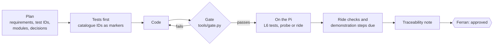
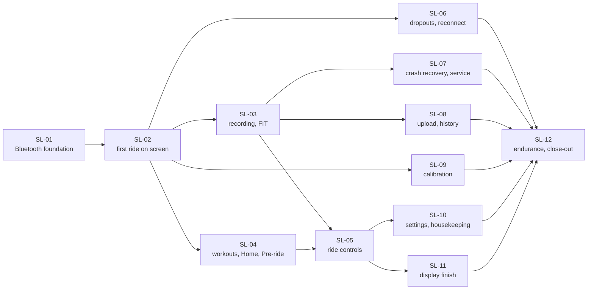
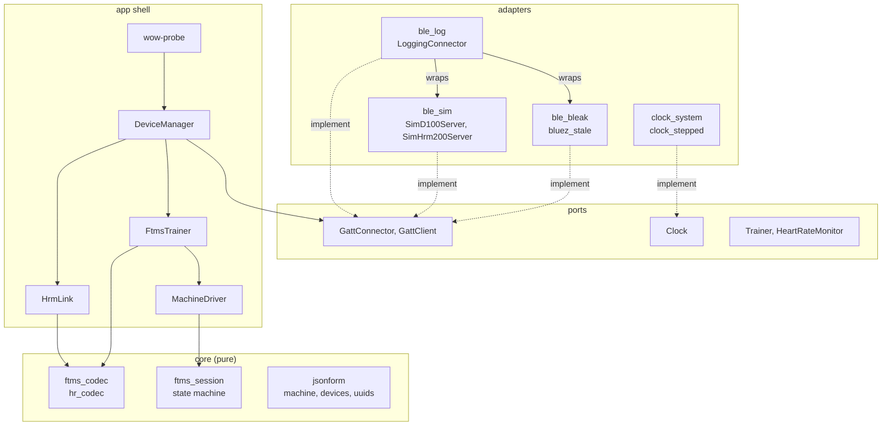
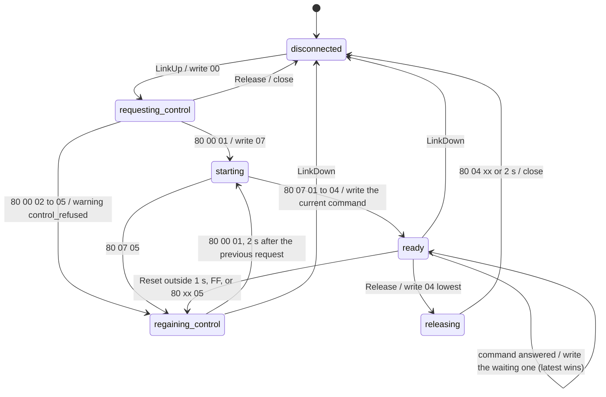
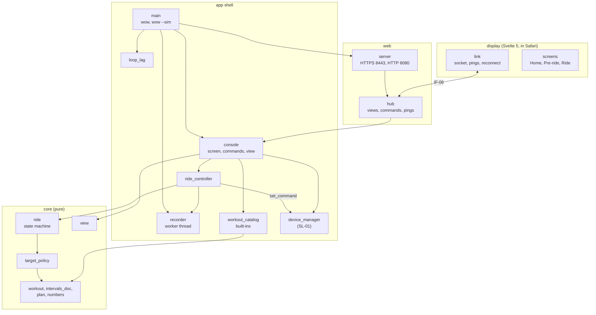

# Phase 5 — Implementation

**Status:** revision 2, 12 Nov 2026. The slice plan; SL-01 (Bluetooth foundation) and SL-02 (first ride on screen) planned and built. Both pass the laptop gate except for SL-01's two log-based tests, which wait for the Phase 2 logs (section 5.4). SL-02 still needs its Pi part: T-SYS-01 and a first real ride with RR-01 to RR-04 (section 11). Waiting for Ferran's approval of both slices after tonight's test. Builds on the Phase 1 requirements (revision 7), the Phase 3A architecture (revision 5), the ICD (revision 4) and the Phase 4 test plan (revision 2).

## 1 How Phase 5 works

Every slice runs the same cycle, and the next slice starts only after Ferran's "approved".



| Element | What it is |
|---------|------------|
| Gate | `uv run python tools/gate.py --through SL-nn`: pytest without `slow` and `pi` (flake8, strict mypy, the import check and the lockfile check run inside it as T-TOOL-01 to T-TOOL-04), the coverage floors of test plan 2.5, then `tools/trace.py`. From SL-02 also `svelte-check`, ESLint, the TypeScript compiler, Vitest and `npm ci`. |
| Markers | Every test carries `case("T-…")` and `req("APP-…")`. Supporting tests outside the matrix carry `S-` IDs (as the plan's S-DSP): S-INF for infrastructure, S-SES for session edge cases (IM-12). |
| Traceability | `tools/trace.py` reads the catalogues of the test plan, the pytest results (`build/pytest-cases.json`, written by `tests/conftest.py`) and `docs/verification-log.md`. It fails when a test names no catalogue ID, when markers and catalogue disagree on requirements, when a catalogue test of a finished slice is missing or not passing, or when any test fails. |
| Slice document | Each slice gets a plan section and a result section in this document, ending with its traceability note, decisions and the approval question. |

## 2 Slice plan

The slices of test plan 4.1, in the same order. Each one is usable on its own: from SL-02 on there is a ride on the screen, and from SL-05 on a full weekly session.



| Slice | New modules | Closes | First real-device evidence |
|-------|-------------|--------|----------------------------|
| SL-01 | `core/ftms_codec`, `core/hr_codec`, `core/ftms_session`; ports; `adapters/ble_bleak`, `ble_sim`, `ble_log`, clocks; `app/ftms_trainer`, `hrm_link`, `device_manager` (connect path); gate, trace | A-61 (OP-19) | `wow-probe` on the Pi (not in the matrix) |
| SL-02 | `core/workout` (watts and %FTP), `core/plan`, `core/target_policy`, `core/ride` (armed, steps, finish), `core/view`, `app/ride_controller`, `web/server`, `web/hub`, `app/main` with `wow --sim`, display skeleton with the ERG ride screen | A-51, A-60 (OP-12, OP-17) | First ride; RR-01 to RR-04 |
| SL-03 | `core/sampler`, `core/metrics`, `app/recorder`, `adapters/fit_garmin`, `adapters/store_files` (ride files), Summary | A-28, A-52, A-54 | FIT into Garmin Connect |
| SL-04 | `core/intervals_doc`, `app/workout_catalog`, `adapters/intervals_icu` (read), built-ins, Home, Pre-ride | A-55 | DS-1 |
| SL-05 | Pause, skip, intensity, resistance mode and screen, free ride, end of workout, discard | OP-4 | DS-2, DS-7 |
| SL-06 | Reconnect for the whole ride, regain on the real trainer, display link, `ble_replay` | A-33, A-44 | DS-3 |
| SL-07 | `app/recovery`, systemd unit, boot, LED | A-29, A-36, A-50 | DS-5 |
| SL-08 | `app/upload_worker`, history, download, delete, storage warning | A-19, A-53 | DS-6 |
| SL-09 | `core/spindown`, `app/calibration_controller`, Calibration screen | — | DS-4 |
| SL-10 | `core/settings`, Settings screen, device scan and choice, idle release, abandoned ride, clock and certificate warnings | — | DS-1 |
| SL-11 | Wake-lock prompt, countdown, profile, sound, sizes, latency reports | A-49, A-56 to A-58 | DS-8, walk-through I-14 to I-20 |
| SL-12 | 4-hour runs, replay regression, full traceability | — | T-SYS-02 |

## 3 SL-01 plan: Bluetooth foundation

### 3.1 Scope

**Requirements** (automated part): APP-101, APP-102, APP-103, APP-104, APP-105, APP-106, APP-108, APP-109, APP-111, APP-113, APP-320 (session part), APP-502 and APP-503 (codec part), APP-603 (codec part), APP-801 (logic part), APP-813, APP-818, APP-819, APP-822 and APP-823 (Python part).

**Tests:** T-COD-01 to T-COD-11; T-SES-01, -02, -05, -08, -09, -10; T-DEV-01 to T-DEV-03; T-LOG-01; T-SIM-01, T-SIM-02; T-TOOL-01 to T-TOOL-04. Pulled forward from SL-06: T-SES-03, -04, -06, -07 (IM-11).

### 3.2 Modules



| Module | Responsibility | Interface |
|--------|----------------|-----------|
| `core/ftms_codec` | Decode Indoor Bike Data by its flags (extra bytes ignored, More Data joined), features, ranges, control point responses, statuses; encode the five commands | IF-01 |
| `core/hr_codec` | Heart Rate Measurement, Battery Level | IF-02 |
| `core/ftms_session` | Take control, Start or Resume, one procedure at a time with the latest command winning, regain control every 2 s, the expected Reset, status repeats, 3 s warning and 30 s re-send, results 02 to 05, orderly release | IF-01 4.1.5, 4.1.6 |
| `core/jsonform` | JSON forms of events, actions and values for `testdata/` | IF-04, APP-821 |
| `ports/*` | The ICD's protocols, with no implementation | IF-03, IF-04, IF-05 |
| `app/machine_driver` | Runs any core state machine: events at once, a Tick at the next deadline, waiting only through `Clock` | AD-07, AD-22 |
| `app/ftms_trainer` | The Trainer port: reads and subscriptions on connect, the session's writes, samples out | IF-05, S-1, S-6 |
| `app/hrm_link` | The strap: battery read, heart rate and battery subscriptions | IF-02 4.2.3 |
| `app/device_manager` | Connect both when Pre-ride opens, keep trying while not found, drop stale loss reports, release in order | IF-05 |
| `adapters/ble_bleak`, `bluez_stale` | bleak 3.0.2 on BlueZ with the stale-link release before every connect and no loss reports during a connect | IF-03 4.3.3 |
| `adapters/ble_sim` | Simulated D100 and HRM 200 as GATT servers behind `SimConnector` | IF-03 4.3.4 |
| `adapters/ble_log` | `LoggingConnector`: every operation in IF-11 lines | IF-11 |
| `adapters/clock_system`, `clock_stepped` | The Pi's clocks; the stepped clock of the tests | IF-04 4.4.1 |
| `app/probe` | `wow-probe`: S-1, an ERG target, S-6 on the real devices, with the Bluetooth log | — |

### 3.3 Exit criteria

Gate green with `--through SL-01` (all catalogue tests of SL-01 implemented and passing, coverage floors met, no trace problems). No L6 tests, ride checks or demonstrations are due in SL-01 (test plan 4.1 and 9). Recommended before SL-02: one `wow-probe` run on the Pi with the D100 and the strap.

## 4 Decisions taken while building SL-01

| ID | Decision | Why |
|----|----------|-----|
| IM-01 | bleak stays at **3.0.2**. bleak **3.1.0** was released on PyPI on 7 Nov 2026, so 3A's "3.0.2, still the latest" (checked 10 Nov) was wrong. 3.1.0's BlueZ client changes the disconnect teardown (the disconnected callback runs once even when the D-Bus connection dies, the bus is always released); it raises dbus-fast to ≥ 4.0. Proposed: try 3.1.0 in SL-06, where reconnects are tested on the D100. | 3.0.2 is what the Phase 2 spikes ran on the Pi and what the ICD's bleak mapping (RD-04) is written against. |
| IM-02 | Pinned development tools, checked on PyPI on 11 Nov 2026: pytest 9.2.0, flake8 7.5.0, mypy 2.4.1, pytest-asyncio 1.4.1.post1, pytest-cov 7.1.0, hypothesis 6.170.15. Build backend `uv_build` 0.11; distribution `witchesonwheels`, module `wow`; Python `>=3.13,<3.14`. dbus-fast resolved to 5.2.0 through bleak. | Test plan 2.4 left these to the first slice. |
| IM-03 | The port protocols live in `src/wow/ports/`, a fifth folder next to `core`, `app`, `web` and `adapters`. | 3A's layer diagram has a ports layer; the core stays free of `async` protocols. |
| IM-04 | The session's inputs carry raw bytes (`indication`, `status_notification`) and its writes are bytes: a timeline is bytes in, bytes out. | Language-neutral cases cover decoding too (D-17). |
| IM-05 | L2 cases: the event and action files of `testdata/README.md`, with `every` and `count` for long runs; at the same instant an event goes in before a Tick. | The harness rule must be written down for a JavaScript v2. |
| IM-06 | While control is refused, Request Control is written every 2.0 s counted from the previous request's write, not from the refusal. | Exactly "every 2 s" (APP-105), independent of the trainer's answer time. |
| IM-07 | Result 04: one retry after 2 s; if that fails too, the warning `trainer_not_responding`, then the command again every 30 s until it succeeds. | ICD 4.1.6 says "retry once after 2 s, then warn" without saying what follows; this matches APP-107's "for as long as the ride runs". |
| IM-08 | Result 03: the last command the trainer accepted becomes the current one again, so a reconnect sends that, not the refused one. | "Keep the last good command" (ICD 4.1.6) made concrete. |
| IM-09 | Release clears the session's command, so a later connection never re-applies an old target. A release before control is granted, or with no resistance range, closes the link at once. | APP-320 with no stale target afterwards. |
| IM-10 | Statuses other than Reset, Control Permission Lost and spin-down are kept only in the Bluetooth log. | ICD 4.1.4, "logged only": the Bluetooth log already holds them. |
| IM-11 | T-SES-03, -04, -06 and -07 (SL-06 in the plan) are implemented and passing now. | The session is one state machine; splitting it across slices would leave untested branches in `core/` (95 % floor). Their real-device evidence stays in SL-06. |
| IM-12 | Supporting tests outside the matrix: S-INF-01 (JSON forms), S-INF-02 (stepped clock), S-INF-03 (`wow-probe`), S-INF-04 (log importer), S-INF-05 (system clock), S-INF-06 (link loss and shutdown during set-up or release), S-SES-01 (session edge cases: malformed or unexpected answers, statuses outside control, refused Start, early release, reconnect while refused). | Every test needs an ID (trace rule); these verify no requirement on their own. |
| IM-13 | Stepped clock: wakes sleepers one at a time in deadline order (ties in arrival order) and lets the event loop run 32 rounds after each wake; `drive(work)` runs anything that waits on the clock. | Closes A-61 (5.3). |
| IM-14 | Simulated D100: dead time 0.7 s then a first-order lag with τ = 0.35 s, so 90 % of a step at 1.5 s (F-25); answers 186, 250, 320, 390 ms after a write, in turn (F-28); one Reset in three copies 0.20, 0.25, 0.30 s after a grant (F-29, F-9); Indoor Bike Data every 0.21 and 0.29 s in turn (4 Hz, F-50), 16 bytes with 10 placeholder vendor bytes (F-1); resistance power interpolated from F-12; stops advertising while linked (F-33); connect takes 2.3 s (F-31's fastest). Op codes it doesn't model yet answer 02 (spin-down comes with SL-09); it sends only the statuses the ICD names. | 3A, "Simulated devices". |
| IM-15 | Simulated GATT servers have three methods beyond the ICD's `GattServer`: `advertising()`, `on_connect()`, `on_disconnect()`. | So the D100 can stop advertising while linked. ICD 4.3.1 clarification proposed. |
| IM-16 | IF-11 details: `released_stale` lines carry `outcome` (`released`, `not connected`, …); `dev` is `other` for a device that is neither the trainer nor the strap. | ICD 4.11 clarification proposed. |
| IM-17 | Device manager in SL-01: a configured device starts as `not_found`, goes to `searching` when Pre-ride opens, and while it isn't found stays `not_found` with a new attempt every 2 s (**design**). A lost link shows `dropout`; reconnecting during a ride comes in SL-06. | APP-102's three states, without flicker between them. |
| IM-18 | `wow-probe` (entry point of the package): checks the bleak adapter on the real D100 and strap before SL-02, and runs against the simulator with `--simulate`. | `ble_bleak` has no automated test and no coverage floor (test plan 2.5); ride checks start in SL-02. |
| IM-19 | T-TOOL-01 and T-TOOL-04 cover Python now and fail as soon as `display/package.json` exists without the display checks, so SL-02 must add them. | The display doesn't exist before SL-02. |
| IM-20 | `tools/trace.py` reads the plan from `docs/phase4-test-plan.md`. | The repository holds the phase documents (3A, repository layout). |

## 5 SL-01 result

### 5.1 What was built

Python 3.13.18 in the workspace; `uv sync --frozen` from the lockfile. 27 modules under `src/wow`, 3 tools, 137 tests, fixtures in `testdata/ftms`, `testdata/hr` and `testdata/timelines/ftms_session` (15 timeline cases).

The trainer session as built, with the decisions above (the ICD's diagram, IF-01 4.1.5, is unchanged in substance; `Lost` is `disconnected` here, and `ProcedurePending` is any phase with a write waiting for its answer):



### 5.2 Test results

| Check | Result |
|-------|--------|
| pytest (not `slow`, not `pi`) | 135 passed, 2 skipped: the two log-based tests (5.4) |
| flake8 7.5.0, mypy 2.4.1 strict (src, tests, tools) | 0 findings (T-TOOL-01) |
| Import check | 0 findings (T-TOOL-02) |
| `uv lock --check` and a frozen dry-run install from a clean copy | pass, lockfile unchanged (T-TOOL-04) |
| Coverage `core/` | 97.0 % branch (floor 95 %) |
| Coverage `app/` | 90.7 % line (floor 85 %) |
| Coverage testable adapters (`ble_sim`, `ble_log`, `clock_stepped`) | 96.3 % line (floor 85 %) |
| Coverage `ble_bleak`, `bluez_stale`, `clock_system` | no floor; covered by the probe and, from SL-02, ride checks |
| `wow-probe --simulate`, real time | PASS: control in under 4 s, 150 W held, last write `04 00`, 71 IF-11 lines |
| Trace | 2 problems: T-COD-01 and T-SIM-01 skipped (5.4) |

### 5.3 Assumption closed

| ID | Result |
|----|--------|
| A-61 | **Confirmed.** The asyncio shell runs on the stepped clock without real waiting: T-DEV-01 checks the strap's `not_found` at exactly 10.0 s, T-SIM-02 rides 12 ERG steps (over 6 minutes of simulated time), and the whole suite runs in about 7 s. Two conditions belong to the result: work that waits on the clock has to be run with `clock.drive()` (or with time moved on beside it), and the zero-time work after one wake must finish within 32 loop rounds (today's longest chain is about 6). |

### 5.4 To finish SL-01

| # | Item | Who |
|---|------|-----|
| 1 | Import the S1 and S2 logs with `tools/import_spike_log.py` (commands in `README.md`). Then T-COD-01 checks all 1076 S1 records and T-SIM-01 compares the simulator with both logs. Both test paths were exercised here on a simulated log of the same form. | Ferran, or send the two logs and Claude does it |
| 2 | Copy the approved test plan to `docs/phase4-test-plan.md` if the repository doesn't have it, and run the gate: `uv run python tools/gate.py --through SL-01`. | Ferran |
| 3 | Recommended: `uv run wow-probe` on the Pi with the D100 and the strap, and send `probe-*.jsonl`. | Ferran |

### 5.5 Proposed changes to approved documents

| Document | Change | From |
|----------|--------|------|
| 3A, Tech choices | Bluetooth row: "bleak 3.0.2 (3.1.0 of 7 Nov 2026 to be tried in SL-06)" instead of "3.0.2, still the latest". Test tool rows: the versions of IM-02. | IM-01, IM-02 |
| 3A, Repository layout | `src/wow/{core,ports,app,web,adapters}/`. | IM-03 |
| ICD 4.1.6 | Result 04: then every 30 s until it succeeds. Result 03: the last accepted command becomes current. Release clears the command. | IM-07 to IM-09 |
| ICD 4.1.5 | Request Control every 2 s counted from the previous request. | IM-06 |
| ICD 4.3.1 | Simulator `GattServer`: `advertising()`, `on_connect()`, `on_disconnect()`. | IM-15 |
| ICD 4.11 | `outcome` on `released_stale`; `dev` may be `other`. | IM-16 |

## 6 Traceability note SL-01

Requirements with a test of SL-01, with all their automated tests from the matrix (test plan 9). "Passed so far": every test that is due has passed and others follow in later slices. `tools/trace.py --note SL-01` prints the same table from the full plan.

| Req. | Automated tests | Ride checks, demonstrations, inspections | Automated part |
|------|-----------------|------------------------------------------|----------------|
| APP-101 | T-COD-07 passed | I-01 pending | passed |
| APP-102 | T-DEV-01 passed, T-VIEW-11 due SL-04 | D-04, I-15 pending | passed so far |
| APP-103 | T-COD-06 passed, T-DEV-02 passed, T-SES-07 passed | — | passed |
| APP-104 | T-COD-07 passed, T-SES-01 passed | RR-01 pending | passed |
| APP-105 | T-COD-08, T-SES-02, T-SES-03, T-SES-04, T-SES-08 passed | D-31, I-18 pending | passed |
| APP-106 | T-SES-05 passed | — | passed |
| APP-107 | T-SES-06, T-SES-07 passed (ahead of SL-06) | D-31, I-18 pending | passed |
| APP-108 | T-COD-01 **skipped** (S1 log), T-COD-02 to T-COD-05 passed, T-LOG-04 due SL-06 | — | open until the S1 log is in |
| APP-109 | T-COD-09 passed | — | passed |
| APP-111 | T-COD-10 passed, T-DEV-03 passed | D-04, RR-06 pending | passed |
| APP-113 | T-COD-11 passed | D-30, I-18 pending | passed |
| APP-320 | T-SES-10 passed; T-RID-13 due SL-05, T-SYS-04 due SL-07, T-DEV-04 due SL-10 | D-13, RR-10 pending | passed so far |
| APP-502 | T-COD-08, T-SES-08 passed; T-CAL-02 due SL-09 | D-20, I-20 pending | passed so far |
| APP-503 | T-COD-08 passed; T-CAL-03 due SL-09 | D-20, I-20 pending | passed so far |
| APP-603 | T-COD-10 passed; T-SMP-03, T-MET-04, T-FIT-04 due SL-03, T-E2E-03 due SL-06 | RR-05 pending | passed so far |
| APP-801 | T-SES-09 passed; T-SYS-01 due SL-02 | RR-02 pending | passed so far |
| APP-813 | T-LOG-01 passed | RR-11, I-05 pending | passed |
| APP-818 | T-TOOL-02 passed | I-09 pending | passed |
| APP-819 | T-SIM-01 **skipped** (S1, S2 logs), T-SIM-02, T-TOOL-02, T-TOOL-03 passed; T-SIM-03 due SL-06, T-SIM-04 due SL-12 | I-10 pending | open until the logs are in |
| APP-822 | T-TOOL-04 passed (Python; `npm ci` from SL-02) | I-12 pending | passed so far |
| APP-823 | T-TOOL-01 passed (Python; display checks from SL-02) | I-13 pending | passed so far |

## 7 SL-02 plan

Planned on 11 Nov 2026 and built on 12 Nov at Ferran's request ("do the same for SL-02"), before SL-01's approval, so both slices can be tested together on the Pi. Built as planned, with the decisions of section 8.

**Content (test plan 4.1):** plan, target policy, ride state machine, HTTPS server, hub, ERG ride screen, start on the first power. Closes A-51 (one event loop meets APP-801, OP-12) and A-60 (0 W at standstill, OP-17) once the Pi has run them.

**Requirements** (automated part): APP-116, APP-117, APP-204 and APP-302 (watts and percent of FTP), APP-301, APP-303, APP-304, APP-313 (target part), APP-401, APP-402, APP-605 (step part), APP-801 (real time), APP-803 and APP-807 (Pi side), APP-816, APP-822 and APP-823 (display part).

**Tests due:** T-WKO-01, T-TGT-01, T-TGT-02, T-TGT-07, T-RID-01 to T-RID-06, T-VIEW-01, T-VIEW-02, T-VIEW-10, T-WEB-01, T-WEB-02, T-WEB-04, T-WEB-06, T-SYS-01 (on the Pi), S-DSP-01; ride checks RR-01 to RR-04 from the first real ride.

### 7.1 Modules



| Module | Responsibility | Interface |
|--------|----------------|-----------|
| `core/numbers` | Round half up on exact fractions; power zones | ICD 1.4, APP-702 |
| `core/workout`, `core/intervals_doc` | Workout types; `workout_doc` steps in `w` and `%ftp` and repeat blocks; anything else refused by name until SL-04 | IF-13 |
| `core/plan` | Steps flattened with start, end and watts at an FTP; `plan_id` = `<ref>@<ftp>` | APP-203, APP-204 |
| `core/target_policy` | ERG target per step with intensity, limited to the trainer's range; when the next target goes out | APP-302 to APP-304, APP-313 |
| `core/ride` | Armed, Running, WorkoutDone, Finished, Cancelled; journal records; trainer commands | IF-04 4.4.2, 4.4.3 |
| `core/view` | View state of Home, Pre-ride and the ride screen; 3 s power; plan message | IF-06 4.6.3 |
| `app/console` | Which screen is open; display commands to the controllers by screen; the view | IF-06 4.6.5 |
| `app/ride_controller` | Runs `core/ride` with the machine driver; trainer commands; journal records to the recorder | AD-07 |
| `app/recorder` | Ride directory, `events.jsonl`, `ble.jsonl`, `logs/ble-system.jsonl`, from a worker thread | IF-09, IF-11 |
| `app/workout_catalog` | The built-in workouts | IF-13 |
| `app/loop_lag` | Logs and counts event-loop wake-ups more than 50 ms late | AD-06, A-51 |
| `app/main` | Composition root; `wow --config`, `--sim`; orderly shutdown | 3A |
| `web/server` | HTTPS site with the display and `/ws`; HTTP site with the redirect and the root certificate | IF-07 |
| `web/hub` | View pump, plan messages, commands and acks, pings | IF-06 |
| `display/` | Link, Home, Pre-ride, ride screen (waiting, ERG, workout done), Finish sheet, Pi-lost state, IF-06 types | 3C |
| `tools/check_ride.py` | RR-01 to RR-04 over a ride directory | Test plan 6 |

### 7.2 A ride through the modules

```mermaid
sequenceDiagram
    participant P as page
    participant H as web/hub
    participant C as console
    participant R as ride_controller
    participant T as trainer (ftms_trainer)
    participant F as recorder
    P->>H: command start
    H->>C: start
    C->>R: start(workout, ftp, lead time)
    R->>F: open rides/<UTC of Start>
    R->>T: set_command(Erg first target)
    R->>F: journal command, armed, trainer_command
    H-->>P: ack, view (waiting_for_power)
    T-->>C: sample, power 0 W
    T-->>C: sample, power ≥ 1 W
    C->>R: PowerSeen
    R->>F: journal ride_started, step_started
    Note over R: next deadline: boundary minus lead time
    R->>T: set_command(Erg next target)
    R->>F: journal trainer_command (due_mono_ms)
    Note over R: boundary
    R->>F: journal step_started
    P->>H: command finish (after the sheet)
    R->>T: set_command(lowest resistance level)
    R->>F: journal finished; files closed 3 s later
    H-->>P: view (home)
```

### 7.3 Exit criteria

Gate green with `--through SL-02`, apart from SL-01's two log-based tests until the logs are imported. On the Pi: T-SYS-01 passes and is logged; a first real ride passes RR-01 to RR-04; Ferran has looked at Home, Pre-ride and the ride screens on the iPhone.

## 8 Decisions taken while building SL-02

| ID | Decision | Why |
|----|----------|-----|
| IM-21 | Display toolchain, exact versions from the npm registry on 12 Nov 2026, locked in `package-lock.json`: svelte 5.57.3, vite 8.3.8, @sveltejs/vite-plugin-svelte 7.3.1, typescript **6.0.3**, svelte-check 4.7.8, eslint 10.14.0, @eslint/js 10.0.1, eslint-plugin-svelte 3.24.1, svelte-eslint-parser 1.10.1, typescript-eslint 8.72.2, globals 17.14.0, vitest 5.1.0, @testing-library/svelte 5.4.2, jsdom 31.0.0, @types/node 26.6.6, the two Sofia Sans font packages 5.3.0. | TypeScript 7.0.2 is the newest, but typescript-eslint 8.72.2 accepts `>=4.8.4 <6.1.0` and svelte-check 4.7.8 `^5.0.0 \|\| ^6.0.0`. Vitest 5.1.0 replaces the plan's 5.0.4 and needs Node.js `^22.12 \|\| ^24 \|\| >=26`. Playwright waits for S-PW-01 (SL-06). |
| IM-22 | New module `app/console`: which screen is open, display commands routed by screen to the controllers, the view assembled from `core/view`. | 3A gives the hub the connections and the ride controller the ride; no module owned the screen. Proposed for 3A. |
| IM-23 | `app/workout_catalog` starts in SL-02 with the built-ins only. Two built-ins the SL-02 parser can read: "ERG check" (6 min: 120 W, 2 × 30 s at 220 W and 60 s at 130 W, 120 W) and "30/30 and a surge" (19 min, Phase 2's S2 session). | The ramp test needs free ride (SL-04); a first ride needs something to ride. |
| IM-24 | `app/recorder` in part, pulled from SL-03: ride directory at Start, named by the UTC of Start; `events.jsonl` and `ble.jsonl` in it; `logs/ble-system.jsonl` outside rides; JSON Lines written by a worker thread, `fsync` at most every 2 s and when a file closes. Samples, `timing.jsonl`, `meta.json` and the FIT file stay in SL-03 and SL-11. | RR-01 to RR-04 need the journal and the Bluetooth log of the first real ride (IF-09, 4.9.1). |
| IM-25 | A ride's files close 3 s after it ends, so the last trainer write and its answer land in the ride's `ble.jsonl`. A ride started in those 3 s gets its own directory. | The lowest-level write at Finish is the last command RR-02 checks. |
| IM-26 | Journal fields beyond ICD 4.9.2: `armed.lead_time` (s) and `step_started.scheduled` (s, the step's planned ride time). `armed.block_modes` comes with block modes in SL-05. | RR-03 and RR-04 need them. Proposed for the ICD. |
| IM-27 | After Finish the console returns to Home (Summary in SL-03); after Cancel or the 30 min timeout to Pre-ride. A command the ICD names but no slice has built yet answers `invalid_state`; a name outside ICD 4.6.5 answers `bad_request`. | ICD 4.6.6 has the two errors; this fixes which applies. |
| IM-28 | The trainer shows `connected` once its GATT set-up is done, before control is granted. Start is allowed then; the first target is written when the session reaches Ready (APP-104). | Seen in a real-time run: the first target fell due while Start or Resume was pending and was written 0.1 ms after its answer. |
| IM-29 | Hub: one pump task. After each send it waits for a change or 1 s, and never less than 0.1 s after the previous send, so a change goes out within 0.1 s, at most 10 and at least 1 view a second. `seq` per connection; the plan message goes before the first view that needs it and again whenever `plan_id` changes. Malformed messages are logged, with an `ack` `bad_request` when the `id` is readable. `ping` is answered; `painted` and `tap_mono_ms` are accepted and not yet written: `timing.jsonl` comes with the latency reports in SL-11. | IF-06 4.6.1, 4.6.2, 4.6.6. |
| IM-30 | The port-80 redirect keeps the HTTPS port in `Location` when it isn't 443. `GET /` answers 503 "display not built" when there is no `index.html`. `/assets/*` is cached for a year (`immutable`), `/` not at all. | wow runs as a user on 8443 and 8080 until SL-07's systemd unit binds 443 and 80. Proposed for ICD 4.7. |
| IM-31 | `wow --config <file> [--sim]`; `--sim` overrides `bluetooth.simulate`. Relative paths in `wow.toml` are taken from the working directory. | One configuration for the Pi and the laptop. |
| IM-32 | Simulated rider: `SimD100Server(pedal_after_erg=3.0)` reports 0 W and 0 km/h until the first Set Target Power, pedals 3 s later, and stops at Set Target Resistance. | A-60's standstill plays out on the simulator, and `wow --sim` rides by itself. |
| IM-33 | Display in SL-02: Home (built-ins), Pre-ride (devices, battery, profile, blocks, Start ride disabled with "Trainer not connected"), ride screen waiting for power, ERG layout and workout done; Finish sheet ("Finish and save", "Keep riding"); values dimmed with a banner after 3 s without a view; reconnect after 0.5, 1, 2, 4, then every 5 s; reload on another app version; pings and `painted`. Intensity, Ride by resistance, Pause and Skip step are drawn and disabled until SL-05. Step time counts down on the page between views, with the 5-to-1 countdown. Screens of later slices show "Not built yet" with Back. | 3C, Figures 2, 8 and 10, as far as SL-02 has data. Drawing the disabled controls lets the layout be judged on the phone now. |
| IM-34 | The page requests the screen wake lock on the Start tap and again when it becomes visible during a ride. The prompt bar (APP-416) stays in SL-11. | A first ride with the phone's Auto-Lock on would otherwise go dark. |
| IM-35 | The display build takes the app version from `pyproject.toml`; `hello` carries the installed distribution's version. The built display goes to `src/wow/web/static/` (not in git), so the wheel carries it: `uv build` was checked to include `wow/web/static/` and `wow/builtin/`. | AD-17, AD-19: the Pi has no Node.js. |
| IM-36 | `tools/check_ride.py` reads the ride's `events.jsonl` and `ble.jsonl` and `logs/ble-system.jsonl`. RR-01 per connection that wrote during the ride: its first control point writes are `00`, `07`, then targets. RR-02 matches each `trainer_command` with the first write of its bytes between its `due_mono_ms` and the next command's; the delay counts from the due time, or from the answer of a procedure pending at that time (from either log). A command equal to the one before isn't written by the session and counts as unchanged; one followed by another within 1 s counts as replaced (APP-106). RR-03 from `ride_started` and each `step_started.scheduled`. RR-04: per boundary, the command issued between max(previous start, boundary − lead time) − 0.1 s and the boundary, written within 100 ms of that instant. | The trainer connects at Pre-ride, before the ride directory exists, so the connection's first writes are in the system log. |
| IM-37 | Tests marked `pi` don't run in the laptop gate. `tools/trace.py` shows them as "due on the Pi" and counts them once `docs/verification-log.md` has a line with their ID and result (T- IDs now accepted there). T-SYS-01 runs 60 min; `WOW_SYS_MINUTES` shortens it. | Test plan 4: L6 runs on the Pi after the laptop gate. |
| IM-38 | Test certificates in `testdata/tls/`: a test-only root and a `wow.local`, `localhost`, `127.0.0.1` server certificate, the root's key deleted. T-WEB-02 plants decoy key files beside and above the static files and tries path traversal on both sites. | Real TLS on localhost, as the S8 spike did (test plan 2.1, L5). |
| IM-39 | Supporting tests: S-WKO-01, S-RID-01, S-VIEW-01 (core edge cases), S-SHL-01 and S-SHL-02 (app shell from Home to Finish on the stepped clock), S-REC-01 (recorder, boot ID), S-LAG-01 (loop lag), S-HUB-01 and S-HUB-02 (message parsing, view pump), S-RR-01 (ride checks), S-CFG-01 (configuration files), S-DSP-01 (Vitest). | Trace rule: every test has an ID. |
| IM-40 | Core details: watts and levels rounded half up on exact fractions; zones are inclusive upper bounds (55 % is zone 1, 55.2 % zone 2, above 120 % zone 6); the 3 s power is the mean of the values received in the last 3 s (one exactly 3 s old is out); heart rate is missing 3 s after its last value; at the end of the workout the trainer goes to its lowest resistance level, the free-ride level's default until SL-05 and SL-10. | ICD 1.4; APP-402; N-1; APP-314. |

## 9 SL-02 result

### 9.1 What was built

51 Python files under `src/wow` (19 new), 4 tools, 251 pytest tests and 14 Vitest tests; the display in 19 files; about 9,600 lines of Python, TypeScript and Svelte in all. New fixtures: `testdata/workouts/`, `testdata/timelines/ride/` (10 cases), `testdata/display/` (9 golden views), `testdata/tls/`.

The display in headless Chrome at 402 × 720 pt against `wow --sim` (Home, Pre-ride, waiting for power, ERG, the 5-to-1 countdown, the Finish sheet) matched 3C's layout as far as SL-02 has data. The phone is the judge (I-14 to I-20); this was only a smoke look.

### 9.2 Test results

| Check | Result |
|-------|--------|
| pytest (not `slow`, not `pi`) | 251 passed, 2 skipped: SL-01's two log-based tests (5.4) |
| flake8, mypy strict; svelte-check, ESLint, tsc on the display | 0 findings (T-TOOL-01) |
| Import check | 0 findings (T-TOOL-02) |
| `uv sync --frozen` and `npm ci` from clean copies | pass, lockfiles unchanged, every npm version exact (T-TOOL-04) |
| Vitest | 14 passed: every golden view renders (S-DSP-01), formatting and the clock offset |
| Coverage `core/` | 96.8 % branch (floor 95 %) |
| Coverage `app/` and `web/` | 94.2 % line (floor 85 %) |
| Coverage testable adapters | 96.6 % line (floor 85 %) |
| T-SYS-01, 1 minute instead of 60, in Claude's workspace (not the Pi) | RR-02 pass, worst 0.3 ms; loop lag worst 3.7 ms, none over 50 ms |
| Trace `--through SL-02` | 2 problems, both SL-01's (T-COD-01, T-SIM-01 skipped); T-SYS-01 due on the Pi |

### 9.3 Assumptions

| ID | State |
|----|-------|
| A-51 | Open until T-SYS-01 runs 60 min on the Pi. The workspace run is encouraging, not evidence: it isn't a Pi 5. |
| A-60 | Open until the first real ride (D-06's check): after Start, wait 20 s without pedaling; the screen must stay on "Start pedaling" at 0:00. |
| A-56 | Still open: the page prints the viewport size to Safari's console only. Read it with Web Inspector, or wait for SL-11's report. |

### 9.4 Findings

| # | Finding | Proposed |
|---|---------|----------|
| SF-1 | T-WKO-01 names the S6 workout `tEST`, but every power step in it is a range, a zone, a ramp or free ride (F-18), which SL-02's parser doesn't read. | SL-02 runs T-WKO-01 on a hand-written fixture (`plain-steps`); `tEST` joins T-WKO-01 in SL-04. Test plan 5.3 to say so. |
| SF-2 | The journal doesn't record a step's target, so RR-04 can't tell an unchanged target from a command that never went out. | Add `target` (W) to `step_started` in SL-03 (ICD 4.9.2). Until then T-TGT-07 covers the logic. |
| SF-3 | `connected` doesn't say whether control is held (IM-28). Harmless for the ride; it could matter for Pre-ride if control is refused. | No change now; revisit with SL-06's regain-control work on the D100. |

### 9.5 Proposed changes to approved documents

| Document | Change | From |
|----------|--------|------|
| 3A, Modules | `app/console` (screen, commands, view). `app/workout_catalog` and `app/recorder` start in SL-02, in part. | IM-22 to IM-24 |
| 3A, Tech choices | Display versions of IM-21; TypeScript 6.0.3, with the reason. | IM-21 |
| ICD 4.9.2 | `armed.lead_time`, `step_started.scheduled`; later `step_started.target`. | IM-26, SF-2 |
| ICD 4.7 | Redirect keeps a non-443 HTTPS port; `/` answers 503 without a built display. | IM-30 |
| ICD 4.6.6 | `invalid_state` for commands not built yet. | IM-27 |
| Test plan 2.4, 5.3, 5.17 | Vitest 5.1.0; T-WKO-01's fixture; L6 results recorded in the verification log by test ID. | IM-21, SF-1, IM-37 |

## 10 Traceability note SL-02

From `tools/trace.py --through SL-02 --note SL-02` on the catalogue rows of SL-01 and SL-02. Ride checks show "pending" until tonight's ride is logged.

| Req. | Automated tests | Ride checks, demonstrations, inspections | Automated part |
|------|-----------------|------------------------------------------|----------------|
| APP-116 | T-RID-05 passed | — | passed |
| APP-117 | T-RID-04 passed | I-15 pending | passed |
| APP-204 | T-WKO-01 passed; T-WKO-03, -05 to -07 due SL-04, T-E2E-01 due SL-05 | — | passed so far |
| APP-301 | T-RID-01 to T-RID-03 passed, T-VIEW-10 passed; T-E2E-01 due SL-05 | D-06, I-16 pending | passed so far |
| APP-302 | T-TGT-01 passed, T-WKO-01 passed; T-E2E-01 due SL-05 | — | passed so far |
| APP-303 | T-TGT-02 passed | D-31, I-16 pending | passed |
| APP-304 | T-RID-06 passed, T-TGT-07 passed; T-E2E-01 due SL-05 | D-08, **RR-04 pending** | passed so far |
| APP-313 | T-TGT-01 passed; T-RID-11, T-E2E-02 due SL-05 | — | passed so far |
| APP-401 | T-VIEW-01 passed; T-VIEW-09 due SL-11 | D-07, I-16 pending | passed so far |
| APP-402 | T-VIEW-02 passed | — | passed |
| APP-605 | T-RID-06 passed; T-RID-10 due SL-05, T-FIT-03 due SL-03 | RR-14 pending | passed so far |
| APP-801 | T-SES-09 passed, **T-SYS-01 due on the Pi** | **RR-02 pending** | passed so far |
| APP-803 | T-WEB-04 passed; T-WEB-07 due SL-11 | RR-08 pending | passed so far |
| APP-807 | T-WEB-04 passed; T-WEB-05 due SL-06, T-E2E-03 due SL-06 | D-17, I-18 pending | passed so far |
| APP-816 | T-WEB-01 passed, T-WEB-02 passed | D-01, I-07 pending | passed |
| APP-822 | T-TOOL-04 passed (Python and display) | I-12 pending | passed |
| APP-823 | T-TOOL-01 passed (Python and display) | I-13 pending | passed |

APP-104 (RR-01) and APP-804 (RR-03) get their first ride-check results tonight too; their automated tests are SL-01's and SL-12's.

## 11 Tonight on the Pi: SL-01 and SL-02 together

| # | Step | Expected | Closes |
|---|------|----------|--------|
| 1 | Laptop: unzip, `uv sync --frozen`; copy the approved test plan to `docs/phase4-test-plan.md`; `cd display && npm ci`; `uv run python tools/gate.py --through SL-02`. | GATE fails only on T-COD-01 and T-SIM-01. | — |
| 2 | Import the S1 and S2 logs (README), gate again. | GATE PASSED. | SL-01 |
| 3 | Copy the folder to the Pi with `src/wow/web/static/` (the Pi can't build it); there `uv sync --frozen`. | — | — |
| 4 | `uv run wow-probe --watts 150 --seconds 60` with the trainer awake and the strap on; Onelap and nRF Connect closed. | PASS line; `probe-*.jsonl`. | SL-01 on the D100 |
| 5 | `cp deploy/wow.example.toml wow.toml`, set the three TLS paths to the `spike_certs.py` files; `mkdir wow-data`, copy `deploy/settings.example.json` to `wow-data/settings.json`. `uv run wow --config wow.toml`. | Log line "wow 0.2.0 started". | — |
| 6 | Safari: `https://wow.local:8443`. Open "ERG check". | Pre-ride; trainer and strap go from searching to connected; battery shown. | — |
| 7 | Start ride, then wait 20 s without pedaling; then pedal. | "Start pedaling", 0:00, trainer set to 120 W; the ride starts at the first stroke. | A-60 |
| 8 | Ride the 6 minutes; at the end tap Finish, then "Finish and save". | Band colours change at each step; countdown 5 to 1; the trainer changes as it reaches 0; the screen stays on. Home after Finish. | — |
| 9 | `uv run python tools/check_ride.py wow-data/rides/<ride id>`; paste the four lines into `docs/verification-log.md`. | RR-01 to RR-04 pass. | RR-01 to RR-04 |
| 10 | Optional: "30/30 and a surge" (19 min), for the lead time on short intervals (OP-4). | As step 8. | — |
| 11 | Stop wow (Ctrl-C). `uv run pytest -m "pi and slow" -s tests/system` (60 min; `WOW_SYS_MINUTES=10` for a first look); log the line as `T-SYS-01`. | `RR-02 pass`, no loop lag over 50 ms. | T-SYS-01, A-51 |
| 12 | Send: the gate's last lines, `check_ride.py` output, the ride directory, wow's console output, the probe log, screenshots of the screens, and anything that surprised you. | — | — |

If the screen is off from what 3C shows, a screenshot per screen is enough; layout fixes go into SL-03.

## 12 Decisions made in Phase 5 so far

1. Phase 5 runs slice by slice, each planned, built, gated and approved before the next; the slices and their order are those of test plan 4.1 (section 2).
2. The gate is `tools/gate.py`: pytest with T-TOOL-01 to T-TOOL-04 inside, coverage floors, `tools/trace.py` (section 1).
3. SL-01 is built as planned in section 3, with decisions IM-01 to IM-20 (section 4).
4. bleak stays at 3.0.2; 3.1.0 is tried in SL-06 (IM-01).
5. T-SES-03, -04, -06 and -07 are done in SL-01 (IM-11); supporting tests carry S-INF and S-SES IDs (IM-12).
6. A-61 is confirmed, with the two conditions of 5.3.
7. The changes of 5.5 to 3A and the ICD are proposed, to be applied when approved.
8. SL-02 was built before SL-01's approval, at Ferran's request, so both are tested together on the Pi (section 7).
9. SL-02 is built with decisions IM-21 to IM-40 (section 8): among them a new `app/console` module, the recorder's journal and Bluetooth log pulled from SL-03, two built-in workouts, TypeScript 6.0.3, and L6 tests recorded in the verification log.
10. The changes of 9.5 to 3A, the ICD and the test plan are proposed, to be applied when approved; findings SF-1 to SF-3 are recorded.

**Approval question:** After tonight's test, do you approve SL-01 as built (its two log-based tests closing once the S1 and S2 logs are imported), SL-02 as built (closing when T-SYS-01 and RR-01 to RR-04 pass on the Pi), and the proposed document changes of 5.5 and 9.5?

## Change log

| Rev. | Date | Change |
|------|------|--------|
| 1 | 11 Nov 2026 | Slice plan; SL-01 planned, built and gated; SL-02 plan. |
| 2 | 12 Nov 2026 | SL-02 built and gated on the laptop (sections 7 to 11); decisions IM-21 to IM-40; findings SF-1 to SF-3; steps for testing SL-01 and SL-02 on the Pi. |

## Sources

- PyPI JSON API, latest versions and upload dates (bleak 3.1.0 uploaded 7 Nov 2026; pytest 9.2.0, flake8 7.5.0, mypy 2.4.1, pytest-asyncio 1.4.1.post1, pytest-cov 7.1.0, hypothesis 6.170.15), read 11 Nov 2026: https://pypi.org/pypi/bleak/json and the same URL for each package
- bleak 3.0.2 and 3.1.0 source distributions, compared file by file (`bleak/backends/bluezdbus/client.py`, `pyproject.toml`): https://pypi.org/project/bleak/3.1.0/
- bleak 3.0.2 API as installed: `BleakScanner.discover(timeout, return_adv, service_uuids, bluez={"adapter": ...})`, `BleakClient(address, disconnected_callback, timeout=..., bluez=...)`, `write_gatt_char(..., response=True)`, `start_notify(char, callback(characteristic, bytearray))`, `BleakDeviceNotFoundError`: https://bleak.readthedocs.io/en/stable/api/client.html
- dbus-fast 5.2.0 as installed: `MessageBus(bus_type=BusType.SYSTEM).connect()`, `bus.call(Message(...))`, `MessageType.ERROR`
- systemd-timesyncd.service(8): `/run/systemd/timesync/synchronized` is touched on each successful synchronisation: https://www.freedesktop.org/software/systemd/man/latest/systemd-timesyncd.service.html
- npm registry, versions and peer dependencies read on 12 Nov 2026 (`npm view <package> version`, `npm view typescript-eslint@8.72.2 peerDependencies` → `typescript >=4.8.4 <6.1.0`, `npm view svelte-check@4.7.8 peerDependencies` → `typescript ^5.0.0 || ^6.0.0`, `npm view vitest@5.1.0 engines` → `node ^22.12.0 || ^24.0.0 || >=26.0.0`): https://registry.npmjs.org
- aiohttp 3.14.5 as installed: `web.WebSocketResponse(heartbeat=...)`, `web.TCPSite(runner, host, port, ssl_context=...)`, `UrlDispatcher.add_static`, `Application.on_response_prepare`, `AppRunner.addresses`: https://docs.aiohttp.org/en/stable/web_reference.html
- Fontsource variable packages 5.3.0: family names `Sofia Sans Variable` and `Sofia Sans Condensed Variable`, from the installed CSS
- Phase 3C display design, revision 2: `claude/phase3-display.md`
- Phase 4 test plan, revision 2: `docs/phase4-test-plan.md`
- Phase 3B Interface Control Document, revision 4: `claude/phase3-icd.md`
- Phase 3A architecture, revision 5: `claude/phase3-architecture.md`
- Phase 2 record, revision 14: `claude/phase2-spikes.md`
- Phase 1 requirements, revision 7: `claude/phase1-requirements.md`
