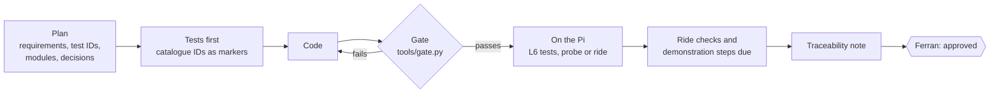
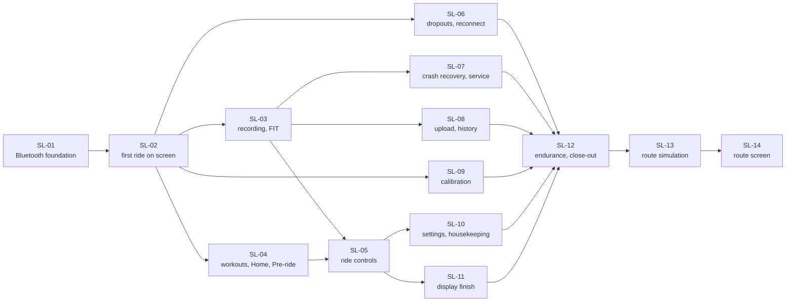
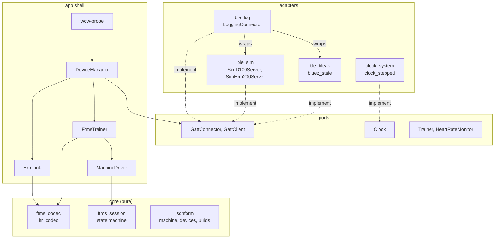
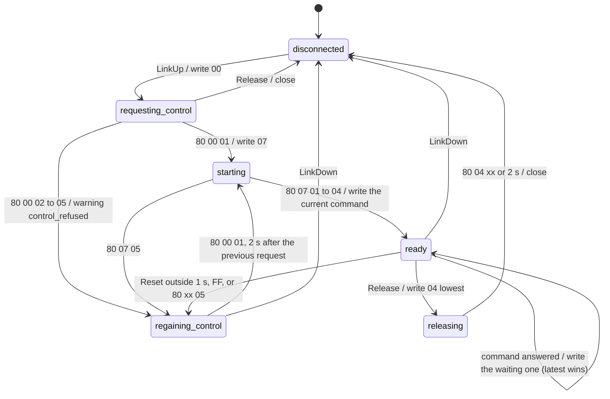
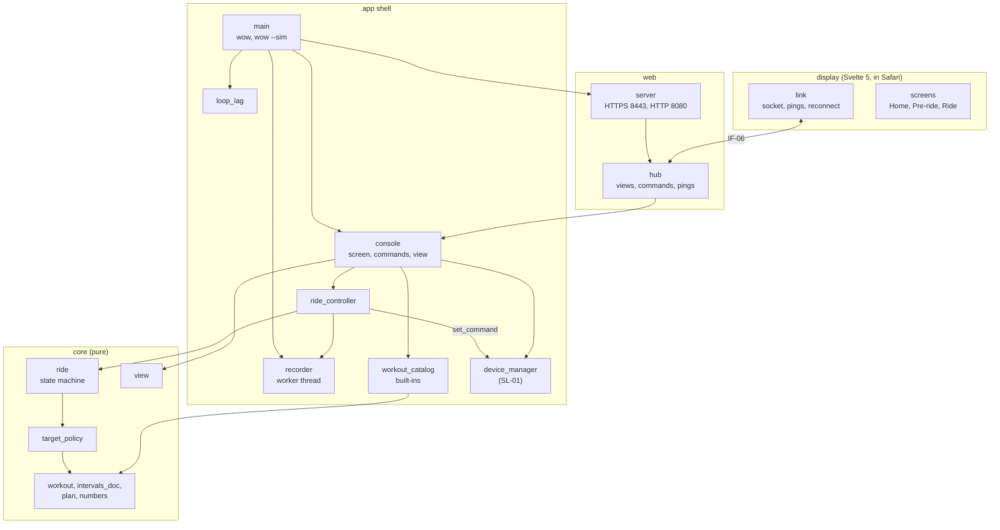

# Phase 5 — Implementation

**Status:** revision 14, 18 Nov 2026. **Phase 5 is closed** (Ferran, 18 Nov 2026; section 51). The slice plan; SL-01 (Bluetooth foundation) and SL-02 (first ride on screen) built, tested on the Pi and **approved by Ferran on 13 Nov 2026** (section 13). SL-03 (recording, FIT) and SL-04 (workouts) planned, built, ridden on the Pi on 13 Nov and **approved by Ferran on 14 Nov 2026** (sections 14 to 19). SL-05 (ride controls) and SL-06 (dropouts, reconnect) planned, built and gated on the laptop, first ridden on the simulator and **approved by Ferran on 15 Nov 2026** (sections 20 to 26); their rides move to the next Pi session. SL-07 (crash recovery, service), SL-08 (upload, history) and SL-09 (calibration) (sections 27 to 32), and SL-10 (settings, housekeeping), SL-11 (display finish) and SL-12 (endurance, close-out) (sections 33 to 38) planned, built and gated, and **approved by Ferran on 16 Nov 2026**; their Pi steps are the closing checks. SL-13 (route simulation) planned, built and gated on 17 Nov 2026 with the closing checks waived for it (sections 39 to 44); SL-14 (route screen), added by Ferran the same day, planned, built and gated (sections 45 to 50); app version 0.8.0, the version that goes to V&V. SL-13 and SL-14 **approved by Ferran on 18 Nov 2026**, with Phase 5 closed; their Pi steps join the closing checks. Builds on the Phase 1 requirements (revision 7), the Phase 3A architecture (revision 5), the ICD (revision 4) and the Phase 4 test plan (revision 2).

## 1 How Phase 5 works

Every slice runs the same cycle, and the next slice starts only after Ferran's "approved".



| Element | What it is |
|---------|------------|
| Gate | `uv run python tools/gate.py --through SL-nn`: pytest without `slow` and `pi` (flake8, strict mypy, the import check and the lockfile check run inside it as T-TOOL-01 to T-TOOL-04), the coverage floors of test plan 2.5, then `tools/trace.py`. From SL-02 also `svelte-check`, ESLint, the TypeScript compiler, Vitest and `npm ci`. |
| Markers | Every test carries `case("T-…")` and `req("APP-…")`. Supporting tests outside the matrix carry `S-` IDs (as the plan's S-DSP): S-INF for infrastructure, S-SES for session edge cases (IM-12). |
| Traceability | `tools/trace.py` reads the catalogues of the test plan, the pytest results (`build/pytest-cases.json`, written by `tests/conftest.py`) and `docs/verification-log.md`. It fails when a test names no catalogue ID, when markers and catalogue disagree on requirements, when a catalogue test of a finished slice is missing or not passing, or when any test fails. |
| Slice document | Each slice gets a plan section and a result section in this document, ending with its traceability note, decisions and the approval question. |

## 2 Slice plan

The slices of test plan 4.1, in the same order. Each one is usable on its own: from SL-02 on there is a ride on the screen, and from SL-05 on a full weekly session.



| Slice | New modules | Closes | First real-device evidence |
|-------|-------------|--------|----------------------------|
| SL-01 | `core/ftms_codec`, `core/hr_codec`, `core/ftms_session`; ports; `adapters/ble_bleak`, `ble_sim`, `ble_log`, clocks; `app/ftms_trainer`, `hrm_link`, `device_manager` (connect path); gate, trace | A-61 (OP-19) | `wow-probe` on the Pi (not in the matrix) |
| SL-02 | `core/workout` (watts and %FTP), `core/plan`, `core/target_policy`, `core/ride` (armed, steps, finish), `core/view`, `app/ride_controller`, `web/server`, `web/hub`, `app/main` with `wow --sim`, display skeleton with the ERG ride screen | A-51, A-60 (OP-12, OP-17) | First ride; RR-01 to RR-04 |
| SL-03 | `core/sampler`, `core/metrics`, `app/recorder`, `adapters/fit_garmin`, `adapters/store_files` (ride files), Summary | A-28, A-52, A-54 | FIT into Garmin Connect |
| SL-04 | `core/intervals_doc`, `app/workout_catalog`, `adapters/intervals_icu` (read), built-ins, Home, Pre-ride | A-55 | DS-1 |
| SL-05 | Pause, skip, intensity, resistance mode and screen, free ride, end of workout, discard | OP-4 | DS-2, DS-7 |
| SL-06 | Reconnect for the whole ride, regain on the real trainer, display link, `ble_replay` | A-33, A-44 | DS-3 |
| SL-07 | `app/recovery`, systemd unit, boot, LED | A-29, A-36, A-50 | DS-5 |
| SL-08 | `app/upload_worker`, history, download, delete, storage warning | A-19, A-53 | DS-6 |
| SL-09 | `core/spindown`, `app/calibration_controller`, Calibration screen | — | DS-4 |
| SL-10 | `core/settings`, Settings screen, device scan and choice, idle release, abandoned ride, clock and certificate warnings | — | DS-1 |
| SL-11 | Wake-lock prompt, countdown, profile, sound, sizes, latency reports | A-49, A-56 to A-58 | DS-8, walk-through I-14 to I-20 |
| SL-12 | 4-hour runs, replay regression, full traceability | — | T-SYS-02 |
| SL-13 | Route simulation, after the ride only: a public GPS route (GPX) gives distance, slope and altitude; with the ride's power these give speed, and the FIT file gets speed, distance, altitude and position. No effect on control or display. Added by Ferran on 14 Nov 2026 as the last slice, run with lighter documentation and testing; it moves "simulated speed, distance and altitude" from Phase 1's out-of-scope list into v1, so its requirements are written when the slice starts. | — | A ride with its route, speed and altitude in intervals.icu and Garmin Connect |
| SL-14 | Route screen: during a ride on a route, a drawing of the route, the elevation profile, speed and grade, with power and heart rate small; the ride along the route worked out every second and the same track in the FIT file. Added by Ferran on 17 Nov 2026 as the last slice of v1; version 0.8.0 goes to V&V with it. Slope mode is a V2 to-do. | — | D-34, in D-33's ride |

## 3 SL-01 plan: Bluetooth foundation

### 3.1 Scope

**Requirements** (automated part): APP-101, APP-102, APP-103, APP-104, APP-105, APP-106, APP-108, APP-109, APP-111, APP-113, APP-320 (session part), APP-502 and APP-503 (codec part), APP-603 (codec part), APP-801 (logic part), APP-813, APP-818, APP-819, APP-822 and APP-823 (Python part).

**Tests:** T-COD-01 to T-COD-11; T-SES-01, -02, -05, -08, -09, -10; T-DEV-01 to T-DEV-03; T-LOG-01; T-SIM-01, T-SIM-02; T-TOOL-01 to T-TOOL-04. Pulled forward from SL-06: T-SES-03, -04, -06, -07 (IM-11).

### 3.2 Modules



| Module | Responsibility | Interface |
|--------|----------------|-----------|
| `core/ftms_codec` | Decode Indoor Bike Data by its flags (extra bytes ignored, More Data joined), features, ranges, control point responses, statuses; encode the five commands | IF-01 |
| `core/hr_codec` | Heart Rate Measurement, Battery Level | IF-02 |
| `core/ftms_session` | Take control, Start or Resume, one procedure at a time with the latest command winning, regain control every 2 s, the expected Reset, status repeats, 3 s warning and 30 s re-send, results 02 to 05, orderly release | IF-01 4.1.5, 4.1.6 |
| `core/jsonform` | JSON forms of events, actions and values for `testdata/` | IF-04, APP-821 |
| `ports/*` | The ICD's protocols, with no implementation | IF-03, IF-04, IF-05 |
| `app/machine_driver` | Runs any core state machine: events at once, a Tick at the next deadline, waiting only through `Clock` | AD-07, AD-22 |
| `app/ftms_trainer` | The Trainer port: reads and subscriptions on connect, the session's writes, samples out | IF-05, S-1, S-6 |
| `app/hrm_link` | The strap: battery read, heart rate and battery subscriptions | IF-02 4.2.3 |
| `app/device_manager` | Connect both when Pre-ride opens, keep trying while not found, drop stale loss reports, release in order | IF-05 |
| `adapters/ble_bleak`, `bluez_stale` | bleak 3.0.2 on BlueZ with the stale-link release before every connect and no loss reports during a connect | IF-03 4.3.3 |
| `adapters/ble_sim` | Simulated D100 and HRM 200 as GATT servers behind `SimConnector` | IF-03 4.3.4 |
| `adapters/ble_log` | `LoggingConnector`: every operation in IF-11 lines | IF-11 |
| `adapters/clock_system`, `clock_stepped` | The Pi's clocks; the stepped clock of the tests | IF-04 4.4.1 |
| `app/probe` | `wow-probe`: S-1, an ERG target, S-6 on the real devices, with the Bluetooth log | — |

### 3.3 Exit criteria

Gate green with `--through SL-01` (all catalogue tests of SL-01 implemented and passing, coverage floors met, no trace problems). No L6 tests, ride checks or demonstrations are due in SL-01 (test plan 4.1 and 9). Recommended before SL-02: one `wow-probe` run on the Pi with the D100 and the strap.

## 4 Decisions taken while building SL-01

| ID | Decision | Why |
|----|----------|-----|
| IM-01 | bleak stays at **3.0.2**. bleak **3.1.0** was released on PyPI on 7 Nov 2026, so 3A's "3.0.2, still the latest" (checked 10 Nov) was wrong. 3.1.0's BlueZ client changes the disconnect teardown (the disconnected callback runs once even when the D-Bus connection dies, the bus is always released); it raises dbus-fast to ≥ 4.0. Proposed: try 3.1.0 in SL-06, where reconnects are tested on the D100. | 3.0.2 is what the Phase 2 spikes ran on the Pi and what the ICD's bleak mapping (RD-04) is written against. |
| IM-02 | Pinned development tools, checked on PyPI on 11 Nov 2026: pytest 9.2.0, flake8 7.5.0, mypy 2.4.1, pytest-asyncio 1.4.1.post1, pytest-cov 7.1.0, hypothesis 6.170.15. Build backend `uv_build` 0.11; distribution `witchesonwheels`, module `wow`; Python `>=3.13,<3.14`. dbus-fast resolved to 5.2.0 through bleak. | Test plan 2.4 left these to the first slice. |
| IM-03 | The port protocols live in `src/wow/ports/`, a fifth folder next to `core`, `app`, `web` and `adapters`. | 3A's layer diagram has a ports layer; the core stays free of `async` protocols. |
| IM-04 | The session's inputs carry raw bytes (`indication`, `status_notification`) and its writes are bytes: a timeline is bytes in, bytes out. | Language-neutral cases cover decoding too (D-17). |
| IM-05 | L2 cases: the event and action files of `testdata/README.md`, with `every` and `count` for long runs; at the same instant an event goes in before a Tick. | The harness rule must be written down for a JavaScript v2. |
| IM-06 | While control is refused, Request Control is written every 2.0 s counted from the previous request's write, not from the refusal. | Exactly "every 2 s" (APP-105), independent of the trainer's answer time. |
| IM-07 | Result 04: one retry after 2 s; if that fails too, the warning `trainer_not_responding`, then the command again every 30 s until it succeeds. | ICD 4.1.6 says "retry once after 2 s, then warn" without saying what follows; this matches APP-107's "for as long as the ride runs". |
| IM-08 | Result 03: the last command the trainer accepted becomes the current one again, so a reconnect sends that, not the refused one. | "Keep the last good command" (ICD 4.1.6) made concrete. |
| IM-09 | Release clears the session's command, so a later connection never re-applies an old target. A release before control is granted, or with no resistance range, closes the link at once. | APP-320 with no stale target afterwards. |
| IM-10 | Statuses other than Reset, Control Permission Lost and spin-down are kept only in the Bluetooth log. | ICD 4.1.4, "logged only": the Bluetooth log already holds them. |
| IM-11 | T-SES-03, -04, -06 and -07 (SL-06 in the plan) are implemented and passing now. | The session is one state machine; splitting it across slices would leave untested branches in `core/` (95 % floor). Their real-device evidence stays in SL-06. |
| IM-12 | Supporting tests outside the matrix: S-INF-01 (JSON forms), S-INF-02 (stepped clock), S-INF-03 (`wow-probe`), S-INF-04 (log importer), S-INF-05 (system clock), S-INF-06 (link loss and shutdown during set-up or release), S-SES-01 (session edge cases: malformed or unexpected answers, statuses outside control, refused Start, early release, reconnect while refused). | Every test needs an ID (trace rule); these verify no requirement on their own. |
| IM-13 | Stepped clock: wakes sleepers one at a time in deadline order (ties in arrival order) and lets the event loop run 32 rounds after each wake; `drive(work)` runs anything that waits on the clock. | Closes A-61 (5.3). |
| IM-14 | Simulated D100: dead time 0.7 s then a first-order lag with τ = 0.35 s, so 90 % of a step at 1.5 s (F-25); answers 186, 250, 320, 390 ms after a write, in turn (F-28); one Reset in three copies 0.20, 0.25, 0.30 s after a grant (F-29, F-9); Indoor Bike Data every 0.21 and 0.29 s in turn (4 Hz, F-50), 16 bytes with 10 placeholder vendor bytes (F-1); resistance power interpolated from F-12; stops advertising while linked (F-33); connect takes 2.3 s (F-31's fastest). Op codes it doesn't model yet answer 02 (spin-down comes with SL-09); it sends only the statuses the ICD names. | 3A, "Simulated devices". |
| IM-15 | Simulated GATT servers have three methods beyond the ICD's `GattServer`: `advertising()`, `on_connect()`, `on_disconnect()`. | So the D100 can stop advertising while linked. ICD 4.3.1 clarification proposed. |
| IM-16 | IF-11 details: `released_stale` lines carry `outcome` (`released`, `not connected`, …); `dev` is `other` for a device that is neither the trainer nor the strap. | ICD 4.11 clarification proposed. |
| IM-17 | Device manager in SL-01: a configured device starts as `not_found`, goes to `searching` when Pre-ride opens, and while it isn't found stays `not_found` with a new attempt every 2 s (**design**). A lost link shows `dropout`; reconnecting during a ride comes in SL-06. | APP-102's three states, without flicker between them. |
| IM-18 | `wow-probe` (entry point of the package): checks the bleak adapter on the real D100 and strap before SL-02, and runs against the simulator with `--simulate`. | `ble_bleak` has no automated test and no coverage floor (test plan 2.5); ride checks start in SL-02. |
| IM-19 | T-TOOL-01 and T-TOOL-04 cover Python now and fail as soon as `display/package.json` exists without the display checks, so SL-02 must add them. | The display doesn't exist before SL-02. |
| IM-20 | `tools/trace.py` reads the plan from `docs/phase4-test-plan.md`. | The repository holds the phase documents (3A, repository layout). |

## 5 SL-01 result

### 5.1 What was built

Python 3.13.18 in the workspace; `uv sync --frozen` from the lockfile. 27 modules under `src/wow`, 3 tools, 137 tests, fixtures in `testdata/ftms`, `testdata/hr` and `testdata/timelines/ftms_session` (15 timeline cases).

The trainer session as built, with the decisions above (the ICD's diagram, IF-01 4.1.5, is unchanged in substance; `Lost` is `disconnected` here, and `ProcedurePending` is any phase with a write waiting for its answer):



### 5.2 Test results

| Check | Result |
|-------|--------|
| pytest (not `slow`, not `pi`) | 135 passed, 2 skipped: the two log-based tests (5.4) |
| flake8 7.5.0, mypy 2.4.1 strict (src, tests, tools) | 0 findings (T-TOOL-01) |
| Import check | 0 findings (T-TOOL-02) |
| `uv lock --check` and a frozen dry-run install from a clean copy | pass, lockfile unchanged (T-TOOL-04) |
| Coverage `core/` | 97.0 % branch (floor 95 %) |
| Coverage `app/` | 90.7 % line (floor 85 %) |
| Coverage testable adapters (`ble_sim`, `ble_log`, `clock_stepped`) | 96.3 % line (floor 85 %) |
| Coverage `ble_bleak`, `bluez_stale`, `clock_system` | no floor; covered by the probe and, from SL-02, ride checks |
| `wow-probe --simulate`, real time | PASS: control in under 4 s, 150 W held, last write `04 00`, 71 IF-11 lines |
| Trace | 2 problems: T-COD-01 and T-SIM-01 skipped (5.4) |

### 5.3 Assumption closed

| ID | Result |
|----|--------|
| A-61 | **Confirmed.** The asyncio shell runs on the stepped clock without real waiting: T-DEV-01 checks the strap's `not_found` at exactly 10.0 s, T-SIM-02 rides 12 ERG steps (over 6 minutes of simulated time), and the whole suite runs in about 7 s. Two conditions belong to the result: work that waits on the clock has to be run with `clock.drive()` (or with time moved on beside it), and the zero-time work after one wake must finish within 32 loop rounds (today's longest chain is about 6). |

### 5.4 To finish SL-01

| # | Item | Who |
|---|------|-----|
| 1 | Import the S1 and S2 logs with `tools/import_spike_log.py` (commands in `README.md`). Then T-COD-01 checks all 1076 S1 records and T-SIM-01 compares the simulator with both logs. Both test paths were exercised here on a simulated log of the same form. | Ferran, or send the two logs and Claude does it |
| 2 | Copy the approved test plan to `docs/phase4-test-plan.md` if the repository doesn't have it, and run the gate: `uv run python tools/gate.py --through SL-01`. | Ferran |
| 3 | Recommended: `uv run wow-probe` on the Pi with the D100 and the strap, and send `probe-*.jsonl`. | Ferran |

### 5.5 Proposed changes to approved documents

| Document | Change | From |
|----------|--------|------|
| 3A, Tech choices | Bluetooth row: "bleak 3.0.2 (3.1.0 of 7 Nov 2026 to be tried in SL-06)" instead of "3.0.2, still the latest". Test tool rows: the versions of IM-02. | IM-01, IM-02 |
| 3A, Repository layout | `src/wow/{core,ports,app,web,adapters}/`. | IM-03 |
| ICD 4.1.6 | Result 04: then every 30 s until it succeeds. Result 03: the last accepted command becomes current. Release clears the command. | IM-07 to IM-09 |
| ICD 4.1.5 | Request Control every 2 s counted from the previous request. | IM-06 |
| ICD 4.3.1 | Simulator `GattServer`: `advertising()`, `on_connect()`, `on_disconnect()`. | IM-15 |
| ICD 4.11 | `outcome` on `released_stale`; `dev` may be `other`. | IM-16 |

## 6 Traceability note SL-01

Requirements with a test of SL-01, with all their automated tests from the matrix (test plan 9). "Passed so far": every test that is due has passed and others follow in later slices. `tools/trace.py --note SL-01` prints the same table from the full plan.

| Req. | Automated tests | Ride checks, demonstrations, inspections | Automated part |
|------|-----------------|------------------------------------------|----------------|
| APP-101 | T-COD-07 passed | I-01 pending | passed |
| APP-102 | T-DEV-01 passed, T-VIEW-11 due SL-04 | D-04, I-15 pending | passed so far |
| APP-103 | T-COD-06 passed, T-DEV-02 passed, T-SES-07 passed | — | passed |
| APP-104 | T-COD-07 passed, T-SES-01 passed | RR-01 pending | passed |
| APP-105 | T-COD-08, T-SES-02, T-SES-03, T-SES-04, T-SES-08 passed | D-31, I-18 pending | passed |
| APP-106 | T-SES-05 passed | — | passed |
| APP-107 | T-SES-06, T-SES-07 passed (ahead of SL-06) | D-31, I-18 pending | passed |
| APP-108 | T-COD-01 **skipped** (S1 log), T-COD-02 to T-COD-05 passed, T-LOG-04 due SL-06 | — | open until the S1 log is in |
| APP-109 | T-COD-09 passed | — | passed |
| APP-111 | T-COD-10 passed, T-DEV-03 passed | D-04, RR-06 pending | passed |
| APP-113 | T-COD-11 passed | D-30, I-18 pending | passed |
| APP-320 | T-SES-10 passed; T-RID-13 due SL-05, T-SYS-04 due SL-07, T-DEV-04 due SL-10 | D-13, RR-10 pending | passed so far |
| APP-502 | T-COD-08, T-SES-08 passed; T-CAL-02 due SL-09 | D-20, I-20 pending | passed so far |
| APP-503 | T-COD-08 passed; T-CAL-03 due SL-09 | D-20, I-20 pending | passed so far |
| APP-603 | T-COD-10 passed; T-SMP-03, T-MET-04, T-FIT-04 due SL-03, T-E2E-03 due SL-06 | RR-05 pending | passed so far |
| APP-801 | T-SES-09 passed; T-SYS-01 due SL-02 | RR-02 pending | passed so far |
| APP-813 | T-LOG-01 passed | RR-11, I-05 pending | passed |
| APP-818 | T-TOOL-02 passed | I-09 pending | passed |
| APP-819 | T-SIM-01 **skipped** (S1, S2 logs), T-SIM-02, T-TOOL-02, T-TOOL-03 passed; T-SIM-03 due SL-06, T-SIM-04 due SL-12 | I-10 pending | open until the logs are in |
| APP-822 | T-TOOL-04 passed (Python; `npm ci` from SL-02) | I-12 pending | passed so far |
| APP-823 | T-TOOL-01 passed (Python; display checks from SL-02) | I-13 pending | passed so far |

## 7 SL-02 plan

Planned on 11 Nov 2026 and built on 12 Nov at Ferran's request ("do the same for SL-02"), before SL-01's approval, so both slices can be tested together on the Pi. Built as planned, with the decisions of section 8.

**Content (test plan 4.1):** plan, target policy, ride state machine, HTTPS server, hub, ERG ride screen, start on the first power. Closes A-51 (one event loop meets APP-801, OP-12) and A-60 (0 W at standstill, OP-17) once the Pi has run them.

**Requirements** (automated part): APP-116, APP-117, APP-204 and APP-302 (watts and percent of FTP), APP-301, APP-303, APP-304, APP-313 (target part), APP-401, APP-402, APP-605 (step part), APP-801 (real time), APP-803 and APP-807 (Pi side), APP-816, APP-822 and APP-823 (display part).

**Tests due:** T-WKO-01, T-TGT-01, T-TGT-02, T-TGT-07, T-RID-01 to T-RID-06, T-VIEW-01, T-VIEW-02, T-VIEW-10, T-WEB-01, T-WEB-02, T-WEB-04, T-WEB-06, T-SYS-01 (on the Pi), S-DSP-01; ride checks RR-01 to RR-04 from the first real ride.

### 7.1 Modules



| Module | Responsibility | Interface |
|--------|----------------|-----------|
| `core/numbers` | Round half up on exact fractions; power zones | ICD 1.4, APP-702 |
| `core/workout`, `core/intervals_doc` | Workout types; `workout_doc` steps in `w` and `%ftp` and repeat blocks; anything else refused by name until SL-04 | IF-13 |
| `core/plan` | Steps flattened with start, end and watts at an FTP; `plan_id` = `<ref>@<ftp>` | APP-203, APP-204 |
| `core/target_policy` | ERG target per step with intensity, limited to the trainer's range; when the next target goes out | APP-302 to APP-304, APP-313 |
| `core/ride` | Armed, Running, WorkoutDone, Finished, Cancelled; journal records; trainer commands | IF-04 4.4.2, 4.4.3 |
| `core/view` | View state of Home, Pre-ride and the ride screen; 3 s power; plan message | IF-06 4.6.3 |
| `app/console` | Which screen is open; display commands to the controllers by screen; the view | IF-06 4.6.5 |
| `app/ride_controller` | Runs `core/ride` with the machine driver; trainer commands; journal records to the recorder | AD-07 |
| `app/recorder` | Ride directory, `events.jsonl`, `ble.jsonl`, `logs/ble-system.jsonl`, from a worker thread | IF-09, IF-11 |
| `app/workout_catalog` | The built-in workouts | IF-13 |
| `app/loop_lag` | Logs and counts event-loop wake-ups more than 50 ms late | AD-06, A-51 |
| `app/main` | Composition root; `wow --config`, `--sim`; orderly shutdown | 3A |
| `web/server` | HTTPS site with the display and `/ws`; HTTP site with the redirect and the root certificate | IF-07 |
| `web/hub` | View pump, plan messages, commands and acks, pings | IF-06 |
| `display/` | Link, Home, Pre-ride, ride screen (waiting, ERG, workout done), Finish sheet, Pi-lost state, IF-06 types | 3C |
| `tools/check_ride.py` | RR-01 to RR-04 over a ride directory | Test plan 6 |

### 7.2 A ride through the modules

```mermaid
sequenceDiagram
    participant P as page
    participant H as web/hub
    participant C as console
    participant R as ride_controller
    participant T as trainer (ftms_trainer)
    participant F as recorder
    P->>H: command start
    H->>C: start
    C->>R: start(workout, ftp, lead time)
    R->>F: open rides/<UTC of Start>
    R->>T: set_command(Erg first target)
    R->>F: journal command, armed, trainer_command
    H-->>P: ack, view (waiting_for_power)
    T-->>C: sample, power 0 W
    T-->>C: sample, power ≥ 1 W
    C->>R: PowerSeen
    R->>F: journal ride_started, step_started
    Note over R: next deadline: boundary minus lead time
    R->>T: set_command(Erg next target)
    R->>F: journal trainer_command (due_mono_ms)
    Note over R: boundary
    R->>F: journal step_started
    P->>H: command finish (after the sheet)
    R->>T: set_command(lowest resistance level)
    R->>F: journal finished; files closed 3 s later
    H-->>P: view (home)
```

### 7.3 Exit criteria

Gate green with `--through SL-02`, apart from SL-01's two log-based tests until the logs are imported. On the Pi: T-SYS-01 passes and is logged; a first real ride passes RR-01 to RR-04; Ferran has looked at Home, Pre-ride and the ride screens on the iPhone.

## 8 Decisions taken while building SL-02

| ID | Decision | Why |
|----|----------|-----|
| IM-21 | Display toolchain, exact versions from the npm registry on 12 Nov 2026, locked in `package-lock.json`: svelte 5.57.3, vite 8.3.8, @sveltejs/vite-plugin-svelte 7.3.1, typescript **6.0.3**, svelte-check 4.7.8, eslint 10.14.0, @eslint/js 10.0.1, eslint-plugin-svelte 3.24.1, svelte-eslint-parser 1.10.1, typescript-eslint 8.72.2, globals 17.14.0, vitest 5.1.0, @testing-library/svelte 5.4.2, jsdom 31.0.0, @types/node 26.6.6, the two Sofia Sans font packages 5.3.0. | TypeScript 7.0.2 is the newest, but typescript-eslint 8.72.2 accepts `>=4.8.4 <6.1.0` and svelte-check 4.7.8 `^5.0.0 \|\| ^6.0.0`. Vitest 5.1.0 replaces the plan's 5.0.4 and needs Node.js `^22.12 \|\| ^24 \|\| >=26`. Playwright waits for S-PW-01 (SL-06). |
| IM-22 | New module `app/console`: which screen is open, display commands routed by screen to the controllers, the view assembled from `core/view`. | 3A gives the hub the connections and the ride controller the ride; no module owned the screen. Proposed for 3A. |
| IM-23 | `app/workout_catalog` starts in SL-02 with the built-ins only. Two built-ins the SL-02 parser can read: "ERG check" (6 min: 120 W, 2 × 30 s at 220 W and 60 s at 130 W, 120 W) and "30/30 and a surge" (19 min, Phase 2's S2 session). | The ramp test needs free ride (SL-04); a first ride needs something to ride. |
| IM-24 | `app/recorder` in part, pulled from SL-03: ride directory at Start, named by the UTC of Start; `events.jsonl` and `ble.jsonl` in it; `logs/ble-system.jsonl` outside rides; JSON Lines written by a worker thread, `fsync` at most every 2 s and when a file closes. Samples, `timing.jsonl`, `meta.json` and the FIT file stay in SL-03 and SL-11. | RR-01 to RR-04 need the journal and the Bluetooth log of the first real ride (IF-09, 4.9.1). |
| IM-25 | A ride's files close 3 s after it ends, so the last trainer write and its answer land in the ride's `ble.jsonl`. A ride started in those 3 s gets its own directory. | The lowest-level write at Finish is the last command RR-02 checks. |
| IM-26 | Journal fields beyond ICD 4.9.2: `armed.lead_time` (s) and `step_started.scheduled` (s, the step's planned ride time). `armed.block_modes` comes with block modes in SL-05. | RR-03 and RR-04 need them. Proposed for the ICD. |
| IM-27 | After Finish the console returns to Home (Summary in SL-03); after Cancel or the 30 min timeout to Pre-ride. A command the ICD names but no slice has built yet answers `invalid_state`; a name outside ICD 4.6.5 answers `bad_request`. | ICD 4.6.6 has the two errors; this fixes which applies. |
| IM-28 | The trainer shows `connected` once its GATT set-up is done, before control is granted. Start is allowed then; the first target is written when the session reaches Ready (APP-104). | Seen in a real-time run: the first target fell due while Start or Resume was pending and was written 0.1 ms after its answer. |
| IM-29 | Hub: one pump task. After each send it waits for a change or 1 s, and never less than 0.1 s after the previous send, so a change goes out within 0.1 s, at most 10 and at least 1 view a second. `seq` per connection; the plan message goes before the first view that needs it and again whenever `plan_id` changes. Malformed messages are logged, with an `ack` `bad_request` when the `id` is readable. `ping` is answered; `painted` and `tap_mono_ms` are accepted and not yet written: `timing.jsonl` comes with the latency reports in SL-11. | IF-06 4.6.1, 4.6.2, 4.6.6. |
| IM-30 | The port-80 redirect keeps the HTTPS port in `Location` when it isn't 443. `GET /` answers 503 "display not built" when there is no `index.html`. `/assets/*` is cached for a year (`immutable`), `/` not at all. | wow runs as a user on 8443 and 8080 until SL-07's systemd unit binds 443 and 80. Proposed for ICD 4.7. |
| IM-31 | `wow --config <file> [--sim]`; `--sim` overrides `bluetooth.simulate`. Relative paths in `wow.toml` are taken from the working directory. | One configuration for the Pi and the laptop. |
| IM-32 | Simulated rider: `SimD100Server(pedal_after_erg=3.0)` reports 0 W and 0 km/h until the first Set Target Power, pedals 3 s later, and stops at Set Target Resistance. | A-60's standstill plays out on the simulator, and `wow --sim` rides by itself. |
| IM-33 | Display in SL-02: Home (built-ins), Pre-ride (devices, battery, profile, blocks, Start ride disabled with "Trainer not connected"), ride screen waiting for power, ERG layout and workout done; Finish sheet ("Finish and save", "Keep riding"); values dimmed with a banner after 3 s without a view; reconnect after 0.5, 1, 2, 4, then every 5 s; reload on another app version; pings and `painted`. Intensity, Ride by resistance, Pause and Skip step are drawn and disabled until SL-05. Step time counts down on the page between views, with the 5-to-1 countdown. Screens of later slices show "Not built yet" with Back. | 3C, Figures 2, 8 and 10, as far as SL-02 has data. Drawing the disabled controls lets the layout be judged on the phone now. |
| IM-34 | The page requests the screen wake lock on the Start tap and again when it becomes visible during a ride. The prompt bar (APP-416) stays in SL-11. | A first ride with the phone's Auto-Lock on would otherwise go dark. |
| IM-35 | The display build takes the app version from `pyproject.toml`; `hello` carries the installed distribution's version. The built display goes to `src/wow/web/static/` (not in git), so the wheel carries it: `uv build` was checked to include `wow/web/static/` and `wow/builtin/`. | AD-17, AD-19: the Pi has no Node.js. |
| IM-36 | `tools/check_ride.py` reads the ride's `events.jsonl` and `ble.jsonl` and `logs/ble-system.jsonl`. RR-01 per connection that wrote during the ride: its first control point writes are `00`, `07`, then targets. RR-02 matches each `trainer_command` with the first write of its bytes between its `due_mono_ms` and the next command's; the delay counts from the due time, or from the answer of a procedure pending at that time (from either log). A command equal to the one before isn't written by the session and counts as unchanged; one followed by another within 1 s counts as replaced (APP-106). RR-03 from `ride_started` and each `step_started.scheduled`. RR-04: per boundary, the command issued between max(previous start, boundary − lead time) − 0.1 s and the boundary, written within 100 ms of that instant. | The trainer connects at Pre-ride, before the ride directory exists, so the connection's first writes are in the system log. |
| IM-37 | Tests marked `pi` don't run in the laptop gate. `tools/trace.py` shows them as "due on the Pi" and counts them once `docs/verification-log.md` has a line with their ID and result (T- IDs now accepted there). T-SYS-01 runs 60 min; `WOW_SYS_MINUTES` shortens it. | Test plan 4: L6 runs on the Pi after the laptop gate. |
| IM-38 | Test certificates in `testdata/tls/`: a test-only root and a `wow.local`, `localhost`, `127.0.0.1` server certificate, the root's key deleted. T-WEB-02 plants decoy key files beside and above the static files and tries path traversal on both sites. | Real TLS on localhost, as the S8 spike did (test plan 2.1, L5). |
| IM-39 | Supporting tests: S-WKO-01, S-RID-01, S-VIEW-01 (core edge cases), S-SHL-01 and S-SHL-02 (app shell from Home to Finish on the stepped clock), S-REC-01 (recorder, boot ID), S-LAG-01 (loop lag), S-HUB-01 and S-HUB-02 (message parsing, view pump), S-RR-01 (ride checks), S-CFG-01 (configuration files), S-DSP-01 (Vitest). | Trace rule: every test has an ID. |
| IM-40 | Core details: watts and levels rounded half up on exact fractions; zones are inclusive upper bounds (55 % is zone 1, 55.2 % zone 2, above 120 % zone 6); the 3 s power is the mean of the values received in the last 3 s (one exactly 3 s old is out); heart rate is missing 3 s after its last value; at the end of the workout the trainer goes to its lowest resistance level, the free-ride level's default until SL-05 and SL-10. | ICD 1.4; APP-402; N-1; APP-314. |

## 9 SL-02 result

### 9.1 What was built

51 Python files under `src/wow` (19 new), 4 tools, 251 pytest tests and 14 Vitest tests; the display in 19 files; about 9,600 lines of Python, TypeScript and Svelte in all. New fixtures: `testdata/workouts/`, `testdata/timelines/ride/` (10 cases), `testdata/display/` (9 golden views), `testdata/tls/`.

The display in headless Chrome at 402 × 720 pt against `wow --sim` (Home, Pre-ride, waiting for power, ERG, the 5-to-1 countdown, the Finish sheet) matched 3C's layout as far as SL-02 has data. The phone is the judge (I-14 to I-20); this was only a smoke look.

### 9.2 Test results

| Check | Result |
|-------|--------|
| pytest (not `slow`, not `pi`) | 251 passed, 2 skipped: SL-01's two log-based tests (5.4) |
| flake8, mypy strict; svelte-check, ESLint, tsc on the display | 0 findings (T-TOOL-01) |
| Import check | 0 findings (T-TOOL-02) |
| `uv sync --frozen` and `npm ci` from clean copies | pass, lockfiles unchanged, every npm version exact (T-TOOL-04) |
| Vitest | 14 passed: every golden view renders (S-DSP-01), formatting and the clock offset |
| Coverage `core/` | 96.8 % branch (floor 95 %) |
| Coverage `app/` and `web/` | 94.2 % line (floor 85 %) |
| Coverage testable adapters | 96.6 % line (floor 85 %) |
| T-SYS-01, 1 minute instead of 60, in Claude's workspace (not the Pi) | RR-02 pass, worst 0.3 ms; loop lag worst 3.7 ms, none over 50 ms |
| Trace `--through SL-02` | 2 problems, both SL-01's (T-COD-01, T-SIM-01 skipped); T-SYS-01 due on the Pi |

### 9.3 Assumptions

| ID | State |
|----|-------|
| A-51 | Open until T-SYS-01 runs 60 min on the Pi. The workspace run is encouraging, not evidence: it isn't a Pi 5. |
| A-60 | Open until the first real ride (D-06's check): after Start, wait 20 s without pedaling; the screen must stay on "Start pedaling" at 0:00. |
| A-56 | Still open: the page prints the viewport size to Safari's console only. Read it with Web Inspector, or wait for SL-11's report. |

### 9.4 Findings

| # | Finding | Proposed |
|---|---------|----------|
| SF-1 | T-WKO-01 names the S6 workout `tEST`, but every power step in it is a range, a zone, a ramp or free ride (F-18), which SL-02's parser doesn't read. | SL-02 runs T-WKO-01 on a hand-written fixture (`plain-steps`); `tEST` joins T-WKO-01 in SL-04. Test plan 5.3 to say so. |
| SF-2 | The journal doesn't record a step's target, so RR-04 can't tell an unchanged target from a command that never went out. | Add `target` (W) to `step_started` in SL-03 (ICD 4.9.2). Until then T-TGT-07 covers the logic. |
| SF-3 | `connected` doesn't say whether control is held (IM-28). Harmless for the ride; it could matter for Pre-ride if control is refused. | No change now; revisit with SL-06's regain-control work on the D100. |

### 9.5 Proposed changes to approved documents

| Document | Change | From |
|----------|--------|------|
| 3A, Modules | `app/console` (screen, commands, view). `app/workout_catalog` and `app/recorder` start in SL-02, in part. | IM-22 to IM-24 |
| 3A, Tech choices | Display versions of IM-21; TypeScript 6.0.3, with the reason. | IM-21 |
| ICD 4.9.2 | `armed.lead_time`, `step_started.scheduled`; later `step_started.target`. | IM-26, SF-2 |
| ICD 4.7 | Redirect keeps a non-443 HTTPS port; `/` answers 503 without a built display. | IM-30 |
| ICD 4.6.6 | `invalid_state` for commands not built yet. | IM-27 |
| Test plan 2.4, 5.3, 5.17 | Vitest 5.1.0; T-WKO-01's fixture; L6 results recorded in the verification log by test ID. | IM-21, SF-1, IM-37 |

## 10 Traceability note SL-02

From `tools/trace.py --through SL-02 --note SL-02` on the catalogue rows of SL-01 and SL-02. Ride checks show "pending" until tonight's ride is logged.

| Req. | Automated tests | Ride checks, demonstrations, inspections | Automated part |
|------|-----------------|------------------------------------------|----------------|
| APP-116 | T-RID-05 passed | — | passed |
| APP-117 | T-RID-04 passed | I-15 pending | passed |
| APP-204 | T-WKO-01 passed; T-WKO-03, -05 to -07 due SL-04, T-E2E-01 due SL-05 | — | passed so far |
| APP-301 | T-RID-01 to T-RID-03 passed, T-VIEW-10 passed; T-E2E-01 due SL-05 | D-06, I-16 pending | passed so far |
| APP-302 | T-TGT-01 passed, T-WKO-01 passed; T-E2E-01 due SL-05 | — | passed so far |
| APP-303 | T-TGT-02 passed | D-31, I-16 pending | passed |
| APP-304 | T-RID-06 passed, T-TGT-07 passed; T-E2E-01 due SL-05 | D-08, **RR-04 pending** | passed so far |
| APP-313 | T-TGT-01 passed; T-RID-11, T-E2E-02 due SL-05 | — | passed so far |
| APP-401 | T-VIEW-01 passed; T-VIEW-09 due SL-11 | D-07, I-16 pending | passed so far |
| APP-402 | T-VIEW-02 passed | — | passed |
| APP-605 | T-RID-06 passed; T-RID-10 due SL-05, T-FIT-03 due SL-03 | RR-14 pending | passed so far |
| APP-801 | T-SES-09 passed, **T-SYS-01 due on the Pi** | **RR-02 pending** | passed so far |
| APP-803 | T-WEB-04 passed; T-WEB-07 due SL-11 | RR-08 pending | passed so far |
| APP-807 | T-WEB-04 passed; T-WEB-05 due SL-06, T-E2E-03 due SL-06 | D-17, I-18 pending | passed so far |
| APP-816 | T-WEB-01 passed, T-WEB-02 passed | D-01, I-07 pending | passed |
| APP-822 | T-TOOL-04 passed (Python and display) | I-12 pending | passed |
| APP-823 | T-TOOL-01 passed (Python and display) | I-13 pending | passed |

APP-104 (RR-01) and APP-804 (RR-03) get their first ride-check results tonight too; their automated tests are SL-01's and SL-12's.

## 11 Tonight on the Pi: SL-01 and SL-02 together

| # | Step | Expected | Closes |
|---|------|----------|--------|
| 1 | Laptop: unzip, `uv sync --frozen`; copy the approved test plan to `docs/phase4-test-plan.md`; `cd display && npm ci`; `uv run python tools/gate.py --through SL-02`. | GATE fails only on T-COD-01 and T-SIM-01. | — |
| 2 | Import the S1 and S2 logs (README), gate again. | GATE PASSED. | SL-01 |
| 3 | Copy the folder to the Pi with `src/wow/web/static/` (the Pi can't build it); there `uv sync --frozen`. | — | — |
| 4 | `uv run wow-probe --watts 150 --seconds 60` with the trainer awake and the strap on; Onelap and nRF Connect closed. | PASS line; `probe-*.jsonl`. | SL-01 on the D100 |
| 5 | `cp deploy/wow.example.toml wow.toml`, set the three TLS paths to the `spike_certs.py` files; `mkdir wow-data`, copy `deploy/settings.example.json` to `wow-data/settings.json`. `uv run wow --config wow.toml`. | Log line "wow 0.2.0 started". | — |
| 6 | Safari: `https://wow.local:8443`. Open "ERG check". | Pre-ride; trainer and strap go from searching to connected; battery shown. | — |
| 7 | Start ride, then wait 20 s without pedaling; then pedal. | "Start pedaling", 0:00, trainer set to 120 W; the ride starts at the first stroke. | A-60 |
| 8 | Ride the 6 minutes; at the end tap Finish, then "Finish and save". | Band colours change at each step; countdown 5 to 1; the trainer changes as it reaches 0; the screen stays on. Home after Finish. | — |
| 9 | `uv run python tools/check_ride.py wow-data/rides/<ride id>`; paste the four lines into `docs/verification-log.md`. | RR-01 to RR-04 pass. | RR-01 to RR-04 |
| 10 | Optional: "30/30 and a surge" (19 min), for the lead time on short intervals (OP-4). | As step 8. | — |
| 11 | Stop wow (Ctrl-C). `uv run pytest -m "pi and slow" -s tests/system` (60 min; `WOW_SYS_MINUTES=10` for a first look); log the line as `T-SYS-01`. | `RR-02 pass`, no loop lag over 50 ms. | T-SYS-01, A-51 |
| 12 | Send: the gate's last lines, `check_ride.py` output, the ride directory, wow's console output, the probe log, screenshots of the screens, and anything that surprised you. | — | — |

If the screen is off from what 3C shows, a screenshot per screen is enough; layout fixes go into SL-03.

## 12 Decisions made in Phase 5 so far

1. Phase 5 runs slice by slice, each planned, built, gated and approved before the next; the slices and their order are those of test plan 4.1 (section 2).
2. The gate is `tools/gate.py`: pytest with T-TOOL-01 to T-TOOL-04 inside, coverage floors, `tools/trace.py` (section 1).
3. SL-01 is built as planned in section 3, with decisions IM-01 to IM-20 (section 4).
4. bleak stays at 3.0.2; 3.1.0 is tried in SL-06 (IM-01).
5. T-SES-03, -04, -06 and -07 are done in SL-01 (IM-11); supporting tests carry S-INF and S-SES IDs (IM-12).
6. A-61 is confirmed, with the two conditions of 5.3.
7. The changes of 5.5 to 3A and the ICD are proposed, to be applied when approved.
8. SL-02 was built before SL-01's approval, at Ferran's request, so both are tested together on the Pi (section 7).
9. SL-02 is built with decisions IM-21 to IM-40 (section 8): among them a new `app/console` module, the recorder's journal and Bluetooth log pulled from SL-03, two built-in workouts, TypeScript 6.0.3, and L6 tests recorded in the verification log.
10. The changes of 9.5 to 3A, the ICD and the test plan are proposed, to be applied when approved; findings SF-1 to SF-3 are recorded.
11. Both slices were tested on the Pi (section 13), with changes IM-41 to IM-47 and findings SF-4 to SF-7; A-51 and A-60 are confirmed.
12. SL-01 and SL-02 are approved (13 Nov 2026). The approved document changes are recorded in 13.6 and applied in each document's next revision.
13. SL-03 and SL-04 are built together with decisions IM-48 to IM-65 (section 15); A-55 is confirmed; findings SF-8 to SF-11 and four test-plan deviations are recorded (16.4).
14. The changes of 16.5 are proposed, to be applied when approved.
15. The deviations of 16.4 are accepted. After the ride of 13 Nov (section 19): changes IM-66 to IM-68, findings SF-12 to SF-15.
16. SL-03 and SL-04 are approved (14 Nov 2026); the changes of 16.5 are approved with them.
17. SL-05 and SL-06 are built together with decisions IM-69 to IM-87 (section 21); findings SF-16 to SF-21 and two test-plan deviations are recorded (22.4); the changes of 22.5 are proposed. After the first simulated ride: changes IM-88 to IM-90, findings SF-22 to SF-24 (section 25).
18. SL-13, route simulation after the ride, is the last slice, run with lighter documentation and testing; its requirements are written when it starts (section 2).
19. SL-05 and SL-06 are approved (15 Nov 2026); their rides move to the next Pi session.
20. SL-07 to SL-09 are built together with decisions IM-91 to IM-103 (section 28), findings SF-25 to SF-27 and three test-plan deviations (29.4); the changes of 29.5 are proposed. A start screen comes before Home (IM-102).
21. SL-10 to SL-12 are built together at Ferran's request (15 Nov 2026), on top of SL-07 to SL-09 before their approval, with decisions IM-104 to IM-127 (section 34), findings SF-28 to SF-36 and four test-plan deviations (35.4); the changes of 35.5 are proposed. App version 0.6.0.
22. SL-07 to SL-12 are approved (16 Nov 2026), with the changes of 29.5 and 35.5; their Pi steps (sections 31 and 37) became the closing checks, the gate for SL-13 and the 1.0 release.
23. Ferran waived the closing checks for SL-13 (17 Nov 2026); they stay the gate for the 1.0 release and Phase 6. SL-13 is built with requirements APP-613, APP-709 and APP-901 to APP-908 (39.1), decisions IM-128 to IM-141 (section 40), findings SF-37 to SF-42 and two deviations (41.4); test plan revision 3 applied in place. App version 0.7.0.
24. SL-14, the route screen, is added by Ferran (17 Nov 2026) as the last slice of v1, and version 0.8.0 is the version that goes to V&V (Phase 6). It is built with requirements APP-909, APP-910 and a changed APP-903 (45.1), decisions IM-142 to IM-151 (section 46), findings SF-43 and SF-44 and two deviations (47.4); slope mode becomes the first V2 to-do; test plan revision 4 applied in place.
25. SL-13 and SL-14 are approved (18 Nov 2026), with the changes of 41.5 and 47.5 and test plan revisions 3 and 4; D-33, D-34 and A-67 to A-72 join the closing checks. Phase 5 is closed (section 51); Phase 6 runs on version 0.8.0 and starts with the closing checks of the handover's section 8.

## 13 First test on the Pi, 12 Nov 2026

### 13.1 Results

| Item | Result | Evidence |
|------|--------|----------|
| Laptop gate through SL-02, S1 and S2 logs imported | passed: 255 pytest, 14 Vitest, trace 0 problems | gate output |
| `wow-probe` on the D100 | control taken (00, 07), 150 W accepted, power received, released with 04 00 | probe log 16:14 UTC |
| Ride "ERG check" 2026-11-12T162426Z | RR-01 to RR-04 pass | `docs/verification-log.md` |
| A-60, no ride before the first stroke | confirmed by Ferran | rider report |
| A-56, the page in Safari on the iPhone | works; three changes asked (13.3) | rider report |
| T-SYS-01, A-51 | pass, 13 Nov: RR-02 pass with 121 commands written, worst 2.8 ms; event-loop lag worst 40.4 ms over 60 min. A-51 confirmed. | `docs/verification-log.md` |

### 13.2 Findings

| ID | Finding | Action |
|----|---------|--------|
| SF-4 | With a lead time of 1.5 s, the reported power starts to change about 0.75 s before the boundary and reaches 90 % of the step at +0.02 s going up and at +1.0 to +1.2 s going down. Ferran felt the change too early. | Default lead time 1.0 s (IM-41). |
| SF-5 | BlueZ refused the strap's first connect with `InProgress` while the trainer was connecting, in the probe and in the app. The retry 2 s later worked. | SL-03: connect one device after the other, or retry `InProgress` at once. |
| SF-6 | One event-loop delay of 61 ms during the first connect, over the 50 ms of A-51; none during the ride. | T-SYS-01 stayed under 50 ms for 60 min (worst 40.4 ms): the delay belongs to the first connect, not to a ride. Watched by the loop-lag monitor. |
| SF-7 | During the ride: trainer data every 250 ms (longest gap 585 ms), strap every 500 ms (longest gap 813 ms), control point answers in 243 to 377 ms, no link loss. | None. |

### 13.3 Changes after the test

| ID | Change | Why |
|----|--------|-----|
| IM-41 | Default lead time 1.0 s (`DEFAULT_LEAD_TIME`, `deploy/settings.example.json`). | SF-4, Ferran's feel. |
| IM-42 | A small white heart next to the heart rate and inside the strap's battery symbol. | Ferran. |
| IM-43 | Home and Pre-ride: the title and Back stay at the top and Start at the bottom; only the content between them scrolls. | Ferran. |
| IM-44 | Optional `[web] listen` address; the tests listen on 127.0.0.1. | With IPv6, a random port differed between the IPv4 and IPv6 sockets. |
| IM-45 | flake8 checks `src`, `tools` and `tests` only; the display checks require Node 22.12 or later. | Ferran's own folders in the repository; Node 18 failed. |
| IM-46 | T-SIM-01 checks the control point answer delays over S1 and S2 together. | S2 alone never took longer than 0.269 s. |
| IM-47 | PEP 257 docstrings on every public object, checked by flake8-docstrings 1.7.0; constants typed `Final`; closed sets of strings as `StrEnum` (`core/vocab.py`). | Ferran's code standard. |

### 13.4 Proposed document changes

| Document | Change | From |
|----------|--------|------|
| Requirements, Table S | Lead time default 1.0 s instead of 1.5 s. The S2 rule gave 1.5 s; the first ride says 1.0 s feels right. | IM-41 |
| 3C | Heart symbol next to the heart rate and in the battery symbol; fixed header and footer on scrolling screens. | IM-42, IM-43 |
| ICD IF-10 | `[web] listen`, optional, all addresses when absent. | IM-44 |

### 13.5 Approval question

Do you approve SL-01 as built, SL-02 as built with the changes of 13.3 (closing when T-SYS-01 passes on the Pi), and the proposed document changes of 5.5, 9.5 and 13.4?

**Approved by Ferran on 13 Nov 2026**, after T-SYS-01 passed. SL-01 and SL-02 are closed.

### 13.6 Approved changes to earlier documents

The changes of 5.5, 9.5 and 13.4 are approved. They are applied together in the next revision of each document, with the changes later slices bring, rather than one revision per slice. Until then this section is the record:

| Document | Changes |
|----------|---------|
| Requirements (Phase 1), Table S | Lead time default 1.0 s (13.4). |
| 3A architecture | Tech choices: bleak 3.0.2 with 3.1.0 to try in SL-06; test tool versions of IM-02; display versions of IM-21 with TypeScript 6.0.3 and its reason (5.5, 9.5). Modules: `app/console`; `app/workout_catalog` and `app/recorder` begin in SL-02 (9.5). Repository layout: `src/wow/{core,ports,app,web,adapters}/` (5.5). |
| ICD | 4.1.5 Request Control every 2 s from the previous request; 4.1.6 result 04, result 03 and release (5.5). 4.3.1 simulator `GattServer` methods (5.5). 4.6.6 `invalid_state` for commands not built yet (9.5). 4.7 redirect port and 503 without a built display (9.5). 4.9.2 `armed.lead_time`, `step_started.scheduled`, later `step_started.target` (9.5). 4.11 `outcome` on `released_stale`, `dev` may be `other` (5.5). IF-10 optional `[web] listen` (13.4). |
| 3C display | Heart symbol by the heart rate and in the battery symbol; fixed header and footer on scrolling screens (13.4). |
| Test plan | 2.4 Vitest 5.1.0; 5.3 T-WKO-01's fixture; 5.17 L6 results in the verification log by test ID (9.5). |

## 14 SL-03 and SL-04 plan

Built together at Ferran's request (13 Nov 2026), on top of the approved SL-01 and SL-02.

### 14.1 Scope

| Slice | Requirements | Tests |
|-------|--------------|-------|
| SL-03 recording, FIT | APP-208, APP-315 (files), APP-411, APP-601 to APP-606, APP-808, APP-814, APP-815 | T-SMP-01 to -04, T-MET-01 to -07, T-FIT-01 to -06, T-REC-01 to -04, T-VIEW-06; RR-05, RR-12 to RR-14 in `tools/check_ride.py` |
| SL-04 workouts | APP-102, APP-201 to APP-206, APP-209 to APP-211 | T-WKO-01 to -09, -11, -12, T-CAT-01 to -05, T-VIEW-11; pulled forward from SL-05: T-TGT-03, T-RID-07 |

### 14.2 Modules

| Module | New or changed | What it does |
|--------|----------------|--------------|
| `core/sampler` | new | One sample per ride second from the newest trainer and strap values (IM-49) |
| `core/metrics` | new | Table M (IM-50) |
| `core/activity` | new | The finished ride as the FIT writer needs it: samples, lap starts, pauses, metrics |
| `core/intervals_doc` | rewritten | intervals.icu `workout_doc` and the built-in format to `Workout` (IM-56) |
| `core/workout`, `core/plan`, `core/target_policy`, `core/ride` | changed | Step kinds (ERG, free ride, unsupported), ramps, free-ride level, link dropouts in the journal |
| `core/view` | changed | Home with today, library and built-ins; Summary; free-ride steps |
| `ports/workouts`, `ports/fit` | new | `WorkoutProvider` (planned, library), `FitWriter` |
| `adapters/fit_garmin` | new | FIT encoding with Garmin's SDK (IM-48) |
| `adapters/intervals_icu` | new | Read the calendar and the library (IM-54) |
| `adapters/store_files` | new | Atomic file writes (IM-51) |
| `app/recorder`, `app/ride_controller` | changed | `samples.jsonl`, `workout.json`, `meta.json`, `ride.fit` (IM-51, IM-52) |
| `app/workout_catalog` | rewritten | Today, library, cache, built-ins (IM-55) |
| `app/console`, `app/main`, `app/config` | changed | Summary screen, catalog on Home, `secrets.json` (IM-57) |
| `tools/check_ride.py` | changed | RR-05, RR-12, RR-13, RR-14 (IM-60) |
| Display | changed | Home sections and offline banner, Summary, ramps and free ride in the profile and the step list (IM-59) |

### 14.3 Exit criteria

Gate green through SL-04; on the Pi: S-FIT-01 and T-REC-03, a recorded ride with RR-01 to RR-05 and RR-12 to RR-14 passing, the FIT file imported into Garmin Connect and intervals.icu (D-25, A-28), DS-1 with today's workout from intervals.icu.

## 15 Decisions taken while building SL-03 and SL-04

| ID | Decision | Why |
|----|----------|-----|
| IM-48 | FIT with `garmin-fit-sdk` 21.221.0 (Garmin's Python SDK, its `Encoder`). Messages in order: `file_id`, `file_creator` (software version = major × 100 + minor), `device_info` of the creator with product name "WitchesOnWheels \<version\>", `developer_data_id` and `field_description`, timer start, one `record` per sample, timer stop and start around each pause, timer stop, one `lap` per lap start, `session` (NP, IF, TSS, threshold power, work), `activity` with the local time. Target power is developer field 0 `target_power`, uint16, W. FIT time has whole seconds, so a lap starting at 200.5 s starts at 200 s in the file. | AD-12; A-28 (OP-6); Garmin's activity file recipe. |
| IM-49 | `core/sampler`: one sample per ride second from the first pedal stroke to Finish. Each channel takes its newest value if it is at most 2.0 s old, else the sample has none; heart rate 0 counts as none. Trainer values reach the sampler before the ride sees the first power, so the first sample has it. Ride time stands still in a pause. | APP-602, APP-603, APP-604 |
| IM-50 | `core/metrics`, table M: missing power is left out, not counted as 0. NP is the fourth root of the mean fourth power of 30-sample rolling means over the samples with power (none under 30); IF = NP / FTP; TSS = duration × NP × IF / (FTP × 3600) × 100 with duration in ride seconds; work is the sum of the samples' watts; time in zone counts samples with power by the zones of the ride's FTP. | APP-606, APP-603 |
| IM-51 | Ride files: `workout.json` at Start (the built-in's bytes; for an intervals.icu entry its JSON written again, so not the HTTP body byte for byte), `meta.json` written whole at Start, at the first pedal stroke and at the end, `samples.jsonl` one line per sample (`t`, `utc`, `power`, `hr_bpm`, `cadence_rpm`, `target`, `mode`). Whole files go through a temporary file, `fsync`, rename and a directory `fsync`. The journal is synced at once on `paused`, `dropout_start`, `dropout_end`, `finished` and `discarded`, otherwise at most every 2 s. | APP-808, APP-814; ICD 4.9 |
| IM-52 | At Finish the controller computes the metrics and the Summary at once; the recorder's worker writes `ride.fit`, then the final `meta.json` with `finished_mono_ms` and `files_mono_ms`. A cancelled ride keeps `meta.json` with state `cancelled`. The journal's `armed` record carries `app_version`. | APP-315 (10 s), APP-815; RR-12 and RR-13 read these fields |
| IM-53 | Summary after Finish: the metrics of table M, the upload state in words, Done back to Home. The upload state is `pending` (upload on) or `off` until SL-08; Download FIT file comes with SL-08. | 3C Figure 10 |
| IM-54 | `adapters/intervals_icu`: `GET /api/v1/athlete/{id}/events?oldest&newest` for 7 days from the local today, and `GET /api/v1/athlete/{id}/workouts`; basic authentication with user `API_KEY`, written as an `Authorization` header with `aiohttp.encode_basic_auth`; one 20 s timeout per call; any error becomes `ProviderError`. | ICD 4.8.2. aiohttp 3.14.5 warns that `BasicAuth` and the session's `auth` go in aiohttp 4 (SF-9). |
| IM-55 | `app/workout_catalog`: today = events of category WORKOUT and type Ride whose `start_date_local` falls on the Pi's local day; library = workouts of type Ride; an entry without a `workout_doc`, or one that fails to parse, is listed and not rideable. Download when Home opens, at most once a minute; the answers go to `data/cache/intervals.json` with `downloaded_utc`. Offline: lists from the cache and the warning `workouts_offline`; with no cache, only the built-ins and no warning, because the ICD's warning needs a download time. | APP-201, APP-202, APP-210, APP-211 |
| IM-56 | `workout_doc`: `%ftp` and `w` targets; a range rides at its midpoint; `power_zone` at the middle of the zone from `zoneTimes` (bottom = the previous zone's top); a zone whose top is 999 % or more, an unknown unit, and heart-rate or pace targets are unsupported; `ramp` keeps both ends; `freeride` has no target; a `reps` block takes its text without the trailing "3x" as label; `warmup` and `cooldown` become the cues "Warm-up" and "Cool-down" when the step has no text. Free-ride and unsupported steps ride at the free-ride level. | APP-204 to APP-206, APP-209; A-55 |
| IM-57 | `secrets.json` in the data directory holds `intervals_athlete_id` and `intervals_api_key`; the app warns in its log when group or others can read it. Without it the catalog has built-ins only. Not in git, never in a log line. | APP-818 until Settings (SL-10) |
| IM-58 | Built-in "Ramp test": 10 min at 120 W, 3 min at 150 W, 2 min at 100 W, then 1-minute steps from 120 W up by 20 W to 600 W, then 5 min free ride. | Ferran's ramp test, 11 Nov; APP-211 |
| IM-59 | Display: Home lists Today, Library and Built in, a not-rideable card disabled with "Can't be ridden here", the offline banner with the download time; Free ride, Past rides and Settings drawn and disabled until their slices. Profile and Home sketch draw ramps as slopes and free ride as a grey bar at a quarter height. Pre-ride step lists read "1 min at 120 W", "90 s 120→200 W", "5 min free ride", "30 s not supported". A free-ride step shows "Free" as target on the ERG layout until SL-05's resistance layout. | 3C Home, Pre-ride; APP-203 |
| IM-60 | `tools/check_ride.py`: RR-05 from `samples.jsonl`, the journal's dropouts and the Bluetooth log's notifications (a value counts as older than 2 s when no notification of its device arrived in the 3 s before its ride second, 1 s for the whole-second sample times); RR-12 from `finished` to `files_mono_ms`; RR-13 from `meta.json`, the journal's `armed` and the FIT's `device_info`; RR-14 from the decoded FIT. | Test plan 6 |
| IM-61 | When Pre-ride opens, each configured device shows `searching` at once, before its connect task first runs. | SF-8 |
| IM-62 | T-REC-03 runs the app as a child process (`python -m tests.support.kill_ride`) with the ride started from the console, kills it 6 to 30 s into the ride, 20 times; `WOW_KILL_RUNS` shortens it. | APP-808; the display plays no part in what is written |
| IM-63 | Supporting tests S-ICU-01 (the adapter against a local HTTP server), S-FIT-01 (4-hour encode on the Pi, `WOW_FIT_HOURS`), S-RID-02 (free-ride steps in the ride), S-REC-02 (a torn last line is dropped by the reader). | Trace rule: every test has an ID |
| IM-64 | The device manager connects one device at a time (an `asyncio.Lock` around `connect`). | SF-5: BlueZ answered `InProgress` to a second connect. |
| IM-65 | `step_started` carries `kind` and `target` (W, or null for free ride); every ramp tick is journalled as a `trainer_command`. | SF-2; RR-04 can tell an unchanged target from a lost one. |

## 16 SL-03 and SL-04 result

### 16.1 What was built

App version 0.3.0. The modules of 14.2. `wow --sim` now records a ride with its samples, journal, Bluetooth log, workout, meta and FIT file, shows the Summary, and lists today's and the library's workouts from intervals.icu when `secrets.json` is there.

### 16.2 Test results

| Gate step | Result (laptop, 13 Nov 2026) |
|-----------|------------------------------|
| flake8, mypy strict | clean, 109 files |
| pytest without `pi` and `slow` | 323 passed, 3 deselected (T-SYS-01, T-REC-03 kill runs, S-FIT-01) |
| Coverage | core 95.9 % branches; app and web 93.9 % lines; testable adapters 97.0 % lines |
| Vitest | 22 passed, the four new golden views included |
| `tools/trace.py --through SL-04` | 0 problems |
| T-REC-03 kill runs on the laptop | 20 of 20 passed (6 min 47 s); a kill 11.4 s into the ride left samples up to second 11 on disk. Counts once run on the Pi. |
| S-FIT-01 on the laptop | a 4-hour ride encoded in 0.3 s |

### 16.3 Assumptions

| ID | Status | Evidence |
|----|--------|----------|
| A-55 `workout_doc` keys | Confirmed | T-WKO-01 to T-WKO-07 pass on Ferran's downloads of 13 Nov 2026 (`testdata/intervals/`) |
| A-28 target power in the FIT file | Open | T-FIT-01 passes; D-25 (import) on the Pi |
| A-52 4-hour FIT in 10 s | Open | 0.3 s on the laptop; S-FIT-01 on the Pi now, T-SYS-02 in SL-12 |
| A-54 pauses as timer events | Open | T-FIT-02 passes; D-26 with SL-05's pause |

### 16.4 Findings

| ID | Finding | What changed |
|----|---------|--------------|
| SF-8 | Between opening a workout and the first run of the connect task, both devices showed `not_found`, so Pre-ride flashed "Trainer not connected" (T-VIEW-11). | IM-61 |
| SF-9 | aiohttp 3.14.5 marks `BasicAuth` and `ClientSession(auth=...)` deprecated, to go in aiohttp 4. | IM-54 |
| SF-10 | The type stubs of `garmin-fit-sdk` 21.221.0 give `event_type` values such as `stopAll`, the decoder returns `stop_all`. | `tools/check_ride.py` compares the decoder's strings |
| SF-11 | Connections one at a time (SF-5) mean a missing trainer delays the strap by up to 10 s on Pre-ride. | None; noted for SL-06 |

Deviations from the test plan, **accepted by Ferran on 13 Nov 2026**:

1. T-SMP-01 and T-MET-07 use Phase 2's S2 log: S5's log is not in the repository.
2. T-REC-01 covers what exists now; pause records come with SL-05, the system log's start and stop with SL-07.
3. T-CAT-04: Free ride is drawn and disabled until SL-05.
4. T-TGT-03 and T-RID-07 were done in SL-04, not SL-05: ramps and free-ride steps need them.

### 16.5 Proposed changes to approved documents

| Document | Change |
|----------|--------|
| 3A architecture | `core/activity` (finished ride for the writer); `ports/workouts`; `secrets.json` in the storage layout (IM-57). |
| ICD | 4.9 `meta.json` fields `finished_mono_ms`, `files_mono_ms`; `armed.app_version`; `step_started.kind` and `.target` (IM-65); `samples.jsonl` fields of IM-51. 4.8.2 header-based basic authentication (IM-54). IF-10 `secrets.json` (IM-57). |
| Test plan | RR-05's age rule with the 1 s of whole-second samples (IM-60); the deviations of 16.4. |

## 17 Traceability notes SL-03 and SL-04

From `tools/trace.py --through SL-04`, 13 Nov 2026.

### 17.1 SL-03

| Req. | Automated tests | Ride checks, demonstrations, inspections | Automated part |
|---|---|---|---|
| APP-208 | T-REC-02 passed | I-02 pending | passed |
| APP-315 | T-E2E-01 due SL-05, T-REC-04 passed, T-RID-13 due SL-05, T-SYS-02 due SL-12 | D-13 pending, RR-12 pending | passed so far |
| APP-411 | T-VIEW-06 passed | D-13 pending, I-20 pending | passed |
| APP-601 | T-FIT-01 passed | D-25 pending, D-26 pending, RR-14 pending | passed |
| APP-602 | T-SMP-01 passed, T-SMP-02 passed | RR-05 pending | passed |
| APP-603 | T-COD-10 passed, T-E2E-03 due SL-06, T-FIT-04 passed, T-MET-04 passed, T-SMP-03 passed | RR-05 pending | passed so far |
| APP-604 | T-FIT-02 passed, T-RID-09 due SL-05, T-SMP-04 passed | RR-14 pending | passed so far |
| APP-605 | T-FIT-03 passed, T-RID-06 passed, T-RID-10 due SL-05 | RR-14 pending | passed so far |
| APP-606 | T-FIT-06 passed, T-MET-01 passed, T-MET-02 passed, T-MET-03 passed, T-MET-04 passed, T-MET-05 passed, T-MET-06 passed, T-MET-07 passed | — | passed |
| APP-702 | T-MET-05 passed, T-SET-03 due SL-10 | — | passed so far |
| APP-808 | T-REC-03 due on the Pi | D-22 pending | not yet due |
| APP-814 | T-REC-01 passed | I-05 pending | passed |
| APP-815 | T-FIT-05 passed, T-REC-02 passed | I-06 pending, RR-13 pending | passed |

### 17.2 SL-04

| Req. | Automated tests | Ride checks, demonstrations, inspections | Automated part |
|---|---|---|---|
| APP-102 | T-DEV-01 passed, T-VIEW-11 passed | D-04 pending, I-15 pending | passed |
| APP-201 | T-CAT-01 passed, T-CAT-02 passed | D-03 pending | passed |
| APP-202 | T-CAT-03 passed, T-CAT-04 passed | D-31 pending, I-14 pending | passed |
| APP-203 | T-WKO-09 passed | D-04 pending, I-15 pending | passed |
| APP-204 | T-E2E-01 due SL-05, T-WKO-01 passed, T-WKO-03 passed, T-WKO-05 passed, T-WKO-06 passed, T-WKO-07 passed | — | passed so far |
| APP-205 | T-WKO-02 passed, T-WKO-03 passed, T-WKO-04 passed, T-WKO-05 passed | — | passed |
| APP-206 | T-RID-07 passed, T-WKO-04 passed | I-15 pending | passed |
| APP-209 | T-WKO-08 passed | D-07 pending, I-16 pending | passed |
| APP-210 | T-CAT-05 passed, T-WKO-12 passed | D-03 pending, I-14 pending | passed |
| APP-211 | T-CAT-04 passed, T-E2E-05 due SL-05, T-WKO-11 passed | D-03 pending, D-29 pending, I-14 pending | passed so far |

## 18 On the Pi: SL-03 and SL-04

1. Update the code and the display (as for SL-02), `uv sync`, `secrets.json` with mode 600.
2. `uv run pytest -m "pi and slow" tests/adapters/test_fit.py tests/system/test_kill.py`: S-FIT-01 and T-REC-03.
3. Ride the ERG check with `wow` on the real trainer; `tools/check_ride.py` on the ride: RR-01 to RR-05 and RR-12 to RR-14 pass.
4. Import `ride.fit` into Garmin Connect and intervals.icu: D-25, A-28.
5. DS-1: today's workout from intervals.icu on Home, Pre-ride with its steps, a ride of it.
6. Results into `docs/verification-log.md` by test ID.

## 19 First ride of SL-03 and SL-04, 13 Nov 2026

Today's planned workout from intervals.icu, "Long ride + SS" (1 h 45: 10 min ramp 140 to 165 W, 45 min at 170 W, 20 min at 225 W, 25 min at 165 W, 5 min ramp 150 to 120 W), ridden from Home on the D100 with the HRM 200.

### 19.1 Results

| Item | Result | Evidence |
|------|--------|----------|
| S-FIT-01 on the Pi | pass: 14,400 records encoded in 0.5 s | `docs/verification-log.md` |
| T-REC-03 on the Pi | pass: 20 kills in 387 s | `docs/verification-log.md` |
| Ride 2026-11-13T170154Z | RR-02 to RR-05 and RR-12 to RR-14 pass; RR-01 fail (SF-12) | `docs/verification-log.md` |
| D-13 | pass: lowest level at the end, Summary 0.3 s after Finish | screenshots, journal |
| Summary | 1:45:13, 176 W average, NP 182 W, IF 0.73, TSS 93, 1111 kJ, heart rate 137 / 157 | screenshot 19:47 |
| FIT import, Garmin Connect and intervals.icu | accepted, "very good" (Ferran) | rider report; target power (A-28) still to note |
| Event loop | worst lag 11 ms, none late, over the whole run | wow's log |
| Lead time | 1.5 s: Ferran's `wow-data/settings.json` still sets it, and the file overrides the default | journal `armed` |

### 19.2 Findings

| ID | Finding | Action |
|----|---------|--------|
| SF-12 | RR-01 sorted the whole system log by monotonic time and picked the writes of every connection with the ride's address and generation. Generations restart at 1 with each run of the app, and monotonic time with each boot, so an earlier run's `00 07` came first and this run's `00` third. | IM-66; RR-01 to be run again on this ride |
| SF-13 | Step time left was rounded down and the countdown up, so the screen showed 0:05 and then 5: the 5 seemed to repeat (Ferran). | IM-67 |
| SF-14 | The two cells under the band grow with their content: "10:14" left too little room for the heart rate, so its heart wrapped to a new line, and "1:45:07" ran off the screen on Workout done (Ferran). On Home a long name pushed "1 h 20" onto two lines. | IM-68 |
| SF-15 | After the ride, the strap and then the trainer went to sleep; the app logged both link losses and reconnects to neither, as planned until SL-06. | None |

### 19.3 Changes after the ride

| ID | Change | Why |
|----|--------|-----|
| IM-66 | `tools/check_ride.py` uses only the system log from the last `connected` record of the ride's connection up to the ride's first write, in file order (the file is only appended to). | SF-12 |
| IM-67 | Step time left and time to go round up to the next whole second, so 0:06 is followed by 5. Time ridden still rounds down. | SF-13 |
| IM-68 | The two cells have equal widths; their numbers keep to one line and shrink to fit the cell (container units and the font's measured digit widths: 0.526 em, colon 0.239 em). Home durations keep to one line. Two new golden views: a step with 10:14 left, Workout done after 1 h 45. | SF-14 |

### 19.4 To close

1. Run `tools/check_ride.py` on 2026-11-13T170154Z with the fixed check: RR-01 pass expected.
2. Note whether intervals.icu or Garmin Connect shows the target power from the FIT file (A-28).
3. Set `"lead_time": 1.0` in `wow-data/settings.json` on the Pi.

### 19.5 Approval question

Do you approve SL-03 and SL-04 as built, with decisions IM-48 to IM-65 and the changes IM-66 to IM-68 of 19.3, closing when RR-01 passes on the second run of 19.4, and the proposed document changes of 16.5?

**Approved by Ferran on 14 Nov 2026**, after RR-01 passed on the second run (SF-12 confirmed). SL-03 and SL-04 are closed. The changes of 16.5 join those of 13.6, to be applied in each document's next revision.

A-28 stays open: intervals.icu showed the laps and 100 % compliance with the planned workout, which comes from its own plan, not from the FIT file's `target_power` field. It is noted with D-25 in SL-08.

## 20 SL-05 and SL-06 plan

Both slices change the ride state machine and the device manager, and SL-06's dropout tests ride through SL-05's pauses and skips, so they were built together, like SL-03 and SL-04.

### 20.1 Scope

| Slice | Requirements | Tests |
|-------|--------------|-------|
| SL-05 ride controls | APP-207, APP-307 to APP-309, APP-311 to APP-317, APP-415, APP-604, APP-605, APP-705 | T-WKO-10, T-TGT-04 to -06, T-RID-08 to -15, T-VIEW-03, -04, T-REC-05, T-E2E-01, -02, -05, S-DSP-02 |
| SL-06 dropouts, reconnect | APP-103, APP-105, APP-107, APP-108, APP-318, APP-319, APP-405, APP-603, APP-805 to APP-807, APP-819, APP-820 | T-RID-16, T-DEV-06 to -10, T-E2E-03, T-LOG-02 to -04, T-SIM-03, T-WEB-05, S-DSP-03, S-PW-01 |

### 20.2 Modules

| Module | Change |
|--------|--------|
| `core/ride` | Pause, resume, skip, intensity, mode switch per block, resistance levels per target, free ride, end of workout, finish and discard from every riding phase, link events; it now owns the lead time and ramp ticks (IM-84) |
| `core/target_policy` | ERG targets and resistance levels only |
| `core/workout`, `core/view` | `free_ride_workout()`; the resistance layout's fields, the free-ride target, the paused screen |
| `app/ride_controller`, `app/console`, `app/config` | The new commands, pauses for the FIT file, the free-ride level saved to `settings.json` |
| `app/device_manager`, `app/ftms_trainer`, `app/hrm_link` | Reconnect for the whole ride, data dropouts, the silent-trainer reset |
| `adapters/ble_sim/faults` (new) | Scripted faults for the simulated D100, HRM 200 and adapter |
| `adapters/ble_replay` (new) | A Bluetooth log played back as a connector |
| `tools/check_ride.py` | RR-06, RR-09, RR-10, RR-11; RR-02 to RR-04 with dropouts, pauses and skips |
| `display` | Ride controls, resistance layout, sheets, Pre-ride block toggle, Free ride on Home; Playwright for S-PW-01 |

### 20.3 Exit criteria

Gate green through SL-06; on the Pi: DS-2 (without D-08's tone and D-12, which need SL-11), DS-7 (without the upload of D-28, SL-08), D-14 to D-17 of DS-3 (D-18 and D-19 need SL-07), and the ride checks of those rides.

## 21 Decisions taken while building SL-05 and SL-06

| ID | Decision | Why |
|----|----------|-----|
| IM-69 | Ride events added to IF-04: `Start` carries `intensity_pct`, `free_ride_level_pct` and `block_modes`; `CancelStart`, `Pause`, `Resume`, `Skip`, `Finish`, `Discard`, `IntensityStep`, `SwitchMode` (mode, optional power), `ResistanceStep`, `FreeRidePowerStep`; action `FreeRideLevel`. Each accepted control is journalled as `command` with its name and arguments; a refused one gives `Refused` with `not_riding` or `invalid_state`. | ICD IF-04, IF-06; the ride checks read the journal |
| IM-70 | Plan time is ride time plus the time skipped; a pause stops ride time. `step_started` carries `cause` (`schedule` or `skip`), `scheduled` (the step's plan start minus the time skipped) and `mode`; `armed` carries `block_modes`. | APP-311, APP-312, APP-605; RR-03 and RR-04 |
| IM-71 | Pause sends the trainer's lowest level, or its lowest power when it has no levels; Resume sends the command for that instant. Finish and Discard close an open pause, and the FIT file stops and starts the timer around each pause. | AD-16, APP-311, APP-604 |
| IM-72 | Skip starts the next step at once and sends its target without lead time; it is refused in a free ride; a skip of the last step ends the workout. | APP-312 |
| IM-73 | A mode switch holds for the rest of the current block; Pre-ride can set a block to resistance beforehand (`set_block_mode`). Back to ERG sends the current target at once. A switch on a free-ride or unsupported step, or to resistance on a trainer without levels, is refused. | APP-307, APP-415 |
| IM-74 | Resistance: 5 % of the range per press, rounded to the trainer's step, inside the range. The level chosen is remembered per planned target in whole watts; a step starts at the level last chosen for its target, otherwise at the level in force. | APP-308, APP-309 |
| IM-75 | Intensity: 50 to 150 % in 5-point steps; the current and later ERG targets follow at once; levels stay; every Start begins at 100 %. | APP-313 |
| IM-76 | Free ride is a workout of one free-ride step of 24 h (`ref` `free_ride`). It starts in resistance at the free-ride level. Ride by power takes the 3 s power rounded to 5 W inside the trainer's range (50 W with no power yet); then 5 W per press. The level the rider sets in a free ride or a free-ride step is saved to `settings.json` (`free_ride_level_pct`, written atomically). | APP-317, APP-705; P-6 |
| IM-77 | Workout done: the trainer goes to the free-ride level and samples continue until Finish. A trainer without levels keeps its last ERG target, as S-RID-01 already expected. | APP-314 |
| IM-78 | Display: Pause and Resume; Skip asks in a sheet that closes by itself after 5 s; Finish opens a sheet with Finish and save, Discard ride (asked again) and Keep riding; the resistance layout has the level at 168 px and large − and +; Ride by resistance and Back to ERG; ± 5 W in a free ride by power; a block toggle on Pre-ride; Free ride on Home. While paused the screen shows the mode and level the ride resumes in. | 3C; APP-408, APP-414; SF-18 |
| IM-79 | The device manager reconnects a lost device for as long as the ride lasts. A device silent for 3 s shows `dropout`; a trainer silent for 10 s has its link closed and reconnected. Reports from an older connection are dropped. | APP-318, APP-319, APP-805, APP-806; A-33 |
| IM-80 | Through a trainer dropout the ride keeps its clock and steps and journals `dropout_start` and `dropout_end`; when the link is back it sends the command for that instant. A strap dropout only leaves a gap. | APP-318, APP-319 |
| IM-81 | Simulator faults (`adapters/ble_sim/faults.py`): link loss, silence, control refused, no answer, control permission lost, reset, battery out of range, strap absent, power zero, adapter down; each a time window on the scheduler clock for one device. The simulated rider pedals 3 s after the first target of any kind. | T-SIM-03, T-DEV-06 to -10 |
| IM-82 | `adapters/ble_replay` plays an IF-11 log back as a connector: reads and notifications at their recorded times, each write compared with the logged one (bytes, time within 100 ms), differences listed. | 3A; SF-16 |
| IM-83 | `tools/check_ride.py`: RR-06, RR-09, RR-10 and RR-11 added. RR-02 leaves out commands that fell due during a trainer dropout and, after a reconnect, counts from the trainer's answer to Start or Resume (`80 07`). RR-03 and RR-04 allow for pauses and skips. | Test plan 6; SF-17 |
| IM-84 | `core/target_policy` gives ERG targets only; `core/ride` owns the lead time, ramp ticks and the free-ride level. T-TGT-07 drives the ride. | SF-20 |
| IM-85 | S-PW-01 with `@playwright/test` 1.65.1 (npm, 14 Nov 2026): project `webkit` with Playwright's `iPhone 17` profile, against `wow --sim` started by Playwright on ports 18443 and 18080 with the test certificate (`display/e2e/wow.toml`); `npm run test:e2e` builds the display and runs it. Not in the gate: it needs WebKit and a running app. | Test plan 5.16 |
| IM-86 | The page declares an empty icon, so the browser asks for no `favicon.ico`. | SF-19 |
| IM-87 | Supporting tests: S-SHL-03 (the ride screen through pause and free ride in the app shell), S-DSP-02, S-DSP-03, S-PW-01; S-RR-01 extended to the new ride checks. App version 0.4.0. | Trace rule: every test has an ID |

## 22 SL-05 and SL-06 result

### 22.1 What was built

App version 0.4.0. The changes of 20.2. `wow --sim` now rides a full weekly session: pause, skip, intensity, resistance blocks, free ride, finish or discard; it rides through simulated dropouts and reconnects; a ride's Bluetooth log can be played back.

### 22.2 Test results

| Gate step | Result (laptop, 14 Nov 2026) |
|-----------|------------------------------|
| flake8, mypy strict | clean, 117 files |
| pytest without `pi` and `slow` | 387 passed, 3 deselected (T-SYS-01, T-REC-03 kill runs, S-FIT-01) |
| Coverage | core 96.6 % branches; app and web 94.4 % lines; testable adapters 96.9 % lines |
| Vitest | 43 passed: the new golden views, S-DSP-02, S-DSP-03 |
| `tools/trace.py --through SL-06` | 0 problems |
| S-PW-01 | passed in Chromium with the iPhone 17 profile (6.6 s); WebKit on Ferran's laptop (deviation 1) |
| Screens of `wow --sim` | free ride by level and by power, paused, Finish and Discard sheets, back to Home: checked in Chromium screenshots; SF-18 found and fixed |

### 22.3 Assumptions

| ID | Status | Evidence |
|----|--------|----------|
| OP-4 lead time | Open | 1.0 s by IM-41; Ferran rates it in D-08 |
| A-33 what the D100 does without us | Open | D-14 and D-16 |
| A-44 control regained after a crash | Open | D-18, after SL-07 |
| A-54 pauses as timer events | Open | T-FIT-02 passes; D-26 with SL-08's download, or an import of this ride's FIT file |

### 22.4 Findings

| ID | Finding | What changed |
|----|---------|--------------|
| SF-16 | Replay: reads returned at once, so the first write came 0.12 s before its logged time. | IM-82: reads wait for their recorded time |
| SF-17 | RR-02 failed a simulated dropout ride: it counted commands that fell due while the trainer was gone, and measured the first write after a reconnect from the reconnect, not from control granted. | IM-83 |
| SF-18 | Paused while riding a free ride by power, the screen switched to the resistance layout at level 0 %: it showed the pause's lowest level, not the ride's mode. | IM-78: `Ride.shown_mode`, `resistance_pct` while paused |
| SF-19 | S-PW-01 failed on one console error: `GET /favicon.ico` answered 404. | IM-86 |
| SF-20 | Core branch coverage fell to 92.6 %: once the ride took over the timing, `send_time`, `ramp_tick` and `free_ride` of `PlanPolicy` were dead code, and T-TGT-07 still tested `send_time`. | IM-84; three refusal and ERG-only tests added; 96.6 % |
| SF-21 | A trainer without levels keeps its last ERG target after the workout (IM-77), but a link that comes back during Workout done gets the lowest power. | None: the D100 has levels; noted |

Deviations from the test plan:

1. S-PW-01 ran here in Chromium with the iPhone 17 profile: the proxy refused Playwright's WebKit download (`cdn.playwright.dev`). The WebKit run is step 2 of section 24.
2. T-TGT-07 checks the lead time through `core/ride` (IM-84), not through `core/target_policy`.

### 22.5 Proposed changes to approved documents

| Document | Change |
|----------|--------|
| 3A architecture | `core/target_policy` gives targets only, `core/ride` schedules them (IM-84); `adapters/ble_sim/faults`; `adapters/ble_replay` as built (IM-82). |
| ICD | IF-04 events and actions of IM-69; journal fields of IM-70 and the `command` record; IF-06 commands `pause`, `resume`, `skip`, `finish`, `discard`, `intensity`, `switch_mode`, `resistance`, `free_ride_power`, `set_block_mode`, `open_free_ride`; view fields `paused`, `resistance_pct`, `free_ride_target`; the plan message at the ride's intensity and its `plan_id` (IM-89); IF-10 `settings.json` `free_ride_level_pct`. |
| Test plan | RR-02's dropout and reconnect rules (IM-83); S-PW-01's set-up (IM-85); T-TGT-07 through the ride; the deviations of 22.4. |
| Phase 1 requirements | When SL-13 starts: requirements for route simulation, and the item taken off the out-of-scope list. |

## 23 Traceability notes SL-05 and SL-06

From `tools/trace.py --through SL-06`, 14 Nov 2026.

### 23.1 SL-05

| Req. | Automated tests | Ride checks, demonstrations, inspections | Automated part |
|---|---|---|---|
| APP-204 | T-E2E-01 passed, T-WKO-01 passed, T-WKO-03 passed, T-WKO-05 passed, T-WKO-06 passed, T-WKO-07 passed | — | passed |
| APP-206 | T-RID-07 passed, T-WKO-04 passed | I-15 pending | passed |
| APP-207 | T-WKO-10 passed | D-05 pending, I-15 pending | passed |
| APP-211 | T-CAT-04 passed, T-E2E-05 passed, T-WKO-11 passed | D-03 pending, D-29 pending, I-14 pending | passed |
| APP-301 | T-E2E-01 passed, T-RID-01 passed, T-RID-02 passed, T-RID-03 passed, T-VIEW-10 passed | D-06 pending, I-16 pending | passed |
| APP-302 | T-E2E-01 passed, T-TGT-01 passed, T-WKO-01 passed | — | passed |
| APP-304 | T-E2E-01 passed, T-RID-06 passed, T-TGT-07 passed | D-08 pending, RR-04 pass | passed |
| APP-305 | T-E2E-01 passed, T-TGT-03 passed | — | passed |
| APP-306 | T-E2E-01 passed, T-RID-07 passed | D-29 pending | passed |
| APP-307 | T-E2E-02 passed, T-E2E-05 passed, T-RID-08 passed | D-09 pending, D-29 pending | passed |
| APP-308 | T-E2E-02 passed, T-TGT-04 passed | — | passed |
| APP-309 | T-E2E-02 passed, T-TGT-05 passed | — | passed |
| APP-311 | T-E2E-02 passed, T-RID-09 passed | D-10 pending | passed |
| APP-312 | T-E2E-02 passed, T-RID-10 passed | — | passed |
| APP-313 | T-E2E-02 passed, T-RID-11 passed, T-TGT-01 passed | — | passed |
| APP-314 | T-E2E-01 passed, T-RID-12 passed | I-17 pending | passed |
| APP-315 | T-E2E-01 passed, T-REC-04 passed, T-RID-13 passed, T-SYS-02 due SL-12 | D-13 pass, RR-12 pass | passed so far |
| APP-316 | T-REC-05 passed, T-RID-14 passed | — | passed |
| APP-317 | T-RID-15 passed | D-28 pending, I-17 pending | passed |
| APP-320 | T-DEV-04 due SL-10, T-RID-13 passed, T-SES-10 passed, T-SYS-04 due SL-07 | D-13 pass, RR-10 pending | passed so far |
| APP-415 | T-RID-07 passed, T-RID-08 passed, T-VIEW-04 passed | D-09 pending, I-17 pending | passed |
| APP-604 | T-FIT-02 passed, T-RID-09 passed, T-SMP-04 passed | RR-14 pass | passed |
| APP-605 | T-FIT-03 passed, T-RID-06 passed, T-RID-10 passed | RR-14 pass | passed |
| APP-705 | T-TGT-06 passed | — | passed |

### 23.2 SL-06

| Req. | Automated tests | Ride checks, demonstrations, inspections | Automated part |
|---|---|---|---|
| APP-103 | T-COD-06 passed, T-DEV-02 passed, T-SES-07 passed | — | passed |
| APP-105 | T-COD-08 passed, T-SES-02 passed, T-SES-03 passed, T-SES-04 passed, T-SES-08 passed | D-31 pending, I-18 pending | passed |
| APP-107 | T-SES-06 passed, T-SES-07 passed | D-31 pending, I-18 pending | passed |
| APP-108 | T-COD-01 passed, T-COD-02 passed, T-COD-03 passed, T-COD-04 passed, T-COD-05 passed, T-LOG-04 passed | — | passed |
| APP-318 | T-DEV-06 passed, T-DEV-08 passed, T-DEV-09 passed, T-DEV-10 passed, T-E2E-03 passed, T-RCV-02 due SL-07, T-RID-16 passed | D-14 pending, D-16 pending | passed so far |
| APP-319 | T-DEV-07 passed, T-DEV-10 passed, T-E2E-03 passed, T-RID-16 passed | D-15 pending, D-16 pending | passed |
| APP-405 | T-VIEW-03 passed | D-07 pending, D-14 pending, D-15 pending, I-18 pending | passed |
| APP-603 | T-COD-10 passed, T-E2E-03 passed, T-FIT-04 passed, T-MET-04 passed, T-SMP-03 passed | RR-05 pass | passed |
| APP-805 | T-DEV-06 passed, T-E2E-03 passed | D-14 pending, D-16 pending, RR-09 pending | passed |
| APP-806 | T-DEV-07 passed, T-E2E-03 passed | D-15 pending, RR-09 pending | passed |
| APP-807 | T-E2E-03 passed, T-WEB-04 passed, T-WEB-05 passed | D-17 pending, I-18 pending | passed |
| APP-819 | T-SIM-01 passed, T-SIM-02 passed, T-SIM-03 passed, T-SIM-04 due SL-12, T-TOOL-02 passed, T-TOOL-03 passed | I-10 pending | passed so far |
| APP-820 | T-LOG-02 passed, T-LOG-03 passed, T-LOG-04 passed, T-LOG-05 due SL-12 | — | passed so far |

## 24 On the Pi: SL-05 and SL-06

1. Laptop: apply the patch, gate through SL-06, build the display.
2. Laptop: `npx playwright install webkit`, then `npm run test:e2e` in `display`: S-PW-01 in WebKit.
3. Pi: update, `uv sync --frozen`, copy the built display; `"lead_time": 1.0` in `wow-data/settings.json`.
4. DS-2 on a planned interval session: D-06, D-07, D-09 to D-11, D-13 (D-08 without the tone; D-12 waits for SL-11's wake lock).
5. DS-7: D-28 (free ride, without the upload) and D-29 (three ramp steps, then Ride by resistance).
6. D-14 to D-17 of DS-3, on an easy ride or at the end of one.
7. `tools/check_ride.py` on each ride; results into `docs/verification-log.md` by ID.

## 25 First ride on the simulator, 14 Nov 2026

Ferran rode a workout on `wow --sim` from the iPhone, with intensity changes and a skip.

### 25.1 Findings

| ID | Finding | Action |
|----|---------|--------|
| SF-22 | The row of −, intensity, + and Ride by resistance sized its items by their content: from 100 to 95 % the − and + narrowed and Ride by resistance widened (Ferran). Pause and Resume shifted the bottom row the same way. | IM-88 |
| SF-23 | An intensity change moved the target and the band into another zone, but the profile kept the plan's colours at 100 % (Ferran). | IM-89 |
| SF-24 | After a skip the profile's marker stayed at the ride time (Ferran); the time to go already counted plan time. | IM-90 |

### 25.2 Changes after the ride

| ID | Change | Why |
|----|--------|-----|
| IM-88 | Fixed grid columns: the intensity row (62 px, the value, 62 px, Ride by resistance at 1.6 parts), the bottom row (three equal columns) and the resistance layout's − and + (two equal columns); the value in tabular digits. | SF-22 |
| IM-89 | While the ride screen is open, the plan message carries its segments at the ride's intensity, watts and zones computed in `core/view` with the targets' rounding; its `plan_id` becomes `<ref>@<ftp>@<intensity>%` when the intensity isn't 100 %, so the hub sends it again at each change. Pre-ride's plan stays at 100 %. | SF-23 |
| IM-90 | The profile's marker sits at plan time, worked out on the page as the plan's end minus the time to go; no new view field. | SF-24 |

Tests: S-VIEW-01 and S-SHL-03 for the plan at an intensity, S-DSP-02 for the marker after a skip. Gate through SL-06 passed again: 389 pytest, 44 Vitest, core 96.4 % branches, 0 problems. Chromium screenshots of `wow --sim` at 100, 95 and 120 % and after a skip show the fixed rows, the recoloured profile and the marker at the next step.

## 26 Approval question

Do you approve SL-05 and SL-06 as built, with decisions IM-69 to IM-87, the changes IM-88 to IM-90 of section 25, the deviations of 22.4 and the proposed document changes of 22.5, closing when the rides of section 24 pass?

**Approved by Ferran on 15 Nov 2026.** The rides of section 24 move to the next session on the Pi, together with those of SL-07 to SL-09 (section 31). The changes of 22.5 join those of 13.6 and 16.5.

## 27 SL-07, SL-08 and SL-09 plan

Built together at Ferran's request (15 Nov 2026), with a start screen in front of Home.

### 27.1 Scope

| Slice | Requirements | Tests |
|-------|--------------|-------|
| SL-07 crash recovery, service | APP-318 (outage), APP-809 to APP-811, APP-826 | T-RID-19, T-RCV-01 to -05, T-HK-03, T-SYS-03, -04, -06 (on the Pi) |
| SL-08 upload, history | APP-607 to APP-612 | T-UPL-01 to -05, T-VIEW-07, T-WEB-03, T-REC-06, T-HK-01 |
| SL-09 calibration | APP-501 to APP-506 | T-CAL-01 to -06 |

### 27.2 Modules

| Module | New or changed | What it does |
|--------|----------------|--------------|
| `core/replay` | new | Rebuilds a ride from its journal (AD-09) |
| `core/sampler` | changed | `Restored`: sampling goes on after a restart without repeating a second |
| `app/recovery` | new | Finds the ride left running, reads it back, works out the outage |
| `app/ride_controller` | changed | `recover`: continue with the outage as a dropout, or finish |
| `app/status_led`, `ports/led`, `adapters/led_sysfs` | new | The ACT LED |
| `deploy/wow.service`, `deploy/install.sh`, `deploy/wow.pi.toml` | new | The service under its own user |
| `core/upload`, `ports/upload` | new | Upload states and the uploader port |
| `adapters/intervals_icu` | changed | Upload |
| `app/upload_worker`, `app/history`, `app/housekeeping` | new | Uploads, past rides, free space |
| `web/server` | changed | FIT download |
| `core/ftms_session` | changed | Spin Down Control |
| `core/spindown`, `app/calibration_controller` | new | The spin-down |
| `adapters/ble_sim/d100` | changed | Spin-down: band, speed-up, Stop Pedaling, result; a spin-down request |
| Display | changed | Start screen; Home recovery offer, warnings, Past rides and Calibrate; History; Summary with download, upload retry and delete; Calibration |

### 27.3 Exit criteria

Gate green through SL-09; on the Pi: the service installed (DS-5, D-21 boot time), T-SYS-03, -04 and -06, the fault steps of DS-3 including D-18 (kill during a ride), DS-6 (files and upload) and DS-4 (calibration).

## 28 Decisions taken while building SL-07 to SL-09

| ID | Decision | Why |
|----|----------|-----|
| IM-91 | The `armed` record carries the trainer's `capabilities` and the `free_ride_level_pct`, so `core/replay` can rebuild the ride: Start from `armed`, the first power from `ride_started`, each rider `command`, the trainer and strap dropouts, and the Ticks between them, all at their journal times plus a shift. The ride timelines were regenerated; only these two fields changed. | AD-09; T-RID-19; SF-25 |
| IM-92 | At start the newest ride whose `meta.json` says `running` is read back. Without `ride_started` it is closed as cancelled; otherwise Home offers it. The crash time is the later of the last journal record and the last sample. Outage: from the monotonic clock in the same boot, from UTC after a reboot with a synchronised clock; otherwise unknown and only Finish is offered. | ICD 4.9.4; APP-809 |
| IM-93 | Continue: the ride is rebuilt with the crash an outage before now, so the step position is that of a ride that never stopped; the journal gets `dropout_start` at the crash's ride time, `recovered` with the outage, the step starts of the outage, and `dropout_end` when the trainer is back. The sampler goes on from the next second, so the outage is recorded as samples without values. Same directory, one FIT file. A ride paused at the crash comes back paused. | APP-809, APP-318, APP-603 |
| IM-94 | Finish from the offer: the ride is rebuilt with the crash at now and finished as with Finish, so its ride time is that at the crash. | APP-809, T-RCV-03 |
| IM-95 | Service (AD-13): `deploy/install.sh` builds the wheel with the display inside, installs it with the dependencies of `uv export --frozen` into `/opt/wow/venv`, creates the system user `wow` (group `bluetooth`), `/var/lib/wow` (0750) and, once, `/etc/wow/wow.toml` from `deploy/wow.pi.toml` (ports 443 and 80, data in `/var/lib/wow`). `wow.service`: `Restart=always`, `RestartSec=2`, `StartLimitIntervalSec=0`, `CAP_NET_BIND_SERVICE`, `NoNewPrivileges`. | APP-810, APP-811, APP-822 |
| IM-96 | LED: `[system] led` in `wow.toml`. The app sets the trigger to `none` and writes `brightness`: blinking every 0.5 s while the trainer isn't connected, steady when it is, off when the app stops. The unit gives the group `wow` write access to `trigger` and `brightness` before the start (`ExecStartPre=+`) and switches the LED off after any stop (`ExecStopPost=+`). Without write access the app logs once and runs on. | APP-826; A-36, A-64 |
| IM-97 | Uploads: one worker; the state, the first and last attempt (UTC) and the attempt count live in `meta.json`. 201 and 200 are done; network errors, timeouts, 429 and 5xx are retried 15 min after the last attempt until 7 days after the first, then failed; 401 and 403 are a refused key with no automatic retry; other 4xx failed. A manual retry starts over (also after done, APP-609). An upload found in `uploading` at start is retried. The worker waits until the ride's final `meta.json` is written. Without an intervals.icu account nothing is sent and rides stay pending. | ICD 4.8.3; APP-607 to APP-609; SF-26 |
| IM-98 | Past rides: Home's Past rides lists the finished rides newest first with date, title, duration, TSS and upload state, and the free space. A ride opens its Summary, which offers Download FIT file, the upload retry and Delete ride with a confirmation; `delete_ride` is also accepted there. The FIT file downloads as `wow-<yyyy-mm-dd>-<title>.fit`, the title reduced to letters, digits and dashes; ride IDs are checked against their pattern, so no path leaves `rides/`. A ride being recorded, offered for recovery or uploading can't be deleted. | APP-610 to APP-612; ICD IF-07 |
| IM-99 | Storage: free space of the data directory read at most once a minute; `storage_low` below 1000 MB (1 GB, decimal) on Home and History. | APP-612 |
| IM-100 | Spin-down: `SpinDown` event in the trainer session, written once control is held; the answer's band goes to `core/spindown`, which follows Stop Pedaling, Success and Error, stops at 120 s, and puts the trainer at its lowest level after any end. Results go to `logs/calibration.jsonl` (UTC, ok, outcome, bytes); the last one shows on the Calibration screen. Refused while a ride is armed, running, paused or done. A trainer request (`14 01`) shows `spindown_requested` on Home once no ride runs, until a calibration succeeds. | ICD S-5; APP-501 to APP-506 |
| IM-101 | Simulated D100 spin-down: band 0 to 40 km/h, speed 32, 36, 39, 41 km/h over 4 s, Stop Pedaling three times, 26 s coast, then Success with the bytes `97 6C` (F-37), Error, or nothing (`spin_down_outcome`). | T-CAL-01 to -06 |
| IM-102 | Start screen: when the page loads, a screen with the app's name, the link state and one Start button comes before Home. It is skipped when the Pi is in a ride or a running calibration, so a reload mid-ride still shows the ride at once (APP-807). Display only. | Ferran, 15 Nov 2026 |
| IM-103 | Supporting tests: S-LED-01 (sysfs LED), S-ICU-02 (status to outcome), S-DSP-06 (Vitest of the new screens). App version 0.5.0. | Trace rule |

## 29 SL-07 to SL-09 result

### 29.1 What was built

The modules of 27.2. `wow --sim` now recovers a ride after a kill, uploads finished rides when an intervals.icu account is set, lists past rides with download and delete, runs a spin-down on the simulated D100, and greets with a start screen.

### 29.2 Test results

| Gate step | Result (laptop, 15 Nov 2026) |
|-----------|------------------------------|
| flake8, mypy strict | clean, 137 files |
| pytest without `pi` and `slow` | 429 passed, 6 deselected (T-SYS-01, -03, -04, -06, T-REC-03 kill runs, S-FIT-01) |
| Coverage | core 96.4 % branches; app and web 93.9 % lines; testable adapters 96.8 % lines |
| Vitest | 59 passed |
| `tools/trace.py --through SL-09` | 0 problems; T-SYS-03, -04, -06 due on the Pi |
| Screens of `wow --sim` | start, Home, Calibration through the spin-down, Summary with download, Past rides, a past ride: checked in Chromium screenshots |
| Wheel | `uv build` includes the display; `uv export --frozen --no-dev --no-emit-project` gives the pinned set |

### 29.3 Assumptions

| ID | Status | Evidence |
|----|--------|----------|
| A-36 the app can drive the ACT LED | Open | IM-96; D-23 |
| A-44 control regained after a crash | Open | T-SYS-06, D-18 |
| A-50 outage from UTC after a reboot | Open | T-RCV-04 on the simulator; D-22 |
| A-53 intervals.icu answers 200 for a file it has | Open | T-UPL-01 against a local server; D-27 |
| A-64 (new) `ExecStartPre=+` may change the group of the LED's sysfs files, and the files keep it until the next boot | Open | systemd.service, "+" prefix runs with full privileges; D-23 |

### 29.4 Findings

| ID | Finding | What changed |
|----|---------|--------------|
| SF-25 | The journal could not rebuild a ride: `armed` lacked the trainer's ranges and the free-ride level that `Start` needs. | IM-91 |
| SF-26 | The upload worker read and rewrote `meta.json`; started before the recorder had written the final one, it could put back the `running` state. | IM-97: it waits for `finished` |
| SF-27 | Core branch coverage was 95.4 % after the slices, close to the floor. | A test of the spin-down machine's edge cases |

Deviations from the test plan:

1. T-SYS-03, T-SYS-04 and T-SYS-06 are written (`tests/system/test_service.py`) but run only on the Pi with the service installed and `simulate = true` for the run.
2. T-RCV-01 to -05 simulate the kill by copying the data directory mid-ride; the real kill is T-SYS-06 and D-18.
3. S-PW-01 taps Start before Free ride (IM-102).

### 29.5 Proposed changes to approved documents

| Document | Change |
|----------|--------|
| 3A architecture | `core/replay`, `core/upload`, `app/history`, `app/housekeeping`; deployment as in IM-95. |
| ICD | 4.4.2 `armed` fields (IM-91); 4.1 `SpinDown` and `SpinDownAnswered` (IM-100); 4.6.3 `SummaryScreen.past`, nullable `HomeScreen.recovery.started_utc`, `HistoryScreen` `start_utc` and `duration`; 4.6.5 `delete_ride` and `upload_retry` on a past ride's Summary; 4.8.3 upload fields in `meta.json` and the waiting rule without an account; 4.10 `[system] led`; `logs/calibration.jsonl` in 4.9. |
| 3C display | Start screen (IM-102); Home's recovery card and the 2 × 2 buttons; History; Summary actions; Calibration. |
| Test plan | The deviations of 29.4. |

## 30 Traceability notes SL-07 to SL-09

From `tools/trace.py --through SL-09`, 15 Nov 2026.

### 30.1 SL-07

| Req. | Automated tests | Ride checks, demonstrations, inspections | Automated part |
|---|---|---|---|
| APP-318 | T-DEV-06 passed, T-DEV-08 passed, T-DEV-09 passed, T-DEV-10 passed, T-E2E-03 passed, T-RCV-02 passed, T-RID-16 passed | D-14 pending, D-16 pending | passed |
| APP-320 | T-DEV-04 due SL-10, T-RID-13 passed, T-SES-10 passed, T-SYS-04 due on the Pi | D-13 pass, RR-10 pending | passed so far |
| APP-809 | T-RCV-01 passed, T-RCV-02 passed, T-RCV-03 passed, T-RCV-04 passed, T-RCV-05 passed, T-RID-19 passed, T-SYS-06 due on the Pi | D-18 pending, D-22 pending | passed so far |
| APP-811 | T-SYS-03 due on the Pi, T-SYS-06 due on the Pi | D-18 pending | not yet due |
| APP-826 | T-HK-03 passed | D-23 pending | passed |

### 30.2 SL-08

| Req. | Automated tests | Ride checks, demonstrations, inspections | Automated part |
|---|---|---|---|
| APP-607 | T-UPL-01 passed | D-25 pending | passed |
| APP-608 | T-UPL-02 passed, T-UPL-03 passed, T-UPL-04 passed | I-20 pending | passed |
| APP-609 | T-UPL-05 passed | D-27 pending | passed |
| APP-610 | T-WEB-03 passed | D-26 pending | passed |
| APP-611 | T-VIEW-07 passed | D-26 pending, I-20 pending | passed |
| APP-612 | T-HK-01 passed, T-REC-06 passed | D-31 pending, I-14 pending | passed |

### 30.3 SL-09

| Req. | Automated tests | Ride checks, demonstrations, inspections | Automated part |
|---|---|---|---|
| APP-501 | T-CAL-01 passed | D-20 pending | passed |
| APP-502 | T-CAL-02 passed, T-COD-08 passed, T-SES-08 passed | D-20 pending, I-20 pending | passed |
| APP-503 | T-CAL-03 passed, T-COD-08 passed | D-20 pending, I-20 pending | passed |
| APP-504 | T-CAL-04 passed | I-20 pending | passed |
| APP-505 | T-CAL-05 passed | — | passed |
| APP-506 | T-CAL-06 passed | I-14 pending | passed |

## 31 On the Pi: SL-05 to SL-09

The rides of section 24 and these, in one or two sessions. Install first; from then on the app runs as the service, on `https://wow.local` (ports 443 and 80).

1. Laptop: apply the patches, gate through SL-09, build the display, copy it to the Pi as before.
2. Pi: `sudo deploy/install.sh`; copy the data: `sudo cp -a ~/wow/wow-data/. /var/lib/wow/`, the TLS files to `/var/lib/wow/tls/`, `sudo chown -R wow:wow /var/lib/wow`, `sudo chmod 600 /var/lib/wow/secrets.json`; `sudo systemctl restart wow`.
3. DS-5: boot time to the page (D-21), the LED (D-23).
4. With `simulate = true` in `/etc/wow/wow.toml`: `uv run pytest -m "pi and slow" -s tests/system/test_service.py`; then back to `simulate = false`.
5. The rides of section 24, plus DS-3's D-18: `sudo systemctl kill --signal=KILL wow` during an easy ride, Continue on Home.
6. DS-6: Past rides, download, delete a test ride, an upload to intervals.icu (D-25, D-27).
7. DS-4: a calibration after a ride (D-20).
8. `tools/check_ride.py` on each ride; results into `docs/verification-log.md`.

## 32 Approval question

Do you approve SL-07, SL-08 and SL-09 as built, with decisions IM-91 to IM-103, the start screen, the deviations of 29.4 and the proposed document changes of 29.5, closing when the steps of section 31 pass?

**Approved by Ferran on 16 Nov 2026** ("I approve everything"). The steps of section 31 are still open; they are part of the closing checks (handover, section 8).

## 33 SL-10, SL-11 and SL-12 plan

Built together at Ferran's request (15 Nov 2026), on top of SL-07 to SL-09 while their approval is pending (section 32).

### 33.1 Scope

| Slice | Requirements | Tests |
|-------|--------------|-------|
| SL-10 settings, housekeeping | APP-110, APP-112, APP-114, APP-115 (trainer part), APP-406, APP-701 to APP-708, APP-817, APP-824, APP-825, APP-830 | T-SET-01 to -08, T-DEV-04, -05, -11, T-RID-18, T-MET-08, T-VIEW-05, -08, T-HK-02, T-SYS-05 (on the Pi) |
| SL-11 display finish | APP-401, APP-403, APP-404, APP-407, APP-409, APP-412, APP-413, APP-414, APP-416, APP-802, APP-803 | T-VIEW-09, T-WEB-07, -08 (on the Pi), S-DSP-04, -05, RR-07, RR-08 |
| SL-12 endurance, close-out | APP-804, APP-812, APP-815, APP-819, APP-820, APP-821 | T-RID-17, T-E2E-04, T-LOG-05, T-SIM-04, T-SYS-02 (on the Pi) |

### 33.2 Modules

| Module | New or changed | What it does |
|--------|----------------|--------------|
| `core/settings` | new | Table S: defaults, ranges and steps, the JSON form of `settings.json` |
| `core/certificate` | new | The end of validity of the display's certificate, from its DER encoding |
| `core/ride` | changed | The finish of a ride left alone for 30 minutes; `Recovered`; the blocks set to resistance |
| `core/view` | changed | Settings screen; warnings for the strap's battery, the clock and the certificate; zones from the settings; cadence |
| `core/devices` | changed | `DeviceKind.CADENCE`, `device_kind`, `FoundDevice` |
| `app/config` | changed | Settings and the account loaded and saved; `secrets.json` 0600 |
| `app/settings_panel` | new | The Settings screen's commands: values, account, scan and choice |
| `app/device_manager` | changed | Idle release, scan, choice of another device |
| `app/housekeeping` | changed | `CertificateWatch` |
| `app/timing_log` | new | `timing.jsonl`: taps with their write, painted views |
| `app/main`, `app/console` | changed | Settings screen, account used at once, warnings, cadence, the devices held while in use |
| `web/hub` | changed | Tap and paint times to the timing log; the page's viewport logged |
| `adapters/ble_sim` | changed | A cadence sensor, a television and a phone advertising; D100 address, name and cadence; strap address and name |
| `adapters/store_files` | changed | `write_atomic` with a file mode set before the content |
| `tools/check_ride` | changed | RR-07, RR-08 |
| `tools/keep_ride` | new | Keeps a real ride as a replay case |
| Display | changed | Settings screen; wake-lock prompt; step tone; profile marks for resistance blocks; banners; sizes; viewport report; `rtt_ms` with taps and paints |
| `deploy/install.sh` | changed | Modes of `secrets.json` and the TLS key |

### 33.3 Exit criteria

Gate green through SL-12; on the Pi: T-SYS-02 (overnight), T-SYS-05, T-WEB-07, T-WEB-08, T-LOG-05 over at least one kept real ride, DS-1 (D-02 device choice), DS-8 with the display walk-through I-14 to I-20, and DS-2 repeated after SL-11 (D-08 tone and countdown, D-12 screen kept on).

## 34 Decisions taken while building SL-10 to SL-12

| ID | Decision | Why |
|----|----------|-----|
| IM-104 | `core/settings` checks table S with the lead time default of 1.0 s (IM-41, approved in 13.6). Zones: five whole, strictly increasing upper bounds of 1 to 200 % of FTP (the range of `zones_pct` in ICD 4.6.4). A value out of its range or step is refused with the field and its range, logged, and acknowledged `invalid_value` (new `Problem`); a value in `settings.json` that can't be used keeps its default and is logged. `RideSettings` is replaced by `Settings`. | APP-701 to APP-705, APP-708; ICD IF-10 |
| IM-105 | Settings screen: each number is edited with a stepper on a draft and sent once with Save (FTP also in 10 W steps), the zones as five steppers, upload as a switch, the trainer and strap from a scan, the account in two fields. The key never comes back to the page: the row says "Key saved". The screen opens from Home only, so a running ride never sees a change; the ride keeps the FTP and zones of its Start. | 3C, Settings; APP-701, APP-817; T-MET-08 |
| IM-106 | `secrets.json` is written atomically with mode 0600 set on the temporary file before any byte (`write_atomic(..., mode)`). An entered account replaces the workout provider and the uploader at once, without a restart; uploads that waited for an account start then. Athlete ID and key: 1 to 128 characters without spaces. Neither is logged. | APP-706, APP-817 |
| IM-107 | Device scan: one 5 s scan filtered on the Fitness Machine, Heart Rate and Cycling Speed and Cadence services, filtered again on the services each device advertises (A-65), the strongest signal kept per address, listed trainers first, then straps, then cadence sensors, each with its kind (`FoundDevice.kind`, ICD change). Only a device of the role being chosen can be picked; a cadence sensor is listed but has no role until APP-115's sensor part is built. The scan waits for the connect lock. The choice goes to `settings.json`, is used at once (the old device released) and at the next start, also with `simulate = true`. `wow --sim` adds a cadence sensor, a television and a phone that advertise. | APP-114; T-DEV-05 |
| IM-108 | Idle release: the console tells the device manager whether Pre-ride, a ride or Calibration is open; 600 s after the last of them closes, both devices are released, the trainer at its lowest level first (S-6), and nothing reconnects until Pre-ride or Calibration opens again; the links show "not found", as at start. The strap goes too, though APP-110 names only the trainer: idle, the Pi has no use for it. Pre-ride opened during a release connects once the release is over. | APP-110, APP-320; T-DEV-04 |
| IM-109 | Abandoned ride: `ABANDON_AFTER` 1800 s from the last power above 0 W or the last accepted rider action, in Running, Paused and WorkoutDone; then Finished with cause `idle`, files and upload as for Finish. Power readings reach the ride state machine only to restart the 30 minutes; its deadline is checked, not moved, by each reading, so 4 readings a second don't reset a timer. A ride rebuilt from its journal doesn't watch (the journal has no power readings); `Recovered` at Continue starts the watch again. | APP-825; T-RID-18 |
| IM-110 | Warnings: `hrm_battery_low` with the level on Pre-ride and the ride screens at or below the threshold; `clock_unsynced` on Home and Pre-ride while the clock isn't synchronised, and on the ride screen when it wasn't at Start or isn't now; `cert_expiring` on Home with the whole days left at 30 and below. The certificate's end is read once at start from the PEM with a small DER reader (`core/certificate`, RFC 5280): Python's `ssl` decodes certificates only from a TLS peer. | APP-112, APP-406, APP-824, APP-830 |
| IM-111 | APP-115 is built for a trainer that declares cadence: shown on both ride screens, recorded in the samples and the FIT file (both already carried it). A cadence sensor waits until one is bought (N-4, D-32). The simulated D100 can declare cadence. | APP-115 (*could*); T-DEV-11 |
| IM-112 | `deploy/install.sh` sets `/var/lib/wow/tls` to 0750 and `secrets.json` and `tls/server.key` to 0600, owned by `wow`. | APP-817; T-SYS-05 |
| IM-113 | Supporting tests S-SET-01 (other settings and the JSON form), S-CRT-01 (certificate reader), S-SIM-04 (advertising-only devices). `RideScreen` gets `cadence_rpm` and `resistance_blocks` (ICD change). | Trace rule |
| IM-114 | Wake lock: the lock's state is reactive; the prompt is a full-width moon-white bar of 64 pt at the top while a ride or a running calibration is on screen, the page is live and the lock isn't held. Any tap on the page asks again (A-57), as does the page becoming visible; a browser without the API is told to set Auto-Lock to Never. The page moves down by the prompt's height. | APP-409, APP-416; 3C, Screen wake lock |
| IM-115 | Step tone: 880 Hz for 150 ms through Web Audio when the step changes, and when the workout ends, while the ride runs. The first tap on the page creates or resumes the audio context (A-49). | APP-413 (*could*); 3C, answer 4 |
| IM-116 | Sizes: the ride screens fit 375 × 600 to 430 × 800 pt with a banner. The power number shrinks first, from 132 pt to no less than 74 pt (48 pt digits, APP-412), with the width so the 74 pt target always fits beside it and with the height; then the profile, down to nothing; the resistance level from 168 pt to no less than 80 pt. The status line is tighter below 390 pt; Settings rows are 44 pt. | 3C, Safari rules; APP-407, APP-412, APP-414; SF-32, SF-33 |
| IM-117 | The profile draws a moon-white line over the blocks the rider set to resistance (`RideScreen.resistance_blocks`). | APP-403; 3C, ERG pin 9 |
| IM-118 | Latency logging: the page sends `rtt_ms` (the round trip its offset came from) with every command and paint report. `app/timing_log` writes `timing.jsonl` while a ride runs: one `tap` line for `intensity`, `resistance`, `switch_mode`, `free_ride_power`, `pause`, `resume` and `skip`, with the first control point write started after the command (null when none starts within 1 s) and whether a procedure was pending when it arrived; one `paint` line per painted view, from the view's `data_mono_ms` and `sent_mono_ms` the hub keeps for the page's last 64 views. A ramp tick or a scheduled change written within that second is attributed to the tap. `tools/check_ride.py` adds RR-07 and RR-08; RR-08 counts every value's arrival (`ble.jsonl`) to the first paint that shows it. | ICD 4.6.7, 4.9.5; APP-802, APP-803 |
| IM-119 | The page reports its viewport (`{"type": "viewport", "width", "height"}`) after each `hello`; the hub writes it to the system log. | A-56 |
| IM-120 | T-WEB-07 and T-WEB-08 run on the Pi (`pi`, `slow`): they measure the Pi's share of the latencies, which laptop numbers don't show. In the workspace (30 s for T-WEB-07): values reached a view within 1.0 ms for 95 %, worst 101 ms; 100 taps in time, worst 391 ms, the one tap that met a pending procedure. | Test plan 5.15 |
| IM-121 | Golden views for every state of test plan 3.1, 56 files; T-VIEW-09 checks the list. Vitest S-DSP-04 (prompt), S-DSP-05 (countdown and clock offset) and S-DSP-06 (tone, Settings). | T-VIEW-09; test plan 5.16 |
| IM-122 | T-RID-17 reads "the last step no later than the first" as no drift: every step starts at the tick that ends its predecessor, so its lateness equals that tick's delay (0 to 80 ms), and the excess over it is the same for the first and the last step. | Test plan 5.5 |
| IM-123 | T-E2E-04 measures the core's memory as the bytes reachable from the ride, the sampler, the trainer session and the power average, at 1 hour and at the end. Measured: 15.1 kB, then 14.6 kB. Its metrics fixture `testdata/metrics/t-e2e-04.metrics.json` was checked by hand against the plan: 176.65 W average against 176.7 W planned, time in zone 2, 3 and 4 as the ramp's shares. | APP-812; SF-28 |
| IM-124 | T-LOG-05: `tools/keep_ride.py` copies a real ride into `testdata/rides/<ride id>/`: the journal, `ble.jsonl` with the system log's lines of the connections the ride used, and `workout.json` reduced to the reference, the name and the steps, so no intervals.icu answer (athlete, calendar) reaches the public repository. `tests/support/replay_ride.py` replays it through the whole app, with the ride's settings and the rider's commands at their times; the release at shutdown, after the log ends, is left out. T-LOG-05 is marked `pi`: it is due until a real ride is kept. S-LOG-01 runs the same path over a simulated ride in the gate. | APP-820; test plan 5.13 |
| IM-125 | T-SIM-04: every requirement verified by T has an implemented catalogue test, and no test reaches BlueZ (no test imports `ble_bleak`); the app with `simulate = true` never builds a `BleakConnector`. | APP-819 |
| IM-126 | T-SYS-02 (`pi`, `slow`): 4 hours real time with a page that pings, a workout of steady blocks, ramps and 30/30s; RR-03, RR-12, the samples, and resident memory growth under 10 MB from 10 minutes on. `WOW_SYS_HOURS` shortens it. | APP-812, APP-804, APP-315; A-52 |
| IM-127 | In the app, the simulated devices keep no history of their notifications (`Traffic.keep_sent`); tests that count them use the rig. App version 0.6.0. | SF-29 |

## 35 SL-10 to SL-12 result

### 35.1 What was built

The modules of 33.2. `wow --sim` now has a Settings screen with the device scan and the account, releases the devices 10 minutes after the last ride, Pre-ride or calibration, finishes a forgotten ride after 30 minutes, warns about the strap's battery, the clock and the certificate, asks for the wake lock with a prompt, plays a tone at each step change, logs taps and paints in `timing.jsonl`, and fits its ride screens from 375 × 600 to 430 × 800.

### 35.2 Test results

| Gate step | Result (workspace, 15 Nov 2026) |
|-----------|---------------------------------|
| flake8, mypy strict | clean, 155 files |
| pytest without `pi` and `slow` | 530 passed, 12 deselected (T-SYS-01 to -06, T-WEB-07, -08, T-LOG-05, T-REC-03 kill runs, S-FIT-01) |
| Coverage | core 96.5 to 96.6 % branches (two gate runs); app and web 95.0 % lines; testable adapters 97.5 % lines |
| Vitest | 95 passed |
| `tools/trace.py --through SL-12` | 0 problems; T-SYS-02 to -06, T-WEB-07, -08 and T-LOG-05 due on the Pi |
| T-E2E-04 on the stepped clock | 60 s for 4 hours; RR-02 worst 0.0 ms, RR-03 worst +0.0 ms, RR-05 pass; core memory flat |
| T-WEB-07, T-WEB-08 in the workspace | see IM-120 |
| T-SYS-02 in the workspace, 15 minutes (`WOW_SYS_HOURS=0.25`) | passed: one sample a second; RR-03 worst +1.5 ms; RR-12 files 0.03 s after the finish; resident memory +496 kB (limit 10 MB for 4 hours) after SF-36. The 4-hour run is due on the Pi. |
| Screens of `wow --sim` in Chrome at 375 × 600, 402 × 664, 430 × 800 | Settings with the scan; Home; Pre-ride; ERG and resistance screens with the clock banner and the wake-lock prompt: everything on screen except at 375 × 600 with banner and prompt together, where the prompt's one tap brings the bottom row back |

### 35.3 Assumptions

| ID | Status | Evidence |
|----|--------|----------|
| A-49 sound after a tap | Built, open | IM-115; D-08 in DS-2 |
| A-52 FIT of a 4-hour ride within 10 s | Open | T-SYS-02 |
| A-56 viewport on the iPhone 17 | Built, open | IM-119: the system log gets the size at every page load (DS-1) |
| A-57 any tap grants the wake lock | Built, open | IM-114; D-17 |
| A-58 no double-tap zoom, selection or pull-to-refresh | Built in SL-02, open | I-03, D-19 |
| A-63 paint timing in Safari | Built, open | RR-08 on the first ride after SL-11 |
| A-65 (new) BlueZ passes bleak's service filter on to discovery, so a scan reports only fitness devices; the device manager filters again either way | Open | D-02 |
| A-66 (new) Safari on the iPhone 17 sizes the ride screens' numbers with the container query units `cqi` and `cqb` as Chrome does | Open | I-03, I-04 in DS-8 |

### 35.4 Findings

| ID | Finding | What changed |
|----|---------|--------------|
| SF-28 | The 3 s power average kept every reading while no page asked for a view: about 1 MB an hour of a ride without a display. Found by T-E2E-04. | Readings leave the window when the next one comes. |
| SF-29 | The simulator kept every notification for the tests: a 4-hour `wow --sim` run would hold about 10 MB, which T-SYS-02 would count against the app. | IM-127 |
| SF-30 | RR-03 and RR-05 counted a pause that began at the same ride time as a step start, or a sample, as before it. T-E2E-04 pauses at a block boundary. | A pause counts from the next instant on (`tools/check_ride.py`). |
| SF-31 | Pre-ride opened while the idle release ran left the strap disconnected: it was still connected when asked, then released. | Devices in use again after a release connect at once. |
| SF-32 | At 375 × 600 the ERG screen ran off both edges (power and target side by side) and off the bottom; at 402 × 664 a banner pushed the buttons off. | IM-116 |
| SF-33 | The status line wrapped at 375 pt; under the wake-lock prompt the page kept its full height. | IM-116; the page's minimum height follows the prompt. |
| SF-34 | The scan list was sorted by kind name, putting cadence sensors first. | Trainers, straps, cadence sensors (IM-107). |
| SF-35 | In the workspace the clock is never synchronised, so `wow --sim` shows the clock banner there; on the Pi it shows only before network time. | None: correct behaviour (APP-824). |
| SF-36 | T-SYS-02's test page kept every message it received in the test process, whose resident memory the test measures: 5.8 MB in 5 minutes. | The page forgets messages it has read. |

Deviations from the test plan:

1. T-WEB-07 and T-WEB-08 run on the Pi only (IM-120).
2. T-LOG-05 is marked `pi` and due until a real ride is kept (IM-124); S-LOG-01 covers the path in the gate.
3. The golden state "Settings: scan running with three devices" is two states: running (no list yet, as the scan returns at its end) and done with three devices.
4. The golden states of Home "storage low" and "calibration requested" stay combined in `home_recovery` (SL-07).

### 35.5 Proposed changes to approved documents

| Document | Change |
|----------|--------|
| Requirements, table S | Zones: 1 to 200 % of FTP, strictly increasing (IM-104). |
| 3A architecture | `core/settings`, `core/certificate`, `app/settings_panel`, `app/timing_log`, `tools/keep_ride`; idle release and the abandoned ride as in IM-108 and IM-109. |
| ICD | 4.4.2 `Recovered` event, `ABANDON_AFTER` checked, not moved, by readings (IM-109); 4.6.3 `RideScreen.cadence_rpm`, `RideScreen.resistance_blocks`, `SettingsScreen.scan.found[].kind` with `cadence`; 4.6.5 `rtt_ms` on `command` and `painted`, new up message `viewport`; 4.6.6 `invalid_value` for a setting out of range; 4.9.5 which commands count as taps, and a tap without a write within 1 s (IM-118); 4.10 `secrets.json` written 0600 before its content; 4.11 `dev` may be `cadence` on `scan_result`. |
| 3C display | Settings screen as built; wake-lock prompt 64 pt; sizes of IM-116; the resistance line on the profile; banners for the battery, the clock and the certificate. |
| Test plan | The deviations of 35.4; T-RID-17's reading (IM-122); T-E2E-04's memory measure (IM-123); 3.1's Settings state split. |

## 36 Traceability notes SL-10 to SL-12

From `tools/trace.py --through SL-12`, 15 Nov 2026.

### SL-10

| Req. | Automated tests | Ride checks, demonstrations, inspections | Automated part |
|---|---|---|---|
| APP-110 | T-DEV-04 passed | — | passed |
| APP-112 | T-VIEW-05 passed | D-30 pending, I-15 pending | passed |
| APP-114 | T-DEV-05 passed | D-02 pending | passed |
| APP-115 | T-DEV-11 passed | D-32 pending | passed |
| APP-320 | T-DEV-04 passed, T-RID-13 passed, T-SES-10 passed, T-SYS-04 due on the Pi | D-13 pass, RR-10 pending | passed so far |
| APP-406 | T-VIEW-05 passed | D-04 pending, D-07 pending, I-15 pending | passed |
| APP-701 | T-MET-08 passed, T-SET-02 passed | — | passed |
| APP-702 | T-MET-05 passed, T-SET-03 passed | — | passed |
| APP-703 | T-SET-04 passed | — | passed |
| APP-704 | T-SET-05 passed | — | passed |
| APP-706 | T-SET-07 passed | — | passed |
| APP-707 | T-SET-06 passed | — | passed |
| APP-708 | T-SET-01 passed | — | passed |
| APP-817 | T-SET-07 passed, T-SET-08 passed, T-SYS-05 due on the Pi | I-08 pending | passed so far |
| APP-824 | T-VIEW-08 passed | D-24 pending, I-18 pending | passed |
| APP-825 | T-RID-18 passed | — | passed |
| APP-830 | T-HK-02 passed | D-31 pending, I-14 pending | passed |

### SL-11

| Req. | Automated tests | Ride checks, demonstrations, inspections | Automated part |
|---|---|---|---|
| APP-401 | T-VIEW-01 passed, T-VIEW-09 passed | D-07 pending, I-16 pending | passed |
| APP-414 | T-VIEW-09 passed | D-09 pending, I-03 pending, I-17 pending | passed |
| APP-802 | T-WEB-08 due on the Pi | D-19 pending, RR-07 pending | not yet due |
| APP-803 | T-WEB-04 passed, T-WEB-07 due on the Pi | RR-08 pending | passed so far |

### SL-12

| Req. | Automated tests | Ride checks, demonstrations, inspections | Automated part |
|---|---|---|---|
| APP-315 | T-E2E-01 passed, T-REC-04 passed, T-RID-13 passed, T-SYS-02 due on the Pi | D-13 pass, RR-12 pass | passed so far |
| APP-804 | T-E2E-04 passed, T-RID-17 passed, T-SYS-02 due on the Pi | RR-03 pass | passed so far |
| APP-812 | T-E2E-04 passed, T-SYS-02 due on the Pi | — | passed so far |
| APP-819 | T-SIM-01 passed, T-SIM-02 passed, T-SIM-03 passed, T-SIM-04 passed, T-TOOL-02 passed, T-TOOL-03 passed | I-10 pending | passed |
| APP-820 | T-LOG-02 passed, T-LOG-03 passed, T-LOG-04 passed, T-LOG-05 due on the Pi | — | passed so far |

## 37 On the Pi: SL-05 to SL-12

Section 31 still holds for SL-05 to SL-09; these steps add SL-10 to SL-12. Install first (`sudo deploy/install.sh` after the laptop's gate and display build), as in 31.

1. Before the first start of 0.6.0: the lead time in `/var/lib/wow/settings.json` stays as it is; check its `ftp` and `zones_pct` on the Settings screen afterwards.
2. T-SYS-05: `uv run pytest -m pi tests/system/test_install.py` (after the account is entered once in Settings, so `secrets.json` exists).
3. DS-1 D-02: Settings, choose the trainer and the strap from the scan; `sudo systemctl restart wow`; the choice is still there. The trainer has to be free (not connected) to advertise (F-33).
4. Idle release: open Pre-ride, go back to Home, wait 10 minutes: Onelap can connect to the D100 without stopping the service.
5. With `simulate = true`: `uv run pytest -m "pi and slow" -s tests/web/test_latency.py` (T-WEB-07, 10 min; T-WEB-08, 2 min).
6. With `simulate = true`, overnight: `uv run pytest -m "pi and slow" -s -k four_hours tests/system/test_sys.py` (T-SYS-02, 4 h). Then back to `simulate = false`.
7. DS-8 on the iPhone with `simulate = true`: the walk-through I-14 to I-20, with Settings, the wake-lock prompt after a reload (one tap, A-57), and the battery (D-30).
8. DS-2 again (the planned interval ride): the countdown, one tone per step (D-08, A-49), the screen kept on for 20 minutes (D-12), 100 taps in resistance mode for RR-07 if DS-3 is ridden too.
9. Keep one real ride for T-LOG-05: `uv run python tools/keep_ride.py /var/lib/wow/rides/<ride id> --out testdata/rides`, read its three files, then `uv run pytest -m pi tests/adapters/test_replay_kept.py` and commit the case.
10. `tools/check_ride.py` on each ride (RR-07 and RR-08 now included); results into `docs/verification-log.md`, with the T-SYS, T-WEB and T-LOG lines.

## 38 Approval question

Do you approve SL-10, SL-11 and SL-12 as built, with decisions IM-104 to IM-127, the deviations of 35.4 and the proposed document changes of 35.5, closing when the steps of section 37 pass?

**Approved by Ferran on 16 Nov 2026**, with SL-07 to SL-09. The steps of section 37 are still open. The changes of 29.5 and 35.5 join those of 13.6, 16.5 and 22.5, to be applied in each document's next revision.

## 39 SL-13 plan: route simulation

Built on 17 Nov 2026 at Ferran's request ("fully implement the last slice"), in the lighter form he set for it on 14 Nov. Before starting, the closing checks of the handover's section 8.2 were checked against `docs/verification-log.md`: none had been logged. **Ferran waived them for SL-13 on 17 Nov 2026**; they stay the gate for the 1.0 release and for Phase 6. He chose, the same day: routes as `.gpx` files in a folder on the Pi, the route picked on Pre-ride, and a ride longer than its route starting the route again.

### 39.1 Requirements (proposed for Phase 1 revision 8)

New use case **UC-09 Ride along a route:** the rider copies GPX files to the Pi, picks one on Pre-ride and rides as usual; after Finish the ride gets the speed, distance, altitude and position of a ride along that route, on the Summary and in the FIT file. The trainer is controlled exactly as without a route. The out-of-scope item "simulated speed, distance and altitude" leaves the list for this after-the-ride form; slope mode (the trainer driven by the route's grade) stays out of scope.

| ID | Requirement | Rationale | Pri. | Ver. | Traces |
|----|-------------|-----------|------|------|--------|
| APP-613 | While the trainer and strap are simulated, the system shall record every ride with upload off. | Rides on the simulator must not land in the rider's training load (SF-37). | must | T | UC-08 |
| APP-709 | The system shall let the rider set his weight, 40 to 150 kg in steps of 1 kg, default 75 kg, and shall use it only for routes. | The route model needs the mass that moves (APP-903). | must | T | UC-06, UC-09 |
| APP-901 | When Pre-ride opens, the system shall list the GPX files in the data directory's `routes` folder that can be used as a route, by name, each with its length and climb. | The rider picks from what is on the Pi. | must | T | UC-09 |
| APP-902 | When the rider chooses a route, or no route, on Pre-ride, the system shall ride the next ride with that choice and keep it for later rides, also for a free ride. | One choice for a week of rides on the same route. | must | T | UC-09 |
| APP-903 | When a ride on a route is finished, the system shall work out from each ride second's recorded power, the route's grade and the rider's and bike's mass the speed, distance, altitude and position of each second, without changing the control of the trainer or the ride screen. | Speed and distance after the fact; nothing in the ride's control path changes. | must | T | UC-09 |
| APP-904 | When a ride on a route is finished, the system shall write the speed, distance, altitude and position of each second into the FIT file's Records, the distance and speeds into its Laps and Session, the climb into its Session, and mark it a virtual ride. | intervals.icu and Garmin Connect show the ride with its map and keep it apart from outdoor rides. | must | T, D | UC-05, UC-09 |
| APP-905 | When a ride is longer than its route, the system shall start the route again from its beginning. | Ferran, 17 Nov 2026. | should | T | UC-09 |
| APP-906 | When a ride on a route is finished, the Summary and Past rides shall show the route's name, the distance ridden and the climb. | The number the rider looks for after a route ride. | should | T, D | UC-05, UC-09 |
| APP-907 | When a file in the `routes` folder is larger than 10 MB, isn't GPX, declares a document type, has fewer than two points or is shorter than 100 m, the system shall leave it out of the list and log why. | A bad file must not stop the app or a ride; the rider needs the reason. | must | T | UC-09 |
| APP-908 | When an interrupted ride on a route is continued or finished after a restart, the system shall keep its route. | Crash recovery (APP-809) must not lose the route. | should | T | UC-07, UC-09 |

### 39.2 Modules

| Module | New or changed | What it does |
|--------|----------------|--------------|
| `core/route` | new | GPX to a route resampled every 10 m: positions, smoothed elevation, grades |
| `core/virtual_ride` | new | The road-cycling power model: a track of speed, distance, position and altitude from power, and the climb |
| `core/settings` | changed | `rider_kg`, `route` |
| `core/activity`, `adapters/fit_garmin` | changed | A track in the activity; FIT fields of APP-904 |
| `core/view` | changed | Pre-ride `routes` and `route`; Summary `route`; Settings `rider_kg` |
| `app/route_catalog` | new | The usable routes of the `routes` folder, read in a thread |
| `app/console`, `app/settings_panel` | changed | `set_route`; the route and the weight at Start; no uploads from simulated devices |
| `app/ride_controller`, `app/recovery` | changed | The route copied into the ride, ridden at Finish in the recorder's thread; read back after a restart |
| `deploy/install.sh`, `deploy/routes/example-loop.gpx` | changed, new | `/var/lib/wow/routes`; a made-up example route |
| Display | changed | Route row and sheet on Pre-ride, route on the Summary, weight in Settings; the gallery `#gallery` (SF-38) |

### 39.3 Exit criteria

Gate green through SL-13. On the Pi: D-33 (a ride on a route, in intervals.icu and Garmin Connect).

## 40 Decisions taken while building SL-13

| ID | Decision | Why |
|----|----------|-----|
| IM-128 | GPX: the track points of every track and segment in order, else the route points; GPX 1.1, 1.0 or no namespace; the name from `metadata`, then the track, then the route, then the file name. Refused with the reason: over 10 MB, a `<!DOCTYPE` or `<!ENTITY`, not XML, a root other than `gpx`, fewer than two points, a latitude or longitude outside WGS84's ranges, a number that isn't finite, a route under 100 m. Parsed with the standard library's ElementTree. | GPX 1.1 schema; Python's documentation warns that Expat before 2.7.2 may be open to entity expansion, and a GPX file needs no document type, so refusing one closes that whatever the Pi's Expat is (A-70). |
| IM-129 | A route is resampled every 10 m of its length (haversine distance on a sphere of the IUGG mean radius, 6,371,008.8 m); elevation is a centred moving average over 5 stations (50 m) whose window narrows at the ends, so a steady climb keeps its height; each piece's grade is kept within ±25 %; a route without elevation on every point is flat. | GPS and map elevations are noisy; a spike would show as a wall (SF-39). |
| IM-130 | Model of Martin et al. (1998) without wheel inertia and bearing losses: gravity, rolling resistance and still-air drag against a push of power ÷ max(speed, 1 m/s); 4 steps of 0.25 s per ride second; speed never below 0 (no rolling back); a second without power coasts; after a pause the rider starts from standstill; a point at the end of each second. Mass = rider weight + 9 kg bike; CdA 0.32 m², Crr 0.004, air 1.225 kg/m³, g 9.80665 m/s². No drivetrain loss is taken off, as the D100 measures at the hub (A-68). | A plain, published model is enough for "how far would this have taken me"; values A-67 to A-69. Steady speeds match the model's balance to 0.1 % (T-VRD-01); 4 hours take 0.24 s in the workspace. |
| IM-131 | A ride longer than its route starts it again; the climb counts each piece ridden inside the route, not the jump from the end back to the start. | Ferran's choice; a point-to-point route mustn't count its whole height as descent. |
| IM-132 | Routes live in the data directory's `routes` folder (`/var/lib/wow/routes`, made by `install.sh`, 0750 `wow`). File names: `.gpx` in any case, not hidden, no path, at most 120 characters. Read in a thread whenever Pre-ride opens; of reads that overlap, only the latest started is kept (SF-42); listed by name; a left-out file is logged with its reason. | Ferran's choice (files copied with `scp`); a large file must not stall the event loop. |
| IM-133 | Pre-ride command `set_route` with `file` (or null); the choice is kept in `settings.json` as `route` and holds for workouts and free rides; a chosen file that has gone shows as no route. The route row is hidden when the folder has no route. Not settable through `settings_set`. | APP-902. |
| IM-134 | At Start the route's bytes are copied to `route.gpx` in the ride directory and `meta.json` gets `route` (file, name) and `rider_kg`. At Finish the recorder's thread rides the route, writes the FIT file, then `meta.json` with the route's distance, climb, descent and highest speed, and passes the result back to the event loop; until then the Summary says the ride along the route is being worked out. A route that can't be read at Finish leaves the FIT file without a track and is logged. | The model must not run on the event loop at Finish, where the trainer's last command goes out (APP-801); a 4-hour ride takes up to about a second on the Pi (estimate). |
| IM-135 | FIT of a ride on a route: Records get `distance`, `speed` and `enhanced_speed`, `altitude` and `enhanced_altitude`, `position_lat` and `position_long` in semicircles (2³¹ per 180°); Laps their distance and average and highest speed; the Session the same plus `total_ascent` and `total_descent`; sport cycling, sub-sport `virtual_activity` (58). Without a route nothing changes (sub-sport `indoor_cycling`). | Garmin FIT SDK profile as installed; both speed and altitude fields for readers that know only one; virtual so the ride stays apart from outdoor records (A-69). |
| IM-136 | Settings: "Weight, for routes", 40 to 150 kg in steps of 1, default 75 kg. | APP-709. |
| IM-137 | Rides on simulated devices (`simulate`, or a replay) start with upload off whatever the setting says; "Upload now" on their Summary still sends one when asked. Tests that check uploads pass `App(upload_simulated=True)`. | SF-37; the rider's explicit action stays possible. |
| IM-138 | The gallery: `https://wow.local/#gallery` lists every golden view of `testdata/display` by screen and shows each through the real screens on the phone, with the Pre-ride plans from a new golden file `testdata/display/plans.json`. Loaded only behind that address (a separate chunk); no WebSocket opened, commands only logged in the page's console; not linked from the app. | SF-38: DS-8's states (D-30, D-31) and the walk-through I-14 to I-20 can be looked at on the iPhone without a fault script. |
| IM-139 | `deploy/routes/example-loop.gpx`: a made-up 18.8 km circle with one 60 m hill, no real map data. Route tests make their GPX in code (`tests/support/routes.py`), so `testdata/` keeps JSON only (I-11). | Ferran's choice: no third-party GPX in the public repository. |
| IM-140 | The test plan gets revision 3 in place: SL-13's catalogue rows, D-33, the golden states and the matrix rows, edited by hand. | `tools/trace.py` needs the catalogue in `docs/phase4-test-plan.md`; `tools/make_matrix.py` isn't in the repository (SF-40). |
| IM-141 | Supporting tests S-DSP-07 (route row and sheet, Summary route, weight) and S-DSP-08 (gallery). App version 0.7.0. | Trace rule. |

## 41 SL-13 result

### 41.1 What was built

The modules of 39.2. `wow --sim` lists the routes of its data directory on Pre-ride, keeps the choice, rides a finished ride along the route (Summary and Past rides with distance and climb; FIT with speed, distance, altitude and position as a virtual ride), keeps the route through crash recovery, never uploads a simulated ride by itself, and shows every screen state under `#gallery`.

### 41.2 Test results

| Gate step | Result (workspace, 17 Nov 2026) |
|-----------|---------------------------------|
| flake8, mypy strict | clean (mypy: 162 files in `src`, `tools`, `tests`) |
| pytest without `pi` and `slow` | 572 passed, 12 deselected |
| Coverage | core 96.6 to 96.7 % branches (three runs); app and web 94.9 % lines; testable adapters 97.4 % lines |
| Vitest | 106 passed |
| `tools/trace.py --through SL-13` | 182 catalogue tests, 584 pytest tests, 0 problems |
| Model speed | a 4-hour ride along a 22.7 km route in 0.24 s (workspace) |
| Screens of `wow --sim` in Chrome at 402 × 874 | Pre-ride with the route row, the route sheet, the chosen route; Summary with distance and climb; Settings with the weight; the gallery's list, `ride_battery_low` and `pre_ride_routes` |

### 41.3 Assumptions

| ID | Status | Evidence |
|----|--------|----------|
| A-67 (new) CdA 0.32 m² and Crr 0.004 give speeds close to Ferran's on the road at the same power | Open | D-33: compare with an outdoor ride of similar power |
| A-68 (new) The D100 reports power at the hub, so no drivetrain loss applies to the model | Open | Manufacturer data, if any; otherwise accepted as a simulation choice |
| A-69 (new) intervals.icu and Garmin Connect show a FIT with sub-sport `virtual_activity` and positions as a virtual ride with its map | Open | D-33 |
| A-70 (new) The Pi's Python uses Expat 2.7.2 or later; the DOCTYPE refusal covers older ones | Open | On the Pi: `python3 -c "import pyexpat; print(pyexpat.EXPAT_VERSION)"` |

### 41.4 Findings and deviations

| ID | Finding | What changed |
|----|---------|--------------|
| SF-37 | A ride on the simulator was uploaded like a real one when an account was set and Upload was on (found 16 Nov from the code). | IM-137 |
| SF-38 | DS-8 needs "the Pi with `simulate = true` and a fault script", but nothing loads a fault script, the simulated strap's battery is fixed at 80 %, and storage low or certificate expiring aren't Bluetooth faults (found 16 Nov). | IM-138 |
| SF-39 | The first smoothing shrank its window at the ends of a route only on one side, so a steady 60 m climb lost 1.2 m. | The window narrows on both sides (IM-129). |
| SF-40 | The test plan names `tools/make_matrix.py` as the generator of section 9, but the repository has no such tool; T-SIM-04 also counted the matrix's 116 rows as a fixed number. | Matrix edited by hand (IM-140); T-SIM-04 counts 126. |
| SF-41 | Test plan 5.16 didn't list S-DSP-06 (SL-10 and SL-11). | Added in revision 3. |
| SF-42 | Two reads of the routes folder could be in flight at once (Pre-ride opened again while one ran); the older one could finish last and put back a route whose file had been deleted. T-RTE-05 failed once on the fresh-clone check. | Only the latest read started is kept; a test forces the old read to finish last (T-RTE-04). |

Deviations from the test plan:

1. DS-8's D-30 and D-31 and the walk-through I-14 to I-20 are done in the gallery: the states are the golden views, not states the simulator is scripted into. What the scripted faults would show is covered by T-VIEW-05, T-VIEW-08, T-DEV and T-SES tests; the phone part, readability and place, is what the gallery shows.
2. The test plan changed in place to revision 3 before approval (IM-140).

### 41.5 Proposed changes to approved documents

| Document | Change |
|----------|--------|
| Requirements (Phase 1 revision 8) | UC-09; APP-613, APP-709, APP-901 to APP-908 of 39.1; table S: rider weight; out-of-scope list as in 39.1. |
| 3A architecture | `core/route`, `core/virtual_ride`, `app/route_catalog`; the route ridden in the recorder's thread (IM-134); the gallery as a display-only tool. |
| ICD | IF-06: command `set_route`; `PreRideScreen.routes`, `.route`; `SummaryScreen.route`; `SettingsScreen.rider_kg`. IF-09: `route.gpx` in the ride directory; `meta.json` `route` and `rider_kg`. IF-10: `settings.json` `rider_kg`, `route`; the `routes` folder. IF-12: the FIT fields and sub-sport of IM-135. |
| 3C display | Pre-ride route row and sheet; Summary route panel; Settings weight; the gallery. |
| Test plan | Revision 3 as applied (IM-140), and the deviations of 41.4. |

## 42 Traceability note SL-13

From `tools/trace.py --through SL-13`, 17 Nov 2026.

| Req. | Automated tests | Ride checks, demonstrations, inspections | Automated part |
|---|---|---|---|
| APP-613 | T-UPL-06 passed | — | passed |
| APP-709 | T-SET-09 passed | — | passed |
| APP-901 | T-RTE-01 passed, T-RTE-04 passed | — | passed |
| APP-902 | T-RTE-05 passed, T-SET-09 passed | — | passed |
| APP-903 | T-RTE-03 passed, T-RTE-06 passed, T-VRD-01 passed, T-VRD-02 passed | — | passed |
| APP-904 | T-FIT-07 passed, T-RTE-06 passed | D-33 pending | passed |
| APP-905 | T-VRD-03 passed | — | passed |
| APP-906 | T-RTE-06 passed | D-33 pending | passed |
| APP-907 | T-RTE-02 passed, T-RTE-04 passed | — | passed |
| APP-908 | T-RCV-06 passed | — | passed |

## 43 On the Pi: SL-13

With the closing checks of the handover's section 8 (sections 31 and 37 here), in the same sessions:

1. Install 0.7.0 as before (laptop gate and display build, `~/wow` on the commit, the built display copied, `sudo deploy/install.sh`). Expected: `wow 0.7.0 started`; `/var/lib/wow/routes` exists.
2. A-70: `python3 -c "import pyexpat; print(pyexpat.EXPAT_VERSION)"`; note the version.
3. Copy a route (README, "Routes"); Pre-ride lists it with length and climb; choose it.
4. D-33: ride with it (any planned ride will do), Upload on. The Summary shows the distance and climb a moment after Finish; intervals.icu and Garmin Connect (FIT download) show a virtual ride with map, speed, distance and elevation (A-69); note the average speed against an outdoor ride of similar power (A-67).
5. Session G of the closing checks with the gallery: `https://wow.local/#gallery` on the iPhone (D-30, D-31, I-14 to I-20).

## 44 Approval question

Do you approve SL-13 as built, with requirements APP-613, APP-709 and APP-901 to APP-908 (39.1), decisions IM-128 to IM-141, the deviations of 41.4 and the proposed document changes of 41.5, closing when D-33 passes; and do you close Phase 5 with it, so that Phase 6 starts with the closing checks of the handover's section 8 (now with D-33 and Session G in the gallery)?

The second half of this question, closing Phase 5, moved to section 50 when SL-14 was added.

**Approved by Ferran on 18 Nov 2026**, with SL-14 (section 50). D-33 is still open; it is part of the closing checks.

## 45 SL-14 plan: route screen

Added and built on 17 Nov 2026 at Ferran's request: "an extra screen, with a very simple map (not realistic, just a pre-defined nice looking one that matches our aesthetics), elevation profile, % of climb, and speed. It still shows small the HR and Power. But no Slope mode, add that as a V2 to do." **Version 0.8.0, built with this slice, is the version that goes to V&V (Phase 6).** The closing checks stay waived for it as for SL-13.

### 45.1 Requirements (proposed for Phase 1 revision 8, with those of 39.1)

UC-09 gains the route screen: during a ride on a route the rider can switch the ride screen to a view of the ride along the route and back. The trainer is still controlled exactly as without a route. **Slope mode** (the trainer's resistance following the route's grade, through FTMS Set Indoor Bike Simulation Parameters, op code 0x11) stays out of v1 and becomes the **first V2 to-do**. Notes for V2: the D100 takes slope through simulation parameters from 0 to 6 %, no descents (Phase 0, "Later, not in v1"); op code 0x11 has never been tried on the D100 (3A, AD-16); the live rider of this slice already gives the grade at the rider's place every second.

| ID | Requirement | Rationale | Pri. | Ver. | Traces |
|----|-------------|-----------|------|------|--------|
| APP-903 (changed) | While a ride on a route runs, the system shall work out from each ride second's recorded power, the route's grade and the rider's and bike's mass the speed, distance, altitude and position of that second, without changing the control of the trainer. | From SL-14 the ride along the route is worked out during the ride (APP-910); the control path stays as without a route. | must | T | UC-09 |
| APP-909 | While a ride on a route runs, the ride screen shall offer a route view, reached and left with one tap, showing a drawing of the route with the rider's place, the route's elevation profile with the rider's place, the speed, the grade at the rider's place, the distance ridden, and smaller the power, the heart rate and the step time left. | Ferran, 17 Nov 2026. The workout screen stays where every ride starts. | should | T, D | UC-09 |
| APP-910 | While a ride on a route runs, the system shall show each ride second's speed, distance, altitude and grade with that second's view, and the FIT file and the Summary shall carry the same ride along the route. | What the rider sees during the ride is what is recorded (SF-43). | must | T | UC-09 |

### 45.2 Modules

| Module | New or changed | What it does |
|--------|----------------|--------------|
| `core/virtual_ride` | changed | `VirtualRider`: the model of IM-130 ridden one second at a time, stopped by pauses; `simulate` is built on it |
| `core/route` | changed | `RouteChoice.route_id` (file and size); the parsed route kept with the choice |
| `core/view` | changed | `route_map` (the route message), `route_live` (the ride view's `route`) |
| `app/route_catalog` | changed | Keeps each listed file's parsed route |
| `app/ride_controller` | changed | The live rider: one second per power sample, standing still from a pause, rebuilt after a restart; at Finish its track goes into the FIT file, `meta.json` and the Summary |
| `app/console` | changed | The route message while a ride on a route runs; `route` in the ride view |
| `web/hub` | changed | Sends the route message once per page and route, before the view that needs it |
| Display | changed, new | `route.ts`, `ui/RouteMap.svelte`, `ui/Elevation.svelte`; the route view in `RideScreen.svelte`; the link keeps the route; the gallery with `routes.json` |

### 45.3 Exit criteria

Gate green through SL-14. On the Pi: D-34, in the same ride as D-33.

## 46 Decisions taken while building SL-14

| ID | Decision | Why |
|----|----------|-----|
| IM-142 | The route view is a second face of the ride screen, not a new screen of the state machine: a "Route ›" button on the workout profile (ERG and resistance) opens it when the ride has a route and power has come; tapping the drawing ("Back to the workout") or Workout returns. The choice lives in the page only; every ride, and every reload, starts on the workout. | One tap each way (APP-909); the ride's states, commands and the ICD's screens stay as they are; the workout screen has the controls a structured ride needs. |
| IM-143 | Layout of the route view: speed (km/h) and grade (%) large on top, the units in their labels; power, heart rate and step time left small in one line; the drawing in the middle with the distance (km) and the route's name as labels; the elevation profile below with the altitude now; Workout, Pause and Finish at the bottom. While paused the speed's label says "Paused" and shows 0.0. A descent's grade carries a minus sign (U+2212). | Ferran's list; the numbers keep the size of the workout screen's cells at 375 × 600 (SF-44). |
| IM-144 | The drawing is the route's own shape, not a map: positions projected flat around the route's mean latitude, north up, the larger side scaled to 1000; at most 400 stations evenly picked, plus the last. Drawn in the app's colours: a dotted ground, a wide verge under the road line, the part ridden in moon white, the start as a small square, the rider as a dot with a halo. No map tiles, no third-party data, no network. | Ferran: "not realistic … matches our aesthetics"; nothing to license or fetch. |
| IM-145 | The route goes to the page in its own message `route` (`route_id`, `name`, `length_m`, `width`, `height`, `ele_min`, `ele_max`, `points` as [distance, x, y, elevation]), about 12 kB for the example route, sent once per page and route before the first view that needs it, like `plan`. Each ride view carries only `route`: `route_id`, `speed_kmh`, `grade_pct`, `altitude_m`, `distance_m` and `at_m` (the place along the route). | The 1 Hz view stays small; a page that joins mid-ride gets the route first. |
| IM-146 | The live rider is the ride: one `VirtualRider` per ride on a route, advanced by one second for each power sample on the event loop (13 µs per ride second in the workspace), stopped before the pause is journalled; at Finish its track goes into the FIT file, `meta.json` and the Summary, with no second ride along the route. This replaces the ride at Finish in the recorder's thread of IM-134; the Summary has the distance and climb at once, and its "being worked out" state and golden view are gone. | APP-910: one source for the screen and the file (SF-43); the cost per second is small next to the 1 s view (A-71). |
| IM-147 | After a restart (APP-809) the rider is rebuilt from the ride's `route.gpx` by replaying the journal's samples with their pauses, so the route view goes on from the crash's place. | APP-908 for the live ride. |
| IM-148 | A route that can't be read at Start: the ride runs without a route view, the FIT file without a track, and the log says why. | As IM-134 for a route that can't be read at Finish. |
| IM-149 | Slope mode is a V2 to-do (45.1); on a route the trainer stays in ERG or resistance. | Ferran, 17 Nov 2026. |
| IM-150 | Tests: T-RTE-07 and T-VRD-04 (APP-909, APP-910); supporting S-DSP-09; demonstration D-34; golden views `ride_route` and `ride_route_paused`, the route messages in `testdata/display/routes.json`, `route: null` in every other ride view; the gallery shows the route states with their route. T-RTE-06 and S-DSP-07 changed for the Summary of IM-146; T-SIM-04 counts 128 rows. Test plan revision 4 applied in place. | Trace rule; as IM-140. |
| IM-151 | App version 0.8.0: the version that goes to V&V. 1.0.0 stays for after the closing checks. | Ferran, 17 Nov 2026. |

## 47 SL-14 result

### 47.1 What was built

The modules of 45.2. On a ride along a route, `wow --sim` shows "Route ›" on the workout profile; the route view shows speed and grade, power, heart rate and step time, the drawing with the place and distance, and the elevation profile with the place and altitude, each second; Workout or the drawing go back. The Summary has the route's totals at Finish, and the FIT file holds the same track the screen showed.

### 47.2 Test results

| Gate step | Result (workspace, 17 Nov 2026) |
|-----------|---------------------------------|
| flake8, mypy strict | clean (mypy: 163 files in `src`, `tools`, `tests`) |
| pytest without `pi` and `slow` | 581 passed, 12 deselected, 9 min 43 s |
| Coverage | core 96.6 % branches; app and web 95.0 % lines; testable adapters 97.4 % lines |
| Vitest | 110 passed |
| `tools/trace.py --through SL-14` | 184 catalogue tests, 593 pytest tests, 0 problems |
| Live model speed | 4 hours of ride seconds in 0.19 s, 13 µs per second (workspace) |
| Screens of `wow --sim` in Chrome | the workout screen with "Route ›"; the route view at 402 × 874, 375 × 600 and 430 × 800; back to the workout |

### 47.3 Assumptions

| ID | Status | Evidence |
|----|--------|----------|
| A-71 (new) The live model's second costs the Pi's event loop well under 1 ms | Open | 13 µs in the workspace; D-34: the view keeps its 1 s rhythm on the route view |
| A-72 (new) Safari on the iPhone draws the route view (SVG pattern, round line caps, the dot over the profile) as Chrome does | Open | D-34 |

### 47.4 Findings and deviations

| ID | Finding | What changed |
|----|---------|--------------|
| SF-43 | With a live rider for the screen and a second ride at Finish for the file (IM-134), a pause that began on a sample's second gave one more second of riding in one than in the other: the sample reached the rider before the pause was journalled. T-RTE-07's comparison of each second with the FIT Record found it. | One rider, the live one, is the ride; it stops before the pause is journalled (IM-146). |
| SF-44 | The first route view at 402 × 874 put the units beside the large speed and grade, which made the numbers smaller, gave the distance a line of its own and let a long route name run over the drawing. | Units in the labels, the distance as a label on the drawing, the name cut with an ellipsis (IM-143). |

Deviations from the test plan:

1. Revision 4 of the test plan was applied in place before approval (IM-150), as revision 3 was for SL-13.
2. T-RTE-06 and S-DSP-07, SL-13 tests not yet approved, changed with SL-14 (IM-146).

### 47.5 Proposed changes to approved documents

| Document | Change |
|----------|--------|
| Requirements (Phase 1 revision 8) | APP-903 as changed, APP-909 and APP-910 of 45.1; UC-09 with the route screen; slope mode as the first V2 to-do in the later-versions list. |
| 3A architecture | The live rider on the event loop (IM-146) in place of the ride at Finish in the recorder's thread (IM-134); the route message. |
| ICD | IF-06: message `route` and `RideScreen.route` (IM-145). |
| 3C display | The route view of the ride screen (IM-142 to IM-144). |
| Test plan | Revision 4 as applied, and the deviations of 47.4. |

## 48 Traceability note SL-14

From `tools/trace.py --through SL-14 --note SL-14`, 17 Nov 2026.

| Req. | Automated tests | Ride checks, demonstrations, inspections | Automated part |
|---|---|---|---|
| APP-909 | T-RTE-07 passed | D-34 pending | passed |
| APP-910 | T-RTE-07 passed, T-VRD-04 passed | D-34 pending | passed |

APP-903 as changed keeps its SL-13 tests (section 42), all passing; T-RTE-06 now checks the Summary's totals at Finish, and T-RTE-07 the same model second by second during the ride.

## 49 On the Pi: SL-13 and SL-14

With the closing checks of the handover's section 8, in the same sessions:

1. Install 0.8.0 as before (laptop gate and display build, `~/wow` on the commit, the built display copied, `sudo deploy/install.sh`). Expected: `wow 0.8.0 started`; `/var/lib/wow/routes` exists.
2. A-70: `python3 -c "import pyexpat; print(pyexpat.EXPAT_VERSION)"`; note the version.
3. Copy a route (README, "Routes"); Pre-ride lists it with length and climb; choose it.
4. D-33 and D-34 in one ride (any planned ride will do), Upload on: during the ride the route view (D-34); after Finish the Summary's distance and climb, then intervals.icu and Garmin Connect (D-33, A-67, A-69).
5. Session G of the closing checks with the gallery, now with `ride_route` and `ride_route_paused`: `https://wow.local/#gallery` on the iPhone (D-30, D-31, I-14 to I-20).

## 50 Approval question

Do you approve SL-14 as built, with requirements APP-909, APP-910 and the changed APP-903 (45.1), slope mode as the first V2 to-do, decisions IM-142 to IM-151, the deviations of 47.4 and the proposed document changes of 47.5, closing when D-34 passes; and, together with SL-13 (section 44), do you close Phase 5 with version 0.8.0 as the version that goes into Phase 6, V&V, starting with the closing checks of the handover's section 8 (now with D-33, D-34 and Session G in the gallery)?

**Approved by Ferran on 18 Nov 2026**, with Phase 5 closed, after he reported the gate passed through SL-14 on his laptop and both patches merged to `main` (`67dd1cb`, the same tree as the one gated in the workspace). D-34 is still open; it is part of the closing checks. The changes of 41.5 and 47.5 join those of 13.6, 16.5, 22.5, 29.5 and 35.5.

## 51 Phase 5 closed

Closed by Ferran on 18 Nov 2026 with the approval of SL-13 and SL-14.

| Item | State at the close |
|------|--------------------|
| Slices | SL-01 to SL-14 built, gated and approved; `main` at `67dd1cb`, app version 0.8.0 |
| Requirements | 128 in the test plan's matrix (Phase 1 revision 7 plus the proposals of 39.1 and 45.1) |
| Verification | 184 automated catalogue tests passing in the gate; L6 tests, ride checks, demonstrations and inspections due in Phase 6 |
| Gate | Last run in the workspace (17 Nov) and on Ferran's laptop (18 Nov): passed through SL-14 |

Carried into Phase 6:

1. The closing checks of the handover's section 8 (the Pi steps of sections 31, 37 and 49), logged in `docs/verification-log.md`; D-32 stays blocked (N-4).
2. The inspections I-01 to I-13 and the walk-through I-14 to I-20.
3. The approved document changes, applied once each: 13.6, 16.5, 22.5, 29.5, 35.5, 41.5 and 47.5 (Phase 1 revision 8, 3A, ICD, 3C and the test plan).
4. Every assumption still open in the registers of this document, closed or accepted.
5. Open questions from Ferran's side: reading the page from outside the home network (handover 4.1), and the npm audit finding of 18 Nov (picomatch ReDoS GHSA-fc5q-39xc-vjpf, dev tools only, no fixed release yet; and the eslint 10.15.0 and typescript-eslint 8.73.0 update that clears the moderate minimatch advisory), proposed and not yet decided.

## Change log

| Rev. | Date | Change |
|------|------|--------|
| 1 | 11 Nov 2026 | Slice plan; SL-01 planned, built and gated; SL-02 plan. |
| 2 | 12 Nov 2026 | SL-02 built and gated on the laptop (sections 7 to 11); decisions IM-21 to IM-40; findings SF-1 to SF-3; steps for testing SL-01 and SL-02 on the Pi. |
| 3 | 12 Nov 2026 | First test on the Pi (section 13): results, findings SF-4 to SF-7, changes IM-41 to IM-47. |
| 4 | 13 Nov 2026 | T-SYS-01 passed (A-51 confirmed); SL-01 and SL-02 approved by Ferran; approved document changes listed in 13.6. |
| 5 | 13 Nov 2026 | SL-03 and SL-04 planned, built and gated on the laptop (sections 14 to 18); decisions IM-48 to IM-65; findings SF-8 to SF-11; A-55 confirmed. |
| 6 | 13 Nov 2026 | First ride of SL-03 and SL-04 (section 19): deviations accepted, findings SF-12 to SF-15, changes IM-66 to IM-68. |
| 7 | 14 Nov 2026 | RR-01 passed on the second run; SL-03 and SL-04 approved by Ferran. |
| 8 | 14 Nov 2026 | SL-05 and SL-06 planned, built and gated on the laptop (sections 20 to 25); decisions IM-69 to IM-87; findings SF-16 to SF-21; SL-13 route simulation added to the slice plan. |
| 9 | 14 Nov 2026 | First ride on the simulator (section 25): findings SF-22 to SF-24, changes IM-88 to IM-90. |
| 10 | 15 Nov 2026 | SL-05 and SL-06 approved by Ferran. SL-07 to SL-09 planned, built and gated on the laptop (sections 27 to 32); decisions IM-91 to IM-103; findings SF-25 to SF-27; start screen. |
| 11 | 15 Nov 2026 | SL-10 to SL-12 planned, built and gated in the workspace at Ferran's request (sections 33 to 38); decisions IM-104 to IM-127; findings SF-28 to SF-36; A-65; app version 0.6.0. |
| 12 | 17 Nov 2026 | SL-07 to SL-12 approved (16 Nov). Closing checks waived for SL-13; SL-13 planned, built and gated (sections 39 to 44): requirements APP-613, APP-709, APP-901 to APP-908; decisions IM-128 to IM-141; findings SF-37 to SF-42; A-67 to A-70; app version 0.7.0. |
| 13 | 17 Nov 2026 | SL-14 added by Ferran, planned, built and gated (sections 45 to 50): requirements APP-909, APP-910, APP-903 changed; slope mode a V2 to-do; decisions IM-142 to IM-151; findings SF-43, SF-44; A-71, A-72; app version 0.8.0, the version for V&V. |
| 14 | 18 Nov 2026 | SL-13 and SL-14 approved by Ferran; Phase 5 closed (section 51). |

## Sources

- Martin, J. C., Milliken, D. L., Cobb, J. E., McFadden, K. L. and Coggan, A. R. (1998), Validation of a mathematical model for road cycling power, Journal of Applied Biomechanics 14(3), 276–291, doi:10.1123/jab.14.3.276 (the model's forces; abstract and indexes read, not the full paper): https://doi.org/10.1123/jab.14.3.276
- GPX 1.1 schema (namespace, `trk`/`trkseg`/`trkpt`, `rte`/`rtept`, `lat`/`lon` in WGS84 decimal degrees, `ele` in metres, `name`): https://www.topografix.com/GPX/1/1/
- Python 3.13, XML processing modules, XML security (Expat before 2.7.2 and entity expansion; `pyexpat.EXPAT_VERSION`): https://docs.python.org/3.13/library/xml.html
- Moritz, H., Geodetic Reference System 1980 (IUGG mean radius R1 = 6,371,008.7714 m, as quoted): https://en.wikipedia.org/wiki/Geodetic_Reference_System_1980
- Standard gravity 9.80665 m/s² (3rd CGPM, 1901) and ISA sea-level density 1.225 kg/m³ (ISO 2533), secondary sources: https://en.wikipedia.org/wiki/Standard_gravity, https://en.wikipedia.org/wiki/International_Standard_Atmosphere
- Garmin FIT SDK 21.221.0 profile as installed: Record `position_lat`/`position_long` (sint32, semicircles), `distance` (scale 100, m), `speed` (scale 1000) and `enhanced_speed`, `altitude` and `enhanced_altitude` (scale 5, offset 500, m); Session `total_distance`, `avg_speed`, `max_speed`, `enhanced_avg_speed`, `enhanced_max_speed`, `total_ascent`, `total_descent`; `sub_sport` 58 `virtual_activity`, 6 `indoor_cycling`; the encoder applies scale and offset itself (`encoder.py`).
- Phase 0 discovery, "Later, not in v1": the D100 takes slope through simulation parameters, 0 to 6 %, no descents: `claude/phase0-discovery.md`
- Observed in this gate, not from documentation: the route view's SVG (pattern, paths with round caps) and the dot over the elevation profile in Chrome at 402 × 874, 375 × 600 and 430 × 800 (Safari: A-72)
- Vite `import.meta.glob` with `eager` and `import`, and `/// <reference types="vite/client" />`: used as built and type-checked here (the gallery chunk in the build output), not re-read in the documentation.

- PyPI JSON API, latest versions and upload dates (bleak 3.1.0 uploaded 7 Nov 2026; pytest 9.2.0, flake8 7.5.0, mypy 2.4.1, pytest-asyncio 1.4.1.post1, pytest-cov 7.1.0, hypothesis 6.170.15), read 11 Nov 2026: https://pypi.org/pypi/bleak/json and the same URL for each package
- bleak 3.0.2 and 3.1.0 source distributions, compared file by file (`bleak/backends/bluezdbus/client.py`, `pyproject.toml`): https://pypi.org/project/bleak/3.1.0/
- bleak 3.0.2 API as installed: `BleakScanner.discover(timeout, return_adv, service_uuids, bluez={"adapter": ...})`, `BleakClient(address, disconnected_callback, timeout=..., bluez=...)`, `write_gatt_char(..., response=True)`, `start_notify(char, callback(characteristic, bytearray))`, `BleakDeviceNotFoundError`: https://bleak.readthedocs.io/en/stable/api/client.html
- dbus-fast 5.2.0 as installed: `MessageBus(bus_type=BusType.SYSTEM).connect()`, `bus.call(Message(...))`, `MessageType.ERROR`
- systemd-timesyncd.service(8): `/run/systemd/timesync/synchronized` is touched on each successful synchronisation: https://www.freedesktop.org/software/systemd/man/latest/systemd-timesyncd.service.html
- npm registry, versions and peer dependencies read on 12 Nov 2026 (`npm view <package> version`, `npm view typescript-eslint@8.72.2 peerDependencies` → `typescript >=4.8.4 <6.1.0`, `npm view svelte-check@4.7.8 peerDependencies` → `typescript ^5.0.0 || ^6.0.0`, `npm view vitest@5.1.0 engines` → `node ^22.12.0 || ^24.0.0 || >=26.0.0`): https://registry.npmjs.org
- aiohttp 3.14.5 as installed: `web.WebSocketResponse(heartbeat=...)`, `web.TCPSite(runner, host, port, ssl_context=...)`, `UrlDispatcher.add_static`, `Application.on_response_prepare`, `AppRunner.addresses`: https://docs.aiohttp.org/en/stable/web_reference.html
- Fontsource variable packages 5.3.0: family names `Sofia Sans Variable` and `Sofia Sans Condensed Variable`, from the installed CSS
- garmin-fit-sdk 21.221.0 on PyPI (Garmin's FIT SDK for Python), its `Encoder`, `Decoder` and type stubs as installed: https://pypi.org/project/garmin-fit-sdk/
- Garmin FIT SDK cookbook, topic "Encoding FIT Activity Files" (message order, timer events, laps, session): https://developer.garmin.com/fit/cookbook/encoding-activity-files/
- intervals.icu developer's post "API access to Intervals.icu": basic authentication with user `API_KEY`; `GET /api/v1/athlete/{id}/events` with `oldest` and `newest` as local dates: https://forum.intervals.icu/t/api-access-to-intervals-icu/609
- aiohttp 3.14.5 as installed: `aiohttp.encode_basic_auth(login, password)` and the deprecation warnings of `BasicAuth` and `ClientSession(auth=...)`
- npm registry, `@playwright/test` 1.65.1, and its device list (`iPhone 17` in `playwright-core/types/types.d.ts`), read 14 Nov 2026: https://registry.npmjs.org/@playwright/test
- systemd.service(5), command line prefixes ("+": full privileges) and `StartLimitIntervalSec=`: https://www.freedesktop.org/software/systemd/man/latest/systemd.service.html
- uv 0.11 command reference (`uv export --frozen --no-dev --no-emit-project`, `uv pip install --python`, `uv build --wheel`): https://docs.astral.sh/uv/reference/cli/
- RFC 5280, Internet X.509 Public Key Infrastructure Certificate and CRL Profile, 4.1 (Certificate, TBSCertificate, Validity) and 4.1.2.5 (UTCTime years 50 to 99 are 19xx): https://www.rfc-editor.org/rfc/rfc5280. Not re-read for this slice; `core/certificate` agrees with OpenSSL 3.0.13's `x509 -enddate` on both test certificates (S-CRT-01).
- Python 3.13 `ssl` as installed: `ssl.PEM_cert_to_DER_cert`; certificates are decoded from a TLS peer (`getpeercert`) or for loaded CA certificates only (`SSLContext.get_ca_certs`)
- bleak 3.0.2 as installed, `bleak/backends/bluezdbus/scanner.py`: `service_uuids` goes into BlueZ's discovery filter as `UUIDs` (A-65)
- Observed in this gate, not from documentation: Vitest with `@sveltejs/vite-plugin-svelte` 7.3.1 compiles runes in a `*.svelte.test.ts` file (S-DSP-06); Chrome's container query units `cqi` and `cqb` and Web Audio behave as the screenshots and S-DSP-06 show (Safari: A-49, A-66)
- Phase 3C display design, revision 2: `claude/phase3-display.md`
- Phase 4 test plan, revision 2: `docs/phase4-test-plan.md`
- Phase 3B Interface Control Document, revision 4: `claude/phase3-icd.md`
- Phase 3A architecture, revision 5: `claude/phase3-architecture.md`
- Phase 2 record, revision 14: `claude/phase2-spikes.md`
- Phase 1 requirements, revision 7: `claude/phase1-requirements.md`
