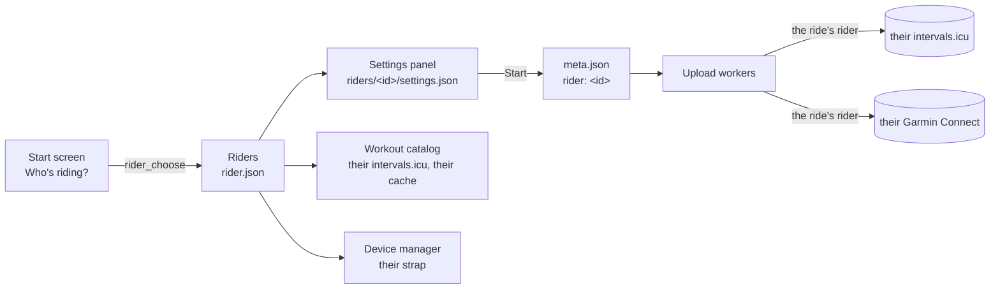

# Riders who share the trainer (experimental, branch `feature/garmin-upload`, 0.8.2)

A side project outside the approved phase documents, like the Garmin upload: no APP requirement, no Phase 4 catalogue entry. The tests carry supporting IDs `S-RDR-01` to `S-RDR-12`. It goes against Phase 0 decision D-16 ("One rider in v1"), so merging it into `main` needs D-16 and the requirements changed first (see the last section).

## Why a release and not just the settings

Switching FTP, zones and weight in Settings before each ride works for the watts, but not for the rest:

- **Accounts:** the intervals.icu account would have to be typed in again on each switch (athlete ID and API key), and Garmin Connect needs `wow-garmin login` over SSH with an MFA code. Left as they are, her rides land in your intervals.icu and Garmin Connect, in your training load.
- **Retries:** the upload worker sends every waiting ride through the account set *now*, so a ride of yours still retrying when she switches goes to her account.
- **Forgetting:** nothing on screen shows whose settings are in force, so a forgotten switch rides your workout at her FTP.

## What it does

With a `[riders]` table in `wow.toml`, each rider has their own settings, intervals.icu account, Garmin Connect sign-in and workout list. The page asks **"Who's riding?"** on its start screen, and Home shows the rider and their FTP with **Switch rider**. Every new ride records its rider in `meta.json`, and both upload workers send a ride through **its own rider's** account, whoever is chosen later. Past rides lists the rider's own rides. Without the table nothing changes: one rider, the files where they were.



| Kept per rider | Shared |
|---|---|
| FTP, zones, weight, lead time, strap warning, free-ride level, last route, both upload switches | The trainer (a new rider starts with the first rider's trainer and lead time) |
| intervals.icu account and its workout cache | Calibration |
| Garmin Connect tokens | Routes folder, the Pi, the certificate |
| Heart-rate strap (none until chosen) | Past rides on disk (each list shows its rider's) |

Rules:

- The rider changes only outside a ride and Calibration (`invalid_state` otherwise); a change from Pre-ride, the Summary, Past rides or Settings goes to Home.
- The start screen sends a choice only when it differs from the rider riding now, so a page reload doesn't move anyone off Pre-ride.
- The rider riding now survives a restart (`rider.json`).
- A ride without a `rider` field (every ride before 0.8.2) is the first rider's. A ride of a rider removed from `wow.toml` waits for that rider's accounts and shows in no list.
- An interrupted ride is taken up by its own rider: Continue or Finish switches to them first.
- A download of the rider before is stopped and its answer dropped, so her calendar never lands in your cache.

## Files

```
/var/lib/wow/
├── rider.json                 the rider riding now
├── riders/
│   ├── ferran/                first rider: a copy of the files below, made once
│   │   ├── settings.json
│   │   ├── secrets.json       0600
│   │   ├── garmin/            0700, tokens of wow-garmin --rider ferran login
│   │   └── cache/intervals.json
│   └── anna/                  created empty; filled from her Settings
├── rides/<id>/meta.json       "rider": "anna"
├── settings.json, secrets.json, garmin/, cache/   left as they were, for main
```

The first start with the table copies `settings.json`, `secrets.json`, `garmin/` and `cache/intervals.json` into the first rider's directory, aside and renamed into place. The originals stay, so `main` still runs on them (their settings then miss whatever changed since). `deploy/install.sh` keeps `riders/*/secrets.json` at 0600 and `riders/*/garmin` at 0700, owned by `wow`.

## Set up on the Pi

1. Install 0.8.2 as usual (laptop: gate and display build; Pi: `git pull`, `uv sync --frozen`, copy the display, `sudo deploy/install.sh`).
2. Add the riders to `/etc/wow/wow.toml`, **you first** (your files become yours), IDs in lower case:
   ```toml
   [riders]
   ferran = "Ferran"
   anna = "Anna"
   ```
   `deploy/wow.pi.toml` has the same lines commented out.
3. `sudo systemctl restart wow`, then `journalctl -u wow -b | grep -E "copy|started"`: one line saying `riders/ferran` gets a copy, then `wow 0.8.2 started`.
4. Her phone needs the Pi's root certificate once, as yours did (`http://wow.local`, then trust it in iOS Settings).
5. On the page: tap her name, **Settings for …**: her FTP, zones, weight, her strap if she has one, her intervals.icu account (typed on the phone, never into a chat).
6. Her Garmin Connect, if she wants it: `sudo -u wow /opt/wow/venv/bin/wow-garmin --rider anna login`, then `… --rider anna check`. Yours is already in place (copied), and from now on every `wow-garmin` call names the rider.

Back to one rider: delete the `[riders]` table and restart. The app then reads the top-level files again, which don't have the changes made since; copy `riders/ferran/*` back over them first if you want those.

## Assumptions

| ID | Assumption | Check |
|---|---|---|
| R-A1 | Her iPhone trusts the private root the same way yours does (Phase 2 S8) | R-8 |
| R-A2 | Two Garmin accounts' tokens can live side by side on the Pi: python-garminconnect keeps each in the directory it's given | R-4 |
| R-A3 | Two pages open at once (both phones) are fine: the hub already serves several pages, each sees the same state | R-2 |

## Pi checks before merging

| ID | Check | Pass |
|---|---|---|
| R-1 | Steps 2 and 3 above | `ls -l /var/lib/wow/riders` shows both, owner `wow`; `riders/ferran` holds your four files; Settings for Ferran shows your FTP, account set, Garmin signed in |
| R-2 | Open the page on your phone | "Who's riding?" with both names; tap yours: Home says "Ferran FTP 250 W" with your workouts |
| R-3 | Switch rider → her name; Settings for her | Her values only; your Settings unchanged when you switch back |
| R-4 | Step 6 | `ls -l /var/lib/wow/riders/anna/garmin`: owner `wow`, 0600 file; her Settings says signed in, yours still too |
| R-5 | She rides a real ride of at least 10 min, Upload on (both if she uses both) | `meta.json` says `"rider": "anna"`; the ride in *her* intervals.icu and Garmin Connect, nothing new in yours |
| R-6 | Past rides as each rider | Each sees their own; your rides before 0.8.2 under you |
| R-7 | `sudo reboot` with her chosen | After boot, Home names her |
| R-8 | Her phone opens `https://wow.local` | No certificate warning |

## Merging into main

Before this leaves the branch: D-16 (Phase 0) revised; Phase 1 requirements for choosing the rider, per-rider settings and accounts, and uploads to the ride's rider, with the out-of-scope line "several riders" moved; 3A (the `Riders` module, `rider.json`, `riders/<id>/`), the ICD (`rider_choose`, the view's `riders`, `meta.json`'s `rider`, IF-10's files) and 3C (start screen, Home's rider line) updated; the S-RDR tests mapped to catalogue IDs.
